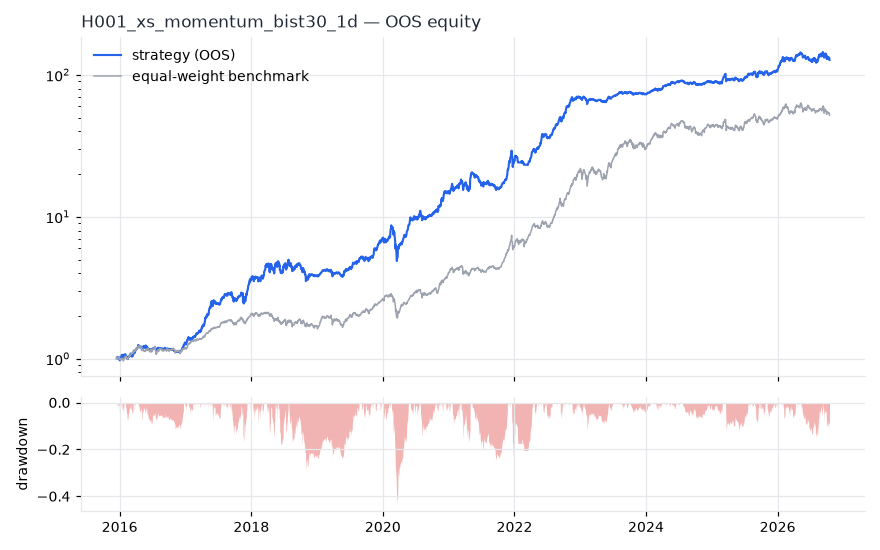
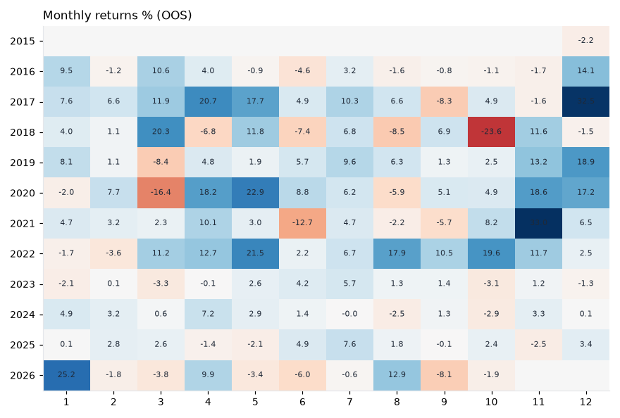

# H001 — xs_momentum on bist30 [1d]  🟡 WATCH

- Kind: strategy · Source: Jegadeesh & Titman (1993) Returns to Buying Winners and Selling Losers
- For system: `bist_orderflow_quant`
- Data: 2012-01-02 00:00:00 → 2026-10-16 00:00:00 · 29 assets · 256.1 bars/year · survivorship mask: False
- Costs: {'commission': 0.001, 'slippage': 0.001, 'funding_annual': 0.0, 'borrow_annual': 0.0}
- Variants tried (DSR trials): 32 (failed: 0)
- Final variant: `xs_momentum|lookback=126,skip=0,top_n=3`

## Verdict reasons
- OOS MaxDD -0.4756 worse than -0.45 (local or USD)

## Walk-forward out-of-sample


| Metric | Strategy | Equal-weight benchmark |
|---|---|---|
| years | 10.76 | 10.76 |
| cagr | 0.5694 | 0.4437 |
| vol | 0.2711 | 0.2642 |
| sharpe | 1.799 | 1.523 |
| sharpe_excess_rf | 1.717 | None |
| sortino | 2.659 | 2.248 |
| max_dd | -0.4394 | -0.3222 |
| max_dd_bars | 279 | 371 |
| calmar | 1.296 | 1.377 |
| ulcer | 0.0912 | 0.0851 |
| var95 | -0.0233 | -0.024 |
| cvar95 | -0.0382 | -0.0377 |
| omega | 1.397 | 1.312 |
| tail_ratio | 1.274 | 1.09 |
| skew | 0.068 | -0.051 |
| kurtosis | 5.398 | 9.059 |
| hit_rate | 0.54 | 0.539 |
| turnover_ann | 6.73 | None |

- **Gate Sharpe (USD, excess of US T-bill): 0.691**
- Deflated Sharpe: **1.0** · PBO: **0.286** · Reality Check p: **0.012**
- PSR 1.0 · Info ratio 0.385 · Beta 0.674 · Up/Down capture 0.806/0.679
- Sharpe with 2× costs: 1.749 · Walk-forward efficiency: 0.869
- Bootstrap: {'p_sharpe_pos': 1.0, 'cagr_p05': 0.3537, 'maxdd_p05': -0.5164}
- Yearly OOS Sharpe: {'2016': 1.62, '2017': 3.51, '2018': 0.36, '2019': 2.87, '2020': 2.13, '2021': 1.47, '2022': 4.57, '2023': 0.54, '2024': 1.99, '2025': 1.16, '2026': 1.0}
- In USD: CAGR 0.2079 · Sharpe 0.762 · excess-rf Sharpe 0.691 · MaxDD -0.4756



## Regimes (where does it work?)
`{"bull": {"sharpe": 2.52, "ann_ret": 0.6568, "bars": 2075}, "bear": {"sharpe": -0.09, "ann_ret": -0.0281, "bars": 680}, "calm": {"sharpe": 2.3, "ann_ret": 0.4936, "bars": 1450}, "stressed": {"sharpe": 1.49, "ann_ret": 0.4813, "bars": 1305}, "vix_lt_20": {"sharpe": 2.0, "ann_ret": 0.5049, "bars": 1931}, "vix_20_30": {"sharpe": 1.65, "ann_ret": 0.4663, "bars": 671}, "vix_ge_30": {"sharpe": 0.88, "ann_ret": 0.3654, "bars": 153}, "curve_inverted": {"sharpe": 0.98, "ann_ret": 0.1574, "bars": 613}, "curve_normal": {"sharpe": 1.97, "ann_ret": 0.5823, "bars": 2142}}`

## Calendar profile (weekday / month / hour)
`{"weekday": {"0": 0.00361, "1": 0.00115, "2": 0.0012, "3": 0.00148, "4": 0.00208}, "month": {"1": 0.00239, "2": 0.00098, "3": 0.00116, "4": 0.00344, "5": 0.00335, "6": 7e-05, "7": 0.00263, "8": 0.00104, "9": 0.00019, "10": 0.00027, "11": 0.00384, "12": 0.00368}}`

## Robustness
- **delay**: `{"sharpe": 1.584, "sharpe_delayed_1bar": 1.629, "retained": 1.028}`
- **neighbourhood**: `{"neighbours": 5, "best_sharpe": 1.557, "neighbour_median": 1.464, "share_positive": 1.0, "stability": 0.941}`
- **noise**: `{"noise_bp": 0.002, "sharpe_min": 1.539, "sharpe_median": 1.569}`

## Timing, take-profit, stop-loss and profit studies (in-sample diagnostics)
- Portfolio overlays (vol target, drawdown brake, equity-curve filter): `{"none": {"sharpe": 1.799, "cagr": 0.5694, "max_dd": -0.4394}, "vol_target_0.1": {"sharpe": 1.941, "cagr": 0.2347, "max_dd": -0.1282}, "vol_target_0.15": {"sharpe": 1.948, "cagr": 0.3614, "max_dd": -0.1869}, "vol_target_0.2": {"sharpe": 1.968, "cagr": 0.4972, "max_dd": -0.2422}, "dd_brake_0.1": {"sharpe": 1.789, "cagr": 0.4834, "max_dd": -0.301}, "dd_brake_0.2": {"sharpe": 1.82, "cagr": 0.5519, "max_dd": -0.3351}, "equity_ma_42": {"sharpe": 1.773, "cagr": 0.4355, "max_dd": -0.3052}, "equity_ma_128": {"sharpe": 1.568, "cagr": 0.4278, "max_dd": -0.3359}, "best_by_calmar": "vol_target_0.2"}`
> Studies are in-sample diagnostics. To use a better exit, register it (exits: [...]) and let the gate judge it.

## Walk-forward windows
- 2020-11-26 00:00:00 → 2021-05-31 00:00:00: IS 1.83 / OOS 1.933 — `xs_momentum|lookback=126,skip=21,top_n=3`
- 2021-06-01 00:00:00 → 2021-12-06 00:00:00: IS 1.999 / OOS 1.994 — `xs_momentum|lookback=126,skip=0,top_n=3`
- 2021-12-07 00:00:00 → 2022-06-08 00:00:00: IS 2.782 / OOS 2.556 — `xs_momentum|lookback=189,skip=0,top_n=5|overlay=eqma_s`
- 2022-06-09 00:00:00 → 2022-12-09 00:00:00: IS 3.161 / OOS 5.598 — `xs_momentum|lookback=189,skip=0,top_n=5|overlay=vt20`
- 2022-12-12 00:00:00 → 2023-06-16 00:00:00: IS 3.372 / OOS 0.137 — `xs_momentum|lookback=189,skip=0,top_n=5|overlay=vt15`
- 2023-06-19 00:00:00 → 2023-12-19 00:00:00: IS 3.047 / OOS 1.336 — `xs_momentum|lookback=252,skip=0,top_n=5|overlay=vt10`
- 2023-12-20 00:00:00 → 2024-06-27 00:00:00: IS 2.864 / OOS 3.957 — `xs_momentum|lookback=252,skip=0,top_n=5|overlay=vt10`
- 2024-06-28 00:00:00 → 2024-12-27 00:00:00: IS 2.891 / OOS 0.126 — `xs_momentum|lookback=189,skip=0,top_n=5|overlay=vt10`
- 2024-12-30 00:00:00 → 2025-07-07 00:00:00: IS 2.429 / OOS 0.764 — `xs_momentum|lookback=189,skip=0,top_n=5|overlay=vt15`
- 2025-07-08 00:00:00 → 2026-01-06 00:00:00: IS 2.088 / OOS 2.048 — `xs_momentum|lookback=189,skip=0,top_n=5|overlay=vt20`
- 2026-01-07 00:00:00 → 2026-07-14 00:00:00: IS 1.44 / OOS 0.813 — `xs_momentum|lookback=189,skip=0,top_n=5|overlay=vt20`
- 2026-07-16 00:00:00 → 2026-10-16 00:00:00: IS 1.751 / OOS 0.41 — `xs_momentum|lookback=126,skip=0,top_n=3`

## Best variants (full sample, reference only)
- xs_momentum|lookback=189,skip=0,top_n=5|overlay=vt20: Sharpe 1.747
- xs_momentum|lookback=189,skip=0,top_n=5|overlay=vt10: Sharpe 1.709
- xs_momentum|lookback=189,skip=0,top_n=5|overlay=vt15: Sharpe 1.704
- xs_momentum|lookback=252,skip=0,top_n=5|overlay=vt20: Sharpe 1.685
- xs_momentum|lookback=189,skip=0,top_n=5: Sharpe 1.674
- xs_momentum|lookback=252,skip=0,top_n=5|overlay=vt15: Sharpe 1.655
- xs_momentum|lookback=252,skip=0,top_n=5|overlay=vt10: Sharpe 1.647
- xs_momentum|lookback=189,skip=0,top_n=5|overlay=dd10: Sharpe 1.645
- xs_momentum|lookback=189,skip=0,top_n=5|overlay=dd20: Sharpe 1.638
- xs_momentum|lookback=252,skip=0,top_n=5: Sharpe 1.6

## Current targets / signals
```json
{
 "EREGL.IS": 0.3333,
 "TUPRS.IS": 0.3333,
 "ALARK.IS": 0.3333
}
```

> Survivorship bias: unless a membership mask is used, universes are today's members (upper-bound results).