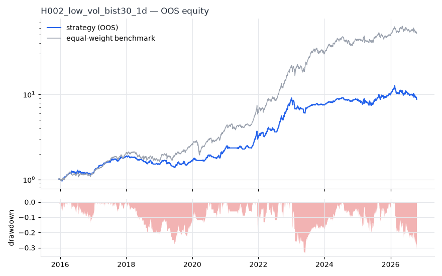
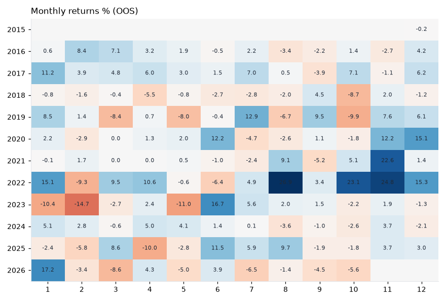

# H002 — low_vol on bist30 [1d]  ❌ REJECT

- Kind: strategy · Source: Ang, Hodrick, Xing & Zhang (2006); Baker, Bradley & Wurgler (2011)
- For system: `bist_shock_quant`
- Data: 2012-01-02 00:00:00 → 2026-10-16 00:00:00 · 29 assets · 256.1 bars/year · survivorship mask: False
- Costs: {'commission': 0.001, 'slippage': 0.001, 'funding_annual': 0.0, 'borrow_annual': 0.0}
- Variants tried (DSR trials): 20 (failed: 0)
- Final variant: `low_vol|lookback=126,top_n=10`

## Verdict reasons
- OOS Sharpe (USD, excess of US T-bill) -0.184 < 0.5
- OOS MaxDD -0.6534 worse than -0.45 (local or USD)
- with 2x costs it does not beat the equal-weight benchmark
- Reality Check p 0.996 > 0.1 (best variant may be data-mined)

## Walk-forward out-of-sample


| Metric | Strategy | Equal-weight benchmark |
|---|---|---|
| years | 10.76 | 10.76 |
| cagr | 0.2233 | 0.4437 |
| vol | 0.2041 | 0.2642 |
| sharpe | 1.09 | 1.523 |
| sharpe_excess_rf | 0.982 | None |
| sortino | 1.426 | 2.248 |
| max_dd | -0.339 | -0.3222 |
| max_dd_bars | 636 | 371 |
| calmar | 0.659 | 1.377 |
| ulcer | 0.1189 | 0.0851 |
| var95 | -0.0173 | -0.024 |
| cvar95 | -0.03 | -0.0377 |
| omega | 1.237 | 1.312 |
| tail_ratio | 1.218 | 1.09 |
| skew | -0.406 | -0.051 |
| kurtosis | 7.79 | 9.059 |
| hit_rate | 0.473 | 0.539 |
| turnover_ann | 10.28 | None |

- **Gate Sharpe (USD, excess of US T-bill): -0.184**
- Deflated Sharpe: **0.998** · PBO: **0.438** · Reality Check p: **0.996**
- PSR 1.0 · Info ratio -1.05 · Beta 0.588 · Up/Down capture 0.617/0.637
- Sharpe with 2× costs: 0.989 · Walk-forward efficiency: 0.645
- Bootstrap: {'p_sharpe_pos': 1.0, 'cagr_p05': 0.0982, 'maxdd_p05': -0.4712}
- Yearly OOS Sharpe: {'2016': 1.14, '2017': 3.48, '2018': -1.7, '2019': 0.73, '2020': 1.91, '2021': 1.49, '2022': 3.74, '2023': -0.58, '2024': 1.27, '2025': 0.71, '2026': -0.43}
- In USD: CAGR -0.0585 · Sharpe -0.1 · excess-rf Sharpe -0.184 · MaxDD -0.6534



## Regimes (where does it work?)
`{"bull": {"sharpe": 1.91, "ann_ret": 0.406, "bars": 2075}, "bear": {"sharpe": -1.95, "ann_ret": -0.3375, "bars": 680}, "calm": {"sharpe": 1.94, "ann_ret": 0.3086, "bars": 1450}, "stressed": {"sharpe": 0.52, "ann_ret": 0.1268, "bars": 1305}, "vix_lt_20": {"sharpe": 1.22, "ann_ret": 0.2228, "bars": 1931}, "vix_20_30": {"sharpe": 1.09, "ann_ret": 0.2704, "bars": 671}, "vix_ge_30": {"sharpe": 0.03, "ann_ret": 0.0085, "bars": 153}, "curve_inverted": {"sharpe": 0.59, "ann_ret": 0.1134, "bars": 613}, "curve_normal": {"sharpe": 1.23, "ann_ret": 0.2537, "bars": 2142}}`

## Calendar profile (weekday / month / hour)
`{"weekday": {"0": 0.00251, "1": -0.00018, "2": -3e-05, "3": 0.00154, "4": 0.0005}, "month": {"1": 0.00187, "2": -0.00091, "3": 0.00039, "4": 0.00079, "5": -0.00072, "6": 0.00154, "7": 0.00094, "8": 0.00106, "9": 0.00012, "10": 9e-05, "11": 0.00327, "12": 0.002}}`

## Robustness
- **delay**: `{"sharpe": 1.271, "sharpe_delayed_1bar": 1.278, "retained": 1.005}`
- **neighbourhood**: `{"neighbours": 3, "best_sharpe": 1.26, "neighbour_median": 1.297, "share_positive": 1.0, "stability": 1.029}`
- **noise**: `{"noise_bp": 0.002, "sharpe_min": 1.242, "sharpe_median": 1.282}`

## Timing, take-profit, stop-loss and profit studies (in-sample diagnostics)
- Portfolio overlays (vol target, drawdown brake, equity-curve filter): `{"none": {"sharpe": 1.09, "cagr": 0.2233, "max_dd": -0.339}, "vol_target_0.1": {"sharpe": 1.135, "cagr": 0.1276, "max_dd": -0.2035}, "vol_target_0.15": {"sharpe": 1.161, "cagr": 0.1941, "max_dd": -0.2977}, "vol_target_0.2": {"sharpe": 1.153, "cagr": 0.2514, "max_dd": -0.4058}, "dd_brake_0.1": {"sharpe": 1.134, "cagr": 0.1946, "max_dd": -0.2364}, "dd_brake_0.2": {"sharpe": 1.08, "cagr": 0.2103, "max_dd": -0.34}, "equity_ma_42": {"sharpe": 1.133, "cagr": 0.186, "max_dd": -0.2417}, "equity_ma_128": {"sharpe": 1.04, "cagr": 0.1777, "max_dd": -0.3041}, "best_by_calmar": "dd_brake_0.1"}`
> Studies are in-sample diagnostics. To use a better exit, register it (exits: [...]) and let the gate judge it.

## Walk-forward windows
- 2020-11-26 00:00:00 → 2021-05-31 00:00:00: IS 1.346 / OOS 1.787 — `low_vol|lookback=63,top_n=10|overlay=eqma_s`
- 2021-06-01 00:00:00 → 2021-12-06 00:00:00: IS 1.645 / OOS 4.121 — `low_vol|lookback=63,top_n=10|overlay=eqma_s`
- 2021-12-07 00:00:00 → 2022-06-08 00:00:00: IS 2.512 / OOS 1.18 — `low_vol|lookback=63,top_n=10|overlay=eqma_s`
- 2022-06-09 00:00:00 → 2022-12-09 00:00:00: IS 2.1 / OOS 4.52 — `low_vol|lookback=63,top_n=10|overlay=eqma_s`
- 2022-12-12 00:00:00 → 2023-06-16 00:00:00: IS 2.547 / OOS -0.359 — `low_vol|lookback=63,top_n=10|overlay=eqma_s`
- 2023-06-19 00:00:00 → 2023-12-19 00:00:00: IS 2.372 / OOS 2.044 — `low_vol|lookback=252,top_n=10|overlay=vt10`
- 2023-12-20 00:00:00 → 2024-06-27 00:00:00: IS 2.431 / OOS 3.634 — `low_vol|lookback=252,top_n=10|overlay=vt10`
- 2024-06-28 00:00:00 → 2024-12-27 00:00:00: IS 2.94 / OOS -0.473 — `low_vol|lookback=252,top_n=10|overlay=vt10`
- 2024-12-30 00:00:00 → 2025-07-07 00:00:00: IS 2.215 / OOS -0.107 — `low_vol|lookback=126,top_n=5`
- 2025-07-08 00:00:00 → 2026-01-06 00:00:00: IS 1.961 / OOS 2.012 — `low_vol|lookback=126,top_n=5`
- 2026-01-07 00:00:00 → 2026-07-14 00:00:00: IS 1.435 / OOS -0.127 — `low_vol|lookback=126,top_n=5`
- 2026-07-16 00:00:00 → 2026-10-16 00:00:00: IS 1.248 / OOS -2.087 — `low_vol|lookback=126,top_n=10`

## Best variants (full sample, reference only)
- low_vol|lookback=63,top_n=10: Sharpe 1.301
- low_vol|lookback=252,top_n=10: Sharpe 1.297
- low_vol|lookback=252,top_n=5: Sharpe 1.297
- low_vol|lookback=126,top_n=10: Sharpe 1.26
- low_vol|lookback=63,top_n=10|overlay=dd20: Sharpe 1.248
- low_vol|lookback=63,top_n=10|overlay=vt15: Sharpe 1.239
- low_vol|lookback=252,top_n=10|overlay=dd20: Sharpe 1.238
- low_vol|lookback=63,top_n=10|overlay=vt10: Sharpe 1.226
- low_vol|lookback=252,top_n=10|overlay=vt10: Sharpe 1.223
- low_vol|lookback=63,top_n=10|overlay=vt20: Sharpe 1.22

## Current targets / signals
```json
{
 "ARCLK.IS": 0.1,
 "BIMAS.IS": 0.1,
 "ENKAI.IS": 0.1,
 "FROTO.IS": 0.1,
 "KCHOL.IS": 0.1,
 "SAHOL.IS": 0.1,
 "TCELL.IS": 0.1,
 "THYAO.IS": 0.1,
 "OYAKC.IS": 0.1,
 "PGSUS.IS": 0.1
}
```

> Survivorship bias: unless a membership mask is used, universes are today's members (upper-bound results).