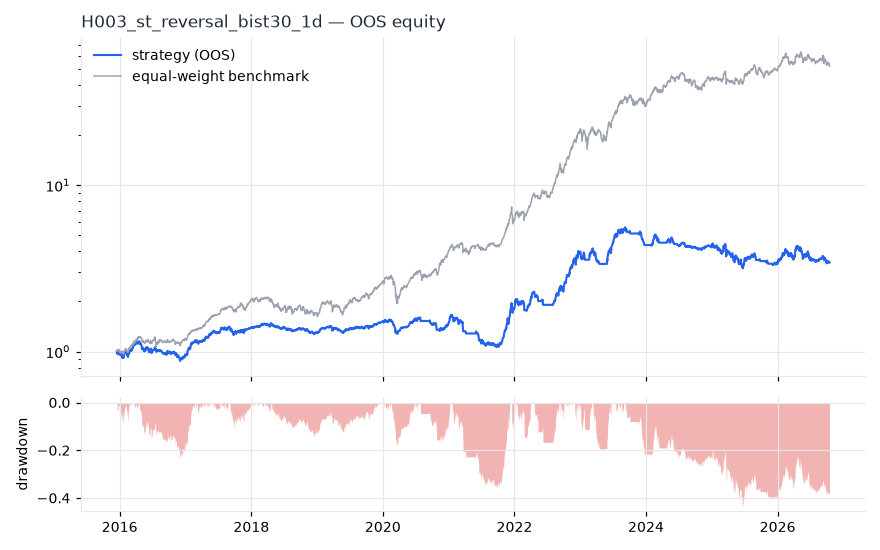
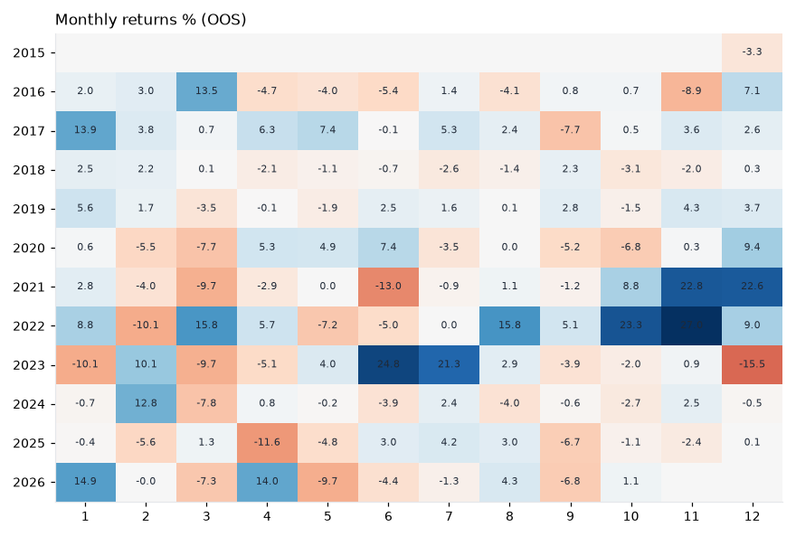

# H003 — st_reversal on bist30 [1d]  ❌ REJECT

- Kind: strategy · Source: Lehmann (1990) Fads, Martingales and Market Efficiency; Jegadeesh (1990)
- For system: `bist_shock_quant`
- Data: 2012-01-02 00:00:00 → 2026-10-16 00:00:00 · 29 assets · 256.1 bars/year · survivorship mask: False
- Costs: {'commission': 0.001, 'slippage': 0.001, 'funding_annual': 0.0, 'borrow_annual': 0.0}
- Variants tried (DSR trials): 20 (failed: 0)
- Final variant: `st_reversal|lookback=5,top_n=3|overlay=dd10`

## Verdict reasons
- OOS Sharpe (USD, excess of US T-bill) -0.468 < 0.5
- OOS MaxDD -0.8307 worse than -0.45 (local or USD)
- with 2x costs it does not beat the equal-weight benchmark
- PBO 0.755 > 0.5 (variant selection is overfit)
- Reality Check p 1.0 > 0.1 (best variant may be data-mined)

## Walk-forward out-of-sample


| Metric | Strategy | Equal-weight benchmark |
|---|---|---|
| years | 10.76 | 10.76 |
| cagr | 0.1214 | 0.4437 |
| vol | 0.2193 | 0.2642 |
| sharpe | 0.633 | 1.523 |
| sharpe_excess_rf | 0.532 | None |
| sortino | 0.769 | 2.248 |
| max_dd | -0.4315 | -0.3222 |
| max_dd_bars | 779 | 371 |
| calmar | 0.281 | 1.377 |
| ulcer | 0.1805 | 0.0851 |
| var95 | -0.0205 | -0.024 |
| cvar95 | -0.0321 | -0.0377 |
| omega | 1.131 | 1.312 |
| tail_ratio | 1.093 | 1.09 |
| skew | -0.215 | -0.051 |
| kurtosis | 6.239 | 9.059 |
| hit_rate | 0.439 | 0.539 |
| turnover_ann | 46.79 | None |

- **Gate Sharpe (USD, excess of US T-bill): -0.468**
- Deflated Sharpe: **0.919** · PBO: **0.755** · Reality Check p: **1.0**
- PSR 0.98 · Info ratio -1.366 · Beta 0.577 · Up/Down capture 0.598/0.675
- Sharpe with 2× costs: 0.205 · Walk-forward efficiency: 0.573
- Bootstrap: {'p_sharpe_pos': 0.959, 'cagr_p05': -0.0142, 'maxdd_p05': -0.6573}
- Yearly OOS Sharpe: {'2016': 0.08, '2017': 2.23, '2018': -0.49, '2019': 1.55, '2020': -0.07, '2021': 0.9, '2022': 2.72, '2023': 0.5, '2024': -0.15, '2025': -0.72, '2026': 0.21}
- In USD: CAGR -0.1369 · Sharpe -0.389 · excess-rf Sharpe -0.468 · MaxDD -0.8307



## Regimes (where does it work?)
`{"bull": {"sharpe": 1.36, "ann_ret": 0.3051, "bars": 2075}, "bear": {"sharpe": -1.84, "ann_ret": -0.3689, "bars": 680}, "calm": {"sharpe": 0.78, "ann_ret": 0.146, "bars": 1450}, "stressed": {"sharpe": 0.52, "ann_ret": 0.1307, "bars": 1305}, "vix_lt_20": {"sharpe": 0.91, "ann_ret": 0.1814, "bars": 1931}, "vix_20_30": {"sharpe": 0.22, "ann_ret": 0.0554, "bars": 671}, "vix_ge_30": {"sharpe": -0.12, "ann_ret": -0.0345, "bars": 153}, "curve_inverted": {"sharpe": 0.56, "ann_ret": 0.1247, "bars": 613}, "curve_normal": {"sharpe": 0.65, "ann_ret": 0.1427, "bars": 2142}}`

## Calendar profile (weekday / month / hour)
`{"weekday": {"0": 0.00034, "1": 0.00064, "2": 0.00013, "3": 0.00132, "4": 0.00027}, "month": {"1": 0.00165, "2": 0.0004, "3": -0.0006, "4": 0.00022, "5": -0.00055, "6": 0.00016, "7": 0.00118, "8": 0.00083, "9": -0.00087, "10": 0.00069, "11": 0.00204, "12": 0.00144}}`

## Robustness
- **delay**: `{"sharpe": 0.692, "sharpe_delayed_1bar": 0.713, "retained": 1.03}`
- **neighbourhood**: `{"neighbours": 0}`
- **noise**: `{"noise_bp": 0.002, "sharpe_min": 0.613, "sharpe_median": 0.701}`

## Timing, take-profit, stop-loss and profit studies (in-sample diagnostics)
- Portfolio overlays (vol target, drawdown brake, equity-curve filter): `{"none": {"sharpe": 0.633, "cagr": 0.1214, "max_dd": -0.4315}, "vol_target_0.1": {"sharpe": 0.534, "cagr": 0.0548, "max_dd": -0.2133}, "vol_target_0.15": {"sharpe": 0.55, "cagr": 0.0798, "max_dd": -0.3081}, "vol_target_0.2": {"sharpe": 0.568, "cagr": 0.104, "max_dd": -0.3916}, "dd_brake_0.1": {"sharpe": 0.659, "cagr": 0.1054, "max_dd": -0.2933}, "dd_brake_0.2": {"sharpe": 0.74, "cagr": 0.1319, "max_dd": -0.3401}, "equity_ma_42": {"sharpe": 0.952, "cagr": 0.1568, "max_dd": -0.3622}, "equity_ma_128": {"sharpe": 0.636, "cagr": 0.0997, "max_dd": -0.3668}, "best_by_calmar": "equity_ma_42"}`
> Studies are in-sample diagnostics. To use a better exit, register it (exits: [...]) and let the gate judge it.

## Walk-forward windows
- 2020-11-26 00:00:00 → 2021-05-31 00:00:00: IS 0.607 / OOS -0.353 — `st_reversal|lookback=21,top_n=5|overlay=eqma_l`
- 2021-06-01 00:00:00 → 2021-12-06 00:00:00: IS 0.705 / OOS 2.013 — `st_reversal|lookback=10,top_n=5`
- 2021-12-07 00:00:00 → 2022-06-08 00:00:00: IS 1.409 / OOS 1.117 — `st_reversal|lookback=21,top_n=5|overlay=eqma_s`
- 2022-06-09 00:00:00 → 2022-12-09 00:00:00: IS 1.564 / OOS 4.212 — `st_reversal|lookback=21,top_n=5|overlay=eqma_s`
- 2022-12-12 00:00:00 → 2023-06-16 00:00:00: IS 2.178 / OOS 1.268 — `st_reversal|lookback=21,top_n=5|overlay=eqma_s`
- 2023-06-19 00:00:00 → 2023-12-19 00:00:00: IS 1.987 / OOS 0.755 — `st_reversal|lookback=21,top_n=5|overlay=eqma_s`
- 2023-12-20 00:00:00 → 2024-06-27 00:00:00: IS 1.867 / OOS -0.26 — `st_reversal|lookback=21,top_n=5|overlay=eqma_s`
- 2024-06-28 00:00:00 → 2024-12-27 00:00:00: IS 1.915 / OOS -0.095 — `st_reversal|lookback=21,top_n=5|overlay=vt10`
- 2024-12-30 00:00:00 → 2025-07-07 00:00:00: IS 1.447 / OOS -0.969 — `st_reversal|lookback=21,top_n=5`
- 2025-07-08 00:00:00 → 2026-01-06 00:00:00: IS 1.039 / OOS 0.165 — `st_reversal|lookback=21,top_n=5|overlay=eqma_s`
- 2026-01-07 00:00:00 → 2026-07-14 00:00:00: IS 0.463 / OOS 0.114 — `st_reversal|lookback=21,top_n=5`
- 2026-07-16 00:00:00 → 2026-10-16 00:00:00: IS 0.566 / OOS -0.765 — `st_reversal|lookback=5,top_n=3|overlay=dd10`

## Best variants (full sample, reference only)
- st_reversal|lookback=5,top_n=3|overlay=vt10: Sharpe 0.833
- st_reversal|lookback=5,top_n=3|overlay=vt15: Sharpe 0.806
- st_reversal|lookback=5,top_n=3|overlay=vt20: Sharpe 0.774
- st_reversal|lookback=21,top_n=5: Sharpe 0.759
- st_reversal|lookback=5,top_n=3: Sharpe 0.744
- st_reversal|lookback=10,top_n=5: Sharpe 0.724
- st_reversal|lookback=21,top_n=5|overlay=vt10: Sharpe 0.71
- st_reversal|lookback=21,top_n=5|overlay=dd10: Sharpe 0.709
- st_reversal|lookback=5,top_n=5: Sharpe 0.708
- st_reversal|lookback=5,top_n=3|overlay=dd20: Sharpe 0.704

## Current targets / signals
```json
{
 "GUBRF.IS": 0.1667,
 "SASA.IS": 0.1667,
 "MGROS.IS": 0.1667
}
```

> Survivorship bias: unless a membership mask is used, universes are today's members (upper-bound results).