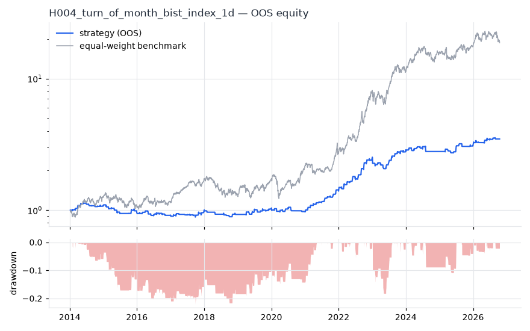
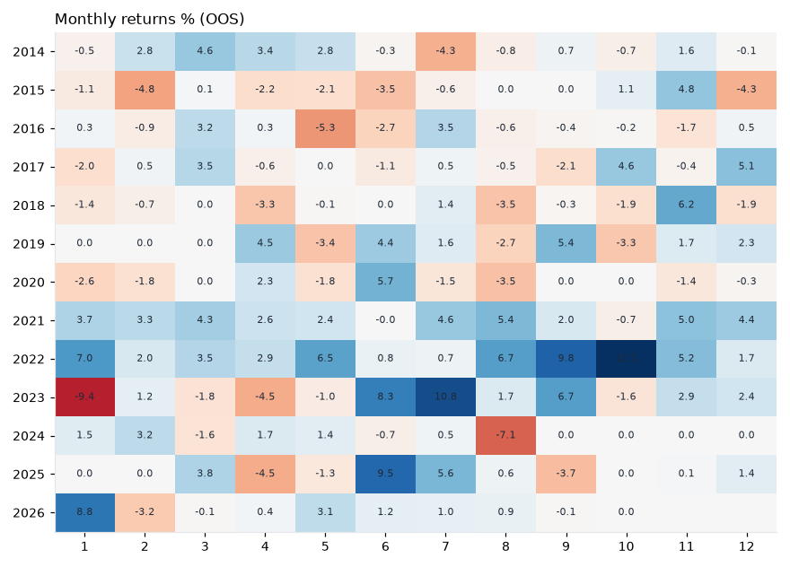

# H004 — turn_of_month on bist_index [1d]  ❌ REJECT

- Kind: strategy · Source: Ariel (1987); Lakonishok & Smidt (1988) Turn-of-the-month effect
- For system: `bist_orderflow_quant`
- Data: 2010-01-04 00:00:00 → 2026-10-16 00:00:00 · 4 assets · 250.9 bars/year · survivorship mask: False
- Costs: {'commission': 0.0005, 'slippage': 0.0005, 'funding_annual': 0.0, 'borrow_annual': 0.0}
- Variants tried (DSR trials): 23 (failed: 0)
- Final variant: `turn_of_month|days_before=2,days_after=4|overlay=eqma_s`

## Verdict reasons
- OOS Sharpe (USD, excess of US T-bill) -0.728 < 0.5
- OOS MaxDD -0.8723 worse than -0.45 (local or USD)
- with 2x costs it does not beat the equal-weight benchmark
- Reality Check p 0.99 > 0.1 (best variant may be data-mined)

## Walk-forward out-of-sample


| Metric | Strategy | Equal-weight benchmark |
|---|---|---|
| years | 12.75 | 12.75 |
| cagr | 0.1026 | 0.2582 |
| vol | 0.1061 | 0.2576 |
| sharpe | 0.974 | 1.021 |
| sharpe_excess_rf | 0.797 | None |
| sortino | 1.293 | 1.476 |
| max_dd | -0.2208 | -0.3445 |
| max_dd_bars | 1742 | 532 |
| calmar | 0.465 | 0.749 |
| ulcer | 0.1165 | 0.1238 |
| var95 | -0.0062 | -0.0233 |
| cvar95 | -0.0154 | -0.0373 |
| omega | 1.454 | 1.196 |
| tail_ratio | 1.741 | 1.141 |
| skew | 0.991 | -0.328 |
| kurtosis | 25.758 | 3.731 |
| hit_rate | 0.111 | 0.537 |
| turnover_ann | 21.69 | None |

- **Gate Sharpe (USD, excess of US T-bill): -0.728**
- Deflated Sharpe: **0.996** · PBO: **0.377** · Reality Check p: **0.99**
- PSR 1.0 · Info ratio -0.685 · Beta 0.175 · Up/Down capture 0.202/0.165
- Sharpe with 2× costs: 0.769 · Walk-forward efficiency: 0.962
- Bootstrap: {'p_sharpe_pos': 1.0, 'cagr_p05': 0.0443, 'maxdd_p05': -0.3035}
- Yearly OOS Sharpe: {'2014': 1.08, '2015': -1.22, '2016': -0.48, '2017': 0.88, '2018': -0.84, '2019': 1.07, '2020': -0.51, '2021': 3.88, '2022': 3.58, '2023': 0.98, '2024': -0.08, '2025': 1.13, '2026': 1.49}
- In USD: CAGR -0.1373 · Sharpe -0.634 · excess-rf Sharpe -0.728 · MaxDD -0.8723



## Regimes (where does it work?)
`{"bull": {"sharpe": 1.36, "ann_ret": 0.1559, "bars": 2338}, "bear": {"sharpe": -0.51, "ann_ret": -0.0394, "bars": 862}, "calm": {"sharpe": 0.87, "ann_ret": 0.0766, "bars": 1675}, "stressed": {"sharpe": 1.08, "ann_ret": 0.1327, "bars": 1525}, "vix_lt_20": {"sharpe": 0.99, "ann_ret": 0.0985, "bars": 2329}, "vix_20_30": {"sharpe": 0.99, "ann_ret": 0.1106, "bars": 714}, "vix_ge_30": {"sharpe": 0.88, "ann_ret": 0.142, "bars": 157}}`

## Calendar profile (weekday / month / hour)
`{"weekday": {"0": 0.00114, "1": 1e-05, "2": 4e-05, "3": 0.00054, "4": 0.00033}, "month": {"1": 0.00015, "2": 6e-05, "3": 0.00068, "4": 0.00012, "5": 4e-05, "6": 0.0008, "7": 0.00087, "8": -0.00013, "9": 0.00065, "10": 0.00034, "11": 0.00094, "12": 0.00042}}`

## Robustness
- **delay**: `{"sharpe": 0.74, "sharpe_delayed_1bar": 0.775, "retained": 1.048}`
- **neighbourhood**: `{"neighbours": 1, "best_sharpe": 0.74, "neighbour_median": 0.642, "share_positive": 1.0, "stability": 0.867}`
- **noise**: `{"noise_bp": 0.002, "sharpe_min": 0.682, "sharpe_median": 0.741}`

## Timing, take-profit, stop-loss and profit studies (in-sample diagnostics)
- Portfolio overlays (vol target, drawdown brake, equity-curve filter): `{"none": {"sharpe": 0.974, "cagr": 0.1026, "max_dd": -0.2208}, "vol_target_0.1": {"sharpe": 0.897, "cagr": 0.1045, "max_dd": -0.2561}, "vol_target_0.15": {"sharpe": 0.92, "cagr": 0.1416, "max_dd": -0.3399}, "vol_target_0.2": {"sharpe": 0.924, "cagr": 0.1663, "max_dd": -0.3847}, "dd_brake_0.1": {"sharpe": 1.024, "cagr": 0.0935, "max_dd": -0.17}, "dd_brake_0.2": {"sharpe": 0.939, "cagr": 0.0978, "max_dd": -0.2424}, "equity_ma_41": {"sharpe": 0.973, "cagr": 0.0866, "max_dd": -0.1277}, "equity_ma_125": {"sharpe": 0.756, "cagr": 0.0677, "max_dd": -0.2794}, "best_by_calmar": "equity_ma_41"}`
> Studies are in-sample diagnostics. To use a better exit, register it (exits: [...]) and let the gate judge it.

## Walk-forward windows
- 2020-12-24 00:00:00 → 2021-06-25 00:00:00: IS 0.13 / OOS 3.335 — `turn_of_month|days_before=2,days_after=4|overlay=eqma_l`
- 2021-06-28 00:00:00 → 2021-12-28 00:00:00: IS 0.911 / OOS 5.101 — `turn_of_month|days_before=2,days_after=4|overlay=dd10`
- 2021-12-29 00:00:00 → 2022-06-27 00:00:00: IS 1.823 / OOS 3.536 — `turn_of_month|days_before=2,days_after=4|overlay=dd10`
- 2022-06-28 00:00:00 → 2022-12-23 00:00:00: IS 2.311 / OOS 3.189 — `turn_of_month|days_before=2,days_after=4|overlay=dd10`
- 2022-12-26 00:00:00 → 2023-06-27 00:00:00: IS 2.508 / OOS -0.546 — `turn_of_month|days_before=2,days_after=4|overlay=dd10`
- 2023-07-03 00:00:00 → 2023-12-26 00:00:00: IS 2.11 / OOS 3.092 — `turn_of_month|days_before=2,days_after=4|overlay=eqma_l`
- 2023-12-27 00:00:00 → 2024-07-01 00:00:00: IS 2.636 / OOS 1.01 — `turn_of_month|days_before=2,days_after=4|overlay=vt10`
- 2024-07-02 00:00:00 → 2024-12-27 00:00:00: IS 2.292 / OOS -0.772 — `turn_of_month|days_before=2,days_after=4|overlay=eqma_l`
- 2024-12-30 00:00:00 → 2025-07-02 00:00:00: IS 1.646 / OOS 1.674 — `turn_of_month|days_before=2,days_after=4|overlay=eqma_l`
- 2025-07-03 00:00:00 → 2025-12-29 00:00:00: IS 1.362 / OOS 0.114 — `turn_of_month|days_before=2,days_after=4|overlay=eqma_s`
- 2025-12-30 00:00:00 → 2026-07-02 00:00:00: IS 0.829 / OOS 2.187 — `turn_of_month|days_before=2,days_after=4|overlay=eqma_s`
- 2026-07-03 00:00:00 → 2026-10-16 00:00:00: IS 1.427 / OOS -0.133 — `turn_of_month|days_before=2,days_after=4|overlay=eqma_s`

## Best variants (full sample, reference only)
- turn_of_month|days_before=2,days_after=4|overlay=dd10: Sharpe 0.82
- turn_of_month|days_before=2,days_after=4: Sharpe 0.814
- turn_of_month|days_before=2,days_after=4|overlay=vt20: Sharpe 0.81
- turn_of_month|days_before=2,days_after=4|overlay=dd20: Sharpe 0.802
- turn_of_month|days_before=2,days_after=4|overlay=vt15: Sharpe 0.778
- turn_of_month|days_before=2,days_after=4|overlay=eqma_l: Sharpe 0.765
- turn_of_month|days_before=2,days_after=4|overlay=eqma_s: Sharpe 0.74
- turn_of_month|days_before=2,days_after=3|overlay=dd10: Sharpe 0.69
- turn_of_month|days_before=2,days_after=3: Sharpe 0.683
- turn_of_month|days_before=2,days_after=2: Sharpe 0.678

## Current targets / signals
```json
{}
```

> Survivorship bias: unless a membership mask is used, universes are today's members (upper-bound results).