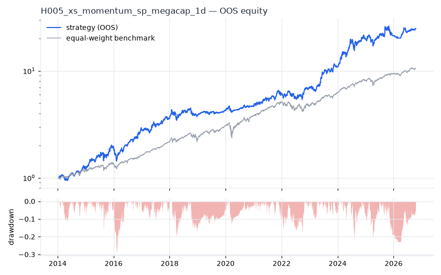
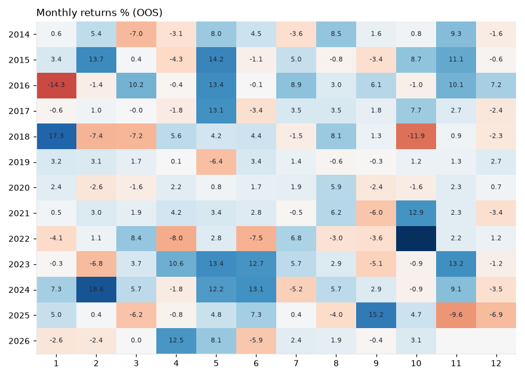

# H005 — xs_momentum on sp_megacap [1d]  🟡 WATCH

- Kind: strategy · Source: Jegadeesh & Titman (1993) Returns to Buying Winners and Selling Losers
- For system: `global_momentum_quant`
- Data: 2010-01-04 00:00:00 → 2026-10-16 00:00:00 · 30 assets · 251.7 bars/year · survivorship mask: True
- Costs: {'commission': 0.0002, 'slippage': 0.0003, 'funding_annual': 0.0, 'borrow_annual': 0.0}
- Variants tried (DSR trials): 32 (failed: 0)
- Final variant: `xs_momentum|lookback=252,skip=0,top_n=10|overlay=dd10`

## Verdict reasons
- with 2x costs it does not beat the equal-weight benchmark

## Walk-forward out-of-sample


| Metric | Strategy | Equal-weight benchmark |
|---|---|---|
| years | 12.76 | 12.76 |
| cagr | 0.2864 | 0.2038 |
| vol | 0.2274 | 0.1622 |
| sharpe | 1.221 | 1.225 |
| sharpe_excess_rf | 1.138 | None |
| sortino | 1.715 | 1.765 |
| max_dd | -0.2905 | -0.279 |
| max_dd_bars | 337 | 314 |
| calmar | 0.986 | 0.731 |
| ulcer | 0.0786 | 0.0443 |
| var95 | -0.0214 | -0.0146 |
| cvar95 | -0.0326 | -0.0242 |
| omega | 1.254 | 1.265 |
| tail_ratio | 1.042 | 0.979 |
| skew | 0.561 | -0.297 |
| kurtosis | 9.37 | 15.548 |
| hit_rate | 0.55 | 0.565 |
| turnover_ann | 6.65 | None |

- **Gate Sharpe (excess of T-bill): 1.138**
- Deflated Sharpe: **1.0** · PBO: **0.32** · Reality Check p: **0.004**
- PSR 1.0 · Info ratio 0.436 · Beta 0.861 · Up/Down capture 1.101/1.022
- Sharpe with 2× costs: 1.206 · Walk-forward efficiency: 0.803
- Bootstrap: {'p_sharpe_pos': 1.0, 'cagr_p05': 0.1691, 'maxdd_p05': -0.4404}
- Yearly OOS Sharpe: {'2014': 1.39, '2015': 1.7, '2016': 1.64, '2017': 1.25, '2018': 0.45, '2019': 1.08, '2020': 0.77, '2021': 1.38, '2022': 0.74, '2023': 2.1, '2024': 2.05, '2025': 0.4, '2026': 1.47}



## Regimes (where does it work?)
`{"bull": {"sharpe": 1.66, "ann_ret": 0.3632, "bars": 2702}, "bear": {"sharpe": -0.67, "ann_ret": -0.1775, "bars": 508}, "calm": {"sharpe": 1.66, "ann_ret": 0.3392, "bars": 1677}, "stressed": {"sharpe": 0.84, "ann_ret": 0.2103, "bars": 1533}, "vix_lt_20": {"sharpe": 2.47, "ann_ret": 0.5306, "bars": 2335}, "vix_20_30": {"sharpe": -1.42, "ann_ret": -0.3401, "bars": 717}, "vix_ge_30": {"sharpe": -2.1, "ann_ret": -0.658, "bars": 158}, "curve_inverted": {"sharpe": 1.63, "ann_ret": 0.4213, "bars": 614}, "curve_normal": {"sharpe": 1.11, "ann_ret": 0.2437, "bars": 2596}}`

## Calendar profile (weekday / month / hour)
`{"weekday": {"0": 0.00131, "1": 0.00072, "2": 0.00222, "3": 0.00094, "4": 0.00032}, "month": {"1": 0.00067, "2": 0.00101, "3": 0.00038, "4": 0.0006, "5": 0.00327, "6": 0.00117, "7": 0.00095, "8": 0.00136, "9": 0.00036, "10": 0.00153, "11": 0.00223, "12": -0.00034}}`

## Robustness
- **delay**: `{"sharpe": 1.156, "sharpe_delayed_1bar": 1.142, "retained": 0.988}`
- **neighbourhood**: `{"neighbours": 1, "best_sharpe": 1.118, "neighbour_median": 1.095, "share_positive": 1.0, "stability": 0.979}`
- **noise**: `{"noise_bp": 0.002, "sharpe_min": 1.14, "sharpe_median": 1.158}`

## Timing, take-profit, stop-loss and profit studies (in-sample diagnostics)
- Portfolio overlays (vol target, drawdown brake, equity-curve filter): `{"none": {"sharpe": 1.221, "cagr": 0.2864, "max_dd": -0.2905}, "vol_target_0.1": {"sharpe": 1.351, "cagr": 0.1533, "max_dd": -0.1067}, "vol_target_0.15": {"sharpe": 1.344, "cagr": 0.2283, "max_dd": -0.1564}, "vol_target_0.2": {"sharpe": 1.326, "cagr": 0.2964, "max_dd": -0.2039}, "dd_brake_0.1": {"sharpe": 1.099, "cagr": 0.2285, "max_dd": -0.226}, "dd_brake_0.2": {"sharpe": 1.201, "cagr": 0.2777, "max_dd": -0.2491}, "equity_ma_41": {"sharpe": 0.924, "cagr": 0.1596, "max_dd": -0.244}, "equity_ma_125": {"sharpe": 0.996, "cagr": 0.1988, "max_dd": -0.2888}, "best_by_calmar": "vol_target_0.15"}`
> Studies are in-sample diagnostics. To use a better exit, register it (exits: [...]) and let the gate judge it.

## Walk-forward windows
- 2020-12-23 00:00:00 → 2021-06-23 00:00:00: IS 1.13 / OOS 1.5 — `xs_momentum|lookback=126,skip=0,top_n=5`
- 2021-06-24 00:00:00 → 2021-12-20 00:00:00: IS 1.001 / OOS 0.938 — `xs_momentum|lookback=126,skip=0,top_n=5`
- 2021-12-21 00:00:00 → 2022-06-21 00:00:00: IS 1.29 / OOS -0.154 — `xs_momentum|lookback=252,skip=0,top_n=10`
- 2022-06-22 00:00:00 → 2022-12-16 00:00:00: IS 0.982 / OOS 1.51 — `xs_momentum|lookback=189,skip=0,top_n=3`
- 2022-12-19 00:00:00 → 2023-06-20 00:00:00: IS 1.028 / OOS 3.136 — `xs_momentum|lookback=252,skip=0,top_n=3`
- 2023-06-21 00:00:00 → 2023-12-15 00:00:00: IS 1.387 / OOS 1.186 — `xs_momentum|lookback=126,skip=0,top_n=3`
- 2023-12-18 00:00:00 → 2024-06-17 00:00:00: IS 1.399 / OOS 4.425 — `xs_momentum|lookback=126,skip=0,top_n=3`
- 2024-06-18 00:00:00 → 2024-12-13 00:00:00: IS 1.92 / OOS 0.477 — `xs_momentum|lookback=126,skip=0,top_n=3`
- 2024-12-16 00:00:00 → 2025-06-17 00:00:00: IS 1.716 / OOS 0.055 — `xs_momentum|lookback=126,skip=0,top_n=3`
- 2025-06-18 00:00:00 → 2025-12-15 00:00:00: IS 1.71 / OOS 0.402 — `xs_momentum|lookback=126,skip=0,top_n=3`
- 2025-12-16 00:00:00 → 2026-06-16 00:00:00: IS 1.581 / OOS 1.155 — `xs_momentum|lookback=252,skip=0,top_n=5|overlay=eqma_s`
- 2026-06-17 00:00:00 → 2026-10-16 00:00:00: IS 1.517 / OOS 2.085 — `xs_momentum|lookback=252,skip=0,top_n=10|overlay=dd10`

## Best variants (full sample, reference only)
- xs_momentum|lookback=252,skip=0,top_n=5|overlay=vt15: Sharpe 1.269
- xs_momentum|lookback=252,skip=0,top_n=5|overlay=vt10: Sharpe 1.246
- xs_momentum|lookback=252,skip=0,top_n=5|overlay=vt20: Sharpe 1.246
- xs_momentum|lookback=252,skip=0,top_n=10|overlay=vt15: Sharpe 1.22
- xs_momentum|lookback=252,skip=0,top_n=10|overlay=vt10: Sharpe 1.214
- xs_momentum|lookback=252,skip=0,top_n=10|overlay=vt20: Sharpe 1.201
- xs_momentum|lookback=252,skip=0,top_n=5: Sharpe 1.187
- xs_momentum|lookback=252,skip=0,top_n=10: Sharpe 1.175
- xs_momentum|lookback=126,skip=0,top_n=10: Sharpe 1.169
- xs_momentum|lookback=252,skip=0,top_n=3: Sharpe 1.168

## Current targets / signals
```json
{
 "AAPL": 0.1,
 "GOOGL": 0.1,
 "XOM": 0.1,
 "JNJ": 0.1,
 "LLY": 0.1,
 "MRK": 0.1,
 "KO": 0.1,
 "CVX": 0.1,
 "CSCO": 0.1,
 "ABBV": 0.1
}
```

> Survivorship bias: unless a membership mask is used, universes are today's members (upper-bound results).