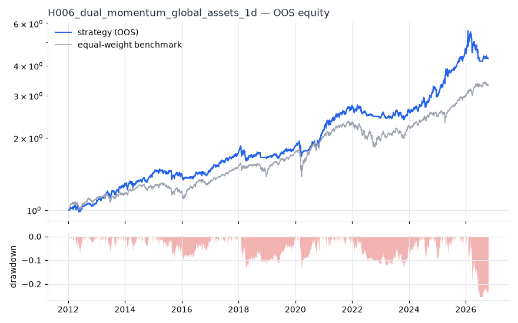
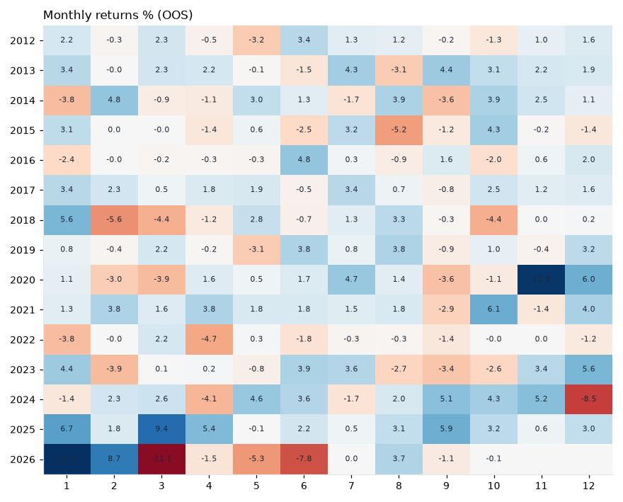

# H006 — dual_momentum on global_assets [1d]  🟡 WATCH

- Kind: strategy · Source: Antonacci (2014) Dual Momentum Investing
- For system: `macro-model`
- Data: 2008-01-02 00:00:00 → 2026-10-16 00:00:00 · 10 assets · 251.7 bars/year · survivorship mask: False
- Costs: {'commission': 0.0002, 'slippage': 0.0003, 'funding_annual': 0.0, 'borrow_annual': 0.0}
- Variants tried (DSR trials): 20 (failed: 0)
- Final variant: `dual_momentum|lookback=252,top_n=5|overlay=eqma_s`

## Verdict reasons
- Reality Check p 0.598 > 0.1 (best variant may be data-mined)

## Walk-forward out-of-sample


| Metric | Strategy | Equal-weight benchmark |
|---|---|---|
| years | 14.76 | 14.76 |
| cagr | 0.1037 | 0.0844 |
| vol | 0.1245 | 0.111 |
| sharpe | 0.855 | 0.785 |
| sharpe_excess_rf | 0.724 | None |
| sortino | 0.988 | 1.1 |
| max_dd | -0.2542 | -0.2308 |
| max_dd_bars | 549 | 630 |
| calmar | 0.408 | 0.365 |
| ulcer | 0.0678 | 0.0554 |
| var95 | -0.0117 | -0.0103 |
| cvar95 | -0.0195 | -0.0162 |
| omega | 1.177 | 1.154 |
| tail_ratio | 0.995 | 1.018 |
| skew | -1.064 | -0.635 |
| kurtosis | 13.975 | 12.368 |
| hit_rate | 0.532 | 0.549 |
| turnover_ann | 5.99 | None |

- **Gate Sharpe (excess of T-bill): 0.724**
- Deflated Sharpe: **0.965** · PBO: **0.017** · Reality Check p: **0.598**
- PSR 0.999 · Info ratio 0.192 · Beta 0.722 · Up/Down capture 0.859/0.803
- Sharpe with 2× costs: 0.831 · Walk-forward efficiency: 0.781
- Bootstrap: {'p_sharpe_pos': 0.999, 'cagr_p05': 0.0529, 'maxdd_p05': -0.3331}
- Yearly OOS Sharpe: {'2012': 0.88, '2013': 1.81, '2014': 0.9, '2015': -0.03, '2016': 0.4, '2017': 2.33, '2018': -0.29, '2019': 1.49, '2020': 1.22, '2021': 1.88, '2022': -1.28, '2023': 0.81, '2024': 0.97, '2025': 2.6, '2026': -0.07}



## Regimes (where does it work?)
`{"bull": {"sharpe": 1.08, "ann_ret": 0.1325, "bars": 3204}, "bear": {"sharpe": -0.42, "ann_ret": -0.0571, "bars": 511}, "calm": {"sharpe": 0.89, "ann_ret": 0.0999, "bars": 2043}, "stressed": {"sharpe": 0.83, "ann_ret": 0.1144, "bars": 1672}, "vix_lt_20": {"sharpe": 1.77, "ann_ret": 0.1946, "bars": 2796}, "vix_20_30": {"sharpe": -0.81, "ann_ret": -0.1217, "bars": 761}, "vix_ge_30": {"sharpe": -1.76, "ann_ret": -0.3557, "bars": 158}, "curve_inverted": {"sharpe": 1.07, "ann_ret": 0.1216, "bars": 614}, "curve_normal": {"sharpe": 0.82, "ann_ret": 0.1034, "bars": 3101}}`

## Calendar profile (weekday / month / hour)
`{"weekday": {"0": 0.0006, "1": 0.00058, "2": 0.00028, "3": 0.00017, "4": 0.00051}, "month": {"1": 0.0011, "2": 0.00038, "3": 9e-05, "4": 2e-05, "5": 0.0001, "6": 0.00038, "7": 0.00067, "8": 0.00039, "9": -7e-05, "10": 0.00052, "11": 0.00092, "12": 0.00065}}`

## Robustness
- **delay**: `{"sharpe": 0.402, "sharpe_delayed_1bar": 0.487, "retained": 1.211}`
- **neighbourhood**: `{"neighbours": 1, "best_sharpe": 0.391, "neighbour_median": 0.433, "share_positive": 1.0, "stability": 1.107}`
- **noise**: `{"noise_bp": 0.002, "sharpe_min": 0.338, "sharpe_median": 0.353}`

## Timing, take-profit, stop-loss and profit studies (in-sample diagnostics)
- Portfolio overlays (vol target, drawdown brake, equity-curve filter): `{"none": {"sharpe": 0.855, "cagr": 0.1037, "max_dd": -0.2542}, "vol_target_0.1": {"sharpe": 0.944, "cagr": 0.1009, "max_dd": -0.137}, "vol_target_0.15": {"sharpe": 0.908, "cagr": 0.1369, "max_dd": -0.1958}, "vol_target_0.2": {"sharpe": 0.906, "cagr": 0.1643, "max_dd": -0.2366}, "dd_brake_0.1": {"sharpe": 0.897, "cagr": 0.1024, "max_dd": -0.1999}, "dd_brake_0.2": {"sharpe": 0.858, "cagr": 0.1035, "max_dd": -0.2466}, "equity_ma_41": {"sharpe": 0.651, "cagr": 0.0606, "max_dd": -0.1387}, "equity_ma_125": {"sharpe": 0.6, "cagr": 0.0616, "max_dd": -0.2598}, "best_by_calmar": "vol_target_0.1"}`
> Studies are in-sample diagnostics. To use a better exit, register it (exits: [...]) and let the gate judge it.

## Walk-forward windows
- 2020-12-16 00:00:00 → 2021-06-16 00:00:00: IS 0.852 / OOS 2.397 — `dual_momentum|lookback=126,top_n=5|overlay=dd10`
- 2021-06-17 00:00:00 → 2021-12-13 00:00:00: IS 1.098 / OOS 1.335 — `dual_momentum|lookback=126,top_n=5|overlay=dd10`
- 2021-12-14 00:00:00 → 2022-06-13 00:00:00: IS 1.419 / OOS -0.585 — `dual_momentum|lookback=126,top_n=5|overlay=dd10`
- 2022-06-14 00:00:00 → 2022-12-09 00:00:00: IS 1.272 / OOS -2.304 — `dual_momentum|lookback=126,top_n=5|overlay=dd10`
- 2022-12-12 00:00:00 → 2023-06-12 00:00:00: IS 0.98 / OOS 0.699 — `dual_momentum|lookback=126,top_n=5|overlay=dd10`
- 2023-06-13 00:00:00 → 2023-12-08 00:00:00: IS 1.16 / OOS -0.037 — `dual_momentum|lookback=126,top_n=5`
- 2023-12-11 00:00:00 → 2024-06-10 00:00:00: IS 0.709 / OOS 1.553 — `dual_momentum|lookback=126,top_n=5`
- 2024-06-11 00:00:00 → 2024-12-06 00:00:00: IS 0.659 / OOS 2.185 — `dual_momentum|lookback=252,top_n=1`
- 2024-12-09 00:00:00 → 2025-06-10 00:00:00: IS 1.099 / OOS 1.66 — `dual_momentum|lookback=252,top_n=1`
- 2025-06-11 00:00:00 → 2025-12-08 00:00:00: IS 0.867 / OOS 2.847 — `dual_momentum|lookback=252,top_n=5|overlay=eqma_l`
- 2025-12-09 00:00:00 → 2026-06-09 00:00:00: IS 1.618 / OOS 0.16 — `dual_momentum|lookback=252,top_n=1`
- 2026-06-10 00:00:00 → 2026-10-16 00:00:00: IS 1.452 / OOS -0.408 — `dual_momentum|lookback=252,top_n=5|overlay=eqma_s`

## Best variants (full sample, reference only)
- dual_momentum|lookback=126,top_n=5: Sharpe 0.967
- dual_momentum|lookback=126,top_n=5|overlay=dd20: Sharpe 0.967
- dual_momentum|lookback=126,top_n=5|overlay=vt20: Sharpe 0.953
- dual_momentum|lookback=126,top_n=5|overlay=dd10: Sharpe 0.952
- dual_momentum|lookback=126,top_n=5|overlay=vt15: Sharpe 0.935
- dual_momentum|lookback=126,top_n=5|overlay=vt10: Sharpe 0.878
- dual_momentum|lookback=252,top_n=5|overlay=vt10: Sharpe 0.737
- dual_momentum|lookback=252,top_n=5: Sharpe 0.735
- dual_momentum|lookback=252,top_n=5|overlay=vt20: Sharpe 0.735
- dual_momentum|lookback=252,top_n=5|overlay=dd20: Sharpe 0.733

## Current targets / signals
```json
{}
```

> Survivorship bias: unless a membership mask is used, universes are today's members (upper-bound results).