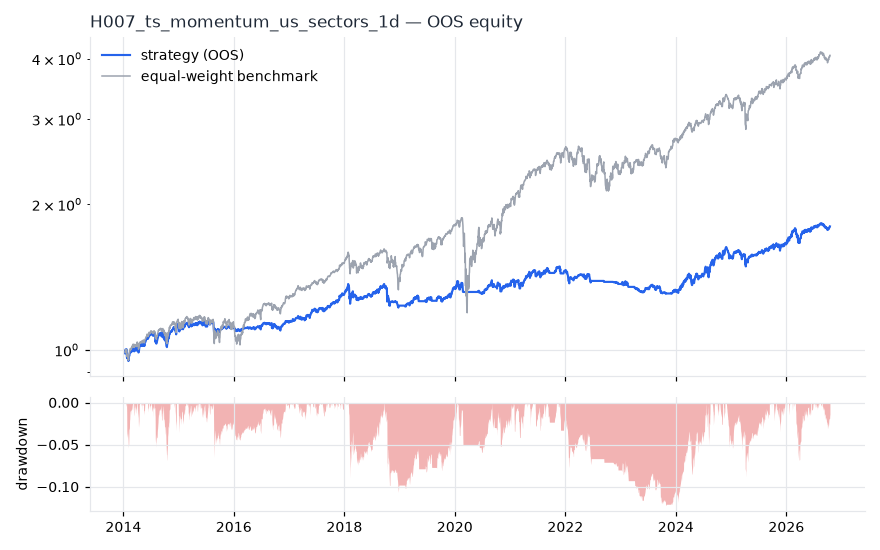
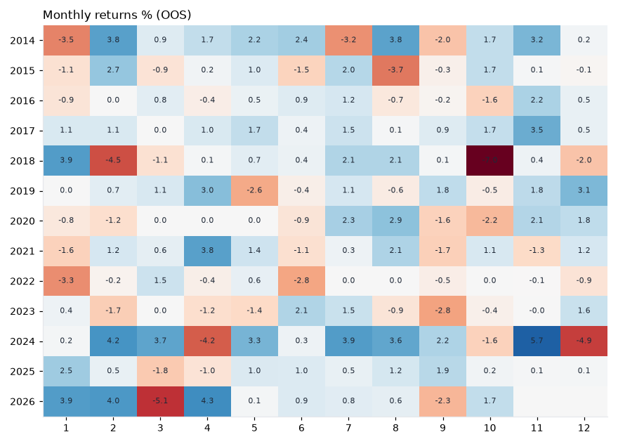

# H007 — ts_momentum on us_sectors [1d]  🟡 WATCH

- Kind: strategy · Source: Moskowitz, Ooi & Pedersen (2012) Time Series Momentum
- For system: `sp500_shock_quant`
- Data: 2010-01-04 00:00:00 → 2026-10-16 00:00:00 · 11 assets · 251.7 bars/year · survivorship mask: False
- Costs: {'commission': 0.0002, 'slippage': 0.0002, 'funding_annual': 0.0, 'borrow_annual': 0.0}
- Variants tried (DSR trials): 20 (failed: 0)
- Final variant: `ts_momentum|lookback=252,vol_target=0.1`

## Verdict reasons
- OOS Sharpe (excess of T-bill) 0.393 < 0.5
- with 2x costs it does not beat the equal-weight benchmark
- PBO 0.833 > 0.5 (variant selection is overfit)
- Reality Check p 0.996 > 0.1 (best variant may be data-mined)

## Walk-forward out-of-sample


| Metric | Strategy | Equal-weight benchmark |
|---|---|---|
| years | 12.76 | 12.76 |
| cagr | 0.0472 | 0.1162 |
| vol | 0.0767 | 0.1609 |
| sharpe | 0.639 | 0.764 |
| sharpe_excess_rf | 0.393 | None |
| sortino | 0.529 | 1.069 |
| max_dd | -0.1223 | -0.3634 |
| max_dd_bars | 683 | 329 |
| calmar | 0.386 | 0.32 |
| ulcer | 0.0488 | 0.0541 |
| var95 | -0.0077 | -0.0145 |
| cvar95 | -0.0125 | -0.0241 |
| omega | 1.132 | 1.161 |
| tail_ratio | 0.972 | 0.985 |
| skew | -0.887 | -0.569 |
| kurtosis | 6.6 | 19.396 |
| hit_rate | 0.483 | 0.551 |
| turnover_ann | 5.09 | None |

- **Gate Sharpe (excess of T-bill): 0.393**
- Deflated Sharpe: **0.947** · PBO: **0.833** · Reality Check p: **0.996**
- PSR 0.987 · Info ratio -0.584 · Beta 0.305 · Up/Down capture 0.461/0.471
- Sharpe with 2× costs: 0.613 · Walk-forward efficiency: 0.711
- Bootstrap: {'p_sharpe_pos': 0.998, 'cagr_p05': 0.0163, 'maxdd_p05': -0.2282}
- Yearly OOS Sharpe: {'2014': 1.07, '2015': 0.02, '2016': 0.46, '2017': 2.45, '2018': -0.46, '2019': 1.54, '2020': 0.32, '2021': 0.77, '2022': -1.27, '2023': -0.62, '2024': 1.61, '2025': 0.79, '2026': 1.41}



## Regimes (where does it work?)
`{"bull": {"sharpe": 1.02, "ann_ret": 0.0787, "bars": 2702}, "bear": {"sharpe": -1.49, "ann_ret": -0.1089, "bars": 508}, "calm": {"sharpe": 0.86, "ann_ret": 0.0579, "bars": 1677}, "stressed": {"sharpe": 0.46, "ann_ret": 0.0394, "bars": 1533}, "vix_lt_20": {"sharpe": 2.16, "ann_ret": 0.1483, "bars": 2335}, "vix_20_30": {"sharpe": -1.67, "ann_ret": -0.1431, "bars": 717}, "vix_ge_30": {"sharpe": -4.62, "ann_ret": -0.5454, "bars": 158}, "curve_inverted": {"sharpe": 0.29, "ann_ret": 0.0227, "bars": 614}, "curve_normal": {"sharpe": 0.72, "ann_ret": 0.0553, "bars": 2596}}`

## Calendar profile (weekday / month / hour)
`{"weekday": {"0": 0.00025, "1": 2e-05, "2": 0.00022, "3": 0.00012, "4": 0.00037}, "month": {"1": 3e-05, "2": 0.00042, "3": -1e-05, "4": 0.00026, "5": 0.00031, "6": 7e-05, "7": 0.00051, "8": 0.00037, "9": -0.00016, "10": -0.00018, "11": 0.00072, "12": 4e-05}}`

## Robustness
- **delay**: `{"sharpe": 0.719, "sharpe_delayed_1bar": 0.683, "retained": 0.949}`
- **neighbourhood**: `{"neighbours": 3, "best_sharpe": 0.696, "neighbour_median": 0.696, "share_positive": 1.0, "stability": 1.0}`
- **noise**: `{"noise_bp": 0.002, "sharpe_min": 0.71, "sharpe_median": 0.72}`

## Timing, take-profit, stop-loss and profit studies (in-sample diagnostics)
- Portfolio overlays (vol target, drawdown brake, equity-curve filter): `{"none": {"sharpe": 0.639, "cagr": 0.0472, "max_dd": -0.1223}, "vol_target_0.1": {"sharpe": 0.601, "cagr": 0.058, "max_dd": -0.2129}, "vol_target_0.15": {"sharpe": 0.572, "cagr": 0.0691, "max_dd": -0.233}, "vol_target_0.2": {"sharpe": 0.624, "cagr": 0.084, "max_dd": -0.2337}, "dd_brake_0.1": {"sharpe": 0.616, "cagr": 0.045, "max_dd": -0.1218}, "dd_brake_0.2": {"sharpe": 0.639, "cagr": 0.0472, "max_dd": -0.1223}, "equity_ma_41": {"sharpe": 0.297, "cagr": 0.0155, "max_dd": -0.1278}, "equity_ma_125": {"sharpe": 0.392, "cagr": 0.0235, "max_dd": -0.1193}, "best_by_calmar": "none"}`
> Studies are in-sample diagnostics. To use a better exit, register it (exits: [...]) and let the gate judge it.

## Walk-forward windows
- 2020-12-23 00:00:00 → 2021-06-23 00:00:00: IS 0.511 / OOS 1.124 — `ts_momentum|lookback=63,vol_target=0.15|overlay=eqma_s`
- 2021-06-24 00:00:00 → 2021-12-20 00:00:00: IS 0.925 / OOS 0.414 — `ts_momentum|lookback=63,vol_target=0.15|overlay=eqma_s`
- 2021-12-21 00:00:00 → 2022-06-21 00:00:00: IS 0.849 / OOS -1.023 — `ts_momentum|lookback=63,vol_target=0.15|overlay=vt10`
- 2022-06-22 00:00:00 → 2022-12-16 00:00:00: IS 0.648 / OOS -2.259 — `ts_momentum|lookback=63,vol_target=0.1|overlay=eqma_l`
- 2022-12-19 00:00:00 → 2023-06-20 00:00:00: IS 0.524 / OOS -0.925 — `ts_momentum|lookback=63,vol_target=0.15|overlay=eqma_l`
- 2023-06-21 00:00:00 → 2023-12-15 00:00:00: IS 0.895 / OOS -0.639 — `ts_momentum|lookback=63,vol_target=0.1`
- 2023-12-18 00:00:00 → 2024-06-17 00:00:00: IS 0.629 / OOS 1.683 — `ts_momentum|lookback=252,vol_target=0.15`
- 2024-06-18 00:00:00 → 2024-12-13 00:00:00: IS 0.522 / OOS 2.196 — `ts_momentum|lookback=252,vol_target=0.15`
- 2024-12-16 00:00:00 → 2025-06-17 00:00:00: IS 0.678 / OOS -0.214 — `ts_momentum|lookback=252,vol_target=0.1`
- 2025-06-18 00:00:00 → 2025-12-15 00:00:00: IS 0.716 / OOS 1.569 — `ts_momentum|lookback=252,vol_target=0.15`
- 2025-12-16 00:00:00 → 2026-06-16 00:00:00: IS 0.818 / OOS 1.77 — `ts_momentum|lookback=252,vol_target=0.15`
- 2026-06-17 00:00:00 → 2026-10-16 00:00:00: IS 1.084 / OOS 0.319 — `ts_momentum|lookback=252,vol_target=0.1`

## Best variants (full sample, reference only)
- ts_momentum|lookback=63,vol_target=0.15|overlay=vt10: Sharpe 0.717
- ts_momentum|lookback=63,vol_target=0.1|overlay=vt10: Sharpe 0.717
- ts_momentum|lookback=63,vol_target=0.15|overlay=vt15: Sharpe 0.717
- ts_momentum|lookback=63,vol_target=0.15|overlay=vt20: Sharpe 0.713
- ts_momentum|lookback=63,vol_target=0.1|overlay=dd20: Sharpe 0.713
- ts_momentum|lookback=63,vol_target=0.1|overlay=vt15: Sharpe 0.713
- ts_momentum|lookback=63,vol_target=0.1|overlay=vt20: Sharpe 0.713
- ts_momentum|lookback=63,vol_target=0.1: Sharpe 0.713
- ts_momentum|lookback=63,vol_target=0.15: Sharpe 0.713
- ts_momentum|lookback=63,vol_target=0.15|overlay=dd20: Sharpe 0.713

## Current targets / signals
```json
{
 "XLF": 0.0737,
 "XLRE": 0.0714,
 "XLI": 0.0609,
 "XLP": 0.0602,
 "XLB": 0.0556,
 "XLV": 0.0532,
 "XLE": 0.0421,
 "XLK": 0.0351
}
```

> Survivorship bias: unless a membership mask is used, universes are today's members (upper-bound results).