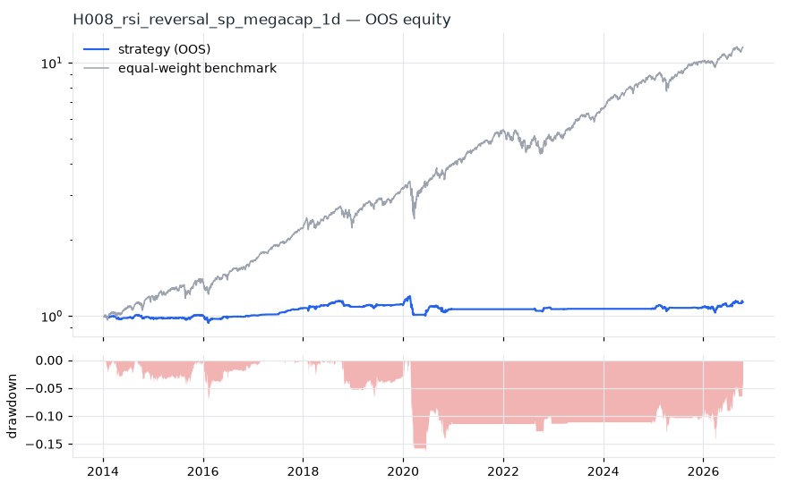
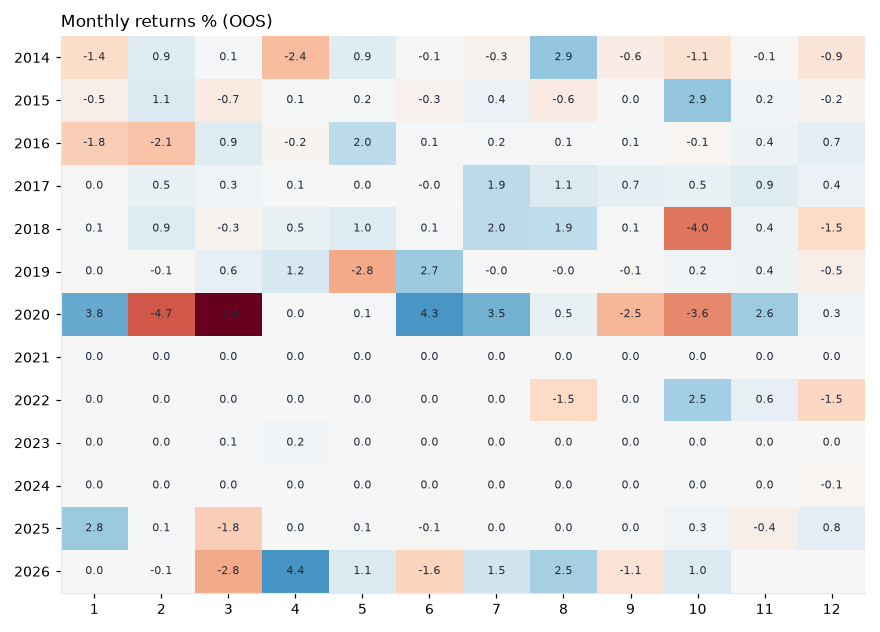
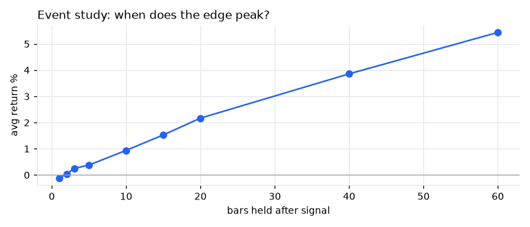
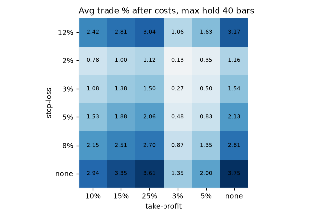

# H008 — rsi_reversal on sp_megacap [1d]  ❌ REJECT

- Kind: rule · Source: Wilder (1978) RSI; Connors (2009)
- For system: `us_f1_bot`
- Data: 2010-01-04 00:00:00 → 2026-10-16 00:00:00 · 29 assets · 251.7 bars/year · survivorship mask: True
- Costs: {'commission': 0.0002, 'slippage': 0.0003, 'funding_annual': 0.0, 'borrow_annual': 0.0}
- Variants tried (DSR trials): 393 (failed: 0)
- Final variant: `rsi_reversal|n=9,lo=35,exit=70|f=trend_sma200|x=trail_pct=0.1|size=atr_risk0.01|overlay=eqma_s`

## Verdict reasons
- DSR 0.009 < 0.9 (luck not excluded after 393 trials)
- OOS Sharpe (excess of T-bill) -0.154 < 0.5
- bootstrap P(SR>0) 0.778 < 0.85
- with 2x costs it does not beat the equal-weight benchmark
- Reality Check p 1.0 > 0.1 (best variant may be data-mined)
- random entries match it (p=0.84): the edge is in the exits, not the signal

## Walk-forward out-of-sample


| Metric | Strategy | Equal-weight benchmark |
|---|---|---|
| years | 12.76 | 12.76 |
| cagr | 0.0099 | 0.211 |
| vol | 0.0504 | 0.1678 |
| sharpe | 0.22 | 1.225 |
| sharpe_excess_rf | -0.154 | None |
| sortino | -0.21 | 1.765 |
| max_dd | -0.1648 | -0.2879 |
| max_dd_bars | 1674 | 318 |
| calmar | 0.06 | 0.733 |
| ulcer | 0.0813 | 0.046 |
| var95 | -0.0037 | -0.0151 |
| cvar95 | -0.0084 | -0.025 |
| omega | 1.066 | 1.265 |
| tail_ratio | 1.023 | 0.979 |
| skew | -0.365 | -0.297 |
| kurtosis | 28.479 | 15.548 |
| hit_rate | 0.336 | 0.565 |
| turnover_ann | 4.98 | None |

- **Gate Sharpe (excess of T-bill): -0.154**
- Deflated Sharpe: **0.009** · PBO: **0.275** · Reality Check p: **1.0**
- PSR 0.784 · Info ratio -1.325 · Beta 0.162 · Up/Down capture 0.153/0.179
- Sharpe with 2× costs: 0.171 · Walk-forward efficiency: 0.131
- Bootstrap: {'p_sharpe_pos': 0.778, 'cagr_p05': -0.0153, 'maxdd_p05': -0.3039}
- Yearly OOS Sharpe: {'2014': -0.52, '2015': 0.68, '2016': 0.02, '2017': 4.24, '2018': 0.23, '2019': 0.47, '2020': -0.27, '2021': 0.0, '2022': 0.03, '2023': 0.76, '2024': -0.18, '2025': 0.41, '2026': 0.76}



## Regimes (where does it work?)
`{"bull": {"sharpe": 0.82, "ann_ret": 0.0376, "bars": 2702}, "bear": {"sharpe": -1.85, "ann_ret": -0.1296, "bars": 508}, "calm": {"sharpe": 0.57, "ann_ret": 0.0152, "bars": 1677}, "stressed": {"sharpe": 0.1, "ann_ret": 0.0067, "bars": 1533}, "vix_lt_20": {"sharpe": 1.67, "ann_ret": 0.0584, "bars": 2335}, "vix_20_30": {"sharpe": -1.38, "ann_ret": -0.0889, "bars": 717}, "vix_ge_30": {"sharpe": -1.96, "ann_ret": -0.2343, "bars": 158}, "curve_inverted": {"sharpe": -1.26, "ann_ret": -0.0485, "bars": 614}, "curve_normal": {"sharpe": 0.48, "ann_ret": 0.0252, "bars": 2596}}`

## Calendar profile (weekday / month / hour)
`{"weekday": {"0": 3e-05, "1": 0.00014, "2": 0.00022, "3": -0.00014, "4": -4e-05}, "month": {"1": 0.00012, "2": -0.00013, "3": -0.00039, "4": 0.00015, "5": 9e-05, "6": 0.00019, "7": 0.00033, "8": 0.00024, "9": -0.00012, "10": -5e-05, "11": 0.0002, "12": -0.0001}}`

## Trades (OOS)
`{"n_trades": 814, "trades_per_year": 63.8, "win_rate": 0.634, "avg_trade": 0.017, "median_trade": 0.0351, "avg_win": 0.0664, "avg_loss": -0.0685, "profit_factor": 1.68, "payoff": 0.97, "expectancy_r": null, "sqn": null, "kelly_fraction": 0.257, "max_consec_losses": 42, "avg_bars": 21.9, "avg_bars_win": 22.8, "avg_bars_loss": 20.3, "avg_mfe": 0.0599, "avg_mae": -0.0393, "edge_ratio": 1.523, "exit_reasons": {"signal": 524, "stop": 290}, "long_short": {"1": {"count": 814, "mean": 0.017}}}`

## Robustness
- **delay**: `{"sharpe": 0.73, "sharpe_delayed_1bar": 1.149, "retained": 1.574}`
- **neighbourhood**: `{"neighbours": 0}`
- **noise**: `{"noise_bp": 0.002, "sharpe_min": 0.207, "sharpe_median": 0.421}`
- **random_entry**: `{"actual_ret_per_exposure_ann": 0.135, "random_median_ann": 0.1676, "random_p95_ann": 0.2119, "trades_actual": 956, "p_value": 0.84}`
- **mc_trade_shuffle**: `{"maxdd_median": -0.1035, "maxdd_p95": -0.1487, "final_p05": 11.0618, "final_median": 11.0618}`

## Timing, take-profit, stop-loss and profit studies (in-sample diagnostics)
- Event study (forward return by bars held): `{"1": {"n": 2275, "mean": -0.0011, "hit": 0.488, "t": -3.62, "per_bar": -0.00114}, "2": {"n": 2275, "mean": 0.0004, "hit": 0.531, "t": 0.71, "per_bar": 0.00019}, "3": {"n": 2274, "mean": 0.0025, "hit": 0.536, "t": 3.92, "per_bar": 0.00084}, "5": {"n": 2274, "mean": 0.0038, "hit": 0.556, "t": 4.63, "per_bar": 0.00076}, "10": {"n": 2268, "mean": 0.0094, "hit": 0.593, "t": 8.16, "per_bar": 0.00094}, "15": {"n": 2264, "mean": 0.0153, "hit": 0.621, "t": 11.26, "per_bar": 0.00102}, "20": {"n": 2260, "mean": 0.0217, "hit": 0.627, "t": 14.28, "per_bar": 0.00108}, "40": {"n": 2249, "mean": 0.0386, "hit": 0.674, "t": 17.88, "per_bar": 0.00097}, "60": {"n": 2243, "mean": 0.0544, "hit": 0.696, "t": 21.01, "per_bar": 0.00091}, "best_holding_bars": 60}`

- Best stop / target / max-hold combinations: `[{"stop": NaN, "target": 0.15, "max_hold": 40, "n": 2275, "mean": 0.0335, "hit": 0.6725, "per_bar": 0.0009, "t": 18.1043}, {"stop": NaN, "target": 0.1, "max_hold": 40, "n": 2275, "mean": 0.0294, "hit": 0.6914, "per_bar": 0.0009, "t": 17.9918}, {"stop": NaN, "target": 0.25, "max_hold": 40, "n": 2275, "mean": 0.0361, "hit": 0.669, "per_bar": 0.0009, "t": 17.8511}, {"stop": NaN, "target": NaN, "max_hold": 40, "n": 2275, "mean": 0.0375, "hit": 0.669, "per_bar": 0.0009, "t": 17.5296}, {"stop": NaN, "target": 0.05, "max_hold": 40, "n": 2275, "mean": 0.02, "hit": 0.7741, "per_bar": 0.0009, "t": 16.6438}]`

- Portfolio overlays (vol target, drawdown brake, equity-curve filter): `{"none": {"sharpe": 0.22, "cagr": 0.0099, "max_dd": -0.1648}, "vol_target_0.1": {"sharpe": 0.354, "cagr": 0.0249, "max_dd": -0.146}, "vol_target_0.15": {"sharpe": 0.313, "cagr": 0.0247, "max_dd": -0.2031}, "vol_target_0.2": {"sharpe": 0.295, "cagr": 0.0242, "max_dd": -0.2501}, "dd_brake_0.1": {"sharpe": 0.166, "cagr": 0.0063, "max_dd": -0.1589}, "dd_brake_0.2": {"sharpe": 0.22, "cagr": 0.0099, "max_dd": -0.1648}, "equity_ma_41": {"sharpe": 0.168, "cagr": 0.0048, "max_dd": -0.0777}, "equity_ma_125": {"sharpe": -0.018, "cagr": -0.0013, "max_dd": -0.1449}, "best_by_calmar": "vol_target_0.1"}`
> Studies are in-sample diagnostics. To use a better exit, register it (exits: [...]) and let the gate judge it.

## Walk-forward windows
- 2020-12-23 00:00:00 → 2021-06-23 00:00:00: IS 1.193 / OOS 0.0 — `rsi_reversal|n=9,lo=10,exit=60|f=trend_sma200|x=signal_only`
- 2021-06-24 00:00:00 → 2021-12-20 00:00:00: IS 1.441 / OOS 0.0 — `rsi_reversal|n=9,lo=10,exit=60|f=regime_bench200|x=signal_only`
- 2021-12-21 00:00:00 → 2022-06-21 00:00:00: IS 1.441 / OOS 0.0 — `rsi_reversal|n=9,lo=10,exit=60|f=regime_bench200|x=signal_only`
- 2022-06-22 00:00:00 → 2022-12-16 00:00:00: IS 1.033 / OOS 0.046 — `rsi_reversal|n=9,lo=35,exit=70|f=trend_sma200|x=trail_pct=0.1|size=atr_risk0.005|overlay=eqma_l`
- 2022-12-19 00:00:00 → 2023-06-20 00:00:00: IS 1.011 / OOS 1.068 — `rsi_reversal|n=9,lo=10,exit=70|f=regime_bench200|x=signal_only`
- 2023-06-21 00:00:00 → 2023-12-15 00:00:00: IS 1.59 / OOS 0.0 — `rsi_reversal|n=21,lo=30,exit=60|f=trend_sma200|x=signal_only`
- 2023-12-18 00:00:00 → 2024-06-17 00:00:00: IS 1.945 / OOS 0.0 — `rsi_reversal|n=28,lo=35,exit=60|f=trend_sma200|x=signal_only`
- 2024-06-18 00:00:00 → 2024-12-13 00:00:00: IS 1.945 / OOS 0.0 — `rsi_reversal|n=28,lo=35,exit=60|f=trend_sma200|x=signal_only`
- 2024-12-16 00:00:00 → 2025-06-17 00:00:00: IS 1.505 / OOS 0.336 — `rsi_reversal|n=9,lo=35,exit=70|f=trend_sma200|x=max_hold=20`
- 2025-06-18 00:00:00 → 2025-12-15 00:00:00: IS 2.076 / OOS 0.427 — `rsi_reversal|n=5,lo=10,exit=70|f=trend_sma200|x=signal_only`
- 2025-12-16 00:00:00 → 2026-06-16 00:00:00: IS 1.98 / OOS 1.139 — `rsi_reversal|n=9,lo=35,exit=70|f=regime_bench200|x=signal_only`
- 2026-06-17 00:00:00 → 2026-10-16 00:00:00: IS 2.021 / OOS 0.405 — `rsi_reversal|n=9,lo=35,exit=70|f=trend_sma200|x=trail_pct=0.1|size=atr_risk0.01|overlay=eqma_s`

## Best variants (full sample, reference only)
- rsi_reversal|n=9,lo=35,exit=70|f=trend_sma200|x=trail_pct=0.1|size=atr_risk0.005|overlay=vt15: Sharpe 1.153
- rsi_reversal|n=9,lo=35,exit=70|f=trend_sma200|x=trail_pct=0.1|size=atr_risk0.005|overlay=vt20: Sharpe 1.133
- rsi_reversal|n=9,lo=35,exit=70|f=trend_sma200|x=trail_pct=0.1|size=atr_risk0.005|overlay=vt10: Sharpe 1.133
- rsi_reversal|n=9,lo=35,exit=70|f=trend_sma200|x=trail_pct=0.1|size=atr_risk0.005: Sharpe 1.13
- rsi_reversal|n=9,lo=35,exit=70|f=trend_sma200|x=trail_pct=0.1|size=atr_risk0.005|overlay=dd20: Sharpe 1.128
- rsi_reversal|n=9,lo=35,exit=70|f=trend_sma200|x=trail_pct=0.1|size=atr_risk0.01|overlay=vt20: Sharpe 1.115
- rsi_reversal|n=9,lo=35,exit=70|f=trend_sma200|x=trail_pct=0.1|size=atr_risk0.005|overlay=dd10: Sharpe 1.109
- rsi_reversal|n=9,lo=35,exit=70|f=trend_sma200|x=trail_pct=0.1|size=atr_risk0.01: Sharpe 1.105
- rsi_reversal|n=9,lo=35,exit=70|f=trend_sma200|x=trail_pct=0.1|size=atr_risk0.01|overlay=vt15: Sharpe 1.102
- rsi_reversal|n=9,lo=35,exit=70|f=trend_sma200|x=trail_pct=0.1|size=atr_risk0.01|overlay=dd20: Sharpe 1.092

## Current targets / signals
```json
{
 "positions": {
  "AMZN": 0.2048,
  "JNJ": 0.1582,
  "MRK": 0.1443
 },
 "entry_long_next_open": [],
 "exit_long_next_open": [
  "BRK-B",
  "V",
  "XOM",
  "PG",
  "MA",
  "HD",
  "COST",
  "LLY",
  "KO",
  "WMT",
  "CVX",
  "ABBV"
 ],
 "entry_short_next_open": []
}
```

> Survivorship bias: unless a membership mask is used, universes are today's members (upper-bound results).