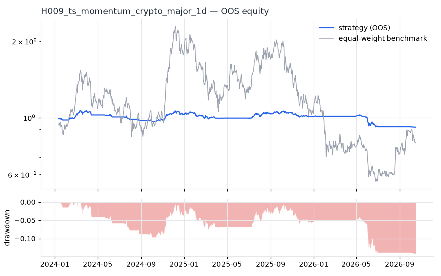
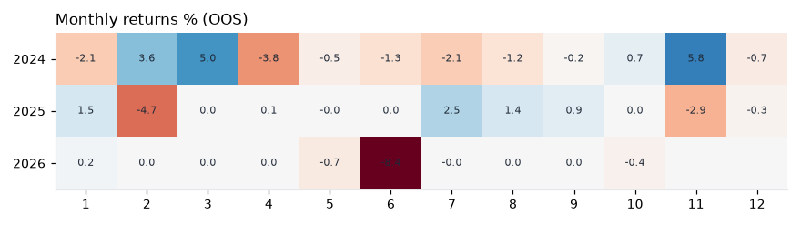

# H009 — ts_momentum on crypto_major [1d]  ❌ REJECT

- Kind: strategy · Source: Moskowitz, Ooi & Pedersen (2012) Time Series Momentum
- For system: `karma_perp_bot`
- Data: 2020-01-01 00:00:00 → 2026-10-16 00:00:00 · 10 assets · 365.4 bars/year · survivorship mask: False
- Costs: {'commission': 0.0006, 'slippage': 0.0005, 'funding_annual': 0.08, 'borrow_annual': 0.0}
- Variants tried (DSR trials): 20 (failed: 0)
- Final variant: `ts_momentum|lookback=252,vol_target=0.15|overlay=vt10`

## Verdict reasons
- OOS too short (2.76y < 3.0y)
- DSR 0.146 < 0.9 (luck not excluded after 20 trials)
- OOS Sharpe (excess of T-bill) -0.945 < 0.5
- bootstrap P(SR>0) 0.257 < 0.85
- only 33% of OOS years positive
- with 2x costs it does not beat the equal-weight benchmark
- PBO 0.849 > 0.5 (variant selection is overfit)
- Reality Check p 0.876 > 0.1 (best variant may be data-mined)

## Walk-forward out-of-sample


| Metric | Strategy | Equal-weight benchmark |
|---|---|---|
| years | 2.76 | 2.76 |
| cagr | -0.0308 | -0.0775 |
| vol | 0.0743 | 0.653 |
| sharpe | -0.384 | 0.203 |
| sharpe_excess_rf | -0.945 | None |
| sortino | -1.242 | 0.291 |
| max_dd | -0.1411 | -0.7534 |
| max_dd_bars | 947 | 677 |
| calmar | -0.218 | -0.103 |
| ulcer | 0.0694 | 0.443 |
| var95 | -0.0067 | -0.0515 |
| cvar95 | -0.0107 | -0.0771 |
| omega | 0.926 | 1.03 |
| tail_ratio | 0.841 | 1.045 |
| skew | -0.629 | 0.045 |
| kurtosis | 9.867 | 3.797 |
| hit_rate | 0.292 | 0.498 |
| turnover_ann | 2.14 | None |

- **Gate Sharpe (excess of T-bill): -0.945**
- Deflated Sharpe: **0.146** · PBO: **0.849** · Reality Check p: **0.876**
- PSR 0.261 · Info ratio -0.268 · Beta 0.08 · Up/Down capture 0.076/0.085
- Sharpe with 2× costs: -0.416 · Walk-forward efficiency: -0.456
- Bootstrap: {'p_sharpe_pos': 0.257, 'cagr_p05': -0.1093, 'maxdd_p05': -0.3107}
- Yearly OOS Sharpe: {'2024': 0.41, '2025': -0.2, '2026': -1.85}



## Regimes (where does it work?)
`{"bull": {"sharpe": 0.32, "ann_ret": 0.0242, "bars": 712}, "bear": {"sharpe": -2.26, "ann_ret": -0.1549, "bars": 297}, "calm": {"sharpe": 0.1, "ann_ret": 0.007, "bars": 493}, "stressed": {"sharpe": -0.79, "ann_ret": -0.0624, "bars": 516}, "vix_lt_20": {"sharpe": 0.2, "ann_ret": 0.0151, "bars": 818}, "vix_20_30": {"sharpe": -3.16, "ann_ret": -0.2442, "bars": 170}}`

## Calendar profile (weekday / month / hour)
`{"weekday": {"0": -0.00017, "1": -0.00089, "2": 0.00043, "3": -0.00042, "4": -0.00022, "5": 7e-05, "6": 0.00065}, "month": {"1": -5e-05, "2": -0.00014, "3": 0.00055, "4": -0.00042, "5": -0.00014, "6": -0.0011, "7": 4e-05, "8": 3e-05, "9": 8e-05, "10": 5e-05, "11": 0.00045, "12": -0.00014}}`

## Robustness
- **delay**: `{"sharpe": 0.912, "sharpe_delayed_1bar": 0.91, "retained": 0.998}`
- **neighbourhood**: `{"neighbours": 1, "best_sharpe": 0.86, "neighbour_median": 0.857, "share_positive": 1.0, "stability": 0.997}`
- **noise**: `{"noise_bp": 0.002, "sharpe_min": 0.905, "sharpe_median": 0.908}`

## Timing, take-profit, stop-loss and profit studies (in-sample diagnostics)
- Portfolio overlays (vol target, drawdown brake, equity-curve filter): `{"none": {"sharpe": -0.384, "cagr": -0.0308, "max_dd": -0.1411}, "vol_target_0.1": {"sharpe": -0.192, "cagr": -0.0245, "max_dd": -0.1951}, "vol_target_0.15": {"sharpe": -0.251, "cagr": -0.0402, "max_dd": -0.2335}, "vol_target_0.2": {"sharpe": -0.349, "cagr": -0.0594, "max_dd": -0.2625}, "dd_brake_0.1": {"sharpe": -0.313, "cagr": -0.0241, "max_dd": -0.1246}, "dd_brake_0.2": {"sharpe": -0.384, "cagr": -0.0308, "max_dd": -0.1411}, "equity_ma_60": {"sharpe": 0.512, "cagr": 0.0266, "max_dd": -0.0541}, "equity_ma_182": {"sharpe": -0.298, "cagr": -0.0159, "max_dd": -0.0742}, "best_by_calmar": "equity_ma_60"}`
> Studies are in-sample diagnostics. To use a better exit, register it (exits: [...]) and let the gate judge it.

## Walk-forward windows
- 2024-01-12 00:00:00 → 2024-07-11 00:00:00: IS 1.061 / OOS 0.193 — `ts_momentum|lookback=252,vol_target=0.1|overlay=eqma_s`
- 2024-07-12 00:00:00 → 2025-01-09 00:00:00: IS 0.701 / OOS 0.689 — `ts_momentum|lookback=252,vol_target=0.15|overlay=eqma_s`
- 2025-01-10 00:00:00 → 2025-07-10 00:00:00: IS 0.842 / OOS -0.864 — `ts_momentum|lookback=126,vol_target=0.1`
- 2025-07-11 00:00:00 → 2026-01-08 00:00:00: IS 0.798 / OOS 0.332 — `ts_momentum|lookback=252,vol_target=0.15|overlay=vt10`
- 2026-01-09 00:00:00 → 2026-07-09 00:00:00: IS 0.908 / OOS -2.314 — `ts_momentum|lookback=63,vol_target=0.15`
- 2026-07-10 00:00:00 → 2026-10-16 00:00:00: IS 0.736 / OOS -2.509 — `ts_momentum|lookback=252,vol_target=0.15|overlay=vt10`

## Best variants (full sample, reference only)
- ts_momentum|lookback=252,vol_target=0.15|overlay=eqma_s: Sharpe 0.895
- ts_momentum|lookback=252,vol_target=0.1|overlay=eqma_s: Sharpe 0.883
- ts_momentum|lookback=252,vol_target=0.1: Sharpe 0.867
- ts_momentum|lookback=252,vol_target=0.1|overlay=vt20: Sharpe 0.867
- ts_momentum|lookback=252,vol_target=0.1|overlay=dd10: Sharpe 0.867
- ts_momentum|lookback=252,vol_target=0.1|overlay=dd20: Sharpe 0.867
- ts_momentum|lookback=252,vol_target=0.1|overlay=vt15: Sharpe 0.867
- ts_momentum|lookback=252,vol_target=0.15: Sharpe 0.867
- ts_momentum|lookback=252,vol_target=0.15|overlay=dd20: Sharpe 0.867
- ts_momentum|lookback=252,vol_target=0.15|overlay=vt20: Sharpe 0.867

## Current targets / signals
```json
{
 "BNB/USDT": 0.0448,
 "BTC/USDT": 0.0415,
 "ETH/USDT": 0.0293,
 "SOL/USDT": 0.0277,
 "LINK/USDT": 0.0228,
 "AVAX/USDT": 0.0193
}
```

> Survivorship bias: unless a membership mask is used, universes are today's members (upper-bound results).