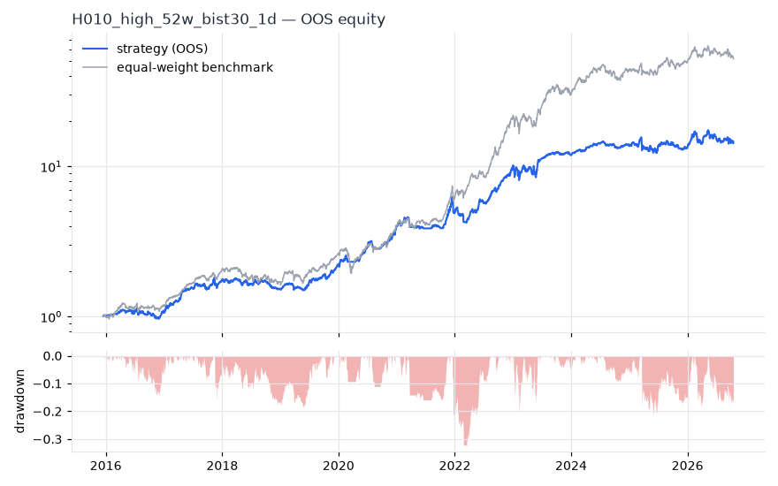
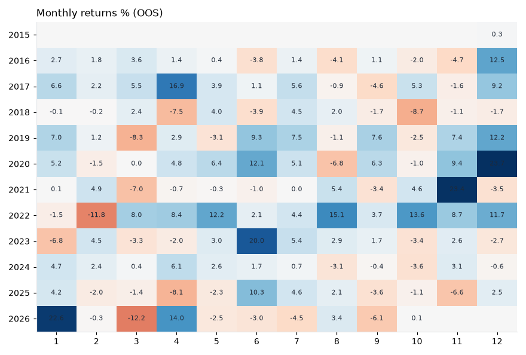

# H010 — high_52w on bist30 [1d]  ❌ REJECT

- Kind: strategy · Source: George & Hwang (2004) The 52-Week High and Momentum Investing
- For system: `bist_orderflow_quant`
- Data: 2012-01-02 00:00:00 → 2026-10-16 00:00:00 · 29 assets · 256.1 bars/year · survivorship mask: False
- Costs: {'commission': 0.001, 'slippage': 0.001, 'funding_annual': 0.0, 'borrow_annual': 0.0}
- Variants tried (DSR trials): 17 (failed: 0)
- Final variant: `high_52w|top_n=10`

## Verdict reasons
- OOS Sharpe (USD, excess of US T-bill) -0.001 < 0.5
- OOS MaxDD -0.5642 worse than -0.45 (local or USD)
- with 2x costs it does not beat the equal-weight benchmark
- PBO 0.609 > 0.5 (variant selection is overfit)
- Reality Check p 0.378 > 0.1 (best variant may be data-mined)

## Walk-forward out-of-sample


| Metric | Strategy | Equal-weight benchmark |
|---|---|---|
| years | 10.76 | 10.76 |
| cagr | 0.2803 | 0.4437 |
| vol | 0.2153 | 0.2642 |
| sharpe | 1.256 | 1.523 |
| sharpe_excess_rf | 1.154 | None |
| sortino | 1.648 | 2.248 |
| max_dd | -0.3274 | -0.3222 |
| max_dd_bars | 483 | 371 |
| calmar | 0.856 | 1.377 |
| ulcer | 0.095 | 0.0851 |
| var95 | -0.0173 | -0.024 |
| cvar95 | -0.0323 | -0.0377 |
| omega | 1.277 | 1.312 |
| tail_ratio | 1.218 | 1.09 |
| skew | -0.665 | -0.051 |
| kurtosis | 9.092 | 9.059 |
| hit_rate | 0.5 | 0.539 |
| turnover_ann | 12.28 | None |

- **Gate Sharpe (USD, excess of US T-bill): -0.001**
- Deflated Sharpe: **1.0** · PBO: **0.609** · Reality Check p: **0.378**
- PSR 1.0 · Info ratio -0.817 · Beta 0.646 · Up/Down capture 0.652/0.645
- Sharpe with 2× costs: 1.142 · Walk-forward efficiency: 0.685
- Bootstrap: {'p_sharpe_pos': 1.0, 'cagr_p05': 0.145, 'maxdd_p05': -0.4467}
- Yearly OOS Sharpe: {'2016': 0.63, '2017': 2.34, '2018': -0.8, '2019': 2.52, '2020': 3.02, '2021': 0.89, '2022': 3.19, '2023': 0.81, '2024': 1.41, '2025': 0.01, '2026': 0.48}
- In USD: CAGR -0.0146 · Sharpe 0.081 · excess-rf Sharpe -0.001 · MaxDD -0.5642



## Regimes (where does it work?)
`{"bull": {"sharpe": 1.89, "ann_ret": 0.4228, "bars": 2075}, "bear": {"sharpe": -1.04, "ann_ret": -0.194, "bars": 680}, "calm": {"sharpe": 2.07, "ann_ret": 0.3298, "bars": 1450}, "stressed": {"sharpe": 0.77, "ann_ret": 0.2047, "bars": 1305}, "vix_lt_20": {"sharpe": 1.5, "ann_ret": 0.3099, "bars": 1931}, "vix_20_30": {"sharpe": 0.82, "ann_ret": 0.1946, "bars": 671}, "vix_ge_30": {"sharpe": 0.48, "ann_ret": 0.1073, "bars": 153}, "curve_inverted": {"sharpe": 1.08, "ann_ret": 0.2504, "bars": 613}, "curve_normal": {"sharpe": 1.31, "ann_ret": 0.2763, "bars": 2142}}`

## Calendar profile (weekday / month / hour)
`{"weekday": {"0": 0.00264, "1": 0.00045, "2": -0.00025, "3": 0.00159, "4": 0.00084}, "month": {"1": 0.00184, "2": 0.00016, "3": -0.00047, "4": 0.00152, "5": 0.00116, "6": 0.0019, "7": 0.00153, "8": 0.00059, "9": 6e-05, "10": 3e-05, "11": 0.00179, "12": 0.00264}}`

## Robustness
- **delay**: `{"sharpe": 1.496, "sharpe_delayed_1bar": 1.537, "retained": 1.027}`
- **neighbourhood**: `{"neighbours": 2, "best_sharpe": 1.47, "neighbour_median": 1.301, "share_positive": 1.0, "stability": 0.885}`
- **noise**: `{"noise_bp": 0.002, "sharpe_min": 1.433, "sharpe_median": 1.482}`

## Timing, take-profit, stop-loss and profit studies (in-sample diagnostics)
- Portfolio overlays (vol target, drawdown brake, equity-curve filter): `{"none": {"sharpe": 1.256, "cagr": 0.2803, "max_dd": -0.3274}, "vol_target_0.1": {"sharpe": 1.417, "cagr": 0.1617, "max_dd": -0.1434}, "vol_target_0.15": {"sharpe": 1.412, "cagr": 0.2447, "max_dd": -0.2121}, "vol_target_0.2": {"sharpe": 1.42, "cagr": 0.3294, "max_dd": -0.2704}, "dd_brake_0.1": {"sharpe": 1.227, "cagr": 0.2361, "max_dd": -0.2492}, "dd_brake_0.2": {"sharpe": 1.217, "cagr": 0.2633, "max_dd": -0.2787}, "equity_ma_42": {"sharpe": 1.134, "cagr": 0.1935, "max_dd": -0.2627}, "equity_ma_128": {"sharpe": 0.971, "cagr": 0.1797, "max_dd": -0.3201}, "best_by_calmar": "vol_target_0.2"}`
> Studies are in-sample diagnostics. To use a better exit, register it (exits: [...]) and let the gate judge it.

## Walk-forward windows
- 2020-11-26 00:00:00 → 2021-05-31 00:00:00: IS 1.954 / OOS 1.303 — `high_52w|top_n=10|overlay=eqma_s`
- 2021-06-01 00:00:00 → 2021-12-06 00:00:00: IS 1.92 / OOS 3.83 — `high_52w|top_n=10|overlay=eqma_s`
- 2021-12-07 00:00:00 → 2022-06-08 00:00:00: IS 2.497 / OOS 0.653 — `high_52w|top_n=10|overlay=eqma_s`
- 2022-06-09 00:00:00 → 2022-12-09 00:00:00: IS 2.54 / OOS 4.973 — `high_52w|top_n=5|overlay=vt15`
- 2022-12-12 00:00:00 → 2023-06-16 00:00:00: IS 2.765 / OOS 1.301 — `high_52w|top_n=10|overlay=dd20`
- 2023-06-19 00:00:00 → 2023-12-19 00:00:00: IS 2.878 / OOS 2.294 — `high_52w|top_n=10|overlay=vt10`
- 2023-12-20 00:00:00 → 2024-06-27 00:00:00: IS 2.847 / OOS 3.208 — `high_52w|top_n=10|overlay=vt10`
- 2024-06-28 00:00:00 → 2024-12-27 00:00:00: IS 3.049 / OOS -0.284 — `high_52w|top_n=10|overlay=vt10`
- 2024-12-30 00:00:00 → 2025-07-07 00:00:00: IS 2.432 / OOS -0.027 — `high_52w|top_n=10`
- 2025-07-08 00:00:00 → 2026-01-06 00:00:00: IS 2.166 / OOS 0.381 — `high_52w|top_n=10|overlay=eqma_s`
- 2026-01-07 00:00:00 → 2026-07-14 00:00:00: IS 1.425 / OOS 0.503 — `high_52w|top_n=10`
- 2026-07-16 00:00:00 → 2026-10-16 00:00:00: IS 1.281 / OOS -0.426 — `high_52w|top_n=10`

## Best variants (full sample, reference only)
- high_52w|top_n=10: Sharpe 1.47
- high_52w|top_n=10|overlay=vt15: Sharpe 1.453
- high_52w|top_n=10|overlay=vt10: Sharpe 1.453
- high_52w|top_n=10|overlay=vt20: Sharpe 1.443
- high_52w|top_n=10|overlay=dd20: Sharpe 1.398
- high_52w|top_n=10|overlay=dd10: Sharpe 1.359
- high_52w|top_n=5: Sharpe 1.351
- high_52w|top_n=5|overlay=vt15: Sharpe 1.35
- high_52w|top_n=5|overlay=vt10: Sharpe 1.345
- high_52w|top_n=10|overlay=eqma_l: Sharpe 1.345

## Current targets / signals
```json
{
 "ASELS.IS": 0.1,
 "BIMAS.IS": 0.1,
 "EREGL.IS": 0.1,
 "GARAN.IS": 0.1,
 "KCHOL.IS": 0.1,
 "KRDMD.IS": 0.1,
 "THYAO.IS": 0.1,
 "TUPRS.IS": 0.1,
 "YKBNK.IS": 0.1,
 "ALARK.IS": 0.1
}
```

> Survivorship bias: unless a membership mask is used, universes are today's members (upper-bound results).