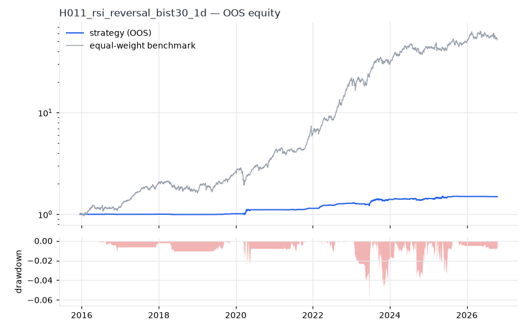
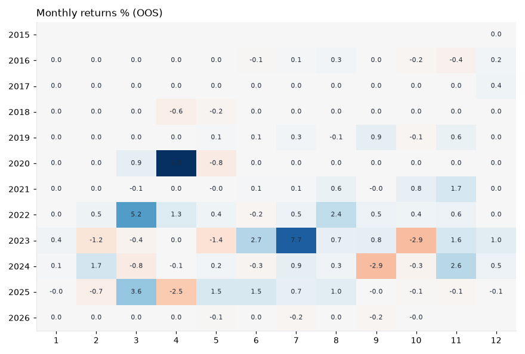
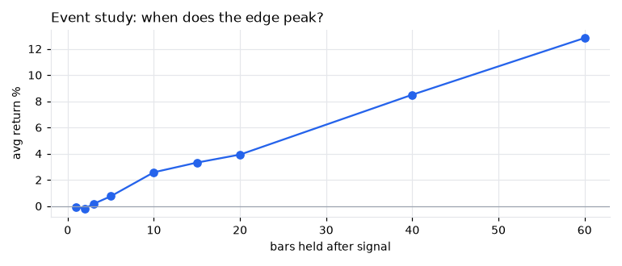
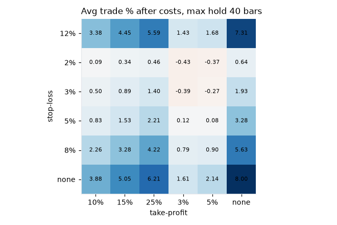

# H011 — rsi_reversal on bist30 [1d]  ❌ REJECT

- Kind: rule · Source: Wilder (1978) RSI; Connors (2009)
- For system: `bist_shock_quant`
- Data: 2012-01-02 00:00:00 → 2026-10-16 00:00:00 · 29 assets · 256.1 bars/year · survivorship mask: False
- Costs: {'commission': 0.001, 'slippage': 0.001, 'funding_annual': 0.0, 'borrow_annual': 0.0}
- Variants tried (DSR trials): 513 (failed: 0)
- Final variant: `rsi_reversal|n=21,lo=30,exit=70|f=none|x=trail_pct=0.15`

## Verdict reasons
- DSR 0.43 < 0.9 (luck not excluded after 513 trials)
- OOS Sharpe (USD, excess of US T-bill) -1.284 < 0.5
- OOS MaxDD -0.916 worse than -0.45 (local or USD)
- with 2x costs it does not beat the equal-weight benchmark
- Reality Check p 1.0 > 0.1 (best variant may be data-mined)

## Walk-forward out-of-sample


| Metric | Strategy | Equal-weight benchmark |
|---|---|---|
| years | 10.76 | 10.76 |
| cagr | 0.0377 | 0.4437 |
| vol | 0.0394 | 0.2642 |
| sharpe | 0.961 | 1.523 |
| sharpe_excess_rf | 0.4 | None |
| sortino | 0.647 | 2.248 |
| max_dd | -0.0625 | -0.3222 |
| max_dd_bars | 805 | 371 |
| calmar | 0.604 | 1.377 |
| ulcer | 0.011 | 0.0851 |
| var95 | -0.002 | -0.024 |
| cvar95 | -0.0051 | -0.0377 |
| omega | 1.387 | 1.312 |
| tail_ratio | 1.514 | 1.09 |
| skew | 1.573 | -0.051 |
| kurtosis | 36.589 | 9.059 |
| hit_rate | 0.237 | 0.539 |
| turnover_ann | 0.8 | None |

- **Gate Sharpe (USD, excess of US T-bill): -1.284**
- Deflated Sharpe: **0.43** · PBO: **0.318** · Reality Check p: **1.0**
- PSR 0.999 · Info ratio -1.458 · Beta 0.063 · Up/Down capture 0.07/0.062
- Sharpe with 2× costs: 0.919 · Walk-forward efficiency: 0.536
- Bootstrap: {'p_sharpe_pos': 1.0, 'cagr_p05': 0.0167, 'maxdd_p05': -0.0929}
- Yearly OOS Sharpe: {'2016': -0.05, '2017': 1.63, '2018': -0.96, '2019': 2.14, '2020': 1.46, '2021': 2.29, '2022': 4.73, '2023': 1.16, '2024': 0.48, '2025': 0.85, '2026': -1.06}
- In USD: CAGR -0.2013 · Sharpe -1.161 · excess-rf Sharpe -1.284 · MaxDD -0.916



## Regimes (where does it work?)
`{"bull": {"sharpe": 1.28, "ann_ret": 0.0443, "bars": 2075}, "bear": {"sharpe": 0.35, "ann_ret": 0.0179, "bars": 680}, "calm": {"sharpe": 0.92, "ann_ret": 0.0288, "bars": 1450}, "stressed": {"sharpe": 1.02, "ann_ret": 0.0478, "bars": 1305}, "vix_lt_20": {"sharpe": 1.01, "ann_ret": 0.0367, "bars": 1931}, "vix_20_30": {"sharpe": 0.32, "ann_ret": 0.0092, "bars": 671}, "vix_ge_30": {"sharpe": 2.06, "ann_ret": 0.178, "bars": 153}, "curve_inverted": {"sharpe": 0.66, "ann_ret": 0.0382, "bars": 613}, "curve_normal": {"sharpe": 1.18, "ann_ret": 0.0377, "bars": 2142}}`

## Calendar profile (weekday / month / hour)
`{"weekday": {"0": 0.00025, "1": 0.00014, "2": -0.00018, "3": 0.00036, "4": 0.00016}, "month": {"1": 2e-05, "2": 2e-05, "3": 0.00035, "4": 0.00032, "5": -1e-05, "6": 0.00017, "7": 0.00043, "8": 0.00022, "9": -3e-05, "10": -0.00011, "11": 0.0003, "12": 9e-05}}`

## Trades (OOS)
`{"n_trades": 122, "trades_per_year": 11.3, "win_rate": 0.566, "avg_trade": 0.1128, "median_trade": 0.0429, "avg_win": 0.2655, "avg_loss": -0.0861, "profit_factor": 4.014, "payoff": 3.083, "expectancy_r": null, "sqn": null, "kelly_fraction": 0.425, "max_consec_losses": 11, "avg_bars": 48.6, "avg_bars_win": 64.7, "avg_bars_loss": 27.8, "avg_mfe": 0.2309, "avg_mae": -0.0621, "edge_ratio": 3.718, "exit_reasons": {"stop": 80, "signal": 42}, "long_short": {"1": {"count": 122, "mean": 0.1128}}}`

## Robustness
- **delay**: `{"sharpe": 1.056, "sharpe_delayed_1bar": 1.085, "retained": 1.028}`
- **neighbourhood**: `{"neighbours": 1, "best_sharpe": 1.04, "neighbour_median": 0.912, "share_positive": 1.0, "stability": 0.877}`
- **noise**: `{"noise_bp": 0.002, "sharpe_min": 0.96, "sharpe_median": 1.027}`
- **random_entry**: `{"actual_ret_per_exposure_ann": 0.4932, "random_median_ann": 0.21, "random_p95_ann": 0.3388, "trades_actual": 135, "p_value": 0.0}`
- **mc_trade_shuffle**: `{"maxdd_median": -0.0182, "maxdd_p95": -0.0275, "final_p05": 0.6534, "final_median": 0.6534}`

## Timing, take-profit, stop-loss and profit studies (in-sample diagnostics)
- Event study (forward return by bars held): `{"1": {"n": 297, "mean": -0.0005, "hit": 0.377, "t": -0.33, "per_bar": -0.0005}, "2": {"n": 297, "mean": -0.0018, "hit": 0.421, "t": -0.8, "per_bar": -0.00091}, "3": {"n": 297, "mean": 0.0017, "hit": 0.471, "t": 0.65, "per_bar": 0.00057}, "5": {"n": 297, "mean": 0.0075, "hit": 0.529, "t": 2.16, "per_bar": 0.0015}, "10": {"n": 297, "mean": 0.0258, "hit": 0.63, "t": 4.99, "per_bar": 0.00258}, "15": {"n": 296, "mean": 0.0332, "hit": 0.615, "t": 5.23, "per_bar": 0.00221}, "20": {"n": 295, "mean": 0.0393, "hit": 0.647, "t": 5.51, "per_bar": 0.00196}, "40": {"n": 295, "mean": 0.085, "hit": 0.671, "t": 8.32, "per_bar": 0.00212}, "60": {"n": 295, "mean": 0.1283, "hit": 0.722, "t": 9.43, "per_bar": 0.00214}, "best_holding_bars": 60}`

- Best stop / target / max-hold combinations: `[{"stop": NaN, "target": 0.25, "max_hold": 40, "n": 297, "mean": 0.0621, "hit": 0.6465, "per_bar": 0.0017, "t": 8.1528}, {"stop": NaN, "target": 0.15, "max_hold": 40, "n": 297, "mean": 0.0505, "hit": 0.6667, "per_bar": 0.0016, "t": 8.102}, {"stop": NaN, "target": NaN, "max_hold": 40, "n": 297, "mean": 0.08, "hit": 0.6465, "per_bar": 0.002, "t": 7.881}, {"stop": 0.12, "target": 0.25, "max_hold": 40, "n": 297, "mean": 0.0559, "hit": 0.6195, "per_bar": 0.0017, "t": 7.4692}, {"stop": NaN, "target": 0.1, "max_hold": 40, "n": 297, "mean": 0.0388, "hit": 0.7104, "per_bar": 0.0015, "t": 7.4453}]`

- Portfolio overlays (vol target, drawdown brake, equity-curve filter): `{"none": {"sharpe": 0.961, "cagr": 0.0377, "max_dd": -0.0625}, "vol_target_0.1": {"sharpe": 0.942, "cagr": 0.0547, "max_dd": -0.1206}, "vol_target_0.15": {"sharpe": 0.99, "cagr": 0.0695, "max_dd": -0.122}, "vol_target_0.2": {"sharpe": 0.971, "cagr": 0.0746, "max_dd": -0.122}, "dd_brake_0.1": {"sharpe": 0.961, "cagr": 0.0377, "max_dd": -0.0625}, "dd_brake_0.2": {"sharpe": 0.961, "cagr": 0.0377, "max_dd": -0.0625}, "equity_ma_42": {"sharpe": 0.756, "cagr": 0.0245, "max_dd": -0.0729}, "equity_ma_128": {"sharpe": 0.786, "cagr": 0.0273, "max_dd": -0.0616}, "best_by_calmar": "vol_target_0.2"}`
> Studies are in-sample diagnostics. To use a better exit, register it (exits: [...]) and let the gate judge it.

## Walk-forward windows
- 2020-11-26 00:00:00 → 2021-05-31 00:00:00: IS 1.693 / OOS -0.132 — `rsi_reversal|n=21,lo=25,exit=60|f=none|x=signal_only`
- 2021-06-01 00:00:00 → 2021-12-06 00:00:00: IS 1.82 / OOS 3.417 — `rsi_reversal|n=28,lo=30,exit=70|f=none|x=signal_only`
- 2021-12-07 00:00:00 → 2022-06-08 00:00:00: IS 1.922 / OOS 5.321 — `rsi_reversal|n=14,lo=30,exit=70|f=none|x=stop_pct=0.03`
- 2022-06-09 00:00:00 → 2022-12-09 00:00:00: IS 2.674 / OOS 3.981 — `rsi_reversal|n=14,lo=30,exit=70|f=none|x=stop_pct=0.03`
- 2022-12-12 00:00:00 → 2023-06-16 00:00:00: IS 2.615 / OOS -1.482 — `rsi_reversal|n=14,lo=30,exit=70|f=none|x=stop_pct=0.03`
- 2023-06-19 00:00:00 → 2023-12-19 00:00:00: IS 2.448 / OOS 2.192 — `rsi_reversal|n=21,lo=30,exit=70|f=none|x=stop_atr=3.0|size=atr_risk0.02`
- 2023-12-20 00:00:00 → 2024-06-27 00:00:00: IS 2.264 / OOS 0.669 — `rsi_reversal|n=21,lo=30,exit=70|f=none|x=signal_only`
- 2024-06-28 00:00:00 → 2024-12-27 00:00:00: IS 2.402 / OOS 0.441 — `rsi_reversal|n=21,lo=30,exit=70|f=none|x=stop_atr=3.0|size=atr_risk0.005`
- 2024-12-30 00:00:00 → 2025-07-07 00:00:00: IS 1.913 / OOS 0.994 — `rsi_reversal|n=14,lo=30,exit=70|f=none|x=max_hold=40`
- 2025-07-08 00:00:00 → 2026-01-06 00:00:00: IS 1.81 / OOS 1.396 — `rsi_reversal|n=21,lo=30,exit=70|f=none|x=trail_atr=4.0`
- 2026-01-07 00:00:00 → 2026-07-14 00:00:00: IS 1.732 / OOS -0.721 — `rsi_reversal|n=21,lo=30,exit=70|f=none|x=trail_atr=4.0`
- 2026-07-16 00:00:00 → 2026-10-16 00:00:00: IS 1.474 / OOS -1.546 — `rsi_reversal|n=21,lo=30,exit=70|f=none|x=trail_pct=0.15`

## Best variants (full sample, reference only)
- rsi_reversal|n=21,lo=30,exit=70|f=none|x=trail_pct=0.15|size=atr_risk0.005: Sharpe 1.072
- rsi_reversal|n=21,lo=30,exit=70|f=none|x=trail_pct=0.15|size=atr_risk0.005|overlay=dd20: Sharpe 1.072
- rsi_reversal|n=21,lo=30,exit=70|f=none|x=trail_pct=0.15|size=atr_risk0.005|overlay=vt20: Sharpe 1.072
- rsi_reversal|n=21,lo=30,exit=70|f=none|x=trail_pct=0.15|size=atr_risk0.005|overlay=vt15: Sharpe 1.071
- rsi_reversal|n=21,lo=30,exit=70|f=none|x=stop_atr=3.0: Sharpe 1.065
- rsi_reversal|n=21,lo=30,exit=70|f=none|x=stop_atr=3.0|overlay=vt20: Sharpe 1.065
- rsi_reversal|n=21,lo=30,exit=70|f=none|x=stop_atr=3.0|overlay=dd20: Sharpe 1.065
- rsi_reversal|n=21,lo=30,exit=70|f=none|x=stop_atr=3.0|overlay=dd10: Sharpe 1.065
- rsi_reversal|n=21,lo=30,exit=70|f=none|x=trail_pct=0.15|size=atr_risk0.005|overlay=dd10: Sharpe 1.061
- rsi_reversal|n=21,lo=30,exit=70|f=none|x=stop_atr=3.0|overlay=vt15: Sharpe 1.056

## Current targets / signals
```json
{
 "positions": {
  "HEKTS.IS": 0.0345
 },
 "entry_long_next_open": [],
 "exit_long_next_open": [],
 "entry_short_next_open": []
}
```

> Survivorship bias: unless a membership mask is used, universes are today's members (upper-bound results).