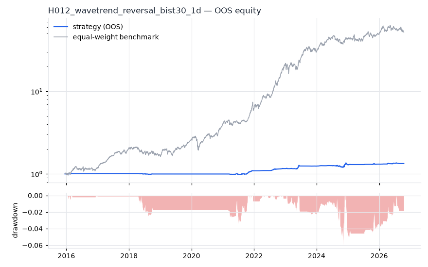
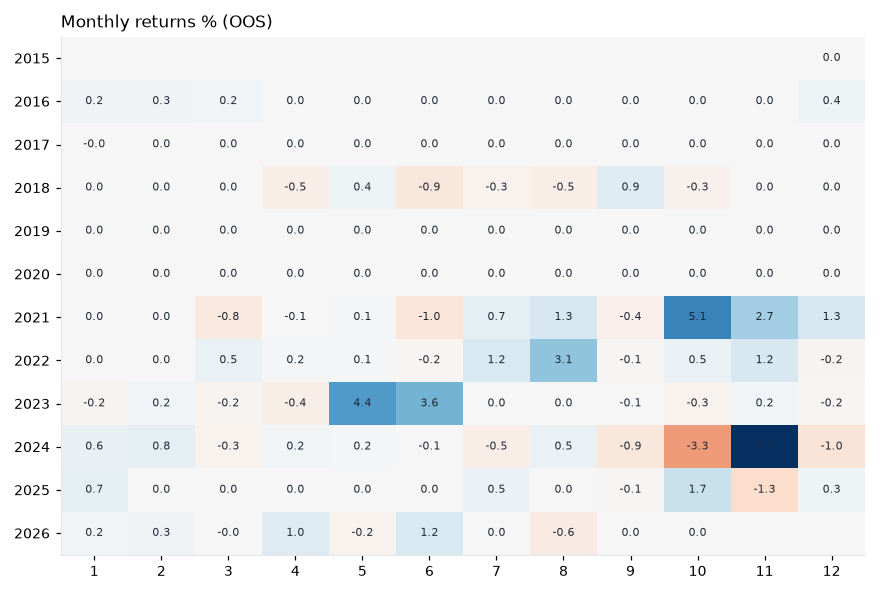
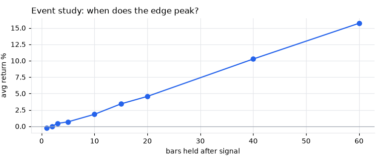
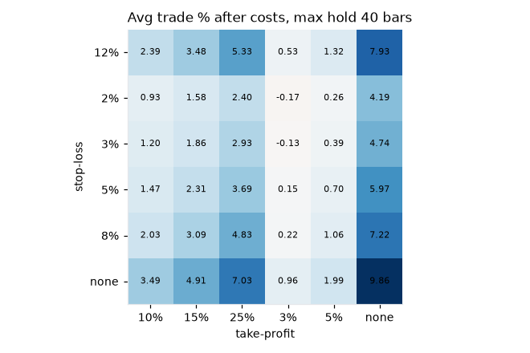

# H012 — wavetrend_reversal on bist30 [1d]  ❌ REJECT

- Kind: rule · Source: LazyBear WaveTrend (ATVS)
- For system: `bist_orderflow_quant`
- Data: 2012-01-02 00:00:00 → 2026-10-16 00:00:00 · 29 assets · 256.1 bars/year · survivorship mask: False
- Costs: {'commission': 0.001, 'slippage': 0.001, 'funding_annual': 0.0, 'borrow_annual': 0.0}
- Variants tried (DSR trials): 234 (failed: 0)
- Final variant: `wavetrend_reversal|n1=9,n2=26,lo=-40|f=trend_sma200|x=trail_atr=3.0,use_signal_exit=False|size=atr_risk0.005`

## Verdict reasons
- DSR 0.787 < 0.9 (luck not excluded after 234 trials)
- OOS Sharpe (USD, excess of US T-bill) -1.358 < 0.5
- OOS MaxDD -0.9253 worse than -0.45 (local or USD)
- with 2x costs it does not beat the equal-weight benchmark
- PBO 0.604 > 0.5 (variant selection is overfit)
- Reality Check p 1.0 > 0.1 (best variant may be data-mined)

## Walk-forward out-of-sample


| Metric | Strategy | Equal-weight benchmark |
|---|---|---|
| years | 10.76 | 10.76 |
| cagr | 0.0272 | 0.4437 |
| vol | 0.031 | 0.2642 |
| sharpe | 0.882 | 1.523 |
| sharpe_excess_rf | 0.171 | None |
| sortino | 0.285 | 2.248 |
| max_dd | -0.0603 | -0.3222 |
| max_dd_bars | 863 | 371 |
| calmar | 0.452 | 1.377 |
| ulcer | 0.0195 | 0.0851 |
| var95 | -0.0016 | -0.024 |
| cvar95 | -0.0041 | -0.0377 |
| omega | 1.374 | 1.312 |
| tail_ratio | 1.54 | 1.09 |
| skew | 3.296 | -0.051 |
| kurtosis | 55.726 | 9.059 |
| hit_rate | 0.214 | 0.539 |
| turnover_ann | 0.99 | None |

- **Gate Sharpe (USD, excess of US T-bill): -1.358**
- Deflated Sharpe: **0.787** · PBO: **0.604** · Reality Check p: **1.0**
- PSR 0.999 · Info ratio -1.474 · Beta 0.043 · Up/Down capture 0.052/0.047
- Sharpe with 2× costs: 0.816 · Walk-forward efficiency: 0.532
- Bootstrap: {'p_sharpe_pos': 0.997, 'cagr_p05': 0.0091, 'maxdd_p05': -0.0957}
- Yearly OOS Sharpe: {'2016': 1.2, '2017': -1.19, '2018': -0.56, '2019': 0.0, '2020': 0.0, '2021': 2.63, '2022': 3.47, '2023': 1.54, '2024': 0.54, '2025': 0.73, '2026': 0.93}
- In USD: CAGR -0.2094 · Sharpe -1.233 · excess-rf Sharpe -1.358 · MaxDD -0.9253



## Regimes (where does it work?)
`{"bull": {"sharpe": 1.18, "ann_ret": 0.0322, "bars": 2075}, "bear": {"sharpe": 0.31, "ann_ret": 0.0127, "bars": 680}, "calm": {"sharpe": 0.56, "ann_ret": 0.0144, "bars": 1450}, "stressed": {"sharpe": 1.16, "ann_ret": 0.0418, "bars": 1305}, "vix_lt_20": {"sharpe": 1.16, "ann_ret": 0.0407, "bars": 1931}, "vix_20_30": {"sharpe": -0.39, "ann_ret": -0.008, "bars": 671}, "vix_ge_30": {"sharpe": 1.97, "ann_ret": 0.0144, "bars": 153}, "curve_inverted": {"sharpe": 0.89, "ann_ret": 0.0423, "bars": 613}, "curve_normal": {"sharpe": 0.95, "ann_ret": 0.0231, "bars": 2142}}`

## Calendar profile (weekday / month / hour)
`{"weekday": {"0": 0.00017, "1": -7e-05, "2": 1e-05, "3": 0.00029, "4": 0.00013}, "month": {"1": 6e-05, "2": 7e-05, "3": -2e-05, "4": 1e-05, "5": 0.00022, "6": 0.00012, "7": 7e-05, "8": 0.00016, "9": -2e-05, "10": 0.00015, "11": 0.00048, "12": 3e-05}}`

## Trades (OOS)
`{"n_trades": 164, "trades_per_year": 15.2, "win_rate": 0.506, "avg_trade": 0.0702, "median_trade": 0.003, "avg_win": 0.197, "avg_loss": -0.0598, "profit_factor": 3.377, "payoff": 3.296, "expectancy_r": null, "sqn": null, "kelly_fraction": 0.356, "max_consec_losses": 8, "avg_bars": 22.3, "avg_bars_win": 33.4, "avg_bars_loss": 11.0, "avg_mfe": 0.186, "avg_mae": -0.0408, "edge_ratio": 4.561, "exit_reasons": {"stop": 164}, "long_short": {"1": {"count": 164, "mean": 0.0702}}}`

## Robustness
- **delay**: `{"sharpe": 1.076, "sharpe_delayed_1bar": 1.137, "retained": 1.057}`
- **neighbourhood**: `{"neighbours": 0}`
- **noise**: `{"noise_bp": 0.002, "sharpe_min": 0.787, "sharpe_median": 0.982}`
- **random_entry**: `{"actual_ret_per_exposure_ann": 0.6143, "random_median_ann": 0.3344, "random_p95_ann": 0.425, "trades_actual": 170, "p_value": 0.0}`
- **mc_trade_shuffle**: `{"maxdd_median": -0.034, "maxdd_p95": -0.0522, "final_p05": 1.1426, "final_median": 1.1426}`

## Timing, take-profit, stop-loss and profit studies (in-sample diagnostics)
- Event study (forward return by bars held): `{"1": {"n": 253, "mean": -0.0022, "hit": 0.451, "t": -1.54, "per_bar": -0.0022}, "2": {"n": 253, "mean": 0.0, "hit": 0.53, "t": 0.01, "per_bar": 2e-05}, "3": {"n": 253, "mean": 0.0044, "hit": 0.561, "t": 1.39, "per_bar": 0.00147}, "5": {"n": 253, "mean": 0.0068, "hit": 0.573, "t": 1.81, "per_bar": 0.00135}, "10": {"n": 253, "mean": 0.0183, "hit": 0.585, "t": 3.41, "per_bar": 0.00183}, "15": {"n": 253, "mean": 0.0342, "hit": 0.625, "t": 5.08, "per_bar": 0.00228}, "20": {"n": 253, "mean": 0.0456, "hit": 0.632, "t": 5.87, "per_bar": 0.00228}, "40": {"n": 253, "mean": 0.1026, "hit": 0.636, "t": 8.08, "per_bar": 0.00256}, "60": {"n": 252, "mean": 0.1571, "hit": 0.722, "t": 9.65, "per_bar": 0.00262}, "best_holding_bars": 60}`

- Best stop / target / max-hold combinations: `[{"stop": NaN, "target": 0.25, "max_hold": 40, "n": 253, "mean": 0.0703, "hit": 0.6364, "per_bar": 0.002, "t": 7.8273}, {"stop": NaN, "target": NaN, "max_hold": 40, "n": 253, "mean": 0.0986, "hit": 0.6364, "per_bar": 0.0025, "t": 7.78}, {"stop": NaN, "target": 0.15, "max_hold": 40, "n": 253, "mean": 0.0491, "hit": 0.6561, "per_bar": 0.0016, "t": 6.9503}, {"stop": 0.12, "target": NaN, "max_hold": 40, "n": 253, "mean": 0.0793, "hit": 0.5731, "per_bar": 0.0023, "t": 6.1871}, {"stop": NaN, "target": 0.1, "max_hold": 40, "n": 253, "mean": 0.0349, "hit": 0.7036, "per_bar": 0.0014, "t": 6.0841}]`

- Portfolio overlays (vol target, drawdown brake, equity-curve filter): `{"none": {"sharpe": 0.882, "cagr": 0.0272, "max_dd": -0.0603}, "vol_target_0.1": {"sharpe": 0.932, "cagr": 0.0465, "max_dd": -0.1011}, "vol_target_0.15": {"sharpe": 0.924, "cagr": 0.0522, "max_dd": -0.1144}, "vol_target_0.2": {"sharpe": 0.903, "cagr": 0.0539, "max_dd": -0.1183}, "dd_brake_0.1": {"sharpe": 0.882, "cagr": 0.0272, "max_dd": -0.0603}, "dd_brake_0.2": {"sharpe": 0.882, "cagr": 0.0272, "max_dd": -0.0603}, "equity_ma_42": {"sharpe": 0.795, "cagr": 0.0197, "max_dd": -0.0525}, "equity_ma_128": {"sharpe": 0.867, "cagr": 0.021, "max_dd": -0.0525}, "best_by_calmar": "vol_target_0.1"}`
> Studies are in-sample diagnostics. To use a better exit, register it (exits: [...]) and let the gate judge it.

## Walk-forward windows
- 2020-11-26 00:00:00 → 2021-05-31 00:00:00: IS 1.557 / OOS -1.573 — `wavetrend_reversal|n1=9,n2=26,lo=-53|f=trend_sma200|x=signal_only`
- 2021-06-01 00:00:00 → 2021-12-06 00:00:00: IS 1.244 / OOS 4.062 — `wavetrend_reversal|n1=9,n2=26,lo=-40|f=volume_confirm|x=trail_atr=3.0,use_signal_exit=False`
- 2021-12-07 00:00:00 → 2022-06-08 00:00:00: IS 2.218 / OOS 2.019 — `wavetrend_reversal|n1=9,n2=26,lo=-40|f=volume_confirm|x=trail_atr=3.0,use_signal_exit=False|size=vol0.1`
- 2022-06-09 00:00:00 → 2022-12-09 00:00:00: IS 2.442 / OOS 4.323 — `wavetrend_reversal|n1=9,n2=26,lo=-40|f=volume_confirm|x=trail_atr=3.0,use_signal_exit=False`
- 2022-12-12 00:00:00 → 2023-06-16 00:00:00: IS 2.542 / OOS 2.306 — `wavetrend_reversal|n1=9,n2=26,lo=-40|f=volume_confirm|x=trail_atr=3.0,use_signal_exit=False`
- 2023-06-19 00:00:00 → 2023-12-19 00:00:00: IS 2.571 / OOS -2.041 — `wavetrend_reversal|n1=9,n2=26,lo=-40|f=volume_confirm|x=trail_atr=3.0,use_signal_exit=False|size=vol0.1`
- 2023-12-20 00:00:00 → 2024-06-27 00:00:00: IS 2.374 / OOS 2.744 — `wavetrend_reversal|n1=9,n2=26,lo=-40|f=volume_confirm|x=trail_atr=3.0,use_signal_exit=False|size=vol0.1`
- 2024-06-28 00:00:00 → 2024-12-27 00:00:00: IS 2.805 / OOS 0.706 — `wavetrend_reversal|n1=9,n2=26,lo=-40|f=volume_confirm|x=trail_atr=3.0,use_signal_exit=False|size=atr_risk0.005`
- 2024-12-30 00:00:00 → 2025-07-07 00:00:00: IS 2.289 / OOS -0.345 — `wavetrend_reversal|n1=9,n2=26,lo=-40|f=trend_sma200|x=trail_atr=3.0,use_signal_exit=False|size=atr_risk0.01|overlay=eqma_s`
- 2025-07-08 00:00:00 → 2026-01-06 00:00:00: IS 1.776 / OOS 0.746 — `wavetrend_reversal|n1=9,n2=26,lo=-40|f=volume_confirm|x=max_hold=20`
- 2026-01-07 00:00:00 → 2026-07-14 00:00:00: IS 1.598 / OOS 1.923 — `wavetrend_reversal|n1=9,n2=26,lo=-40|f=volume_confirm|x=max_hold=20`
- 2026-07-16 00:00:00 → 2026-10-16 00:00:00: IS 1.756 / OOS -0.767 — `wavetrend_reversal|n1=9,n2=26,lo=-40|f=trend_sma200|x=trail_atr=3.0,use_signal_exit=False|size=atr_risk0.005`

## Best variants (full sample, reference only)
- wavetrend_reversal|n1=9,n2=26,lo=-40|f=trend_sma200|x=trail_atr=3.0,use_signal_exit=False|size=atr_risk0.005|overlay=eqma_s: Sharpe 1.051
- wavetrend_reversal|n1=9,n2=26,lo=-40|f=trend_sma200|x=trail_atr=3.0,use_signal_exit=False|size=atr_risk0.01: Sharpe 1.043
- wavetrend_reversal|n1=9,n2=26,lo=-40|f=trend_sma200|x=trail_atr=3.0,use_signal_exit=False|size=atr_risk0.01|overlay=dd20: Sharpe 1.043
- wavetrend_reversal|n1=9,n2=26,lo=-40|f=trend_sma200|x=trail_atr=3.0,use_signal_exit=False|size=atr_risk0.005: Sharpe 1.041
- wavetrend_reversal|n1=9,n2=26,lo=-40|f=trend_sma200|x=trail_atr=3.0,use_signal_exit=False|size=atr_risk0.005|overlay=vt20: Sharpe 1.041
- wavetrend_reversal|n1=9,n2=26,lo=-40|f=trend_sma200|x=trail_atr=3.0,use_signal_exit=False|size=atr_risk0.005|overlay=dd20: Sharpe 1.041
- wavetrend_reversal|n1=9,n2=26,lo=-40|f=trend_sma200|x=trail_atr=3.0,use_signal_exit=False|size=atr_risk0.005|overlay=vt15: Sharpe 1.041
- wavetrend_reversal|n1=9,n2=26,lo=-40|f=trend_sma200|x=trail_atr=3.0,use_signal_exit=False|size=atr_risk0.005|overlay=dd10: Sharpe 1.041
- wavetrend_reversal|n1=9,n2=26,lo=-40|f=trend_sma200|x=trail_atr=3.0,use_signal_exit=False|size=atr_risk0.01|overlay=eqma_s: Sharpe 1.04
- wavetrend_reversal|n1=9,n2=26,lo=-40|f=trend_sma200|x=trail_atr=3.0,use_signal_exit=False|size=atr_risk0.01|overlay=vt20: Sharpe 1.036

## Current targets / signals
```json
{
 "positions": {},
 "entry_long_next_open": [],
 "exit_long_next_open": [
  "EKGYO.IS",
  "YKBNK.IS"
 ],
 "entry_short_next_open": []
}
```

> Survivorship bias: unless a membership mask is used, universes are today's members (upper-bound results).