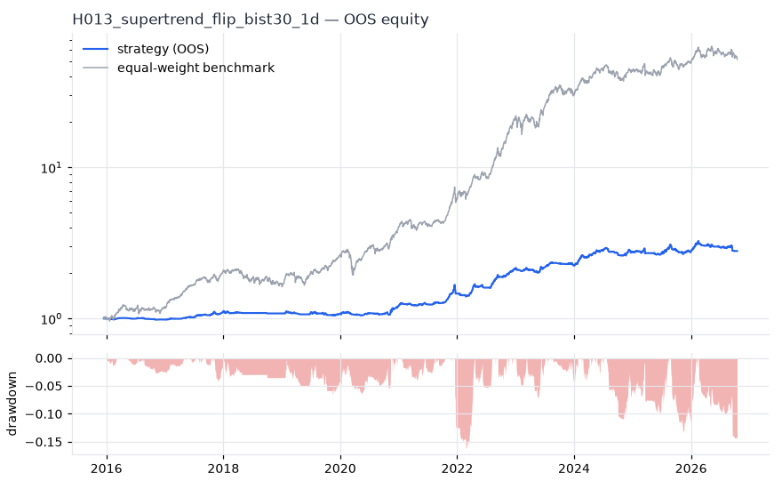
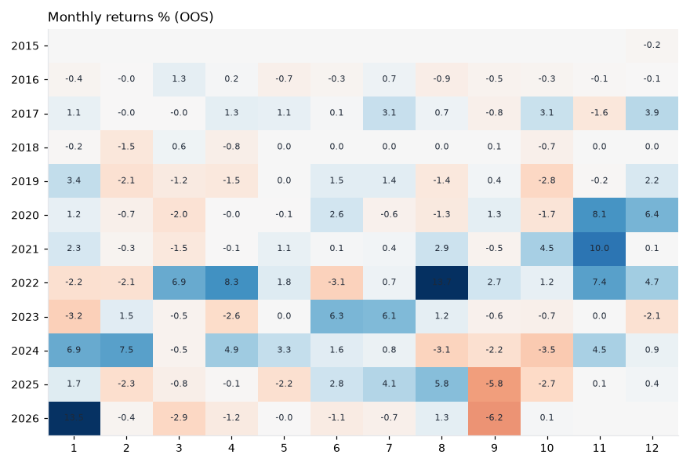
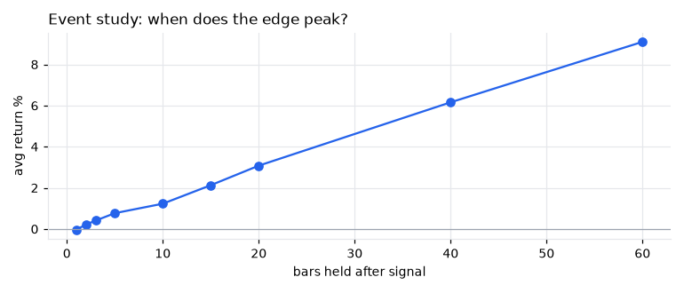
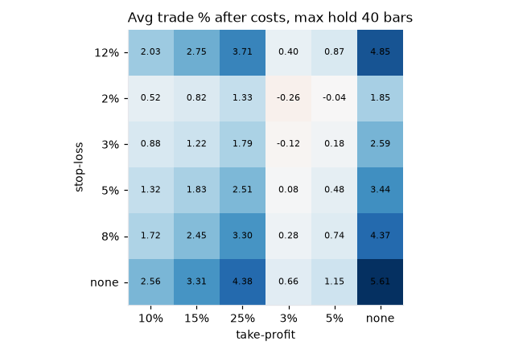

# H013 — supertrend_flip on bist30 [1d]  ❌ REJECT

- Kind: rule · Source: Supertrend (ATR bands)
- For system: `bist_orderflow_quant`
- Data: 2012-01-02 00:00:00 → 2026-10-16 00:00:00 · 29 assets · 256.1 bars/year · survivorship mask: False
- Costs: {'commission': 0.001, 'slippage': 0.001, 'funding_annual': 0.0, 'borrow_annual': 0.0}
- Variants tried (DSR trials): 168 (failed: 0)
- Final variant: `supertrend_flip|cfg=(10, 3.0)|f=none|x=max_hold=40`

## Verdict reasons
- OOS Sharpe (USD, excess of US T-bill) -0.884 < 0.5
- OOS MaxDD -0.8434 worse than -0.45 (local or USD)
- with 2x costs it does not beat the equal-weight benchmark
- Reality Check p 1.0 > 0.1 (best variant may be data-mined)

## Walk-forward out-of-sample


| Metric | Strategy | Equal-weight benchmark |
|---|---|---|
| years | 10.76 | 10.76 |
| cagr | 0.1003 | 0.4437 |
| vol | 0.0877 | 0.2642 |
| sharpe | 1.134 | 1.523 |
| sharpe_excess_rf | 0.883 | None |
| sortino | 1.269 | 2.248 |
| max_dd | -0.1637 | -0.3222 |
| max_dd_bars | 734 | 371 |
| calmar | 0.613 | 1.377 |
| ulcer | 0.0493 | 0.0851 |
| var95 | -0.0071 | -0.024 |
| cvar95 | -0.0126 | -0.0377 |
| omega | 1.289 | 1.312 |
| tail_ratio | 1.24 | 1.09 |
| skew | -1.132 | -0.051 |
| kurtosis | 22.189 | 9.059 |
| hit_rate | 0.446 | 0.539 |
| turnover_ann | 6.1 | None |

- **Gate Sharpe (USD, excess of US T-bill): -0.884**
- Deflated Sharpe: **0.901** · PBO: **0.281** · Reality Check p: **1.0**
- PSR 1.0 · Info ratio -1.4 · Beta 0.22 · Up/Down capture 0.244/0.242
- Sharpe with 2× costs: 0.992 · Walk-forward efficiency: 0.689
- Bootstrap: {'p_sharpe_pos': 0.999, 'cagr_p05': 0.0425, 'maxdd_p05': -0.2678}
- Yearly OOS Sharpe: {'2016': -0.53, '2017': 2.47, '2018': -0.69, '2019': -0.05, '2020': 1.52, '2021': 1.69, '2022': 3.6, '2023': 0.62, '2024': 2.05, '2025': 0.08, '2026': 0.21}
- In USD: CAGR -0.1531 · Sharpe -0.769 · excess-rf Sharpe -0.884 · MaxDD -0.8434



## Regimes (where does it work?)
`{"bull": {"sharpe": 1.72, "ann_ret": 0.1621, "bars": 2075}, "bear": {"sharpe": -1.49, "ann_ret": -0.0916, "bars": 680}, "calm": {"sharpe": 2.06, "ann_ret": 0.1599, "bars": 1450}, "stressed": {"sharpe": 0.33, "ann_ret": 0.0323, "bars": 1305}, "vix_lt_20": {"sharpe": 1.28, "ann_ret": 0.1048, "bars": 1931}, "vix_20_30": {"sharpe": 1.35, "ann_ret": 0.1429, "bars": 671}, "vix_ge_30": {"sharpe": -2.36, "ann_ret": -0.1579, "bars": 153}, "curve_inverted": {"sharpe": 1.38, "ann_ret": 0.1261, "bars": 613}, "curve_normal": {"sharpe": 1.06, "ann_ret": 0.0919, "bars": 2142}}`

## Calendar profile (weekday / month / hour)
`{"weekday": {"0": 0.00083, "1": -0.0003, "2": 0.00011, "3": 0.00107, "4": 0.00022}, "month": {"1": 0.00097, "2": -2e-05, "3": -2e-05, "4": 0.00036, "5": 0.00019, "6": 0.00046, "7": 0.00069, "8": 0.00076, "9": -0.00051, "10": -0.00017, "11": 0.00128, "12": 0.00071}}`

## Trades (OOS)
`{"n_trades": 997, "trades_per_year": 92.7, "win_rate": 0.499, "avg_trade": 0.06, "median_trade": -0.0, "avg_win": 0.1975, "avg_loss": -0.0772, "profit_factor": 2.554, "payoff": 2.559, "expectancy_r": null, "sqn": null, "kelly_fraction": 0.304, "max_consec_losses": 19, "avg_bars": 27.4, "avg_bars_win": 36.5, "avg_bars_loss": 18.3, "avg_mfe": 0.176, "avg_mae": -0.0642, "edge_ratio": 2.742, "exit_reasons": {"signal": 614, "time": 383}, "long_short": {"1": {"count": 997, "mean": 0.06}}}`

## Robustness
- **delay**: `{"sharpe": 1.26, "sharpe_delayed_1bar": 1.258, "retained": 0.999}`
- **neighbourhood**: `{"neighbours": 2, "best_sharpe": 1.258, "neighbour_median": 1.233, "share_positive": 1.0, "stability": 0.98}`
- **noise**: `{"noise_bp": 0.002, "sharpe_min": 1.239, "sharpe_median": 1.257}`
- **random_entry**: `{"actual_ret_per_exposure_ann": 0.42, "random_median_ann": 0.3375, "random_p95_ann": 0.3743, "trades_actual": 1167, "p_value": 0.0}`
- **mc_trade_shuffle**: `{"maxdd_median": -0.0357, "maxdd_p95": -0.0532, "final_p05": 7.6707, "final_median": 7.6707}`

## Timing, take-profit, stop-loss and profit studies (in-sample diagnostics)
- Event study (forward return by bars held): `{"1": {"n": 1646, "mean": -0.0003, "hit": 0.394, "t": -0.62, "per_bar": -0.00034}, "2": {"n": 1646, "mean": 0.0022, "hit": 0.491, "t": 2.74, "per_bar": 0.00112}, "3": {"n": 1646, "mean": 0.0041, "hit": 0.509, "t": 4.07, "per_bar": 0.00136}, "5": {"n": 1646, "mean": 0.0077, "hit": 0.535, "t": 5.73, "per_bar": 0.00155}, "10": {"n": 1646, "mean": 0.0123, "hit": 0.545, "t": 6.29, "per_bar": 0.00123}, "15": {"n": 1646, "mean": 0.0213, "hit": 0.569, "t": 9.04, "per_bar": 0.00142}, "20": {"n": 1645, "mean": 0.0308, "hit": 0.584, "t": 10.71, "per_bar": 0.00154}, "40": {"n": 1634, "mean": 0.0616, "hit": 0.611, "t": 14.38, "per_bar": 0.00154}, "60": {"n": 1627, "mean": 0.091, "hit": 0.628, "t": 16.54, "per_bar": 0.00152}, "best_holding_bars": 60}`

- Best stop / target / max-hold combinations: `[{"stop": NaN, "target": NaN, "max_hold": 40, "n": 1646, "mean": 0.0561, "hit": 0.5948, "per_bar": 0.0014, "t": 13.0972}, {"stop": NaN, "target": 0.25, "max_hold": 40, "n": 1646, "mean": 0.0438, "hit": 0.5978, "per_bar": 0.0012, "t": 12.8364}, {"stop": NaN, "target": 0.15, "max_hold": 40, "n": 1646, "mean": 0.0331, "hit": 0.6185, "per_bar": 0.001, "t": 11.5903}, {"stop": 0.12, "target": NaN, "max_hold": 40, "n": 1646, "mean": 0.0485, "hit": 0.5583, "per_bar": 0.0014, "t": 11.5743}, {"stop": 0.12, "target": 0.25, "max_hold": 40, "n": 1646, "mean": 0.0371, "hit": 0.5626, "per_bar": 0.0012, "t": 11.1694}]`

- Portfolio overlays (vol target, drawdown brake, equity-curve filter): `{"none": {"sharpe": 1.134, "cagr": 0.1003, "max_dd": -0.1637}, "vol_target_0.1": {"sharpe": 1.279, "cagr": 0.1362, "max_dd": -0.1296}, "vol_target_0.15": {"sharpe": 1.235, "cagr": 0.1769, "max_dd": -0.1883}, "vol_target_0.2": {"sharpe": 1.238, "cagr": 0.2065, "max_dd": -0.2362}, "dd_brake_0.1": {"sharpe": 1.124, "cagr": 0.0972, "max_dd": -0.1457}, "dd_brake_0.2": {"sharpe": 1.134, "cagr": 0.1003, "max_dd": -0.1637}, "equity_ma_42": {"sharpe": 1.259, "cagr": 0.1003, "max_dd": -0.1243}, "equity_ma_128": {"sharpe": 0.938, "cagr": 0.0741, "max_dd": -0.1637}, "best_by_calmar": "vol_target_0.1"}`
> Studies are in-sample diagnostics. To use a better exit, register it (exits: [...]) and let the gate judge it.

## Walk-forward windows
- 2020-11-26 00:00:00 → 2021-05-31 00:00:00: IS 1.267 / OOS 1.629 — `supertrend_flip|cfg=(14, 3.0)|f=none|x=trail_atr=3.0`
- 2021-06-01 00:00:00 → 2021-12-06 00:00:00: IS 1.364 / OOS 5.261 — `supertrend_flip|cfg=(10, 3.0)|f=none|x=trail_atr=3.0`
- 2021-12-07 00:00:00 → 2022-06-08 00:00:00: IS 2.514 / OOS 1.081 — `supertrend_flip|cfg=(10, 3.0)|f=none|x=ma_exit=20`
- 2022-06-09 00:00:00 → 2022-12-09 00:00:00: IS 2.427 / OOS 4.484 — `supertrend_flip|cfg=(10, 3.0)|f=none|x=trail_atr=3.0`
- 2022-12-12 00:00:00 → 2023-06-16 00:00:00: IS 3.007 / OOS 1.026 — `supertrend_flip|cfg=(10, 3.0)|f=none|x=trail_pct=0.15|overlay=vt10`
- 2023-06-19 00:00:00 → 2023-12-19 00:00:00: IS 2.946 / OOS 2.042 — `supertrend_flip|cfg=(10, 3.0)|f=none|x=trail_pct=0.1|overlay=vt10`
- 2023-12-20 00:00:00 → 2024-06-27 00:00:00: IS 2.953 / OOS 3.843 — `supertrend_flip|cfg=(10, 3.0)|f=none|x=trail_pct=0.15|overlay=vt10`
- 2024-06-28 00:00:00 → 2024-12-27 00:00:00: IS 3.336 / OOS -0.444 — `supertrend_flip|cfg=(10, 3.0)|f=none|x=trail_pct=0.15|overlay=vt10`
- 2024-12-30 00:00:00 → 2025-07-07 00:00:00: IS 2.498 / OOS -0.305 — `supertrend_flip|cfg=(10, 3.0)|f=none|x=trail_pct=0.1|overlay=vt10`
- 2025-07-08 00:00:00 → 2026-01-06 00:00:00: IS 2.192 / OOS 0.902 — `supertrend_flip|cfg=(14, 3.0)|f=none|x=trail_pct=0.15`
- 2026-01-07 00:00:00 → 2026-07-14 00:00:00: IS 1.435 / OOS 0.619 — `supertrend_flip|cfg=(10, 3.0)|f=none|x=trail_pct=0.1`
- 2026-07-16 00:00:00 → 2026-10-16 00:00:00: IS 1.338 / OOS -1.706 — `supertrend_flip|cfg=(10, 3.0)|f=none|x=max_hold=40`

## Best variants (full sample, reference only)
- supertrend_flip|cfg=(10, 3.0)|f=none|x=trail_pct=0.1|overlay=vt10: Sharpe 1.351
- supertrend_flip|cfg=(10, 3.0)|f=none|x=trail_pct=0.1|overlay=vt15: Sharpe 1.329
- supertrend_flip|cfg=(10, 3.0)|f=none|x=trail_pct=0.1|overlay=vt20: Sharpe 1.32
- supertrend_flip|cfg=(10, 3.0)|f=none|x=trail_pct=0.1: Sharpe 1.319
- supertrend_flip|cfg=(10, 3.0)|f=none|x=trail_pct=0.1|overlay=dd20: Sharpe 1.319
- supertrend_flip|cfg=(10, 3.0)|f=none|x=trail_pct=0.1|overlay=dd10: Sharpe 1.311
- supertrend_flip|cfg=(10, 3.0)|f=none|x=trail_pct=0.15|overlay=vt10: Sharpe 1.307
- supertrend_flip|cfg=(10, 3.0)|f=none|x=trail_pct=0.15: Sharpe 1.302
- supertrend_flip|cfg=(10, 3.0)|f=none|x=trail_pct=0.15|overlay=dd20: Sharpe 1.302
- supertrend_flip|cfg=(10, 3.0)|f=none|x=trail_pct=0.15|overlay=vt15: Sharpe 1.302

## Current targets / signals
```json
{
 "positions": {
  "TAVHL.IS": 0.0345
 },
 "entry_long_next_open": [],
 "exit_long_next_open": [],
 "entry_short_next_open": []
}
```

> Survivorship bias: unless a membership mask is used, universes are today's members (upper-bound results).