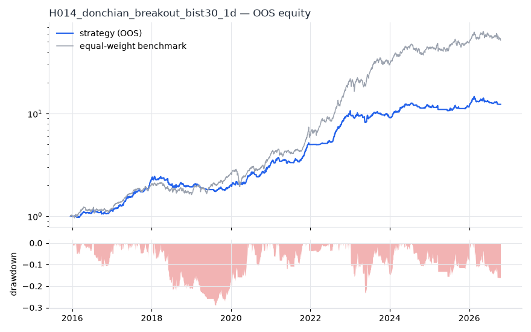
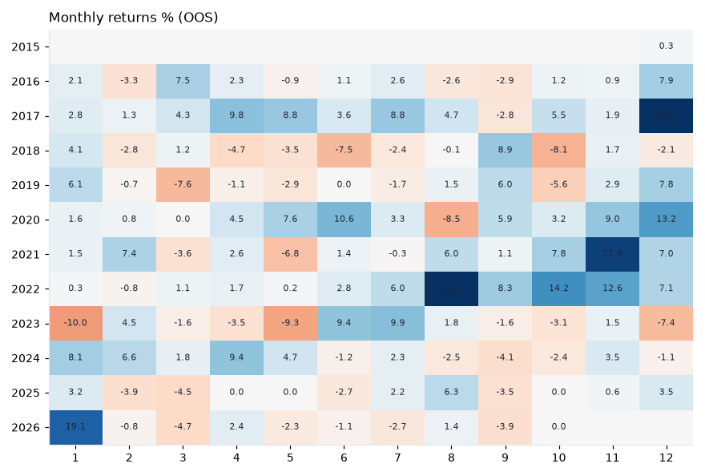
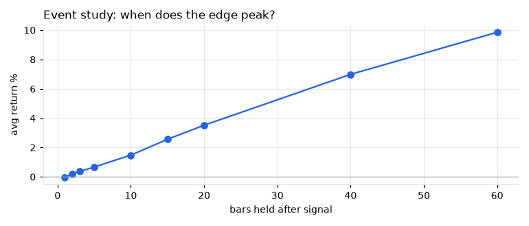
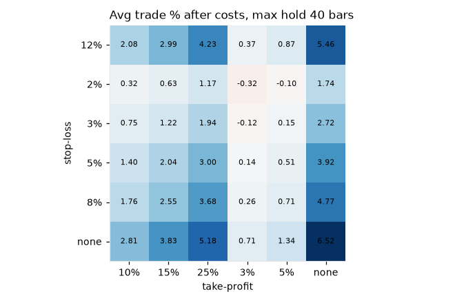

# H014 — donchian_breakout on bist30 [1d]  ❌ REJECT

- Kind: rule · Source: Turtle / Donchian
- For system: `bist_orderflow_quant`
- Data: 2012-01-02 00:00:00 → 2026-10-16 00:00:00 · 29 assets · 256.1 bars/year · survivorship mask: False
- Costs: {'commission': 0.001, 'slippage': 0.001, 'funding_annual': 0.0, 'borrow_annual': 0.0}
- Variants tried (DSR trials): 177 (failed: 0)
- Final variant: `donchian_breakout|entry=20,exit=20|f=volume_confirm|x=trail_atr=4.0`

## Verdict reasons
- OOS Sharpe (USD, excess of US T-bill) -0.103 < 0.5
- OOS MaxDD -0.6184 worse than -0.45 (local or USD)
- with 2x costs it does not beat the equal-weight benchmark
- Reality Check p 0.954 > 0.1 (best variant may be data-mined)

## Walk-forward out-of-sample


| Metric | Strategy | Equal-weight benchmark |
|---|---|---|
| years | 10.76 | 10.76 |
| cagr | 0.2632 | 0.4437 |
| vol | 0.1571 | 0.2642 |
| sharpe | 1.566 | 1.523 |
| sharpe_excess_rf | 1.425 | None |
| sortino | 2.125 | 2.248 |
| max_dd | -0.2886 | -0.3222 |
| max_dd_bars | 603 | 371 |
| calmar | 0.912 | 1.377 |
| ulcer | 0.1112 | 0.0851 |
| var95 | -0.0136 | -0.024 |
| cvar95 | -0.0228 | -0.0377 |
| omega | 1.364 | 1.312 |
| tail_ratio | 1.262 | 1.09 |
| skew | -0.379 | -0.051 |
| kurtosis | 6.665 | 9.059 |
| hit_rate | 0.466 | 0.539 |
| turnover_ann | 14.58 | None |

- **Gate Sharpe (USD, excess of US T-bill): -0.103**
- Deflated Sharpe: **0.999** · PBO: **0.326** · Reality Check p: **0.954**
- PSR 1.0 · Info ratio -0.745 · Beta 0.362 · Up/Down capture 0.449/0.399
- Sharpe with 2× costs: 1.37 · Walk-forward efficiency: 0.82
- Bootstrap: {'p_sharpe_pos': 1.0, 'cagr_p05': 0.128, 'maxdd_p05': -0.3823}
- Yearly OOS Sharpe: {'2016': 1.2, '2017': 4.27, '2018': -0.81, '2019': 0.4, '2020': 2.67, '2021': 2.87, '2022': 5.01, '2023': -0.48, '2024': 1.93, '2025': 0.12, '2026': 0.56}
- In USD: CAGR -0.0278 · Sharpe -0.008 · excess-rf Sharpe -0.103 · MaxDD -0.6184



## Regimes (where does it work?)
`{"bull": {"sharpe": 2.32, "ann_ret": 0.3728, "bars": 2075}, "bear": {"sharpe": -0.99, "ann_ret": -0.1405, "bars": 680}, "calm": {"sharpe": 2.53, "ann_ret": 0.3565, "bars": 1450}, "stressed": {"sharpe": 0.71, "ann_ret": 0.1235, "bars": 1305}, "vix_lt_20": {"sharpe": 1.51, "ann_ret": 0.2341, "bars": 1931}, "vix_20_30": {"sharpe": 1.9, "ann_ret": 0.3146, "bars": 671}, "vix_ge_30": {"sharpe": 0.7, "ann_ret": 0.0967, "bars": 153}, "curve_inverted": {"sharpe": 0.64, "ann_ret": 0.1089, "bars": 613}, "curve_normal": {"sharpe": 1.86, "ann_ret": 0.2854, "bars": 2142}}`

## Calendar profile (weekday / month / hour)
`{"weekday": {"0": 0.0016, "1": 0.00025, "2": 0.00044, "3": 0.00158, "4": 0.00093}, "month": {"1": 0.00156, "2": 0.00039, "3": -0.00024, "4": 0.00102, "5": -0.0002, "6": 0.0007, "7": 0.00122, "8": 0.00122, "9": 0.00047, "10": 0.00049, "11": 0.00252, "12": 0.00242}}`

## Trades (OOS)
`{"n_trades": 987, "trades_per_year": 91.8, "win_rate": 0.511, "avg_trade": 0.0787, "median_trade": 0.0029, "avg_win": 0.219, "avg_loss": -0.0678, "profit_factor": 3.372, "payoff": 3.231, "expectancy_r": null, "sqn": null, "kelly_fraction": 0.359, "max_consec_losses": 13, "avg_bars": 31.5, "avg_bars_win": 46.7, "avg_bars_loss": 15.5, "avg_mfe": 0.2305, "avg_mae": -0.0436, "edge_ratio": 5.283, "exit_reasons": {"stop": 881, "signal": 106}, "long_short": {"1": {"count": 987, "mean": 0.0787}}}`

## Robustness
- **delay**: `{"sharpe": 1.378, "sharpe_delayed_1bar": 1.267, "retained": 0.92}`
- **neighbourhood**: `{"neighbours": 1, "best_sharpe": 1.374, "neighbour_median": 1.343, "share_positive": 1.0, "stability": 0.978}`
- **noise**: `{"noise_bp": 0.002, "sharpe_min": 1.334, "sharpe_median": 1.374}`
- **random_entry**: `{"actual_ret_per_exposure_ann": 0.4621, "random_median_ann": 0.3541, "random_p95_ann": 0.374, "trades_actual": 1151, "p_value": 0.0}`
- **mc_trade_shuffle**: `{"maxdd_median": -0.0336, "maxdd_p95": -0.0487, "final_p05": 13.9135, "final_median": 13.9135}`

## Timing, take-profit, stop-loss and profit studies (in-sample diagnostics)
- Event study (forward return by bars held): `{"1": {"n": 6727, "mean": -0.0002, "hit": 0.395, "t": -0.62, "per_bar": -0.00018}, "2": {"n": 6727, "mean": 0.0019, "hit": 0.491, "t": 4.31, "per_bar": 0.00096}, "3": {"n": 6727, "mean": 0.0036, "hit": 0.523, "t": 6.31, "per_bar": 0.00119}, "5": {"n": 6727, "mean": 0.0067, "hit": 0.533, "t": 8.96, "per_bar": 0.00135}, "10": {"n": 6727, "mean": 0.0148, "hit": 0.553, "t": 13.83, "per_bar": 0.00148}, "15": {"n": 6727, "mean": 0.0256, "hit": 0.58, "t": 19.58, "per_bar": 0.0017}, "20": {"n": 6727, "mean": 0.0352, "hit": 0.589, "t": 23.23, "per_bar": 0.00176}, "40": {"n": 6705, "mean": 0.0699, "hit": 0.617, "t": 30.01, "per_bar": 0.00175}, "60": {"n": 6685, "mean": 0.0986, "hit": 0.631, "t": 33.55, "per_bar": 0.00164}, "best_holding_bars": 60}`

- Best stop / target / max-hold combinations: `[{"stop": NaN, "target": 0.25, "max_hold": 40, "n": 6727, "mean": 0.0518, "hit": 0.6129, "per_bar": 0.0014, "t": 29.5638}, {"stop": NaN, "target": NaN, "max_hold": 40, "n": 6727, "mean": 0.0652, "hit": 0.6062, "per_bar": 0.0016, "t": 28.0258}, {"stop": NaN, "target": 0.15, "max_hold": 40, "n": 6727, "mean": 0.0383, "hit": 0.6386, "per_bar": 0.0012, "t": 26.6878}, {"stop": 0.12, "target": 0.25, "max_hold": 40, "n": 6727, "mean": 0.0423, "hit": 0.567, "per_bar": 0.0014, "t": 24.6618}, {"stop": 0.12, "target": NaN, "max_hold": 40, "n": 6727, "mean": 0.0546, "hit": 0.5573, "per_bar": 0.0016, "t": 23.7617}]`

- Portfolio overlays (vol target, drawdown brake, equity-curve filter): `{"none": {"sharpe": 1.566, "cagr": 0.2632, "max_dd": -0.2886}, "vol_target_0.1": {"sharpe": 1.577, "cagr": 0.1845, "max_dd": -0.241}, "vol_target_0.15": {"sharpe": 1.576, "cagr": 0.2758, "max_dd": -0.3127}, "vol_target_0.2": {"sharpe": 1.552, "cagr": 0.3551, "max_dd": -0.3808}, "dd_brake_0.1": {"sharpe": 1.63, "cagr": 0.2414, "max_dd": -0.2164}, "dd_brake_0.2": {"sharpe": 1.536, "cagr": 0.2514, "max_dd": -0.3106}, "equity_ma_42": {"sharpe": 1.685, "cagr": 0.2451, "max_dd": -0.2065}, "equity_ma_128": {"sharpe": 1.672, "cagr": 0.247, "max_dd": -0.2014}, "best_by_calmar": "equity_ma_128"}`
> Studies are in-sample diagnostics. To use a better exit, register it (exits: [...]) and let the gate judge it.

## Walk-forward windows
- 2020-11-26 00:00:00 → 2021-05-31 00:00:00: IS 1.557 / OOS 1.289 — `donchian_breakout|entry=20,exit=10|f=volume_confirm|x=trail_atr=3.0,use_signal_exit=False|size=atr_risk0.01|overlay=eqma_l`
- 2021-06-01 00:00:00 → 2021-12-06 00:00:00: IS 1.407 / OOS 5.509 — `donchian_breakout|entry=20,exit=10|f=volume_confirm|x=trail_atr=3.0,use_signal_exit=False|size=atr_risk0.01|overlay=eqma_l`
- 2021-12-07 00:00:00 → 2022-06-08 00:00:00: IS 2.569 / OOS 1.364 — `donchian_breakout|entry=20,exit=10|f=volume_confirm|x=trail_atr=3.0,use_signal_exit=False|size=vol0.1`
- 2022-06-09 00:00:00 → 2022-12-09 00:00:00: IS 2.752 / OOS 7.106 — `donchian_breakout|entry=20,exit=20|f=volume_confirm|x=trail_atr=3.0|size=atr_risk0.01|overlay=vt15`
- 2022-12-12 00:00:00 → 2023-06-16 00:00:00: IS 3.596 / OOS -0.138 — `donchian_breakout|entry=20,exit=20|f=volume_confirm|x=trail_atr=3.0|size=atr_risk0.01`
- 2023-06-19 00:00:00 → 2023-12-19 00:00:00: IS 3.154 / OOS 0.605 — `donchian_breakout|entry=20,exit=20|f=volume_confirm|x=trail_atr=3.0|size=atr_risk0.01|overlay=vt15`
- 2023-12-20 00:00:00 → 2024-06-27 00:00:00: IS 2.778 / OOS 3.231 — `donchian_breakout|entry=20,exit=20|f=volume_confirm|x=trail_atr=3.0|size=atr_risk0.01|overlay=vt15`
- 2024-06-28 00:00:00 → 2024-12-27 00:00:00: IS 3.122 / OOS -0.371 — `donchian_breakout|entry=20,exit=20|f=volume_confirm|x=stop_pct=0.08,tp_pct=0.2`
- 2024-12-30 00:00:00 → 2025-07-07 00:00:00: IS 2.478 / OOS -1.323 — `donchian_breakout|entry=20,exit=20|f=volume_confirm|x=trail_atr=3.0|size=atr_risk0.01|overlay=eqma_s`
- 2025-07-08 00:00:00 → 2026-01-06 00:00:00: IS 2.222 / OOS 2.063 — `donchian_breakout|entry=20,exit=20|f=volume_confirm|x=trail_atr=3.0|size=atr_risk0.01|overlay=eqma_s`
- 2026-01-07 00:00:00 → 2026-07-14 00:00:00: IS 1.202 / OOS 0.387 — `donchian_breakout|entry=20,exit=20|f=volume_confirm|x=stop_pct=0.08`
- 2026-07-16 00:00:00 → 2026-10-16 00:00:00: IS 1.368 / OOS -1.538 — `donchian_breakout|entry=20,exit=20|f=volume_confirm|x=trail_atr=4.0`

## Best variants (full sample, reference only)
- donchian_breakout|entry=20,exit=20|f=volume_confirm|x=trail_atr=3.0|size=atr_risk0.01|overlay=dd10: Sharpe 1.532
- donchian_breakout|entry=20,exit=10|f=volume_confirm|x=trail_atr=3.0,use_signal_exit=False|size=atr_risk0.01|overlay=dd10: Sharpe 1.522
- donchian_breakout|entry=20,exit=20|f=volume_confirm|x=trail_atr=3.0|size=atr_risk0.01: Sharpe 1.508
- donchian_breakout|entry=20,exit=10|f=volume_confirm|x=trail_atr=3.0,use_signal_exit=False|size=atr_risk0.01: Sharpe 1.503
- donchian_breakout|entry=20,exit=20|f=volume_confirm|x=trail_atr=3.0|size=atr_risk0.01|overlay=dd20: Sharpe 1.486
- donchian_breakout|entry=20,exit=10|f=volume_confirm|x=trail_atr=3.0,use_signal_exit=False|size=atr_risk0.01|overlay=dd20: Sharpe 1.482
- donchian_breakout|entry=20,exit=20|f=volume_confirm|x=trail_atr=3.0|size=atr_risk0.01|overlay=vt20: Sharpe 1.475
- donchian_breakout|entry=20,exit=10|f=volume_confirm|x=trail_atr=3.0,use_signal_exit=False|size=atr_risk0.01|overlay=vt20: Sharpe 1.471
- donchian_breakout|entry=20,exit=20|f=volume_confirm|x=trail_atr=3.0|size=atr_risk0.01|overlay=vt15: Sharpe 1.468
- donchian_breakout|entry=20,exit=10|f=volume_confirm|x=trail_atr=3.0,use_signal_exit=False|size=atr_risk0.01|overlay=vt15: Sharpe 1.465

## Current targets / signals
```json
{
 "positions": {
  "TUPRS.IS": 0.0345
 },
 "entry_long_next_open": [],
 "exit_long_next_open": [
  "ARCLK.IS",
  "BIMAS.IS",
  "ENKAI.IS",
  "FROTO.IS",
  "GUBRF.IS",
  "KCHOL.IS",
  "KRDMD.IS",
  "SASA.IS",
  "SISE.IS",
  "THYAO.IS",
  "TTKOM.IS",
  "OYAKC.IS",
  "MGROS.IS",
  "PGSUS.IS"
 ],
 "entry_short_next_open": []
}
```

> Survivorship bias: unless a membership mask is used, universes are today's members (upper-bound results).