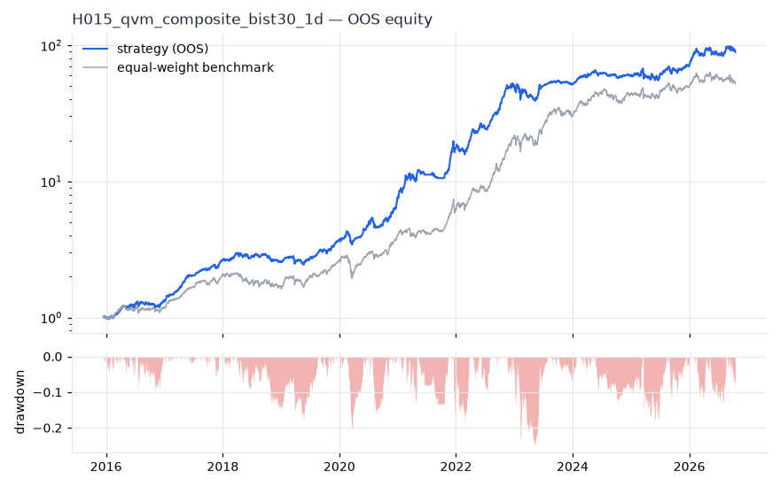
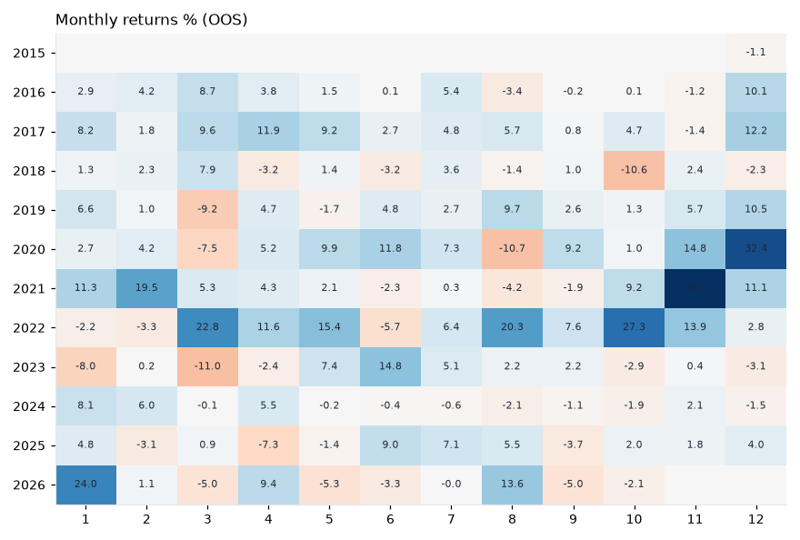

# H015 — qvm_composite on bist30 [1d]  🟡 WATCH

- Kind: strategy · Source: Asness, Moskowitz & Pedersen (2013) Value and Momentum Everywhere; AQR QMJ
- For system: `bist_orderflow_quant`
- Data: 2012-01-02 00:00:00 → 2026-10-16 00:00:00 · 29 assets · 256.1 bars/year · survivorship mask: False
- Costs: {'commission': 0.001, 'slippage': 0.001, 'funding_annual': 0.0, 'borrow_annual': 0.0}
- Variants tried (DSR trials): 32 (failed: 0)
- Final variant: `qvm_composite|top_n=5,w_value=0.5,w_mom=0.33`

## Verdict reasons
- OOS MaxDD -0.5041 worse than -0.45 (local or USD)

## Walk-forward out-of-sample


| Metric | Strategy | Equal-weight benchmark |
|---|---|---|
| years | 10.76 | 10.76 |
| cagr | 0.5181 | 0.4437 |
| vol | 0.2277 | 0.2642 |
| sharpe | 1.949 | 1.523 |
| sharpe_excess_rf | 1.851 | None |
| sortino | 2.833 | 2.248 |
| max_dd | -0.2554 | -0.3222 |
| max_dd_bars | 356 | 371 |
| calmar | 2.029 | 1.377 |
| ulcer | 0.0735 | 0.0851 |
| var95 | -0.0189 | -0.024 |
| cvar95 | -0.0311 | -0.0377 |
| omega | 1.434 | 1.312 |
| tail_ratio | 1.278 | 1.09 |
| skew | -0.175 | -0.051 |
| kurtosis | 6.308 | 9.059 |
| hit_rate | 0.547 | 0.539 |
| turnover_ann | 5.46 | None |

- **Gate Sharpe (USD, excess of US T-bill): 0.614**
- Deflated Sharpe: **1.0** · PBO: **0.183** · Reality Check p: **0.004**
- PSR 1.0 · Info ratio 0.258 · Beta 0.687 · Up/Down capture 0.741/0.628
- Sharpe with 2× costs: 1.902 · Walk-forward efficiency: 0.891
- Bootstrap: {'p_sharpe_pos': 1.0, 'cagr_p05': 0.327, 'maxdd_p05': -0.3646}
- Yearly OOS Sharpe: {'2016': 1.7, '2017': 5.23, '2018': -0.05, '2019': 2.36, '2020': 2.96, '2021': 2.74, '2022': 4.2, '2023': 0.23, '2024': 1.14, '2025': 0.85, '2026': 1.28}
- In USD: CAGR 0.1684 · Sharpe 0.692 · excess-rf Sharpe 0.614 · MaxDD -0.5041



## Regimes (where does it work?)
`{"bull": {"sharpe": 2.77, "ann_ret": 0.6509, "bars": 2075}, "bear": {"sharpe": -0.94, "ann_ret": -0.1884, "bars": 680}, "calm": {"sharpe": 2.87, "ann_ret": 0.5069, "bars": 1450}, "stressed": {"sharpe": 1.37, "ann_ret": 0.3736, "bars": 1305}, "vix_lt_20": {"sharpe": 2.03, "ann_ret": 0.4165, "bars": 1931}, "vix_20_30": {"sharpe": 2.03, "ann_ret": 0.554, "bars": 671}, "vix_ge_30": {"sharpe": 1.12, "ann_ret": 0.3039, "bars": 153}, "curve_inverted": {"sharpe": 0.56, "ann_ret": 0.125, "bars": 613}, "curve_normal": {"sharpe": 2.34, "ann_ret": 0.535, "bars": 2142}}`

## Calendar profile (weekday / month / hour)
`{"weekday": {"0": 0.00327, "1": 0.00092, "2": 0.00097, "3": 0.00179, "4": 0.0017}, "month": {"1": 0.00242, "2": 0.00161, "3": 0.00089, "4": 0.00192, "5": 0.00171, "6": 0.00123, "7": 0.00186, "8": 0.00137, "9": 0.00052, "10": 0.00111, "11": 0.00321, "12": 0.00307}}`

## Robustness
- **delay**: `{"sharpe": 1.666, "sharpe_delayed_1bar": 1.657, "retained": 0.995}`
- **neighbourhood**: `{"neighbours": 5, "best_sharpe": 1.607, "neighbour_median": 1.584, "share_positive": 1.0, "stability": 0.985}`
- **noise**: `{"noise_bp": 0.002, "sharpe_min": 1.638, "sharpe_median": 1.661}`

## Timing, take-profit, stop-loss and profit studies (in-sample diagnostics)
- Portfolio overlays (vol target, drawdown brake, equity-curve filter): `{"none": {"sharpe": 1.949, "cagr": 0.5181, "max_dd": -0.2554}, "vol_target_0.1": {"sharpe": 2.062, "cagr": 0.2484, "max_dd": -0.1363}, "vol_target_0.15": {"sharpe": 2.073, "cagr": 0.3877, "max_dd": -0.2017}, "vol_target_0.2": {"sharpe": 2.087, "cagr": 0.5383, "max_dd": -0.2639}, "dd_brake_0.1": {"sharpe": 1.938, "cagr": 0.4576, "max_dd": -0.2205}, "dd_brake_0.2": {"sharpe": 1.933, "cagr": 0.5043, "max_dd": -0.2655}, "equity_ma_42": {"sharpe": 1.97, "cagr": 0.4093, "max_dd": -0.1954}, "equity_ma_128": {"sharpe": 1.842, "cagr": 0.4373, "max_dd": -0.2374}, "best_by_calmar": "equity_ma_42"}`
> Studies are in-sample diagnostics. To use a better exit, register it (exits: [...]) and let the gate judge it.

## Walk-forward windows
- 2020-11-26 00:00:00 → 2021-05-31 00:00:00: IS 1.808 / OOS 3.745 — `qvm_composite|top_n=5,w_value=0.5,w_mom=0.5|overlay=dd10`
- 2021-06-01 00:00:00 → 2021-12-06 00:00:00: IS 2.156 / OOS 3.747 — `qvm_composite|top_n=5,w_value=0.33,w_mom=0.5|overlay=eqma_s`
- 2021-12-07 00:00:00 → 2022-06-08 00:00:00: IS 2.817 / OOS 2.638 — `qvm_composite|top_n=5,w_value=0.5,w_mom=0.5|overlay=dd10`
- 2022-06-09 00:00:00 → 2022-12-09 00:00:00: IS 3.092 / OOS 6.184 — `qvm_composite|top_n=5,w_value=0.5,w_mom=0.5|overlay=vt20`
- 2022-12-12 00:00:00 → 2023-06-16 00:00:00: IS 3.503 / OOS 0.217 — `qvm_composite|top_n=5,w_value=0.5,w_mom=0.5|overlay=dd10`
- 2023-06-19 00:00:00 → 2023-12-19 00:00:00: IS 3.249 / OOS 1.153 — `qvm_composite|top_n=5,w_value=0.5,w_mom=0.5|overlay=vt10`
- 2023-12-20 00:00:00 → 2024-06-27 00:00:00: IS 3.016 / OOS 2.517 — `qvm_composite|top_n=5,w_value=0.5,w_mom=0.5|overlay=vt15`
- 2024-06-28 00:00:00 → 2024-12-27 00:00:00: IS 2.811 / OOS -0.558 — `qvm_composite|top_n=5,w_value=0.33,w_mom=0.5|overlay=vt10`
- 2024-12-30 00:00:00 → 2025-07-07 00:00:00: IS 2.242 / OOS 0.248 — `qvm_composite|top_n=10,w_value=0.5,w_mom=0.33`
- 2025-07-08 00:00:00 → 2026-01-06 00:00:00: IS 1.948 / OOS 2.013 — `qvm_composite|top_n=10,w_value=0.2,w_mom=0.2`
- 2026-01-07 00:00:00 → 2026-07-14 00:00:00: IS 1.472 / OOS 0.998 — `qvm_composite|top_n=10,w_value=0.33,w_mom=0.2`
- 2026-07-16 00:00:00 → 2026-10-16 00:00:00: IS 1.498 / OOS 0.977 — `qvm_composite|top_n=5,w_value=0.5,w_mom=0.33`

## Best variants (full sample, reference only)
- qvm_composite|top_n=5,w_value=0.5,w_mom=0.5|overlay=vt20: Sharpe 1.82
- qvm_composite|top_n=5,w_value=0.5,w_mom=0.5|overlay=vt15: Sharpe 1.803
- qvm_composite|top_n=5,w_value=0.5,w_mom=0.5|overlay=vt10: Sharpe 1.801
- qvm_composite|top_n=5,w_value=0.5,w_mom=0.5: Sharpe 1.737
- qvm_composite|top_n=5,w_value=0.5,w_mom=0.5|overlay=dd20: Sharpe 1.722
- qvm_composite|top_n=5,w_value=0.33,w_mom=0.5|overlay=vt20: Sharpe 1.714
- qvm_composite|top_n=5,w_value=0.5,w_mom=0.5|overlay=dd10: Sharpe 1.708
- qvm_composite|top_n=5,w_value=0.33,w_mom=0.5|overlay=vt15: Sharpe 1.692
- qvm_composite|top_n=5,w_value=0.33,w_mom=0.5|overlay=vt10: Sharpe 1.681
- qvm_composite|top_n=5,w_value=0.33,w_mom=0.5: Sharpe 1.642

## Current targets / signals
```json
{
 "ASELS.IS": 0.2,
 "BIMAS.IS": 0.2,
 "KRDMD.IS": 0.2,
 "THYAO.IS": 0.2,
 "TUPRS.IS": 0.2
}
```

> Survivorship bias: unless a membership mask is used, universes are today's members (upper-bound results).