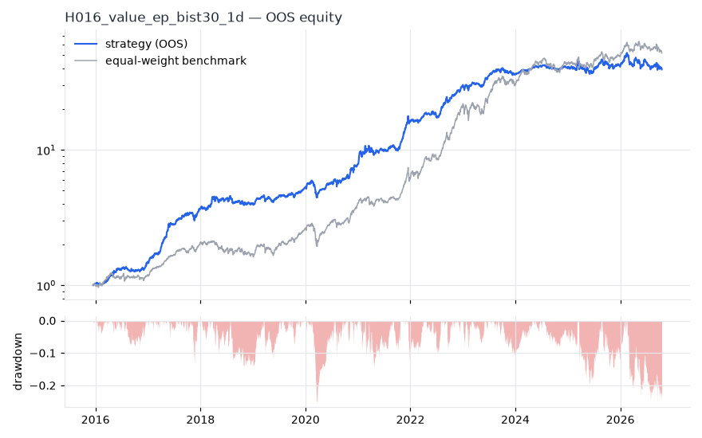
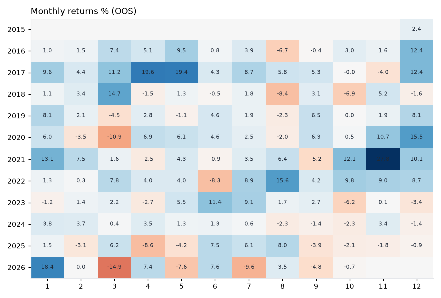

# H016 — value_ep on bist30 [1d]  🟡 WATCH

- Kind: strategy · Source: Basu (1977) earnings yield
- For system: `bist_shock_quant`
- Data: 2012-01-02 00:00:00 → 2026-10-16 00:00:00 · 29 assets · 256.1 bars/year · survivorship mask: False
- Costs: {'commission': 0.001, 'slippage': 0.001, 'funding_annual': 0.0, 'borrow_annual': 0.0}
- Variants tried (DSR trials): 20 (failed: 0)
- Final variant: `value_ep|top_n=10,freq=ME`

## Verdict reasons
- OOS Sharpe (USD, excess of US T-bill) 0.346 < 0.5
- OOS MaxDD -0.5236 worse than -0.45 (local or USD)

## Walk-forward out-of-sample


| Metric | Strategy | Equal-weight benchmark |
|---|---|---|
| years | 10.76 | 10.76 |
| cagr | 0.4068 | 0.4437 |
| vol | 0.2226 | 0.2642 |
| sharpe | 1.646 | 1.523 |
| sharpe_excess_rf | 1.546 | None |
| sortino | 2.374 | 2.248 |
| max_dd | -0.253 | -0.3222 |
| max_dd_bars | 166 | 371 |
| calmar | 1.608 | 1.377 |
| ulcer | 0.0732 | 0.0851 |
| var95 | -0.0195 | -0.024 |
| cvar95 | -0.0303 | -0.0377 |
| omega | 1.342 | 1.312 |
| tail_ratio | 1.172 | 1.09 |
| skew | 0.018 | -0.051 |
| kurtosis | 4.611 | 9.059 |
| hit_rate | 0.538 | 0.539 |
| turnover_ann | 2.39 | None |

- **Gate Sharpe (USD, excess of US T-bill): 0.346**
- Deflated Sharpe: **1.0** · PBO: **0.364** · Reality Check p: **0.014**
- PSR 1.0 · Info ratio -0.216 · Beta 0.655 · Up/Down capture 0.714/0.653
- Sharpe with 2× costs: 1.625 · Walk-forward efficiency: 0.791
- Bootstrap: {'p_sharpe_pos': 1.0, 'cagr_p05': 0.2586, 'maxdd_p05': -0.3883}
- Yearly OOS Sharpe: {'2016': 2.33, '2017': 4.24, '2018': 0.58, '2019': 1.91, '2020': 1.69, '2021': 2.49, '2022': 3.26, '2023': 1.06, '2024': 1.11, '2025': 0.26, '2026': -0.05}
- In USD: CAGR 0.0827 · Sharpe 0.423 · excess-rf Sharpe 0.346 · MaxDD -0.5236



## Regimes (where does it work?)
`{"bull": {"sharpe": 2.37, "ann_ret": 0.5414, "bars": 2075}, "bear": {"sharpe": -0.84, "ann_ret": -0.1683, "bars": 680}, "calm": {"sharpe": 2.53, "ann_ret": 0.4795, "bars": 1450}, "stressed": {"sharpe": 0.95, "ann_ret": 0.2404, "bars": 1305}, "vix_lt_20": {"sharpe": 2.01, "ann_ret": 0.4132, "bars": 1931}, "vix_20_30": {"sharpe": 1.22, "ann_ret": 0.3174, "bars": 671}, "vix_ge_30": {"sharpe": -0.05, "ann_ret": -0.0126, "bars": 153}, "curve_inverted": {"sharpe": 1.04, "ann_ret": 0.1706, "bars": 613}, "curve_normal": {"sharpe": 1.78, "ann_ret": 0.4222, "bars": 2142}}`

## Calendar profile (weekday / month / hour)
`{"weekday": {"0": 0.00259, "1": 0.00106, "2": 2e-05, "3": 0.00175, "4": 0.00173}, "month": {"1": 0.00257, "2": 0.00091, "3": 0.00086, "4": 0.00146, "5": 0.00172, "6": 0.00141, "7": 0.0016, "8": 0.00078, "9": 0.00059, "10": 0.00032, "11": 0.00239, "12": 0.00261}}`

## Robustness
- **delay**: `{"sharpe": 1.41, "sharpe_delayed_1bar": 1.394, "retained": 0.989}`
- **neighbourhood**: `{"neighbours": 3, "best_sharpe": 1.405, "neighbour_median": 1.56, "share_positive": 1.0, "stability": 1.11}`
- **noise**: `{"noise_bp": 0.002, "sharpe_min": 1.411, "sharpe_median": 1.412}`

## Timing, take-profit, stop-loss and profit studies (in-sample diagnostics)
- Portfolio overlays (vol target, drawdown brake, equity-curve filter): `{"none": {"sharpe": 1.646, "cagr": 0.4068, "max_dd": -0.253}, "vol_target_0.1": {"sharpe": 1.748, "cagr": 0.2026, "max_dd": -0.1354}, "vol_target_0.15": {"sharpe": 1.744, "cagr": 0.3111, "max_dd": -0.1969}, "vol_target_0.2": {"sharpe": 1.75, "cagr": 0.4259, "max_dd": -0.2544}, "dd_brake_0.1": {"sharpe": 1.676, "cagr": 0.374, "max_dd": -0.1921}, "dd_brake_0.2": {"sharpe": 1.635, "cagr": 0.3968, "max_dd": -0.298}, "equity_ma_42": {"sharpe": 1.408, "cagr": 0.2665, "max_dd": -0.3113}, "equity_ma_128": {"sharpe": 1.415, "cagr": 0.2971, "max_dd": -0.391}, "best_by_calmar": "dd_brake_0.1"}`
> Studies are in-sample diagnostics. To use a better exit, register it (exits: [...]) and let the gate judge it.

## Walk-forward windows
- 2020-11-26 00:00:00 → 2021-05-31 00:00:00: IS 1.697 / OOS 1.741 — `value_ep|top_n=3,freq=QE`
- 2021-06-01 00:00:00 → 2021-12-06 00:00:00: IS 1.626 / OOS 4.38 — `value_ep|top_n=3,freq=ME|overlay=vt20`
- 2021-12-07 00:00:00 → 2022-06-08 00:00:00: IS 2.425 / OOS 1.702 — `value_ep|top_n=3,freq=ME|overlay=vt20`
- 2022-06-09 00:00:00 → 2022-12-09 00:00:00: IS 2.619 / OOS 3.662 — `value_ep|top_n=3,freq=ME|overlay=vt20`
- 2022-12-12 00:00:00 → 2023-06-16 00:00:00: IS 2.763 / OOS 2.052 — `value_ep|top_n=3,freq=ME|overlay=vt20`
- 2023-06-19 00:00:00 → 2023-12-19 00:00:00: IS 2.846 / OOS 0.976 — `value_ep|top_n=3,freq=ME|overlay=vt20`
- 2023-12-20 00:00:00 → 2024-06-27 00:00:00: IS 2.607 / OOS 2.887 — `value_ep|top_n=5,freq=ME|overlay=vt10`
- 2024-06-28 00:00:00 → 2024-12-27 00:00:00: IS 2.761 / OOS -0.447 — `value_ep|top_n=5,freq=ME|overlay=vt10`
- 2024-12-30 00:00:00 → 2025-07-07 00:00:00: IS 2.239 / OOS -0.05 — `value_ep|top_n=10,freq=QE`
- 2025-07-08 00:00:00 → 2026-01-06 00:00:00: IS 2.005 / OOS 0.932 — `value_ep|top_n=5,freq=ME`
- 2026-01-07 00:00:00 → 2026-07-14 00:00:00: IS 1.459 / OOS -0.082 — `value_ep|top_n=10,freq=ME`
- 2026-07-16 00:00:00 → 2026-10-16 00:00:00: IS 1.216 / OOS -0.772 — `value_ep|top_n=10,freq=ME`

## Best variants (full sample, reference only)
- value_ep|top_n=3,freq=ME|overlay=vt10: Sharpe 1.679
- value_ep|top_n=3,freq=ME|overlay=vt15: Sharpe 1.674
- value_ep|top_n=3,freq=ME|overlay=vt20: Sharpe 1.663
- value_ep|top_n=5,freq=ME|overlay=vt10: Sharpe 1.595
- value_ep|top_n=5,freq=ME|overlay=vt15: Sharpe 1.589
- value_ep|top_n=3,freq=ME: Sharpe 1.586
- value_ep|top_n=5,freq=ME: Sharpe 1.56
- value_ep|top_n=5,freq=ME|overlay=vt20: Sharpe 1.56
- value_ep|top_n=5,freq=ME|overlay=dd20: Sharpe 1.541
- value_ep|top_n=3,freq=ME|overlay=dd10: Sharpe 1.529

## Current targets / signals
```json
{
 "AKBNK.IS": 0.1,
 "FROTO.IS": 0.1,
 "GARAN.IS": 0.1,
 "ISCTR.IS": 0.1,
 "SISE.IS": 0.1,
 "THYAO.IS": 0.1,
 "YKBNK.IS": 0.1,
 "TTKOM.IS": 0.1,
 "OYAKC.IS": 0.1,
 "PGSUS.IS": 0.1
}
```

> Survivorship bias: unless a membership mask is used, universes are today's members (upper-bound results).