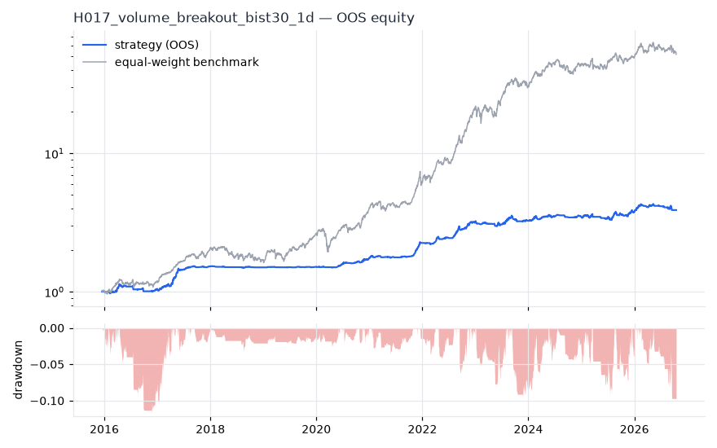
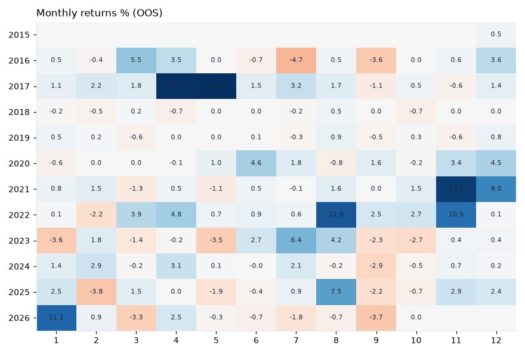
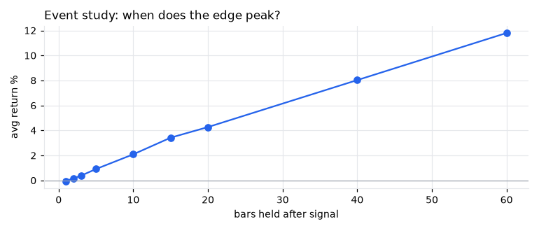
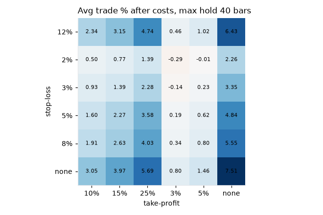

# H017 — volume_breakout on bist30 [1d]  ❌ REJECT

- Kind: rule · Source: Price breakout on volume surge
- For system: `bist_orderflow_quant`
- Data: 2012-01-02 00:00:00 → 2026-10-16 00:00:00 · 29 assets · 256.1 bars/year · survivorship mask: False
- Costs: {'commission': 0.001, 'slippage': 0.001, 'funding_annual': 0.0, 'borrow_annual': 0.0}
- Variants tried (DSR trials): 165 (failed: 0)
- Final variant: `volume_breakout|n=20,rv=2.0|f=trend_sma200|x=trail_atr=3.0,use_signal_exit=False|size=atr_risk0.02|overlay=vt10`

## Verdict reasons
- OOS Sharpe (USD, excess of US T-bill) -0.696 < 0.5
- OOS MaxDD -0.8252 worse than -0.45 (local or USD)
- with 2x costs it does not beat the equal-weight benchmark
- Reality Check p 0.996 > 0.1 (best variant may be data-mined)

## Walk-forward out-of-sample


| Metric | Strategy | Equal-weight benchmark |
|---|---|---|
| years | 10.76 | 10.76 |
| cagr | 0.1348 | 0.4437 |
| vol | 0.0941 | 0.2642 |
| sharpe | 1.391 | 1.523 |
| sharpe_excess_rf | 1.156 | None |
| sortino | 1.731 | 2.248 |
| max_dd | -0.1153 | -0.3222 |
| max_dd_bars | 702 | 371 |
| calmar | 1.169 | 1.377 |
| ulcer | 0.039 | 0.0851 |
| var95 | -0.0077 | -0.024 |
| cvar95 | -0.014 | -0.0377 |
| omega | 1.382 | 1.312 |
| tail_ratio | 1.363 | 1.09 |
| skew | -0.28 | -0.051 |
| kurtosis | 12.516 | 9.059 |
| hit_rate | 0.413 | 0.539 |
| turnover_ann | 7.92 | None |

- **Gate Sharpe (USD, excess of US T-bill): -0.696**
- Deflated Sharpe: **0.999** · PBO: **0.45** · Reality Check p: **0.996**
- PSR 1.0 · Info ratio -1.17 · Beta 0.178 · Up/Down capture 0.226/0.195
- Sharpe with 2× costs: 1.217 · Walk-forward efficiency: 0.765
- Bootstrap: {'p_sharpe_pos': 1.0, 'cagr_p05': 0.0667, 'maxdd_p05': -0.2054}
- Yearly OOS Sharpe: {'2016': 0.44, '2017': 3.11, '2018': -0.79, '2019': 0.53, '2020': 2.43, '2021': 3.72, '2022': 3.25, '2023': 0.21, '2024': 0.87, '2025': 0.72, '2026': 0.43}
- In USD: CAGR -0.1266 · Sharpe -0.585 · excess-rf Sharpe -0.696 · MaxDD -0.8252



## Regimes (where does it work?)
`{"bull": {"sharpe": 1.94, "ann_ret": 0.1954, "bars": 2075}, "bear": {"sharpe": -0.96, "ann_ret": -0.0661, "bars": 680}, "calm": {"sharpe": 2.03, "ann_ret": 0.2106, "bars": 1450}, "stressed": {"sharpe": 0.52, "ann_ret": 0.0423, "bars": 1305}, "vix_lt_20": {"sharpe": 1.17, "ann_ret": 0.1141, "bars": 1931}, "vix_20_30": {"sharpe": 2.18, "ann_ret": 0.2007, "bars": 671}, "vix_ge_30": {"sharpe": 0.73, "ann_ret": 0.0365, "bars": 153}, "curve_inverted": {"sharpe": 0.71, "ann_ret": 0.0679, "bars": 613}, "curve_normal": {"sharpe": 1.59, "ann_ret": 0.1489, "bars": 2142}}`

## Calendar profile (weekday / month / hour)
`{"weekday": {"0": 0.00079, "1": -0.00023, "2": 0.00048, "3": 0.00094, "4": 0.00057}, "month": {"1": 0.00056, "2": 0.00013, "3": 0.00025, "4": 0.00118, "5": 0.00038, "6": 0.00037, "7": 0.00035, "8": 0.00111, "9": -0.0005, "10": 1e-05, "11": 0.00137, "12": 0.00098}}`

## Trades (OOS)
`{"n_trades": 353, "trades_per_year": 32.8, "win_rate": 0.535, "avg_trade": 0.0649, "median_trade": 0.0128, "avg_win": 0.1689, "avg_loss": -0.055, "profit_factor": 3.537, "payoff": 3.069, "expectancy_r": null, "sqn": null, "kelly_fraction": 0.384, "max_consec_losses": 11, "avg_bars": 20.0, "avg_bars_win": 29.8, "avg_bars_loss": 8.7, "avg_mfe": 0.1845, "avg_mae": -0.0348, "edge_ratio": 5.305, "exit_reasons": {"stop": 353}, "long_short": {"1": {"count": 353, "mean": 0.0649}}}`

## Robustness
- **delay**: `{"sharpe": 1.357, "sharpe_delayed_1bar": 1.311, "retained": 0.966}`
- **neighbourhood**: `{"neighbours": 0}`
- **noise**: `{"noise_bp": 0.002, "sharpe_min": 1.275, "sharpe_median": 1.352}`
- **random_entry**: `{"actual_ret_per_exposure_ann": 0.4883, "random_median_ann": 0.3438, "random_p95_ann": 0.4001, "trades_actual": 403, "p_value": 0.04}`
- **mc_trade_shuffle**: `{"maxdd_median": -0.1247, "maxdd_p95": -0.181, "final_p05": 52.9625, "final_median": 52.9625}`

## Timing, take-profit, stop-loss and profit studies (in-sample diagnostics)
- Event study (forward return by bars held): `{"1": {"n": 1529, "mean": -0.0005, "hit": 0.387, "t": -0.77, "per_bar": -0.00055}, "2": {"n": 1529, "mean": 0.0018, "hit": 0.481, "t": 1.67, "per_bar": 0.00089}, "3": {"n": 1529, "mean": 0.0038, "hit": 0.513, "t": 2.76, "per_bar": 0.00126}, "5": {"n": 1529, "mean": 0.0091, "hit": 0.534, "t": 5.11, "per_bar": 0.00181}, "10": {"n": 1529, "mean": 0.0209, "hit": 0.558, "t": 8.08, "per_bar": 0.00209}, "15": {"n": 1529, "mean": 0.0342, "hit": 0.595, "t": 11.05, "per_bar": 0.00228}, "20": {"n": 1529, "mean": 0.0427, "hit": 0.606, "t": 12.26, "per_bar": 0.00214}, "40": {"n": 1522, "mean": 0.0803, "hit": 0.613, "t": 15.28, "per_bar": 0.00201}, "60": {"n": 1520, "mean": 0.118, "hit": 0.643, "t": 18.13, "per_bar": 0.00197}, "best_holding_bars": 60}`

- Best stop / target / max-hold combinations: `[{"stop": NaN, "target": 0.25, "max_hold": 40, "n": 1529, "mean": 0.0569, "hit": 0.6115, "per_bar": 0.0016, "t": 15.0808}, {"stop": NaN, "target": NaN, "max_hold": 40, "n": 1529, "mean": 0.0751, "hit": 0.6017, "per_bar": 0.0019, "t": 14.3146}, {"stop": NaN, "target": 0.15, "max_hold": 40, "n": 1529, "mean": 0.0397, "hit": 0.6364, "per_bar": 0.0013, "t": 13.1024}, {"stop": 0.12, "target": 0.25, "max_hold": 40, "n": 1529, "mean": 0.0474, "hit": 0.5664, "per_bar": 0.0016, "t": 12.7966}, {"stop": 0.12, "target": NaN, "max_hold": 40, "n": 1529, "mean": 0.0643, "hit": 0.554, "per_bar": 0.0019, "t": 12.3539}]`

- Portfolio overlays (vol target, drawdown brake, equity-curve filter): `{"none": {"sharpe": 1.391, "cagr": 0.1348, "max_dd": -0.1153}, "vol_target_0.1": {"sharpe": 1.389, "cagr": 0.1479, "max_dd": -0.1187}, "vol_target_0.15": {"sharpe": 1.358, "cagr": 0.195, "max_dd": -0.165}, "vol_target_0.2": {"sharpe": 1.358, "cagr": 0.2309, "max_dd": -0.1926}, "dd_brake_0.1": {"sharpe": 1.381, "cagr": 0.1334, "max_dd": -0.1132}, "dd_brake_0.2": {"sharpe": 1.391, "cagr": 0.1348, "max_dd": -0.1153}, "equity_ma_42": {"sharpe": 1.353, "cagr": 0.1187, "max_dd": -0.1111}, "equity_ma_128": {"sharpe": 1.381, "cagr": 0.1195, "max_dd": -0.1121}, "best_by_calmar": "vol_target_0.1"}`
> Studies are in-sample diagnostics. To use a better exit, register it (exits: [...]) and let the gate judge it.

## Walk-forward windows
- 2020-11-26 00:00:00 → 2021-05-31 00:00:00: IS 1.803 / OOS 0.943 — `volume_breakout|n=20,rv=1.5|f=trend_sma200|x=stop_atr=2.0,tp_r=3.0,be_r=1.0`
- 2021-06-01 00:00:00 → 2021-12-06 00:00:00: IS 1.685 / OOS 5.631 — `volume_breakout|n=20,rv=1.5|f=trend_sma200|x=stop_atr=2.0,tp_atr=5.0`
- 2021-12-07 00:00:00 → 2022-06-08 00:00:00: IS 2.704 / OOS 3.144 — `volume_breakout|n=20,rv=1.5|f=trend_sma200|x=stop_atr=2.0,tp_atr=5.0`
- 2022-06-09 00:00:00 → 2022-12-09 00:00:00: IS 3.005 / OOS 4.04 — `volume_breakout|n=20,rv=1.5|f=none|x=stop_atr=2.0,tp_r=3.0,be_r=1.0`
- 2022-12-12 00:00:00 → 2023-06-16 00:00:00: IS 3.322 / OOS -0.465 — `volume_breakout|n=20,rv=1.5|f=none|x=stop_atr=2.0,tp_atr=5.0`
- 2023-06-19 00:00:00 → 2023-12-19 00:00:00: IS 2.862 / OOS 1.013 — `volume_breakout|n=20,rv=2.0|f=trend_sma200|x=stop_atr=2.0,partial_r=1.0,partial_frac=0.5,partial_to_be=True,trail_atr=3.0,use_signal_exit=False|size=atr_risk0.01`
- 2023-12-20 00:00:00 → 2024-06-27 00:00:00: IS 2.612 / OOS 1.246 — `volume_breakout|n=20,rv=2.0|f=trend_sma200|x=trail_atr=3.0,use_signal_exit=False|size=atr_risk0.005`
- 2024-06-28 00:00:00 → 2024-12-27 00:00:00: IS 2.724 / OOS 0.373 — `volume_breakout|n=20,rv=1.5|f=none|x=stop_pct=0.05,tp_pct=0.1`
- 2024-12-30 00:00:00 → 2025-07-07 00:00:00: IS 2.276 / OOS -0.554 — `volume_breakout|n=20,rv=2.0|f=trend_sma200|x=trail_atr=3.0,use_signal_exit=False|size=atr_risk0.02|overlay=vt10`
- 2025-07-08 00:00:00 → 2026-01-06 00:00:00: IS 1.858 / OOS 1.893 — `volume_breakout|n=20,rv=2.0|f=trend_sma200|x=trail_atr=3.0,use_signal_exit=False|size=atr_risk0.02`
- 2026-01-07 00:00:00 → 2026-07-14 00:00:00: IS 1.237 / OOS 1.342 — `volume_breakout|n=20,rv=2.0|f=trend_sma200|x=trail_atr=3.0,use_signal_exit=False|size=atr_risk0.02|overlay=vt10`
- 2026-07-16 00:00:00 → 2026-10-16 00:00:00: IS 1.461 / OOS -1.879 — `volume_breakout|n=20,rv=2.0|f=trend_sma200|x=trail_atr=3.0,use_signal_exit=False|size=atr_risk0.02|overlay=vt10`

## Best variants (full sample, reference only)
- volume_breakout|n=20,rv=2.0|f=trend_sma200|x=trail_atr=3.0,use_signal_exit=False|size=atr_risk0.02: Sharpe 1.433
- volume_breakout|n=20,rv=2.0|f=trend_sma200|x=trail_atr=3.0,use_signal_exit=False|size=atr_risk0.02|overlay=dd20: Sharpe 1.433
- volume_breakout|n=20,rv=2.0|f=trend_sma200|x=trail_atr=3.0,use_signal_exit=False|size=atr_risk0.02|overlay=vt20: Sharpe 1.429
- volume_breakout|n=20,rv=2.0|f=trend_sma200|x=trail_atr=3.0,use_signal_exit=False|size=atr_risk0.02|overlay=vt15: Sharpe 1.409
- volume_breakout|n=20,rv=2.0|f=trend_sma200|x=trail_atr=3.0,use_signal_exit=False|size=atr_risk0.02|overlay=dd10: Sharpe 1.368
- volume_breakout|n=20,rv=2.0|f=trend_sma200|x=stop_atr=2.0,partial_r=1.0,partial_frac=0.5,partial_to_be=True,trail_atr=3.0,use_signal_exit=False|size=vol0.2|overlay=vt15: Sharpe 1.363
- volume_breakout|n=20,rv=2.0|f=trend_sma200|x=stop_atr=2.0,partial_r=1.0,partial_frac=0.5,partial_to_be=True,trail_atr=3.0,use_signal_exit=False|size=vol0.1: Sharpe 1.363
- volume_breakout|n=20,rv=2.0|f=trend_sma200|x=stop_atr=2.0,partial_r=1.0,partial_frac=0.5,partial_to_be=True,trail_atr=3.0,use_signal_exit=False|size=vol0.2: Sharpe 1.363
- volume_breakout|n=20,rv=2.0|f=trend_sma200|x=stop_atr=2.0,partial_r=1.0,partial_frac=0.5,partial_to_be=True,trail_atr=3.0,use_signal_exit=False|size=vol0.2|overlay=vt10: Sharpe 1.363
- volume_breakout|n=20,rv=2.0|f=trend_sma200|x=stop_atr=2.0,partial_r=1.0,partial_frac=0.5,partial_to_be=True,trail_atr=3.0,use_signal_exit=False|size=vol0.2|overlay=dd20: Sharpe 1.363

## Current targets / signals
```json
{
 "positions": {},
 "entry_long_next_open": [],
 "exit_long_next_open": [
  "AKBNK.IS",
  "ARCLK.IS",
  "ASELS.IS",
  "BIMAS.IS",
  "EKGYO.IS",
  "ENKAI.IS",
  "EREGL.IS",
  "FROTO.IS",
  "GUBRF.IS",
  "HEKTS.IS",
  "ISCTR.IS",
  "KCHOL.IS",
  "KRDMD.IS",
  "PETKM.IS",
  "SAHOL.IS",
  "SASA.IS",
  "SISE.IS",
  "TCELL.IS",
  "THYAO.IS",
  "TOASO.IS",
  "TUPRS.IS",
  "YKBNK.IS",
  "TTKOM.IS",
  "TAVHL.IS",
  "OYAKC.IS",
  "MGROS.IS",
  "PGSUS.IS"
 ],
 "entry_short_next_open": []
}
```

> Survivorship bias: unless a membership mask is used, universes are today's members (upper-bound results).