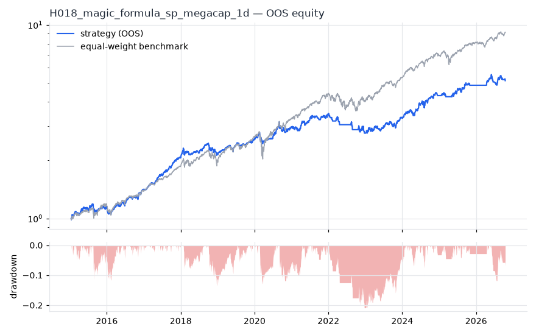
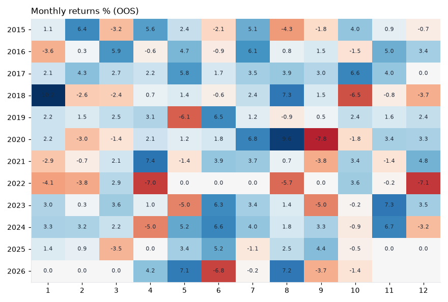

# H018 — magic_formula on sp_megacap [1d]  🟡 WATCH

- Kind: strategy · Source: Greenblatt (2005) Magic Formula: EBIT/EV + ROC
- For system: `us_f1_bot`
- Data: 2011-01-03 00:00:00 → 2026-10-16 00:00:00 · 30 assets · 251.6 bars/year · survivorship mask: True
- Costs: {'commission': 0.0002, 'slippage': 0.0003, 'funding_annual': 0.0, 'borrow_annual': 0.0}
- Variants tried (DSR trials): 20 (failed: 0)
- Final variant: `magic_formula|top_n=10,freq=QE|overlay=eqma_s`

## Verdict reasons
- with 2x costs it does not beat the equal-weight benchmark
- PBO 0.688 > 0.5 (variant selection is overfit)

## Walk-forward out-of-sample


| Metric | Strategy | Equal-weight benchmark |
|---|---|---|
| years | 11.76 | 11.76 |
| cagr | 0.1495 | 0.2072 |
| vol | 0.1252 | 0.1653 |
| sharpe | 1.176 | 1.222 |
| sharpe_excess_rf | 1.013 | None |
| sortino | 1.449 | 1.76 |
| max_dd | -0.2089 | -0.279 |
| max_dd_bars | 522 | 314 |
| calmar | 0.716 | 0.742 |
| ulcer | 0.0704 | 0.0459 |
| var95 | -0.0127 | -0.0148 |
| cvar95 | -0.0192 | -0.0248 |
| omega | 1.249 | 1.266 |
| tail_ratio | 1.053 | 0.983 |
| skew | -0.35 | -0.298 |
| kurtosis | 3.605 | 15.561 |
| hit_rate | 0.478 | 0.566 |
| turnover_ann | 8.0 | None |

- **Gate Sharpe (excess of T-bill): 1.013**
- Deflated Sharpe: **1.0** · PBO: **0.688** · Reality Check p: **0.05**
- PSR 1.0 · Info ratio -0.475 · Beta 0.544 · Up/Down capture 0.714/0.71
- Sharpe with 2× costs: 1.144 · Walk-forward efficiency: 0.731
- Bootstrap: {'p_sharpe_pos': 1.0, 'cagr_p05': 0.0812, 'maxdd_p05': -0.2777}
- Yearly OOS Sharpe: {'2015': 0.9, '2016': 1.64, '2017': 4.32, '2018': 0.52, '2019': 1.83, '2020': 1.02, '2021': 1.35, '2022': -1.59, '2023': 1.58, '2024': 2.05, '2025': 1.23, '2026': 0.68}



## Regimes (where does it work?)
`{"bull": {"sharpe": 1.93, "ann_ret": 0.2325, "bars": 2455}, "bear": {"sharpe": -1.88, "ann_ret": -0.2691, "bars": 503}, "calm": {"sharpe": 1.81, "ann_ret": 0.1976, "bars": 1554}, "stressed": {"sharpe": 0.65, "ann_ret": 0.0915, "bars": 1404}, "vix_lt_20": {"sharpe": 3.24, "ann_ret": 0.3532, "bars": 2095}, "vix_20_30": {"sharpe": -2.28, "ann_ret": -0.3366, "bars": 705}, "vix_ge_30": {"sharpe": -2.4, "ann_ret": -0.4257, "bars": 158}, "curve_inverted": {"sharpe": 1.29, "ann_ret": 0.1778, "bars": 614}, "curve_normal": {"sharpe": 1.14, "ann_ret": 0.1392, "bars": 2344}}`

## Calendar profile (weekday / month / hour)
`{"weekday": {"0": 0.0009, "1": 0.0005, "2": 0.00053, "3": 0.00044, "4": 0.00058}, "month": {"1": 0.00063, "2": 0.0003, "3": 0.00044, "4": 0.00053, "5": 0.00072, "6": 0.00084, "7": 0.00136, "8": 0.00091, "9": -0.00032, "10": 0.00028, "11": 0.00118, "12": 0.00011}}`

## Robustness
- **delay**: `{"sharpe": 1.188, "sharpe_delayed_1bar": 1.176, "retained": 0.991}`
- **neighbourhood**: `{"neighbours": 1, "best_sharpe": 1.178, "neighbour_median": 1.113, "share_positive": 1.0, "stability": 0.945}`
- **noise**: `{"noise_bp": 0.002, "sharpe_min": 1.137, "sharpe_median": 1.184}`

## Timing, take-profit, stop-loss and profit studies (in-sample diagnostics)
- Portfolio overlays (vol target, drawdown brake, equity-curve filter): `{"none": {"sharpe": 1.176, "cagr": 0.1495, "max_dd": -0.2089}, "vol_target_0.1": {"sharpe": 1.287, "cagr": 0.1461, "max_dd": -0.1724}, "vol_target_0.15": {"sharpe": 1.272, "cagr": 0.2102, "max_dd": -0.2521}, "vol_target_0.2": {"sharpe": 1.241, "cagr": 0.2567, "max_dd": -0.3082}, "dd_brake_0.1": {"sharpe": 1.116, "cagr": 0.13, "max_dd": -0.1773}, "dd_brake_0.2": {"sharpe": 1.164, "cagr": 0.1477, "max_dd": -0.2176}, "equity_ma_41": {"sharpe": 1.12, "cagr": 0.1099, "max_dd": -0.197}, "equity_ma_125": {"sharpe": 0.941, "cagr": 0.0988, "max_dd": -0.2139}, "best_by_calmar": "vol_target_0.1"}`
> Studies are in-sample diagnostics. To use a better exit, register it (exits: [...]) and let the gate judge it.

## Walk-forward windows
- 2020-12-28 00:00:00 → 2021-06-25 00:00:00: IS 1.302 / OOS 1.505 — `magic_formula|top_n=10,freq=ME|overlay=eqma_s`
- 2021-06-28 00:00:00 → 2021-12-22 00:00:00: IS 1.535 / OOS 1.28 — `magic_formula|top_n=10,freq=ME|overlay=eqma_s`
- 2021-12-23 00:00:00 → 2022-06-23 00:00:00: IS 1.689 / OOS -2.199 — `magic_formula|top_n=10,freq=ME|overlay=eqma_s`
- 2022-06-24 00:00:00 → 2022-12-20 00:00:00: IS 1.13 / OOS -0.911 — `magic_formula|top_n=10,freq=ME|overlay=eqma_l`
- 2022-12-21 00:00:00 → 2023-06-22 00:00:00: IS 1.082 / OOS 0.712 — `magic_formula|top_n=10,freq=ME|overlay=eqma_s`
- 2023-06-23 00:00:00 → 2023-12-19 00:00:00: IS 1.154 / OOS 2.27 — `magic_formula|top_n=10,freq=QE|overlay=vt15`
- 2023-12-20 00:00:00 → 2024-06-20 00:00:00: IS 1.213 / OOS 2.779 — `magic_formula|top_n=10,freq=QE|overlay=vt15`
- 2024-06-21 00:00:00 → 2024-12-17 00:00:00: IS 1.27 / OOS 1.392 — `magic_formula|top_n=10,freq=QE|overlay=vt15`
- 2024-12-18 00:00:00 → 2025-06-20 00:00:00: IS 1.249 / OOS 0.477 — `magic_formula|top_n=10,freq=QE|overlay=eqma_s`
- 2025-06-23 00:00:00 → 2025-12-17 00:00:00: IS 1.593 / OOS 1.918 — `magic_formula|top_n=10,freq=QE|overlay=eqma_s`
- 2025-12-18 00:00:00 → 2026-06-18 00:00:00: IS 1.693 / OOS 0.848 — `magic_formula|top_n=10,freq=QE|overlay=eqma_s`
- 2026-06-22 00:00:00 → 2026-10-16 00:00:00: IS 1.646 / OOS 0.449 — `magic_formula|top_n=10,freq=QE|overlay=eqma_s`

## Best variants (full sample, reference only)
- magic_formula|top_n=10,freq=QE|overlay=vt10: Sharpe 1.264
- magic_formula|top_n=10,freq=QE|overlay=vt15: Sharpe 1.256
- magic_formula|top_n=10,freq=QE|overlay=vt20: Sharpe 1.227
- magic_formula|top_n=10,freq=ME|overlay=vt15: Sharpe 1.193
- magic_formula|top_n=10,freq=ME|overlay=vt10: Sharpe 1.19
- magic_formula|top_n=10,freq=QE|overlay=eqma_s: Sharpe 1.178
- magic_formula|top_n=10,freq=QE: Sharpe 1.175
- magic_formula|top_n=10,freq=ME|overlay=vt20: Sharpe 1.172
- magic_formula|top_n=10,freq=QE|overlay=dd10: Sharpe 1.156
- magic_formula|top_n=10,freq=QE|overlay=dd20: Sharpe 1.133

## Current targets / signals
```json
{
 "AAPL": 0.1,
 "MSFT": 0.1,
 "NVDA": 0.1,
 "BRK-B": 0.1,
 "V": 0.1,
 "MA": 0.1,
 "HD": 0.1,
 "ORCL": 0.1,
 "ADBE": 0.1,
 "NFLX": 0.1
}
```

> Survivorship bias: unless a membership mask is used, universes are today's members (upper-bound results).