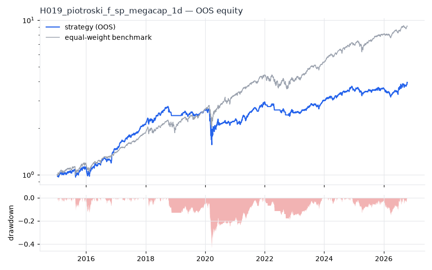
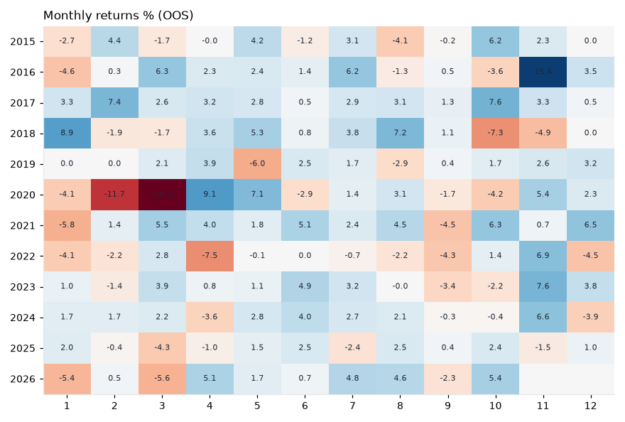

# H019 — piotroski_f on sp_megacap [1d]  🟡 WATCH

- Kind: strategy · Source: Piotroski (2000) F-score
- For system: `us_f1_bot`
- Data: 2011-01-03 00:00:00 → 2026-10-16 00:00:00 · 30 assets · 251.6 bars/year · survivorship mask: True
- Costs: {'commission': 0.0002, 'slippage': 0.0003, 'funding_annual': 0.0, 'borrow_annual': 0.0}
- Variants tried (DSR trials): 20 (failed: 0)
- Final variant: `piotroski_f|top_n=5,freq=QE`

## Verdict reasons
- with 2x costs it does not beat the equal-weight benchmark
- Reality Check p 0.948 > 0.1 (best variant may be data-mined)

## Walk-forward out-of-sample


| Metric | Strategy | Equal-weight benchmark |
|---|---|---|
| years | 11.76 | 11.76 |
| cagr | 0.1237 | 0.2072 |
| vol | 0.174 | 0.1653 |
| sharpe | 0.758 | 1.222 |
| sharpe_excess_rf | 0.64 | None |
| sortino | 0.917 | 1.76 |
| max_dd | -0.4354 | -0.279 |
| max_dd_bars | 778 | 314 |
| calmar | 0.284 | 0.742 |
| ulcer | 0.0985 | 0.0459 |
| var95 | -0.014 | -0.0148 |
| cvar95 | -0.0252 | -0.0248 |
| omega | 1.179 | 1.266 |
| tail_ratio | 0.984 | 0.983 |
| skew | 0.23 | -0.298 |
| kurtosis | 40.32 | 15.561 |
| hit_rate | 0.509 | 0.566 |
| turnover_ann | 6.31 | None |

- **Gate Sharpe (excess of T-bill): 0.64**
- Deflated Sharpe: **0.949** · PBO: **0.353** · Reality Check p: **0.948**
- PSR 0.995 · Info ratio -0.688 · Beta 0.863 · Up/Down capture 0.817/0.861
- Sharpe with 2× costs: 0.739 · Walk-forward efficiency: 0.531
- Bootstrap: {'p_sharpe_pos': 0.997, 'cagr_p05': 0.0395, 'maxdd_p05': -0.5478}
- Yearly OOS Sharpe: {'2015': 0.69, '2016': 1.77, '2017': 3.69, '2018': 0.93, '2019': 0.96, '2020': -0.17, '2021': 2.03, '2022': -1.12, '2023': 2.05, '2024': 1.48, '2025': 0.28, '2026': 0.76}



## Regimes (where does it work?)
`{"bull": {"sharpe": 1.64, "ann_ret": 0.2112, "bars": 2455}, "bear": {"sharpe": -0.83, "ann_ret": -0.2559, "bars": 503}, "calm": {"sharpe": 1.72, "ann_ret": 0.1859, "bars": 1554}, "stressed": {"sharpe": 0.32, "ann_ret": 0.0719, "bars": 1404}, "vix_lt_20": {"sharpe": 2.77, "ann_ret": 0.3206, "bars": 2095}, "vix_20_30": {"sharpe": -1.34, "ann_ret": -0.2113, "bars": 705}, "vix_ge_30": {"sharpe": -1.61, "ann_ret": -0.8408, "bars": 158}, "curve_inverted": {"sharpe": 0.73, "ann_ret": 0.0906, "bars": 614}, "curve_normal": {"sharpe": 0.77, "ann_ret": 0.1426, "bars": 2344}}`

## Calendar profile (weekday / month / hour)
`{"weekday": {"0": 0.0004, "1": 0.00054, "2": 0.00063, "3": 0.00029, "4": 0.00075}, "month": {"1": -0.00042, "2": -9e-05, "3": 2e-05, "4": 0.00084, "5": 0.00098, "6": 0.00075, "7": 0.00115, "8": 0.00064, "9": -0.00051, "10": 0.0005, "11": 0.00192, "12": 0.00054}}`

## Robustness
- **delay**: `{"sharpe": 1.016, "sharpe_delayed_1bar": 0.987, "retained": 0.972}`
- **neighbourhood**: `{"neighbours": 3, "best_sharpe": 1.008, "neighbour_median": 1.077, "share_positive": 1.0, "stability": 1.068}`
- **noise**: `{"noise_bp": 0.002, "sharpe_min": 1.011, "sharpe_median": 1.016}`

## Timing, take-profit, stop-loss and profit studies (in-sample diagnostics)
- Portfolio overlays (vol target, drawdown brake, equity-curve filter): `{"none": {"sharpe": 0.758, "cagr": 0.1237, "max_dd": -0.4354}, "vol_target_0.1": {"sharpe": 0.854, "cagr": 0.0939, "max_dd": -0.196}, "vol_target_0.15": {"sharpe": 0.851, "cagr": 0.1364, "max_dd": -0.2826}, "vol_target_0.2": {"sharpe": 0.85, "cagr": 0.1708, "max_dd": -0.3798}, "dd_brake_0.1": {"sharpe": 0.853, "cagr": 0.1079, "max_dd": -0.3176}, "dd_brake_0.2": {"sharpe": 0.852, "cagr": 0.1183, "max_dd": -0.3284}, "equity_ma_41": {"sharpe": 0.852, "cagr": 0.0876, "max_dd": -0.1842}, "equity_ma_125": {"sharpe": 1.029, "cagr": 0.1103, "max_dd": -0.1851}, "best_by_calmar": "equity_ma_125"}`
> Studies are in-sample diagnostics. To use a better exit, register it (exits: [...]) and let the gate judge it.

## Walk-forward windows
- 2020-12-28 00:00:00 → 2021-06-25 00:00:00: IS 0.689 / OOS 1.641 — `piotroski_f|top_n=5,freq=ME|overlay=dd10`
- 2021-06-28 00:00:00 → 2021-12-22 00:00:00: IS 1.002 / OOS 2.643 — `piotroski_f|top_n=10,freq=ME|overlay=eqma_s`
- 2021-12-23 00:00:00 → 2022-06-23 00:00:00: IS 1.378 / OOS -1.873 — `piotroski_f|top_n=10,freq=ME|overlay=eqma_s`
- 2022-06-24 00:00:00 → 2022-12-20 00:00:00: IS 0.96 / OOS -0.482 — `piotroski_f|top_n=10,freq=ME|overlay=eqma_s`
- 2022-12-21 00:00:00 → 2023-06-22 00:00:00: IS 0.757 / OOS 2.102 — `piotroski_f|top_n=10,freq=ME|overlay=vt10`
- 2023-06-23 00:00:00 → 2023-12-19 00:00:00: IS 1.255 / OOS 2.092 — `piotroski_f|top_n=10,freq=ME|overlay=vt10`
- 2023-12-20 00:00:00 → 2024-06-20 00:00:00: IS 1.418 / OOS 1.596 — `piotroski_f|top_n=10,freq=ME|overlay=vt10`
- 2024-06-21 00:00:00 → 2024-12-17 00:00:00: IS 1.352 / OOS 1.716 — `piotroski_f|top_n=10,freq=ME|overlay=vt10`
- 2024-12-18 00:00:00 → 2025-06-20 00:00:00: IS 1.033 / OOS -0.673 — `piotroski_f|top_n=10,freq=ME|overlay=vt10`
- 2025-06-23 00:00:00 → 2025-12-17 00:00:00: IS 1.143 / OOS 0.845 — `piotroski_f|top_n=10,freq=ME`
- 2025-12-18 00:00:00 → 2026-06-18 00:00:00: IS 1.096 / OOS -0.948 — `piotroski_f|top_n=10,freq=ME|overlay=vt10`
- 2026-06-22 00:00:00 → 2026-10-16 00:00:00: IS 1.08 / OOS 2.275 — `piotroski_f|top_n=5,freq=QE`

## Best variants (full sample, reference only)
- piotroski_f|top_n=10,freq=ME|overlay=vt10: Sharpe 1.28
- piotroski_f|top_n=10,freq=ME|overlay=vt15: Sharpe 1.236
- piotroski_f|top_n=10,freq=ME|overlay=vt20: Sharpe 1.195
- piotroski_f|top_n=10,freq=ME|overlay=dd10: Sharpe 1.17
- piotroski_f|top_n=5,freq=ME|overlay=vt20: Sharpe 1.136
- piotroski_f|top_n=5,freq=ME|overlay=vt15: Sharpe 1.132
- piotroski_f|top_n=10,freq=ME: Sharpe 1.132
- piotroski_f|top_n=5,freq=ME|overlay=dd20: Sharpe 1.119
- piotroski_f|top_n=5,freq=ME|overlay=vt10: Sharpe 1.11
- piotroski_f|top_n=10,freq=ME|overlay=dd20: Sharpe 1.103

## Current targets / signals
```json
{
 "AAPL": 0.2,
 "MSFT": 0.2,
 "LLY": 0.2,
 "ADBE": 0.2,
 "ABBV": 0.2
}
```

> Survivorship bias: unless a membership mask is used, universes are today's members (upper-bound results).