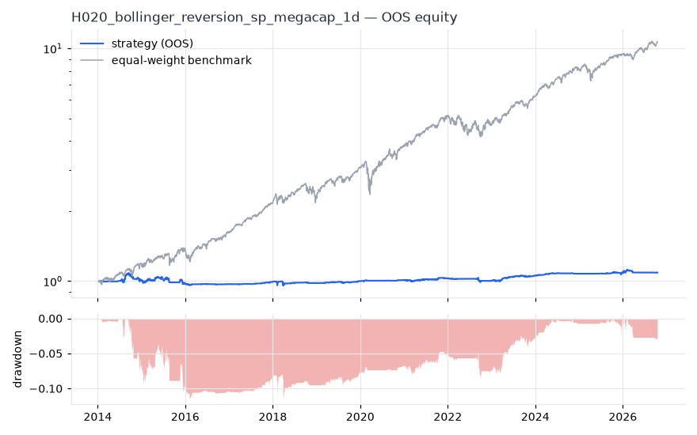
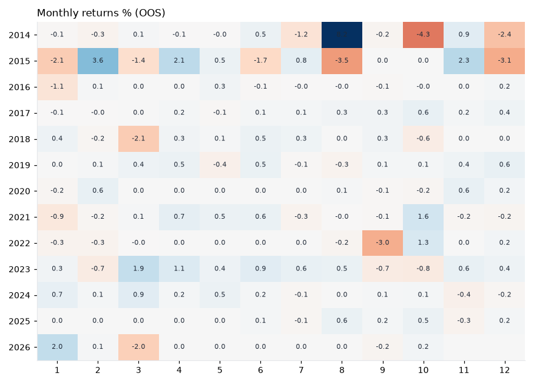
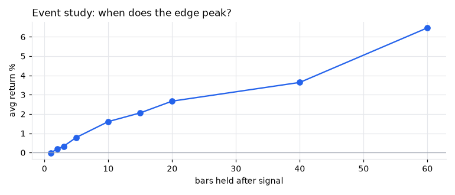
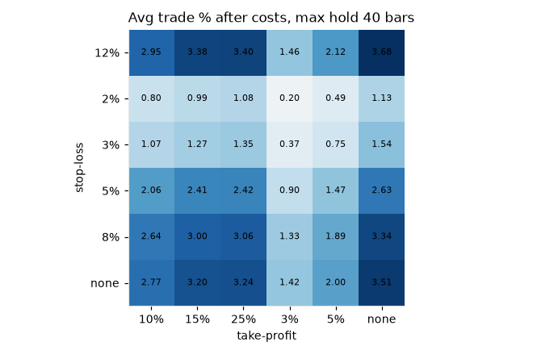

# H020 — bollinger_reversion on sp_megacap [1d]  ❌ REJECT

- Kind: rule · Source: Bollinger (2001)
- For system: `sp500_shock_quant`
- Data: 2010-01-04 00:00:00 → 2026-10-16 00:00:00 · 30 assets · 251.7 bars/year · survivorship mask: True
- Costs: {'commission': 0.0002, 'slippage': 0.0003, 'funding_annual': 0.0, 'borrow_annual': 0.0}
- Variants tried (DSR trials): 177 (failed: 0)
- Final variant: `bollinger_reversion|n=30,k=2.5|f=low_vol|x=signal_only`

## Verdict reasons
- DSR 0.036 < 0.9 (luck not excluded after 177 trials)
- OOS Sharpe (excess of T-bill) -0.32 < 0.5
- bootstrap P(SR>0) 0.824 < 0.85
- with 2x costs it does not beat the equal-weight benchmark
- Reality Check p 1.0 > 0.1 (best variant may be data-mined)

## Walk-forward out-of-sample


| Metric | Strategy | Equal-weight benchmark |
|---|---|---|
| years | 12.76 | 12.76 |
| cagr | 0.0067 | 0.2038 |
| vol | 0.0362 | 0.1622 |
| sharpe | 0.202 | 1.225 |
| sharpe_excess_rf | -0.32 | None |
| sortino | -0.43 | 1.765 |
| max_dd | -0.1161 | -0.279 |
| max_dd_bars | 2773 | 314 |
| calmar | 0.057 | 0.731 |
| ulcer | 0.0683 | 0.0443 |
| var95 | -0.0025 | -0.0146 |
| cvar95 | -0.0059 | -0.0242 |
| omega | 1.062 | 1.265 |
| tail_ratio | 1.06 | 0.979 |
| skew | -1.208 | -0.297 |
| kurtosis | 29.834 | 15.548 |
| hit_rate | 0.358 | 0.565 |
| turnover_ann | 5.38 | None |

- **Gate Sharpe (excess of T-bill): -0.32**
- Deflated Sharpe: **0.036** · PBO: **0.444** · Reality Check p: **1.0**
- PSR 0.763 · Info ratio -1.253 · Beta 0.081 · Up/Down capture 0.102/0.119
- Sharpe with 2× costs: 0.127 · Walk-forward efficiency: 0.127
- Bootstrap: {'p_sharpe_pos': 0.824, 'cagr_p05': -0.0072, 'maxdd_p05': -0.1804}
- Yearly OOS Sharpe: {'2014': 0.13, '2015': -0.35, '2016': -0.57, '2017': 1.71, '2018': -0.18, '2019': 1.12, '2020': 1.41, '2021': 0.63, '2022': -0.82, '2023': 1.61, '2024': 1.8, '2025': 0.54, '2026': 0.06}



## Regimes (where does it work?)
`{"bull": {"sharpe": 0.5, "ann_ret": 0.0187, "bars": 2702}, "bear": {"sharpe": -1.83, "ann_ret": -0.0535, "bars": 508}, "calm": {"sharpe": 0.61, "ann_ret": 0.018, "bars": 1677}, "stressed": {"sharpe": -0.1, "ann_ret": -0.0044, "bars": 1533}, "vix_lt_20": {"sharpe": 1.09, "ann_ret": 0.0383, "bars": 2335}, "vix_20_30": {"sharpe": -2.0, "ann_ret": -0.0755, "bars": 717}, "vix_ge_30": {"sharpe": -1.9, "ann_ret": -0.0751, "bars": 158}, "curve_inverted": {"sharpe": 1.14, "ann_ret": 0.0256, "bars": 614}, "curve_normal": {"sharpe": 0.08, "ann_ret": 0.003, "bars": 2596}}`

## Calendar profile (weekday / month / hour)
`{"weekday": {"0": -0.0, "1": -1e-05, "2": 5e-05, "3": 3e-05, "4": 8e-05}, "month": {"1": -5e-05, "2": 0.00012, "3": -7e-05, "4": 0.00019, "5": 6e-05, "6": 6e-05, "7": 0.0, "8": 0.00019, "9": -0.00013, "10": -5e-05, "11": 0.00017, "12": -0.00014}}`

## Trades (OOS)
`{"n_trades": 173, "trades_per_year": 13.6, "win_rate": 0.815, "avg_trade": 0.0202, "median_trade": 0.0264, "avg_win": 0.0356, "avg_loss": -0.0477, "profit_factor": 3.285, "payoff": 0.746, "expectancy_r": null, "sqn": null, "kelly_fraction": 0.567, "max_consec_losses": 3, "avg_bars": 14.9, "avg_bars_win": 11.3, "avg_bars_loss": 30.6, "avg_mfe": 0.0353, "avg_mae": -0.0417, "edge_ratio": 0.846, "exit_reasons": {"signal": 173}, "long_short": {"1": {"count": 173, "mean": 0.0202}}}`

## Robustness
- **delay**: `{"sharpe": 0.839, "sharpe_delayed_1bar": 0.747, "retained": 0.89}`
- **neighbourhood**: `{"neighbours": 5, "best_sharpe": 0.818, "neighbour_median": 0.655, "share_positive": 1.0, "stability": 0.801}`
- **noise**: `{"noise_bp": 0.002, "sharpe_min": 0.705, "sharpe_median": 0.85}`
- **random_entry**: `{"actual_ret_per_exposure_ann": 0.4034, "random_median_ann": 0.2607, "random_p95_ann": 0.5012, "trades_actual": 221, "p_value": 0.08}`
- **mc_trade_shuffle**: `{"maxdd_median": -0.0098, "maxdd_p95": -0.0154, "final_p05": 0.1815, "final_median": 0.1815}`

## Timing, take-profit, stop-loss and profit studies (in-sample diagnostics)
- Event study (forward return by bars held): `{"1": {"n": 287, "mean": -0.0001, "hit": 0.523, "t": -0.12, "per_bar": -9e-05}, "2": {"n": 287, "mean": 0.0019, "hit": 0.547, "t": 1.55, "per_bar": 0.00095}, "3": {"n": 287, "mean": 0.0033, "hit": 0.516, "t": 2.15, "per_bar": 0.00109}, "5": {"n": 287, "mean": 0.0079, "hit": 0.585, "t": 3.9, "per_bar": 0.00159}, "10": {"n": 287, "mean": 0.0161, "hit": 0.603, "t": 5.82, "per_bar": 0.00161}, "15": {"n": 287, "mean": 0.0206, "hit": 0.617, "t": 6.08, "per_bar": 0.00137}, "20": {"n": 285, "mean": 0.0267, "hit": 0.674, "t": 6.11, "per_bar": 0.00134}, "40": {"n": 285, "mean": 0.0364, "hit": 0.674, "t": 5.71, "per_bar": 0.00091}, "60": {"n": 285, "mean": 0.0647, "hit": 0.754, "t": 8.85, "per_bar": 0.00108}, "best_holding_bars": 60}`

- Best stop / target / max-hold combinations: `[{"stop": 0.12, "target": 0.05, "max_hold": 40, "n": 287, "mean": 0.0212, "hit": 0.77, "per_bar": 0.001, "t": 7.4565}, {"stop": 0.12, "target": 0.1, "max_hold": 40, "n": 287, "mean": 0.0295, "hit": 0.6864, "per_bar": 0.0009, "t": 7.4427}, {"stop": 0.12, "target": 0.15, "max_hold": 40, "n": 287, "mean": 0.0338, "hit": 0.676, "per_bar": 0.001, "t": 7.4389}, {"stop": 0.12, "target": 0.03, "max_hold": 40, "n": 287, "mean": 0.0146, "hit": 0.8432, "per_bar": 0.001, "t": 6.8651}, {"stop": 0.08, "target": 0.05, "max_hold": 40, "n": 287, "mean": 0.0189, "hit": 0.7456, "per_bar": 0.0009, "t": 6.7433}]`

- Portfolio overlays (vol target, drawdown brake, equity-curve filter): `{"none": {"sharpe": 0.202, "cagr": 0.0067, "max_dd": -0.1161}, "vol_target_0.1": {"sharpe": 0.294, "cagr": 0.0155, "max_dd": -0.1467}, "vol_target_0.15": {"sharpe": 0.252, "cagr": 0.015, "max_dd": -0.192}, "vol_target_0.2": {"sharpe": 0.216, "cagr": 0.013, "max_dd": -0.2191}, "dd_brake_0.1": {"sharpe": 0.135, "cagr": 0.0041, "max_dd": -0.1325}, "dd_brake_0.2": {"sharpe": 0.202, "cagr": 0.0067, "max_dd": -0.1161}, "equity_ma_41": {"sharpe": 0.122, "cagr": 0.0027, "max_dd": -0.0921}, "equity_ma_125": {"sharpe": -0.104, "cagr": -0.0032, "max_dd": -0.1568}, "best_by_calmar": "vol_target_0.1"}`
> Studies are in-sample diagnostics. To use a better exit, register it (exits: [...]) and let the gate judge it.

## Walk-forward windows
- 2020-12-23 00:00:00 → 2021-06-23 00:00:00: IS 0.996 / OOS 0.325 — `bollinger_reversion|n=10,k=2.0|f=low_vol|x=stop_atr=2.0,partial_r=1.0,partial_frac=0.5,partial_to_be=True,trail_atr=3.0,use_signal_exit=False`
- 2021-06-24 00:00:00 → 2021-12-20 00:00:00: IS 1.1 / OOS 1.024 — `bollinger_reversion|n=30,k=1.5|f=low_vol|x=signal_only`
- 2021-12-21 00:00:00 → 2022-06-21 00:00:00: IS 1.035 / OOS -0.933 — `bollinger_reversion|n=30,k=1.5|f=low_vol|x=signal_only`
- 2022-06-22 00:00:00 → 2022-12-16 00:00:00: IS 1.032 / OOS -1.145 — `bollinger_reversion|n=30,k=1.5|f=low_vol|x=max_hold=20`
- 2022-12-19 00:00:00 → 2023-06-20 00:00:00: IS 0.935 / OOS 2.563 — `bollinger_reversion|n=30,k=2.0|f=low_vol|x=stop_atr=2.0,tp_r=2.0,use_signal_exit=False`
- 2023-06-21 00:00:00 → 2023-12-15 00:00:00: IS 1.824 / OOS 0.677 — `bollinger_reversion|n=30,k=2.0|f=low_vol|x=trail_atr=3.0,use_signal_exit=False`
- 2023-12-18 00:00:00 → 2024-06-17 00:00:00: IS 1.771 / OOS 3.303 — `bollinger_reversion|n=30,k=2.0|f=low_vol|x=trail_atr=3.0,use_signal_exit=False`
- 2024-06-18 00:00:00 → 2024-12-13 00:00:00: IS 1.958 / OOS -0.33 — `bollinger_reversion|n=30,k=2.0|f=low_vol|x=trail_atr=3.0,use_signal_exit=False`
- 2024-12-16 00:00:00 → 2025-06-17 00:00:00: IS 1.725 / OOS -1.419 — `bollinger_reversion|n=30,k=2.0|f=low_vol|x=trail_atr=3.0,use_signal_exit=False`
- 2025-06-18 00:00:00 → 2025-12-15 00:00:00: IS 1.718 / OOS 0.6 — `bollinger_reversion|n=30,k=2.0|f=low_vol|x=trail_atr=3.0,use_signal_exit=False`
- 2025-12-16 00:00:00 → 2026-06-16 00:00:00: IS 1.941 / OOS 0.315 — `bollinger_reversion|n=10,k=2.0|f=low_vol|x=stop_atr=2.0,partial_r=1.0,partial_frac=0.5,partial_to_be=True,trail_atr=3.0,use_signal_exit=False|size=atr_risk0.02|overlay=vt10`
- 2026-06-17 00:00:00 → 2026-10-16 00:00:00: IS 2.204 / OOS 0.135 — `bollinger_reversion|n=30,k=2.5|f=low_vol|x=signal_only`

## Best variants (full sample, reference only)
- bollinger_reversion|n=10,k=2.0|f=low_vol|x=stop_atr=2.0,partial_r=1.0,partial_frac=0.5,partial_to_be=True,trail_atr=3.0,use_signal_exit=False|size=atr_risk0.02|overlay=dd20: Sharpe 1.201
- bollinger_reversion|n=10,k=2.0|f=low_vol|x=stop_atr=2.0,partial_r=1.0,partial_frac=0.5,partial_to_be=True,trail_atr=3.0,use_signal_exit=False|size=atr_risk0.02: Sharpe 1.201
- bollinger_reversion|n=10,k=2.0|f=low_vol|x=stop_atr=2.0,partial_r=1.0,partial_frac=0.5,partial_to_be=True,trail_atr=3.0,use_signal_exit=False|size=atr_risk0.02|overlay=vt20: Sharpe 1.201
- bollinger_reversion|n=10,k=2.0|f=low_vol|x=stop_atr=2.0,partial_r=1.0,partial_frac=0.5,partial_to_be=True,trail_atr=3.0,use_signal_exit=False|size=atr_risk0.02|overlay=vt15: Sharpe 1.2
- bollinger_reversion|n=10,k=2.0|f=low_vol|x=stop_atr=2.0,partial_r=1.0,partial_frac=0.5,partial_to_be=True,trail_atr=3.0,use_signal_exit=False|size=atr_risk0.02|overlay=dd10: Sharpe 1.188
- bollinger_reversion|n=10,k=2.0|f=low_vol|x=stop_atr=2.0,partial_r=1.0,partial_frac=0.5,partial_to_be=True,trail_atr=3.0,use_signal_exit=False|size=atr_risk0.02|overlay=vt10: Sharpe 1.177
- bollinger_reversion|n=10,k=2.0|f=low_vol|x=stop_atr=2.0,partial_r=1.0,partial_frac=0.5,partial_to_be=True,trail_atr=3.0,use_signal_exit=False|size=atr_risk0.01|overlay=vt15: Sharpe 1.161
- bollinger_reversion|n=10,k=2.0|f=low_vol|x=stop_atr=2.0,partial_r=1.0,partial_frac=0.5,partial_to_be=True,trail_atr=3.0,use_signal_exit=False|size=atr_risk0.01: Sharpe 1.161
- bollinger_reversion|n=10,k=2.0|f=low_vol|x=stop_atr=2.0,partial_r=1.0,partial_frac=0.5,partial_to_be=True,trail_atr=3.0,use_signal_exit=False|size=atr_risk0.01|overlay=vt20: Sharpe 1.161
- bollinger_reversion|n=10,k=2.0|f=low_vol|x=stop_atr=2.0,partial_r=1.0,partial_frac=0.5,partial_to_be=True,trail_atr=3.0,use_signal_exit=False|size=atr_risk0.01|overlay=dd20: Sharpe 1.161

## Current targets / signals
```json
{
 "positions": {
  "JPM": 0.0333,
  "PEP": 0.0333
 },
 "entry_long_next_open": [],
 "exit_long_next_open": [
  "AAPL",
  "MSFT",
  "BRK-B",
  "V",
  "UNH",
  "XOM",
  "PG",
  "MA",
  "HD",
  "COST",
  "LLY",
  "MRK",
  "PEP",
  "KO",
  "WMT",
  "CVX",
  "ADBE",
  "CRM",
  "META",
  "ABBV"
 ],
 "entry_short_next_open": []
}
```

> Survivorship bias: unless a membership mask is used, universes are today's members (upper-bound results).