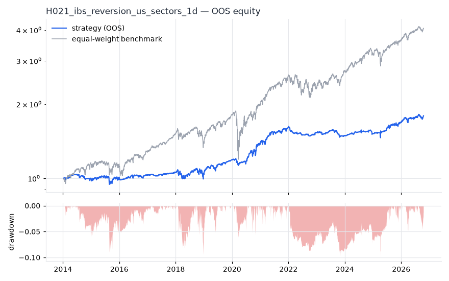
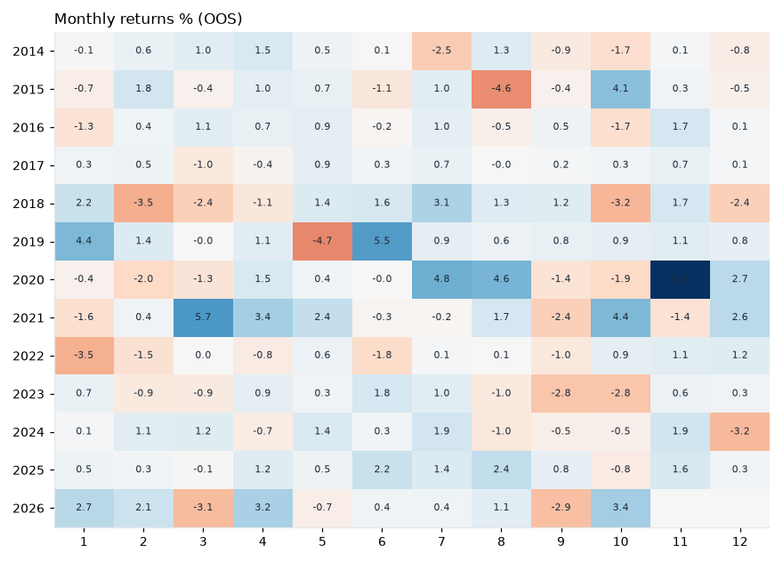
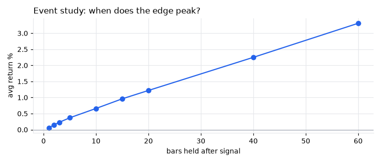
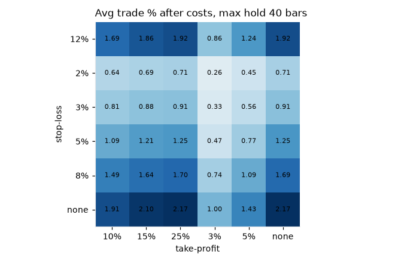

# H021 — ibs_reversion on us_sectors [1d]  🟡 WATCH

- Kind: rule · Source: Internal Bar Strength
- For system: `sp500_shock_quant`
- Data: 2010-01-04 00:00:00 → 2026-10-16 00:00:00 · 11 assets · 251.7 bars/year · survivorship mask: False
- Costs: {'commission': 0.0002, 'slippage': 0.0002, 'funding_annual': 0.0, 'borrow_annual': 0.0}
- Variants tried (DSR trials): 165 (failed: 0)
- Final variant: `ibs_reversion|lo=0.2,hi=0.8|f=none|x=trail_atr=3.0,use_signal_exit=False`

## Verdict reasons
- DSR 0.831 < 0.9 (luck not excluded after 165 trials)
- OOS Sharpe (excess of T-bill) 0.407 < 0.5
- with 2x costs it does not beat the equal-weight benchmark
- PBO 0.659 > 0.5 (variant selection is overfit)
- Reality Check p 1.0 > 0.1 (best variant may be data-mined)

## Walk-forward out-of-sample


| Metric | Strategy | Equal-weight benchmark |
|---|---|---|
| years | 12.76 | 12.76 |
| cagr | 0.0469 | 0.1162 |
| vol | 0.0726 | 0.1609 |
| sharpe | 0.667 | 0.764 |
| sharpe_excess_rf | 0.407 | None |
| sortino | 0.593 | 1.069 |
| max_dd | -0.1015 | -0.3634 |
| max_dd_bars | 887 | 329 |
| calmar | 0.462 | 0.32 |
| ulcer | 0.0385 | 0.0541 |
| var95 | -0.0066 | -0.0145 |
| cvar95 | -0.0109 | -0.0241 |
| omega | 1.15 | 1.161 |
| tail_ratio | 1.047 | 0.985 |
| skew | 0.683 | -0.569 |
| kurtosis | 22.924 | 19.396 |
| hit_rate | 0.498 | 0.551 |
| turnover_ann | 30.54 | None |

- **Gate Sharpe (excess of T-bill): 0.407**
- Deflated Sharpe: **0.831** · PBO: **0.659** · Reality Check p: **1.0**
- PSR 0.992 · Info ratio -0.605 · Beta 0.309 · Up/Down capture 0.39/0.389
- Sharpe with 2× costs: 0.498 · Walk-forward efficiency: 0.525
- Bootstrap: {'p_sharpe_pos': 0.997, 'cagr_p05': 0.0189, 'maxdd_p05': -0.2049}
- Yearly OOS Sharpe: {'2014': -0.15, '2015': 0.16, '2016': 0.53, '2017': 0.92, '2018': 0.02, '2019': 2.08, '2020': 1.65, '2021': 1.74, '2022': -1.22, '2023': -0.6, '2024': 0.51, '2025': 1.12, '2026': 1.23}



## Regimes (where does it work?)
`{"bull": {"sharpe": 1.11, "ann_ret": 0.0733, "bars": 2702}, "bear": {"sharpe": -0.83, "ann_ret": -0.0836, "bars": 508}, "calm": {"sharpe": 0.89, "ann_ret": 0.0475, "bars": 1677}, "stressed": {"sharpe": 0.56, "ann_ret": 0.0495, "bars": 1533}, "vix_lt_20": {"sharpe": 2.12, "ann_ret": 0.1122, "bars": 2335}, "vix_20_30": {"sharpe": -0.73, "ann_ret": -0.0682, "bars": 717}, "vix_ge_30": {"sharpe": -2.3, "ann_ret": -0.3634, "bars": 158}, "curve_inverted": {"sharpe": 0.14, "ann_ret": 0.0073, "bars": 614}, "curve_normal": {"sharpe": 0.76, "ann_ret": 0.0582, "bars": 2596}}`

## Calendar profile (weekday / month / hour)
`{"weekday": {"0": 0.00015, "1": 0.00022, "2": 0.00029, "3": 0.00021, "4": 9e-05}, "month": {"1": 0.00013, "2": 3e-05, "3": -1e-05, "4": 0.00044, "5": 0.00017, "6": 0.00032, "7": 0.0005, "8": 0.00021, "9": -0.00033, "10": 5e-05, "11": 0.00078, "12": 6e-05}}`

## Trades (OOS)
`{"n_trades": 1389, "trades_per_year": 108.9, "win_rate": 0.468, "avg_trade": 0.0118, "median_trade": -0.0029, "avg_win": 0.0586, "avg_loss": -0.0294, "profit_factor": 1.756, "payoff": 1.996, "expectancy_r": null, "sqn": null, "kelly_fraction": 0.201, "max_consec_losses": 29, "avg_bars": 20.7, "avg_bars_win": 33.5, "avg_bars_loss": 9.3, "avg_mfe": 0.0593, "avg_mae": -0.0191, "edge_ratio": 3.112, "exit_reasons": {"stop": 1389}, "long_short": {"1": {"count": 1389, "mean": 0.0118}}}`

## Robustness
- **delay**: `{"sharpe": 0.883, "sharpe_delayed_1bar": 0.968, "retained": 1.097}`
- **neighbourhood**: `{"neighbours": 1, "best_sharpe": 0.881, "neighbour_median": 0.867, "share_positive": 1.0, "stability": 0.985}`
- **noise**: `{"noise_bp": 0.002, "sharpe_min": 0.783, "sharpe_median": 0.817}`
- **random_entry**: `{"actual_ret_per_exposure_ann": 0.1362, "random_median_ann": 0.1216, "random_p95_ann": 0.1335, "trades_actual": 1719, "p_value": 0.04}`
- **mc_trade_shuffle**: `{"maxdd_median": -0.0564, "maxdd_p95": -0.0829, "final_p05": 5.7002, "final_median": 5.7002}`

## Timing, take-profit, stop-loss and profit studies (in-sample diagnostics)
- Event study (forward return by bars held): `{"1": {"n": 8440, "mean": 0.0006, "hit": 0.529, "t": 4.98, "per_bar": 0.00062}, "2": {"n": 8439, "mean": 0.0015, "hit": 0.554, "t": 8.02, "per_bar": 0.00077}, "3": {"n": 8437, "mean": 0.0023, "hit": 0.563, "t": 9.78, "per_bar": 0.00078}, "5": {"n": 8434, "mean": 0.0037, "hit": 0.585, "t": 12.16, "per_bar": 0.00075}, "10": {"n": 8430, "mean": 0.0066, "hit": 0.6, "t": 15.23, "per_bar": 0.00066}, "15": {"n": 8414, "mean": 0.0096, "hit": 0.613, "t": 17.9, "per_bar": 0.00064}, "20": {"n": 8401, "mean": 0.0122, "hit": 0.624, "t": 19.93, "per_bar": 0.00061}, "40": {"n": 8343, "mean": 0.0225, "hit": 0.668, "t": 27.21, "per_bar": 0.00056}, "60": {"n": 8293, "mean": 0.0331, "hit": 0.682, "t": 34.16, "per_bar": 0.00055}, "best_holding_bars": 60}`

- Best stop / target / max-hold combinations: `[{"stop": NaN, "target": 0.15, "max_hold": 40, "n": 8440, "mean": 0.021, "hit": 0.6633, "per_bar": 0.0005, "t": 26.8912}, {"stop": NaN, "target": 0.25, "max_hold": 40, "n": 8440, "mean": 0.0217, "hit": 0.6621, "per_bar": 0.0005, "t": 26.6735}, {"stop": NaN, "target": NaN, "max_hold": 40, "n": 8440, "mean": 0.0217, "hit": 0.6618, "per_bar": 0.0005, "t": 26.4213}, {"stop": NaN, "target": 0.1, "max_hold": 40, "n": 8440, "mean": 0.0191, "hit": 0.6681, "per_bar": 0.0005, "t": 26.233}, {"stop": 0.12, "target": 0.15, "max_hold": 40, "n": 8440, "mean": 0.0186, "hit": 0.6533, "per_bar": 0.0005, "t": 24.1144}]`

- Portfolio overlays (vol target, drawdown brake, equity-curve filter): `{"none": {"sharpe": 0.667, "cagr": 0.0469, "max_dd": -0.1015}, "vol_target_0.1": {"sharpe": 0.453, "cagr": 0.0413, "max_dd": -0.1702}, "vol_target_0.15": {"sharpe": 0.572, "cagr": 0.0661, "max_dd": -0.1978}, "vol_target_0.2": {"sharpe": 0.608, "cagr": 0.0758, "max_dd": -0.1978}, "dd_brake_0.1": {"sharpe": 0.647, "cagr": 0.0443, "max_dd": -0.1015}, "dd_brake_0.2": {"sharpe": 0.667, "cagr": 0.0469, "max_dd": -0.1015}, "equity_ma_41": {"sharpe": 0.299, "cagr": 0.0133, "max_dd": -0.1395}, "equity_ma_125": {"sharpe": 0.353, "cagr": 0.018, "max_dd": -0.1866}, "best_by_calmar": "none"}`
> Studies are in-sample diagnostics. To use a better exit, register it (exits: [...]) and let the gate judge it.

## Walk-forward windows
- 2020-12-23 00:00:00 → 2021-06-23 00:00:00: IS 1.143 / OOS 2.266 — `ibs_reversion|lo=0.1,hi=0.8|f=none|x=stop_atr=2.0,tp_r=2.0,use_signal_exit=False|size=atr_risk0.005`
- 2021-06-24 00:00:00 → 2021-12-20 00:00:00: IS 2.2 / OOS 1.265 — `ibs_reversion|lo=0.2,hi=0.8|f=trend_sma200|x=stop_atr=2.0,tp_r=2.0`
- 2021-12-21 00:00:00 → 2022-06-21 00:00:00: IS 2.306 / OOS -2.351 — `ibs_reversion|lo=0.2,hi=0.8|f=trend_sma200|x=stop_atr=1.5,tp_atr=3.0`
- 2022-06-22 00:00:00 → 2022-12-16 00:00:00: IS 1.93 / OOS 0.866 — `ibs_reversion|lo=0.2,hi=0.8|f=trend_sma200|x=stop_atr=1.5`
- 2022-12-19 00:00:00 → 2023-06-20 00:00:00: IS 1.822 / OOS 0.767 — `ibs_reversion|lo=0.2,hi=0.8|f=trend_sma200|x=stop_atr=1.5`
- 2023-06-21 00:00:00 → 2023-12-15 00:00:00: IS 1.825 / OOS -2.157 — `ibs_reversion|lo=0.1,hi=0.8|f=none|x=stop_atr=1.5`
- 2023-12-18 00:00:00 → 2024-06-17 00:00:00: IS 1.158 / OOS 2.5 — `ibs_reversion|lo=0.1,hi=0.8|f=none|x=stop_swing=10`
- 2024-06-18 00:00:00 → 2024-12-13 00:00:00: IS 1.031 / OOS 0.346 — `ibs_reversion|lo=0.1,hi=0.8|f=none|x=stop_swing=10`
- 2024-12-16 00:00:00 → 2025-06-17 00:00:00: IS 0.847 / OOS 0.224 — `ibs_reversion|lo=0.1,hi=0.8|f=none|x=stop_swing=10`
- 2025-06-18 00:00:00 → 2025-12-15 00:00:00: IS 1.187 / OOS 2.019 — `ibs_reversion|lo=0.1,hi=0.8|f=none|x=stop_atr=2.0,tp_r=2.0,use_signal_exit=False`
- 2025-12-16 00:00:00 → 2026-06-16 00:00:00: IS 1.321 / OOS 1.598 — `ibs_reversion|lo=0.2,hi=0.8|f=none|x=stop_atr=2.0,partial_r=1.0,partial_frac=0.5,partial_to_be=True,trail_atr=3.0,use_signal_exit=False`
- 2026-06-17 00:00:00 → 2026-10-16 00:00:00: IS 1.493 / OOS 0.615 — `ibs_reversion|lo=0.2,hi=0.8|f=none|x=trail_atr=3.0,use_signal_exit=False`

## Best variants (full sample, reference only)
- ibs_reversion|lo=0.1,hi=0.8|f=none|x=stop_atr=2.0,partial_r=1.0,partial_frac=0.5,partial_to_be=True,trail_atr=3.0,use_signal_exit=False|size=atr_risk0.01: Sharpe 0.94
- ibs_reversion|lo=0.1,hi=0.8|f=none|x=stop_atr=2.0,partial_r=1.0,partial_frac=0.5,partial_to_be=True,trail_atr=3.0,use_signal_exit=False|size=atr_risk0.01|overlay=dd20: Sharpe 0.94
- ibs_reversion|lo=0.1,hi=0.8|f=none|x=stop_atr=2.0,partial_r=1.0,partial_frac=0.5,partial_to_be=True,trail_atr=3.0,use_signal_exit=False|size=atr_risk0.005|overlay=dd20: Sharpe 0.937
- ibs_reversion|lo=0.1,hi=0.8|f=none|x=stop_atr=2.0,partial_r=1.0,partial_frac=0.5,partial_to_be=True,trail_atr=3.0,use_signal_exit=False|size=atr_risk0.005: Sharpe 0.937
- ibs_reversion|lo=0.1,hi=0.8|f=none|x=stop_atr=2.0,partial_r=1.0,partial_frac=0.5,partial_to_be=True,trail_atr=3.0,use_signal_exit=False|size=atr_risk0.005|overlay=vt20: Sharpe 0.937
- ibs_reversion|lo=0.1,hi=0.8|f=none|x=stop_atr=2.0,partial_r=1.0,partial_frac=0.5,partial_to_be=True,trail_atr=3.0,use_signal_exit=False|size=atr_risk0.005|overlay=vt15: Sharpe 0.936
- ibs_reversion|lo=0.1,hi=0.8|f=none|x=stop_atr=2.0,partial_r=1.0,partial_frac=0.5,partial_to_be=True,trail_atr=3.0,use_signal_exit=False|size=atr_risk0.01|overlay=vt20: Sharpe 0.936
- ibs_reversion|lo=0.1,hi=0.8|f=none|x=stop_atr=2.0,partial_r=1.0,partial_frac=0.5,partial_to_be=True,trail_atr=3.0,use_signal_exit=False|size=atr_risk0.01|overlay=vt15: Sharpe 0.923
- ibs_reversion|lo=0.1,hi=0.8|f=none|x=stop_atr=2.0,partial_r=1.0,partial_frac=0.5,partial_to_be=True,trail_atr=3.0,use_signal_exit=False|size=atr_risk0.005|overlay=vt10: Sharpe 0.895
- ibs_reversion|lo=0.1,hi=0.8|f=none|x=stop_atr=2.0,partial_r=1.0,partial_frac=0.5,partial_to_be=True,trail_atr=3.0,use_signal_exit=False: Sharpe 0.891

## Current targets / signals
```json
{
 "positions": {
  "XLK": 0.0909,
  "XLF": 0.0909,
  "XLV": 0.0909,
  "XLE": 0.0909,
  "XLP": 0.0909,
  "XLU": 0.0909,
  "XLB": 0.0909,
  "XLRE": 0.0909,
  "XLC": 0.0909
 },
 "entry_long_next_open": [
  "XLK",
  "XLV",
  "XLC"
 ],
 "exit_long_next_open": [
  "XLE",
  "XLU"
 ],
 "entry_short_next_open": []
}
```

> Survivorship bias: unless a membership mask is used, universes are today's members (upper-bound results).