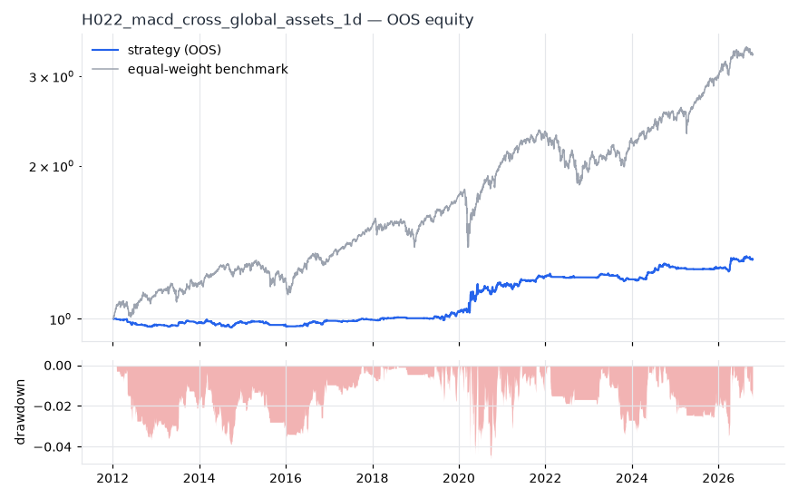
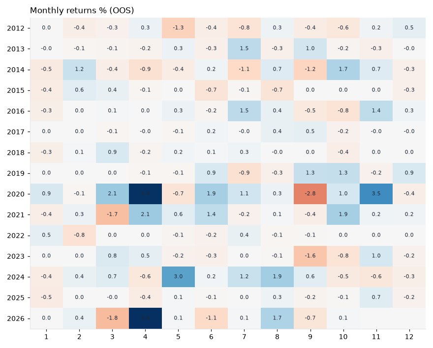
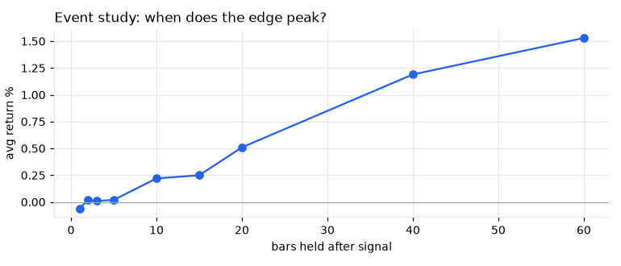
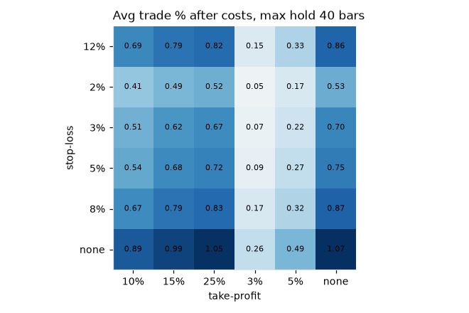

# H022 — macd_cross on global_assets [1d]  🟡 WATCH

- Kind: rule · Source: Appel MACD
- For system: `macro-model`
- Data: 2008-01-02 00:00:00 → 2026-10-16 00:00:00 · 10 assets · 251.7 bars/year · survivorship mask: False
- Costs: {'commission': 0.0002, 'slippage': 0.0003, 'funding_annual': 0.0, 'borrow_annual': 0.0}
- Variants tried (DSR trials): 173 (failed: 0)
- Final variant: `macd_cross|cfg=(5, 35, 5),zero_filter=True|f=none|x=signal_only`

## Verdict reasons
- DSR 0.611 < 0.9 (luck not excluded after 173 trials)
- OOS Sharpe (excess of T-bill) 0.071 < 0.5
- with 2x costs it does not beat the equal-weight benchmark
- PBO 0.872 > 0.5 (variant selection is overfit)
- Reality Check p 1.0 > 0.1 (best variant may be data-mined)
- random entries match it (p=0.68): the edge is in the exits, not the signal

## Walk-forward out-of-sample


| Metric | Strategy | Equal-weight benchmark |
|---|---|---|
| years | 14.76 | 14.76 |
| cagr | 0.0186 | 0.0844 |
| vol | 0.0378 | 0.111 |
| sharpe | 0.506 | 0.785 |
| sharpe_excess_rf | 0.071 | None |
| sortino | 0.107 | 1.1 |
| max_dd | -0.0459 | -0.2308 |
| max_dd_bars | 1441 | 630 |
| calmar | 0.404 | 0.365 |
| ulcer | 0.0186 | 0.0554 |
| var95 | -0.0025 | -0.0103 |
| cvar95 | -0.0051 | -0.0162 |
| omega | 1.164 | 1.154 |
| tail_ratio | 1.065 | 1.018 |
| skew | 1.074 | -0.635 |
| kurtosis | 70.901 | 12.368 |
| hit_rate | 0.338 | 0.549 |
| turnover_ann | 10.64 | None |

- **Gate Sharpe (excess of T-bill): 0.071**
- Deflated Sharpe: **0.611** · PBO: **0.872** · Reality Check p: **1.0**
- PSR 0.975 · Info ratio -0.675 · Beta 0.145 · Up/Down capture 0.161/0.152
- Sharpe with 2× costs: 0.365 · Walk-forward efficiency: 0.493
- Bootstrap: {'p_sharpe_pos': 0.994, 'cagr_p05': 0.0053, 'maxdd_p05': -0.1081}
- Yearly OOS Sharpe: {'2012': -1.34, '2013': 0.84, '2014': -0.1, '2015': -0.89, '2016': 1.07, '2017': 0.63, '2018': 0.48, '2019': 0.94, '2020': 1.12, '2021': 1.09, '2022': -0.29, '2023': -0.47, '2024': 1.67, '2025': -0.28, '2026': 1.22}



## Regimes (where does it work?)
`{"bull": {"sharpe": 0.63, "ann_ret": 0.0196, "bars": 3204}, "bear": {"sharpe": 0.25, "ann_ret": 0.016, "bars": 511}, "calm": {"sharpe": -0.25, "ann_ret": -0.0056, "bars": 2043}, "stressed": {"sharpe": 0.98, "ann_ret": 0.0493, "bars": 1672}, "vix_lt_20": {"sharpe": 1.0, "ann_ret": 0.0237, "bars": 2796}, "vix_20_30": {"sharpe": 0.37, "ann_ret": 0.0148, "bars": 761}, "vix_ge_30": {"sharpe": -0.33, "ann_ret": -0.0421, "bars": 158}, "curve_inverted": {"sharpe": 0.84, "ann_ret": 0.0244, "bars": 614}, "curve_normal": {"sharpe": 0.46, "ann_ret": 0.018, "bars": 3101}}`

## Calendar profile (weekday / month / hour)
`{"weekday": {"0": 0.00015, "1": -4e-05, "2": 0.00015, "3": 6e-05, "4": 7e-05}, "month": {"1": -5e-05, "2": 6e-05, "3": 2e-05, "4": 0.00037, "5": 5e-05, "6": 6e-05, "7": 0.0001, "8": 0.00014, "9": -0.00015, "10": 8e-05, "11": 0.00023, "12": 1e-05}}`

## Trades (OOS)
`{"n_trades": 1181, "trades_per_year": 80.0, "win_rate": 0.414, "avg_trade": 0.0046, "median_trade": -0.0036, "avg_win": 0.0335, "avg_loss": -0.0158, "profit_factor": 1.5, "payoff": 2.122, "expectancy_r": null, "sqn": null, "kelly_fraction": 0.138, "max_consec_losses": 15, "avg_bars": 9.3, "avg_bars_win": 15.0, "avg_bars_loss": 5.3, "avg_mfe": 0.0275, "avg_mae": -0.0143, "edge_ratio": 1.927, "exit_reasons": {"signal": 1181}, "long_short": {"1": {"count": 1181, "mean": 0.0046}}}`

## Robustness
- **delay**: `{"sharpe": 0.28, "sharpe_delayed_1bar": 0.351, "retained": 1.256}`
- **neighbourhood**: `{"neighbours": 5, "best_sharpe": 0.278, "neighbour_median": 0.315, "share_positive": 1.0, "stability": 1.131}`
- **noise**: `{"noise_bp": 0.002, "sharpe_min": 0.245, "sharpe_median": 0.263}`
- **random_entry**: `{"actual_ret_per_exposure_ann": 0.0674, "random_median_ann": 0.0735, "random_p95_ann": 0.0916, "trades_actual": 1523, "p_value": 0.68}`
- **mc_trade_shuffle**: `{"maxdd_median": -0.0725, "maxdd_p95": -0.1121, "final_p05": 0.6362, "final_median": 0.6362}`

## Timing, take-profit, stop-loss and profit studies (in-sample diagnostics)
- Event study (forward return by bars held): `{"1": {"n": 1528, "mean": -0.0006, "hit": 0.505, "t": -2.08, "per_bar": -0.00058}, "2": {"n": 1527, "mean": 0.0002, "hit": 0.523, "t": 0.46, "per_bar": 0.00012}, "3": {"n": 1527, "mean": 0.0001, "hit": 0.55, "t": 0.24, "per_bar": 5e-05}, "5": {"n": 1526, "mean": 0.0002, "hit": 0.533, "t": 0.25, "per_bar": 4e-05}, "10": {"n": 1519, "mean": 0.0022, "hit": 0.541, "t": 2.0, "per_bar": 0.00022}, "15": {"n": 1518, "mean": 0.0025, "hit": 0.558, "t": 1.87, "per_bar": 0.00017}, "20": {"n": 1514, "mean": 0.0051, "hit": 0.573, "t": 3.4, "per_bar": 0.00025}, "40": {"n": 1509, "mean": 0.0119, "hit": 0.579, "t": 5.71, "per_bar": 0.0003}, "60": {"n": 1498, "mean": 0.0153, "hit": 0.603, "t": 5.93, "per_bar": 0.00026}, "best_holding_bars": 60}`

- Best stop / target / max-hold combinations: `[{"stop": NaN, "target": NaN, "max_hold": 40, "n": 1528, "mean": 0.0107, "hit": 0.5687, "per_bar": 0.0003, "t": 5.1697}, {"stop": NaN, "target": 0.25, "max_hold": 40, "n": 1528, "mean": 0.0105, "hit": 0.5687, "per_bar": 0.0003, "t": 5.1539}, {"stop": NaN, "target": 0.15, "max_hold": 40, "n": 1528, "mean": 0.0099, "hit": 0.57, "per_bar": 0.0003, "t": 5.0197}, {"stop": NaN, "target": 0.1, "max_hold": 40, "n": 1528, "mean": 0.0089, "hit": 0.5759, "per_bar": 0.0002, "t": 4.7899}, {"stop": 0.08, "target": NaN, "max_hold": 40, "n": 1528, "mean": 0.0087, "hit": 0.5308, "per_bar": 0.0002, "t": 4.7857}]`

- Portfolio overlays (vol target, drawdown brake, equity-curve filter): `{"none": {"sharpe": 0.506, "cagr": 0.0186, "max_dd": -0.0459}, "vol_target_0.1": {"sharpe": 0.545, "cagr": 0.0295, "max_dd": -0.0749}, "vol_target_0.15": {"sharpe": 0.522, "cagr": 0.031, "max_dd": -0.0749}, "vol_target_0.2": {"sharpe": 0.514, "cagr": 0.0326, "max_dd": -0.0853}, "dd_brake_0.1": {"sharpe": 0.506, "cagr": 0.0186, "max_dd": -0.0459}, "dd_brake_0.2": {"sharpe": 0.506, "cagr": 0.0186, "max_dd": -0.0459}, "equity_ma_41": {"sharpe": 0.188, "cagr": 0.0055, "max_dd": -0.0529}, "equity_ma_125": {"sharpe": 0.327, "cagr": 0.0109, "max_dd": -0.0539}, "best_by_calmar": "vol_target_0.15"}`
> Studies are in-sample diagnostics. To use a better exit, register it (exits: [...]) and let the gate judge it.

## Walk-forward windows
- 2020-12-16 00:00:00 → 2021-06-16 00:00:00: IS 1.09 / OOS 0.579 — `macd_cross|cfg=(5, 35, 5),zero_filter=False|f=none|x=signal_only`
- 2021-06-17 00:00:00 → 2021-12-13 00:00:00: IS 1.148 / OOS 1.034 — `macd_cross|cfg=(5, 35, 5),zero_filter=True|f=trend_sma200|x=stop_atr=2.0,partial_r=1.0,partial_frac=0.5,partial_to_be=True,trail_atr=3.0,use_signal_exit=False`
- 2021-12-14 00:00:00 → 2022-06-13 00:00:00: IS 1.578 / OOS 0.087 — `macd_cross|cfg=(12, 26, 9),zero_filter=True|f=trend_sma200|x=stop_swing=5`
- 2022-06-14 00:00:00 → 2022-12-09 00:00:00: IS 1.456 / OOS 0.048 — `macd_cross|cfg=(12, 26, 9),zero_filter=True|f=trend_sma200|x=stop_swing=5`
- 2022-12-12 00:00:00 → 2023-06-12 00:00:00: IS 1.321 / OOS 2.158 — `macd_cross|cfg=(12, 26, 9),zero_filter=True|f=trend_sma200|x=stop_swing=5`
- 2023-06-13 00:00:00 → 2023-12-08 00:00:00: IS 1.355 / OOS -1.872 — `macd_cross|cfg=(12, 26, 9),zero_filter=True|f=trend_sma200|x=trail_atr=4.0`
- 2023-12-11 00:00:00 → 2024-06-10 00:00:00: IS 0.863 / OOS 2.129 — `macd_cross|cfg=(8, 21, 5),zero_filter=True|f=trend_sma200|x=max_hold=20`
- 2024-06-11 00:00:00 → 2024-12-06 00:00:00: IS 0.888 / OOS 1.441 — `macd_cross|cfg=(8, 21, 5),zero_filter=True|f=trend_sma200|x=trail_pct=0.05`
- 2024-12-09 00:00:00 → 2025-06-10 00:00:00: IS 1.096 / OOS -1.471 — `macd_cross|cfg=(5, 35, 5),zero_filter=True|f=trend_sma200|x=max_hold=10`
- 2025-06-11 00:00:00 → 2025-12-08 00:00:00: IS 1.118 / OOS 0.945 — `macd_cross|cfg=(5, 35, 5),zero_filter=True|f=trend_sma200|x=max_hold=10`
- 2025-12-09 00:00:00 → 2026-06-09 00:00:00: IS 1.408 / OOS 1.566 — `macd_cross|cfg=(5, 35, 5),zero_filter=True|f=none|x=signal_only`
- 2026-06-10 00:00:00 → 2026-10-16 00:00:00: IS 1.386 / OOS 0.275 — `macd_cross|cfg=(5, 35, 5),zero_filter=True|f=none|x=signal_only`

## Best variants (full sample, reference only)
- macd_cross|cfg=(12, 26, 9),zero_filter=True|f=trend_sma200|x=stop_swing=5: Sharpe 0.759
- macd_cross|cfg=(12, 26, 9),zero_filter=True|f=trend_sma200|x=stop_swing=5|overlay=dd20: Sharpe 0.759
- macd_cross|cfg=(12, 26, 9),zero_filter=True|f=trend_sma200|x=stop_swing=5|overlay=vt20: Sharpe 0.759
- macd_cross|cfg=(12, 26, 9),zero_filter=True|f=trend_sma200|x=stop_swing=5|overlay=vt15: Sharpe 0.759
- macd_cross|cfg=(12, 26, 9),zero_filter=True|f=trend_sma200|x=stop_swing=5|overlay=dd10: Sharpe 0.759
- macd_cross|cfg=(12, 26, 9),zero_filter=True|f=trend_sma200|x=stop_swing=5|overlay=vt10: Sharpe 0.759
- macd_cross|cfg=(12, 26, 9),zero_filter=True|f=trend_sma200|x=stop_atr=2.0|overlay=vt10: Sharpe 0.735
- macd_cross|cfg=(12, 26, 9),zero_filter=True|f=trend_sma200|x=stop_atr=2.0|overlay=vt15: Sharpe 0.735
- macd_cross|cfg=(12, 26, 9),zero_filter=True|f=trend_sma200|x=stop_atr=2.0|overlay=dd10: Sharpe 0.735
- macd_cross|cfg=(12, 26, 9),zero_filter=True|f=trend_sma200|x=stop_atr=2.0: Sharpe 0.735

## Current targets / signals
```json
{
 "positions": {
  "EFA": 0.1,
  "TLT": 0.1,
  "IEF": 0.1,
  "GLD": 0.1,
  "VNQ": 0.1
 },
 "entry_long_next_open": [],
 "exit_long_next_open": [],
 "entry_short_next_open": []
}
```

> Survivorship bias: unless a membership mask is used, universes are today's members (upper-bound results).