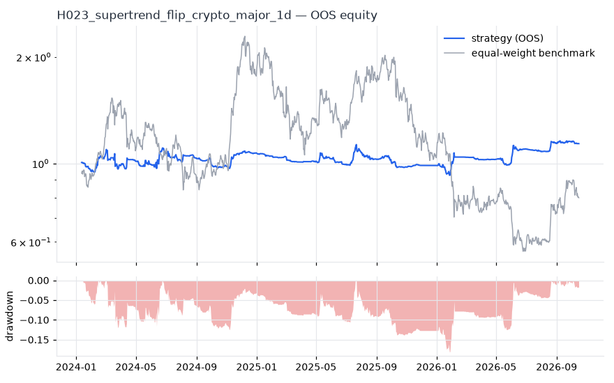
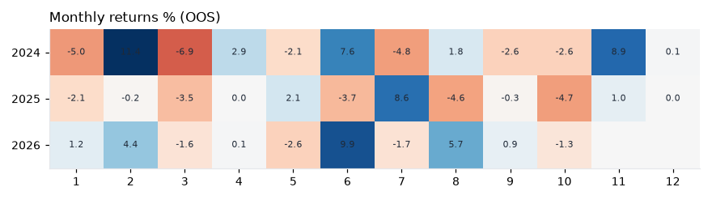
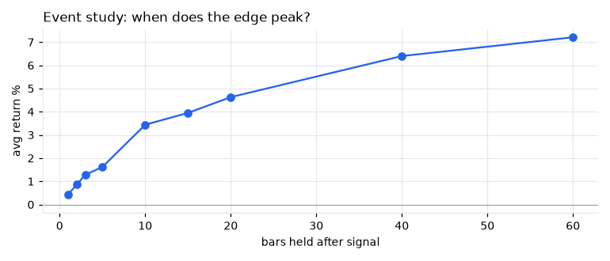
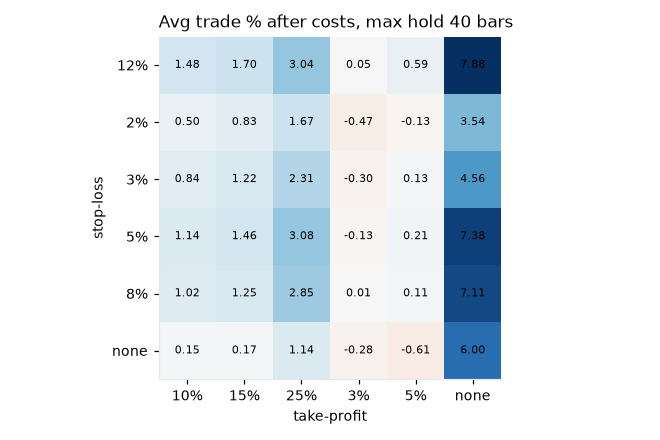

# H023 — supertrend_flip on crypto_major [1d]  ❌ REJECT

- Kind: rule · Source: Supertrend (ATR bands)
- For system: `karma_perp_bot`
- Data: 2020-01-01 00:00:00 → 2026-10-16 00:00:00 · 10 assets · 365.4 bars/year · survivorship mask: False
- Costs: {'commission': 0.0006, 'slippage': 0.0005, 'funding_annual': 0.08, 'borrow_annual': 0.0}
- Variants tried (DSR trials): 163 (failed: 0)
- Final variant: `supertrend_flip|cfg=(14, 3.0)|f=none|x=trail_pct=0.15|size=atr_risk0.005|overlay=vt10`

## Verdict reasons
- OOS too short (2.76y < 3.0y)
- DSR 0.289 < 0.9 (luck not excluded after 163 trials)
- OOS Sharpe (excess of T-bill) 0.111 < 0.5
- bootstrap P(SR>0) 0.791 < 0.85
- Reality Check p 0.844 > 0.1 (best variant may be data-mined)

## Walk-forward out-of-sample


| Metric | Strategy | Equal-weight benchmark |
|---|---|---|
| years | 2.76 | 2.76 |
| cagr | 0.0479 | -0.0775 |
| vol | 0.1569 | 0.653 |
| sharpe | 0.377 | 0.203 |
| sharpe_excess_rf | 0.111 | None |
| sortino | 0.168 | 0.291 |
| max_dd | -0.1812 | -0.7534 |
| max_dd_bars | 394 | 677 |
| calmar | 0.265 | -0.103 |
| ulcer | 0.081 | 0.443 |
| var95 | -0.0101 | -0.0515 |
| cvar95 | -0.0177 | -0.0771 |
| omega | 1.083 | 1.03 |
| tail_ratio | 1.134 | 1.045 |
| skew | 0.114 | 0.045 |
| kurtosis | 20.879 | 3.797 |
| hit_rate | 0.419 | 0.498 |
| turnover_ann | 12.25 | None |

- **Gate Sharpe (excess of T-bill): 0.111**
- Deflated Sharpe: **0.289** · PBO: **0.387** · Reality Check p: **0.844**
- PSR 0.734 · Info ratio -0.11 · Beta 0.001 · Up/Down capture 0.022/0.009
- Sharpe with 2× costs: 0.29 · Walk-forward efficiency: 0.35
- Bootstrap: {'p_sharpe_pos': 0.791, 'cagr_p05': -0.0728, 'maxdd_p05': -0.3117}
- Yearly OOS Sharpe: {'2024': 0.44, '2025': -0.73, '2026': 1.37}



## Regimes (where does it work?)
`{"bull": {"sharpe": -0.02, "ann_ret": -0.0028, "bars": 712}, "bear": {"sharpe": 1.56, "ann_ret": 0.2075, "bars": 297}, "calm": {"sharpe": 0.2, "ann_ret": 0.0279, "bars": 493}, "stressed": {"sharpe": 0.52, "ann_ret": 0.0889, "bars": 516}, "vix_lt_20": {"sharpe": 0.39, "ann_ret": 0.0625, "bars": 818}, "vix_20_30": {"sharpe": -0.15, "ann_ret": -0.0211, "bars": 170}}`

## Calendar profile (weekday / month / hour)
`{"weekday": {"0": 0.00012, "1": 4e-05, "2": -0.0011, "3": 0.00124, "4": 0.00061, "5": 0.00095, "6": -0.00073}, "month": {"1": -0.0007, "2": 0.00178, "3": -0.00124, "4": 0.00036, "5": -0.00025, "6": 0.00152, "7": 0.00022, "8": 0.0003, "9": -0.00022, "10": -0.00112, "11": 0.00161, "12": 2e-05}}`

## Trades (OOS)
`{"n_trades": 236, "trades_per_year": 85.5, "win_rate": 0.419, "avg_trade": 0.0145, "median_trade": -0.0411, "avg_win": 0.1623, "avg_loss": -0.0923, "profit_factor": 1.271, "payoff": 1.759, "expectancy_r": null, "sqn": null, "kelly_fraction": 0.09, "max_consec_losses": 22, "avg_bars": 14.3, "avg_bars_win": 19.6, "avg_bars_loss": 10.5, "avg_mfe": 0.171, "avg_mae": -0.0603, "edge_ratio": 2.837, "exit_reasons": {"stop": 213, "signal": 23}, "long_short": {"-1": {"count": 114, "mean": 0.0099}, "1": {"count": 122, "mean": 0.0189}}}`

## Robustness
- **delay**: `{"sharpe": 1.043, "sharpe_delayed_1bar": 0.771, "retained": 0.739}`
- **neighbourhood**: `{"neighbours": 0}`
- **noise**: `{"noise_bp": 0.002, "sharpe_min": 0.914, "sharpe_median": 1.003}`
- **random_entry**: `{"actual_ret_per_exposure_ann": 0.7703, "random_median_ann": 0.1199, "random_p95_ann": 0.4779, "trades_actual": 460, "p_value": 0.0}`
- **mc_trade_shuffle**: `{"maxdd_median": -0.062, "maxdd_p95": -0.0927, "final_p05": 1.4622, "final_median": 1.4622}`

## Timing, take-profit, stop-loss and profit studies (in-sample diagnostics)
- Event study (forward return by bars held): `{"1": {"n": 234, "mean": 0.0044, "hit": 0.526, "t": 1.29, "per_bar": 0.00437}, "2": {"n": 234, "mean": 0.0086, "hit": 0.5, "t": 1.79, "per_bar": 0.00431}, "3": {"n": 234, "mean": 0.0128, "hit": 0.53, "t": 2.02, "per_bar": 0.00427}, "5": {"n": 234, "mean": 0.0162, "hit": 0.517, "t": 2.17, "per_bar": 0.00324}, "10": {"n": 234, "mean": 0.0344, "hit": 0.521, "t": 2.83, "per_bar": 0.00344}, "15": {"n": 234, "mean": 0.0395, "hit": 0.513, "t": 2.44, "per_bar": 0.00264}, "20": {"n": 234, "mean": 0.0463, "hit": 0.5, "t": 2.42, "per_bar": 0.00232}, "40": {"n": 231, "mean": 0.064, "hit": 0.476, "t": 2.37, "per_bar": 0.0016}, "60": {"n": 226, "mean": 0.0721, "hit": 0.451, "t": 1.91, "per_bar": 0.0012}, "best_holding_bars": 10}`

- Event study short: `{"1": {"n": 232, "mean": -0.0015, "hit": 0.435, "t": -0.4, "per_bar": -0.0015}, "2": {"n": 232, "mean": -0.0049, "hit": 0.466, "t": -1.09, "per_bar": -0.00246}, "3": {"n": 231, "mean": -0.0033, "hit": 0.429, "t": -0.61, "per_bar": -0.0011}, "5": {"n": 229, "mean": -0.0078, "hit": 0.406, "t": -1.31, "per_bar": -0.00157}, "10": {"n": 228, "mean": -0.0053, "hit": 0.5, "t": -0.69, "per_bar": -0.00053}, "15": {"n": 228, "mean": 0.0054, "hit": 0.557, "t": 0.52, "per_bar": 0.00036}, "20": {"n": 228, "mean": 0.0086, "hit": 0.557, "t": 0.77, "per_bar": 0.00043}, "40": {"n": 225, "mean": -0.0014, "hit": 0.529, "t": -0.08, "per_bar": -4e-05}, "60": {"n": 224, "mean": -0.0368, "hit": 0.594, "t": -1.12, "per_bar": -0.00061}, "best_holding_bars": 20}`
- Best stop / target / max-hold combinations: `[{"stop": 0.05, "target": 0.25, "max_hold": 40, "n": 234, "mean": 0.0308, "hit": 0.2949, "per_bar": 0.0034, "t": 3.573}, {"stop": 0.05, "target": NaN, "max_hold": 40, "n": 234, "mean": 0.0738, "hit": 0.265, "per_bar": 0.0048, "t": 3.4417}, {"stop": 0.12, "target": NaN, "max_hold": 40, "n": 234, "mean": 0.0788, "hit": 0.4017, "per_bar": 0.0031, "t": 3.3029}, {"stop": 0.03, "target": 0.25, "max_hold": 40, "n": 234, "mean": 0.0231, "hit": 0.2137, "per_bar": 0.0039, "t": 3.2261}, {"stop": 0.05, "target": NaN, "max_hold": 20, "n": 234, "mean": 0.0528, "hit": 0.3077, "per_bar": 0.0054, "t": 3.2142}]`

- Portfolio overlays (vol target, drawdown brake, equity-curve filter): `{"none": {"sharpe": 0.377, "cagr": 0.0479, "max_dd": -0.1812}, "vol_target_0.1": {"sharpe": 0.485, "cagr": 0.0548, "max_dd": -0.1659}, "vol_target_0.15": {"sharpe": 0.555, "cagr": 0.0824, "max_dd": -0.223}, "vol_target_0.2": {"sharpe": 0.569, "cagr": 0.1, "max_dd": -0.2584}, "dd_brake_0.1": {"sharpe": 0.082, "cagr": 0.0015, "max_dd": -0.2022}, "dd_brake_0.2": {"sharpe": 0.377, "cagr": 0.0479, "max_dd": -0.1812}, "equity_ma_60": {"sharpe": -0.194, "cagr": -0.0308, "max_dd": -0.2343}, "equity_ma_182": {"sharpe": -0.528, "cagr": -0.0556, "max_dd": -0.2287}, "best_by_calmar": "vol_target_0.2"}`
> Studies are in-sample diagnostics. To use a better exit, register it (exits: [...]) and let the gate judge it.

## Walk-forward windows
- 2024-01-12 00:00:00 → 2024-07-11 00:00:00: IS 1.145 / OOS 0.423 — `supertrend_flip|cfg=(7, 2.0)|f=none|x=stop_pct=0.08,tp_pct=0.2|size=atr_risk0.01`
- 2024-07-12 00:00:00 → 2025-01-09 00:00:00: IS 1.278 / OOS 0.525 — `supertrend_flip|cfg=(14, 3.0)|f=none|x=trail_pct=0.15|size=atr_risk0.005|overlay=vt10`
- 2025-01-10 00:00:00 → 2025-07-10 00:00:00: IS 1.162 / OOS -1.53 — `supertrend_flip|cfg=(14, 3.0)|f=none|x=trail_pct=0.15|size=atr_risk0.005|overlay=vt10`
- 2025-07-11 00:00:00 → 2026-01-08 00:00:00: IS 0.884 / OOS -0.176 — `supertrend_flip|cfg=(14, 3.0)|f=none|x=trail_pct=0.15|size=atr_risk0.005|overlay=vt15`
- 2026-01-09 00:00:00 → 2026-07-09 00:00:00: IS 1.033 / OOS 1.424 — `supertrend_flip|cfg=(14, 3.0)|f=none|x=trail_pct=0.15|size=atr_risk0.005|overlay=vt10`
- 2026-07-10 00:00:00 → 2026-10-16 00:00:00: IS 0.959 / OOS 1.645 — `supertrend_flip|cfg=(14, 3.0)|f=none|x=trail_pct=0.15|size=atr_risk0.005|overlay=vt10`

## Best variants (full sample, reference only)
- supertrend_flip|cfg=(14, 3.0)|f=none|x=trail_pct=0.15|size=atr_risk0.005|overlay=vt10: Sharpe 1.039
- supertrend_flip|cfg=(14, 3.0)|f=none|x=trail_pct=0.15|size=atr_risk0.01|overlay=vt10: Sharpe 0.996
- supertrend_flip|cfg=(14, 3.0)|f=none|x=trail_pct=0.15|size=atr_risk0.01|overlay=vt15: Sharpe 0.983
- supertrend_flip|cfg=(14, 3.0)|f=none|x=trail_pct=0.15|size=atr_risk0.005|overlay=vt15: Sharpe 0.965
- supertrend_flip|cfg=(14, 3.0)|f=none|x=trail_pct=0.15|size=atr_risk0.01|overlay=vt20: Sharpe 0.96
- supertrend_flip|cfg=(14, 3.0)|f=none|x=trail_pct=0.15|size=atr_risk0.005|overlay=vt20: Sharpe 0.897
- supertrend_flip|cfg=(14, 3.0)|f=none|x=trail_pct=0.15|size=atr_risk0.005: Sharpe 0.888
- supertrend_flip|cfg=(14, 3.0)|f=none|x=trail_pct=0.15|size=atr_risk0.005|overlay=dd20: Sharpe 0.888
- supertrend_flip|cfg=(14, 3.0)|f=none|x=trail_pct=0.15|size=atr_risk0.005|overlay=dd10: Sharpe 0.87
- supertrend_flip|cfg=(14, 3.0)|f=none|x=trail_pct=0.15|size=atr_risk0.01: Sharpe 0.827

## Current targets / signals
```json
{
 "positions": {
  "BTC/USDT": 0.0542,
  "ETH/USDT": -0.0411,
  "SOL/USDT": -0.0314,
  "BNB/USDT": 0.0675,
  "DOGE/USDT": -0.0232,
  "LINK/USDT": -0.0239
 },
 "entry_long_next_open": [],
 "exit_long_next_open": [
  "BNB/USDT",
  "ADA/USDT"
 ],
 "entry_short_next_open": [
  "BNB/USDT",
  "ADA/USDT"
 ]
}
```

> Survivorship bias: unless a membership mask is used, universes are today's members (upper-bound results).