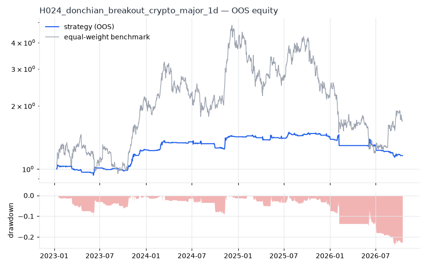
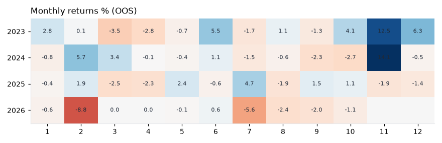
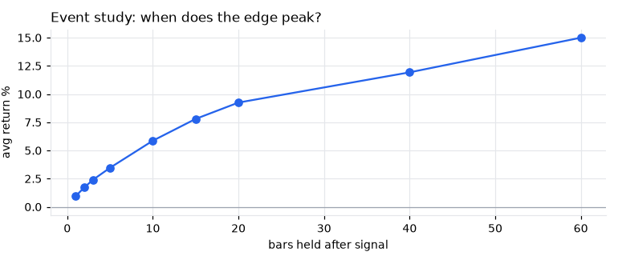
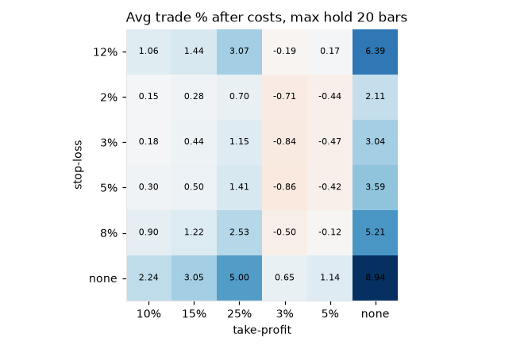

# H024 — donchian_breakout on crypto_major [1d]  ❌ REJECT

- Kind: rule · Source: Turtle / Donchian
- For system: `karma_perp_bot`
- Data: 2020-01-01 00:00:00 → 2026-10-16 00:00:00 · 10 assets · 365.4 bars/year · survivorship mask: False
- Costs: {'commission': 0.0006, 'slippage': 0.0005, 'funding_annual': 0.08, 'borrow_annual': 0.0}
- Variants tried (DSR trials): 169 (failed: 0)
- Final variant: `donchian_breakout|entry=55,exit=10|f=none|x=max_hold=5|size=atr_risk0.01|overlay=vt15`

## Verdict reasons
- DSR 0.217 < 0.9 (luck not excluded after 169 trials)
- OOS Sharpe (excess of T-bill) 0.033 < 0.5
- bootstrap P(SR>0) 0.73 < 0.85
- with 2x costs it does not beat the equal-weight benchmark
- Reality Check p 0.818 > 0.1 (best variant may be data-mined)

## Walk-forward out-of-sample


| Metric | Strategy | Equal-weight benchmark |
|---|---|---|
| years | 3.76 | 3.76 |
| cagr | 0.04 | 0.1495 |
| vol | 0.1338 | 0.6265 |
| sharpe | 0.36 | 0.535 |
| sharpe_excess_rf | 0.033 | None |
| sortino | 0.047 | 0.781 |
| max_dd | -0.2401 | -0.7534 |
| max_dd_bars | 451 | 677 |
| calmar | 0.166 | 0.198 |
| ulcer | 0.0785 | 0.3912 |
| var95 | -0.0063 | -0.0497 |
| cvar95 | -0.0161 | -0.0727 |
| omega | 1.106 | 1.08 |
| tail_ratio | 1.138 | 1.07 |
| skew | -1.899 | 0.118 |
| kurtosis | 61.976 | 3.889 |
| hit_rate | 0.254 | 0.51 |
| turnover_ann | 14.55 | None |

- **Gate Sharpe (excess of T-bill): 0.033**
- Deflated Sharpe: **0.217** · PBO: **0.183** · Reality Check p: **0.818**
- PSR 0.753 · Info ratio -0.448 · Beta -0.001 · Up/Down capture 0.016/0.006
- Sharpe with 2× costs: 0.241 · Walk-forward efficiency: 0.322
- Bootstrap: {'p_sharpe_pos': 0.73, 'cagr_p05': -0.0732, 'maxdd_p05': -0.3764}
- Yearly OOS Sharpe: {'2023': 1.84, '2024': 1.18, '2025': 0.08, '2026': -1.34}



## Regimes (where does it work?)
`{"bull": {"sharpe": 0.83, "ann_ret": 0.0968, "bars": 1059}, "bear": {"sharpe": -0.64, "ann_ret": -0.1145, "bars": 316}, "calm": {"sharpe": 0.56, "ann_ret": 0.0587, "bars": 743}, "stressed": {"sharpe": 0.22, "ann_ret": 0.036, "bars": 632}, "vix_lt_20": {"sharpe": 0.7, "ann_ret": 0.0806, "bars": 1131}, "vix_20_30": {"sharpe": -0.57, "ann_ret": -0.1136, "bars": 223}}`

## Calendar profile (weekday / month / hour)
`{"weekday": {"0": -0.00013, "1": -0.00044, "2": 0.00068, "3": -4e-05, "4": -0.00029, "5": 0.00085, "6": 0.00029}, "month": {"1": 9e-05, "2": -7e-05, "3": -0.0002, "4": -0.00043, "5": 0.0001, "6": 0.00059, "7": -0.00033, "8": -0.0003, "9": -0.00034, "10": 0.00012, "11": 0.00263, "12": 0.00046}}`

## Trades (OOS)
`{"n_trades": 389, "trades_per_year": 103.4, "win_rate": 0.491, "avg_trade": 0.0198, "median_trade": -0.0022, "avg_win": 0.1005, "avg_loss": -0.0581, "profit_factor": 1.669, "payoff": 1.73, "expectancy_r": null, "sqn": null, "kelly_fraction": 0.197, "max_consec_losses": 12, "avg_bars": 5.0, "avg_bars_win": 5.0, "avg_bars_loss": 4.9, "avg_mfe": 0.1048, "avg_mae": -0.0689, "edge_ratio": 1.52, "exit_reasons": {"time": 382, "signal": 7}, "long_short": {"-1": {"count": 146, "mean": 0.0049}, "1": {"count": 243, "mean": 0.0287}}}`

## Robustness
- **delay**: `{"sharpe": 1.107, "sharpe_delayed_1bar": 0.857, "retained": 0.774}`
- **neighbourhood**: `{"neighbours": 0}`
- **noise**: `{"noise_bp": 0.002, "sharpe_min": 1.026, "sharpe_median": 1.107}`
- **random_entry**: `{"actual_ret_per_exposure_ann": 1.6917, "random_median_ann": 0.061, "random_p95_ann": 0.3687, "trades_actual": 568, "p_value": 0.0}`
- **mc_trade_shuffle**: `{"maxdd_median": -0.0833, "maxdd_p95": -0.1256, "final_p05": 3.1612, "final_median": 3.1612}`

## Timing, take-profit, stop-loss and profit studies (in-sample diagnostics)
- Event study (forward return by bars held): `{"1": {"n": 627, "mean": 0.0097, "hit": 0.509, "t": 4.04, "per_bar": 0.00971}, "2": {"n": 627, "mean": 0.0173, "hit": 0.539, "t": 5.26, "per_bar": 0.00867}, "3": {"n": 627, "mean": 0.024, "hit": 0.55, "t": 5.61, "per_bar": 0.00799}, "5": {"n": 627, "mean": 0.0347, "hit": 0.552, "t": 6.21, "per_bar": 0.00694}, "10": {"n": 627, "mean": 0.0587, "hit": 0.553, "t": 7.13, "per_bar": 0.00587}, "15": {"n": 626, "mean": 0.078, "hit": 0.554, "t": 7.6, "per_bar": 0.0052}, "20": {"n": 625, "mean": 0.0925, "hit": 0.56, "t": 7.6, "per_bar": 0.00463}, "40": {"n": 614, "mean": 0.1193, "hit": 0.537, "t": 7.13, "per_bar": 0.00298}, "60": {"n": 589, "mean": 0.15, "hit": 0.54, "t": 7.24, "per_bar": 0.0025}, "best_holding_bars": 15}`

- Event study short: `{"1": {"n": 369, "mean": 0.0002, "hit": 0.482, "t": 0.07, "per_bar": 0.00024}, "2": {"n": 369, "mean": -0.0014, "hit": 0.469, "t": -0.32, "per_bar": -0.00068}, "3": {"n": 369, "mean": 0.0013, "hit": 0.431, "t": 0.25, "per_bar": 0.00045}, "5": {"n": 369, "mean": 0.0121, "hit": 0.477, "t": 2.05, "per_bar": 0.00241}, "10": {"n": 369, "mean": -0.0025, "hit": 0.434, "t": -0.34, "per_bar": -0.00025}, "15": {"n": 369, "mean": -0.0142, "hit": 0.472, "t": -1.63, "per_bar": -0.00095}, "20": {"n": 369, "mean": -0.0193, "hit": 0.461, "t": -1.73, "per_bar": -0.00096}, "40": {"n": 369, "mean": -0.0357, "hit": 0.501, "t": -2.0, "per_bar": -0.00089}, "60": {"n": 369, "mean": -0.066, "hit": 0.496, "t": -3.06, "per_bar": -0.0011}, "best_holding_bars": 5}`
- Best stop / target / max-hold combinations: `[{"stop": NaN, "target": NaN, "max_hold": 20, "n": 627, "mean": 0.0894, "hit": 0.555, "per_bar": 0.0045, "t": 7.3711}, {"stop": NaN, "target": 0.25, "max_hold": 20, "n": 627, "mean": 0.05, "hit": 0.5726, "per_bar": 0.0031, "t": 7.3424}, {"stop": NaN, "target": 0.25, "max_hold": 10, "n": 627, "mean": 0.0386, "hit": 0.5534, "per_bar": 0.0043, "t": 6.929}, {"stop": NaN, "target": NaN, "max_hold": 10, "n": 627, "mean": 0.0565, "hit": 0.5486, "per_bar": 0.0056, "t": 6.8693}, {"stop": NaN, "target": NaN, "max_hold": 40, "n": 627, "mean": 0.1128, "hit": 0.5279, "per_bar": 0.0028, "t": 6.866}]`

- Portfolio overlays (vol target, drawdown brake, equity-curve filter): `{"none": {"sharpe": 0.36, "cagr": 0.04, "max_dd": -0.2401}, "vol_target_0.1": {"sharpe": 0.579, "cagr": 0.0771, "max_dd": -0.1545}, "vol_target_0.15": {"sharpe": 0.555, "cagr": 0.0938, "max_dd": -0.2361}, "vol_target_0.2": {"sharpe": 0.493, "cagr": 0.0909, "max_dd": -0.3193}, "dd_brake_0.1": {"sharpe": 0.401, "cagr": 0.0439, "max_dd": -0.2108}, "dd_brake_0.2": {"sharpe": 0.383, "cagr": 0.0427, "max_dd": -0.2252}, "equity_ma_60": {"sharpe": 0.167, "cagr": 0.0124, "max_dd": -0.2004}, "equity_ma_182": {"sharpe": 0.113, "cagr": 0.0063, "max_dd": -0.2669}, "best_by_calmar": "vol_target_0.1"}`
> Studies are in-sample diagnostics. To use a better exit, register it (exits: [...]) and let the gate judge it.

## Walk-forward windows
- 2024-01-10 00:00:00 → 2024-04-09 00:00:00: IS 1.217 / OOS 2.614 — `donchian_breakout|entry=55,exit=10|f=none|x=max_hold=5|size=atr_risk0.01|overlay=vt10`
- 2024-04-10 00:00:00 → 2024-07-09 00:00:00: IS 1.536 / OOS -0.079 — `donchian_breakout|entry=55,exit=10|f=none|x=max_hold=5|size=atr_risk0.01|overlay=vt10`
- 2024-07-10 00:00:00 → 2024-10-08 00:00:00: IS 1.157 / OOS -2.024 — `donchian_breakout|entry=55,exit=10|f=none|x=max_hold=5|size=atr_risk0.01|overlay=vt10`
- 2024-10-09 00:00:00 → 2025-01-07 00:00:00: IS 1.005 / OOS 3.112 — `donchian_breakout|entry=55,exit=10|f=none|x=max_hold=5|size=atr_risk0.01|overlay=vt10`
- 2025-01-08 00:00:00 → 2025-04-08 00:00:00: IS 1.486 / OOS 0.093 — `donchian_breakout|entry=55,exit=10|f=none|x=max_hold=5|size=atr_risk0.01|overlay=vt10`
- 2025-04-09 00:00:00 → 2025-07-08 00:00:00: IS 1.583 / OOS -0.378 — `donchian_breakout|entry=55,exit=10|f=none|x=max_hold=5|size=atr_risk0.01|overlay=vt10`
- 2025-07-09 00:00:00 → 2025-10-07 00:00:00: IS 1.397 / OOS 2.827 — `donchian_breakout|entry=55,exit=10|f=none|x=max_hold=5|size=atr_risk0.01|overlay=vt10`
- 2025-10-08 00:00:00 → 2026-01-06 00:00:00: IS 1.727 / OOS -3.015 — `donchian_breakout|entry=55,exit=10|f=none|x=max_hold=5|size=atr_risk0.01|overlay=vt10`
- 2026-01-07 00:00:00 → 2026-04-07 00:00:00: IS 1.219 / OOS -0.984 — `donchian_breakout|entry=55,exit=10|f=volume_confirm|x=trail_pct=0.05`
- 2026-04-08 00:00:00 → 2026-07-07 00:00:00: IS 0.942 / OOS -0.994 — `donchian_breakout|entry=100,exit=10|f=none|x=max_hold=10,use_signal_exit=False`
- 2026-07-08 00:00:00 → 2026-10-06 00:00:00: IS 0.865 / OOS -2.12 — `donchian_breakout|entry=100,exit=10|f=none|x=max_hold=10,use_signal_exit=False`
- 2026-10-07 00:00:00 → 2026-10-16 00:00:00: IS 1.153 / OOS -8.531 — `donchian_breakout|entry=55,exit=10|f=none|x=max_hold=5|size=atr_risk0.01|overlay=vt15`

## Best variants (full sample, reference only)
- donchian_breakout|entry=55,exit=10|f=none|x=max_hold=5|size=atr_risk0.01|overlay=vt10: Sharpe 1.166
- donchian_breakout|entry=55,exit=10|f=none|x=max_hold=5,use_signal_exit=False|size=atr_risk0.01|overlay=vt10: Sharpe 1.153
- donchian_breakout|entry=55,exit=10|f=none|x=max_hold=5|size=atr_risk0.01|overlay=vt15: Sharpe 1.091
- donchian_breakout|entry=55,exit=10|f=none|x=max_hold=5,use_signal_exit=False|size=atr_risk0.01|overlay=vt15: Sharpe 1.08
- donchian_breakout|entry=55,exit=10|f=none|x=max_hold=5|size=atr_risk0.01: Sharpe 1.076
- donchian_breakout|entry=55,exit=10|f=none|x=max_hold=5|size=atr_risk0.01|overlay=dd20: Sharpe 1.076
- donchian_breakout|entry=55,exit=10|f=none|x=max_hold=5|size=atr_risk0.01|overlay=dd10: Sharpe 1.073
- donchian_breakout|entry=55,exit=10|f=none|x=max_hold=5|size=atr_risk0.01|overlay=vt20: Sharpe 1.069
- donchian_breakout|entry=55,exit=10|f=none|x=max_hold=5,use_signal_exit=False|size=atr_risk0.01|overlay=dd20: Sharpe 1.067
- donchian_breakout|entry=55,exit=10|f=none|x=max_hold=5,use_signal_exit=False|size=atr_risk0.01: Sharpe 1.067

## Current targets / signals
```json
{
 "positions": {},
 "entry_long_next_open": [],
 "exit_long_next_open": [],
 "entry_short_next_open": []
}
```

> Survivorship bias: unless a membership mask is used, universes are today's members (upper-bound results).