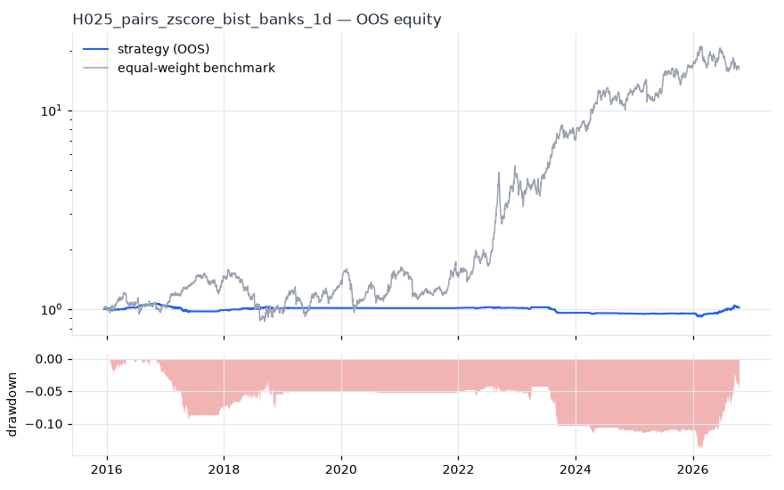
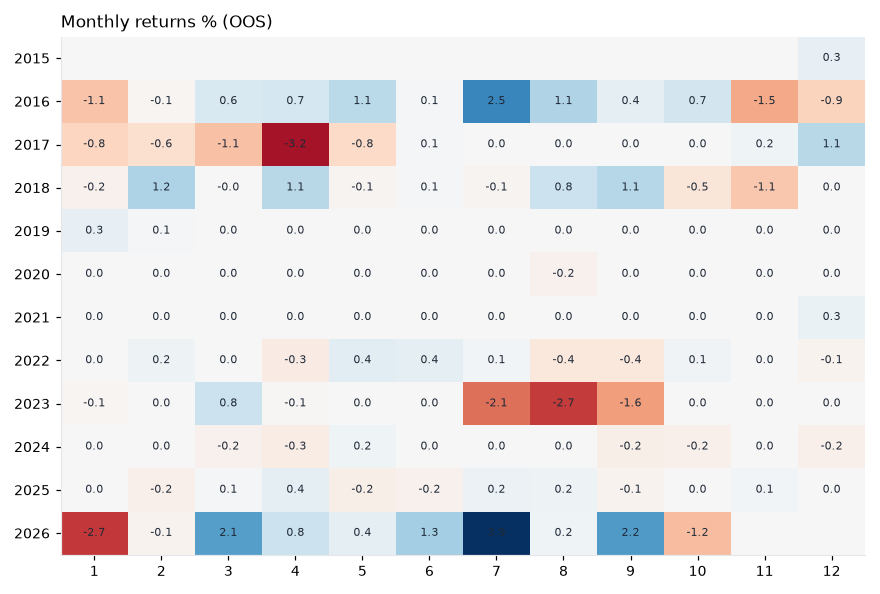

# H025 — pairs_zscore on bist_banks [1d]  ❌ REJECT

- Kind: strategy · Source: Gatev, Goetzmann & Rouwenhorst (2006) Pairs Trading; Vidyamurthy (2004)
- For system: `bist_shock_quant`
- Data: 2012-01-02 00:00:00 → 2026-10-16 00:00:00 · 9 assets · 256.0 bars/year · survivorship mask: False
- Costs: {'commission': 0.001, 'slippage': 0.001, 'funding_annual': 0.0, 'borrow_annual': 0.0}
- Variants tried (DSR trials): 38 (failed: 0)
- Final variant: `pairs_zscore|form=126,entry_z=1.5,min_corr=0.6,hedge=ratio`

## Verdict reasons
- DSR 0.01 < 0.9 (luck not excluded after 38 trials)
- OOS Sharpe (USD, excess of US T-bill) -1.478 < 0.5
- OOS MaxDD -0.9432 worse than -0.45 (local or USD)
- bootstrap P(SR>0) 0.598 < 0.85
- with 2x costs it does not beat the equal-weight benchmark
- PBO 0.737 > 0.5 (variant selection is overfit)
- Reality Check p 0.99 > 0.1 (best variant may be data-mined)

## Walk-forward out-of-sample


| Metric | Strategy | Equal-weight benchmark |
|---|---|---|
| years | 10.76 | 10.76 |
| cagr | 0.0014 | 0.2953 |
| vol | 0.0339 | 0.3479 |
| sharpe | 0.059 | 0.917 |
| sharpe_excess_rf | -0.592 | None |
| sortino | -0.843 | 1.375 |
| max_dd | -0.141 | -0.4523 |
| max_dd_bars | 2523 | 524 |
| calmar | 0.01 | 0.653 |
| ulcer | 0.0713 | 0.1845 |
| var95 | -0.003 | -0.0314 |
| cvar95 | -0.0055 | -0.049 |
| omega | 1.017 | 1.178 |
| tail_ratio | 0.895 | 1.15 |
| skew | 0.714 | 0.179 |
| kurtosis | 21.292 | 4.478 |
| hit_rate | 0.239 | 0.509 |
| turnover_ann | 5.31 | None |

- **Gate Sharpe (USD, excess of US T-bill): -1.478**
- Deflated Sharpe: **0.01** · PBO: **0.737** · Reality Check p: **0.99**
- PSR 0.576 · Info ratio -0.902 · Beta -0.006 · Up/Down capture -0.01/-0.013
- Sharpe with 2× costs: -0.254 · Walk-forward efficiency: 0.084
- Bootstrap: {'p_sharpe_pos': 0.598, 'cagr_p05': -0.0154, 'maxdd_p05': -0.2069}
- Yearly OOS Sharpe: {'2016': 0.91, '2017': -1.12, '2018': 0.4, '2019': 0.7, '2020': -0.88, '2021': 1.09, '2022': 0.02, '2023': -1.98, '2024': -0.91, '2025': 0.28, '2026': 1.27}
- In USD: CAGR -0.2293 · Sharpe -1.355 · excess-rf Sharpe -1.478 · MaxDD -0.9432



## Regimes (where does it work?)
`{"bull": {"sharpe": -0.19, "ann_ret": -0.0054, "bars": 1825}, "bear": {"sharpe": 0.38, "ann_ret": 0.0164, "bars": 929}, "calm": {"sharpe": -0.5, "ann_ret": -0.0156, "bars": 1450}, "stressed": {"sharpe": 0.59, "ann_ret": 0.0215, "bars": 1304}, "vix_lt_20": {"sharpe": -0.02, "ann_ret": -0.0009, "bars": 1930}, "vix_20_30": {"sharpe": 0.28, "ann_ret": 0.0086, "bars": 671}, "vix_ge_30": {"sharpe": 0.99, "ann_ret": 0.0091, "bars": 153}, "curve_inverted": {"sharpe": -1.36, "ann_ret": -0.0274, "bars": 612}, "curve_normal": {"sharpe": 0.28, "ann_ret": 0.0104, "bars": 2142}}`

## Calendar profile (weekday / month / hour)
`{"weekday": {"0": 5e-05, "1": 2e-05, "2": 6e-05, "3": -0.0001, "4": 1e-05}, "month": {"1": -0.00019, "2": 2e-05, "3": 9e-05, "4": -4e-05, "5": 4e-05, "6": 8e-05, "7": 0.00019, "8": -4e-05, "9": 5e-05, "10": -4e-05, "11": -0.0001, "12": 2e-05}}`

## Robustness
- **delay**: `{"sharpe": 0.04, "sharpe_delayed_1bar": 0.144, "retained": 3.602}`
- **neighbourhood**: `{"neighbours": 5, "best_sharpe": 0.039, "neighbour_median": 0.078, "share_positive": 0.6, "stability": 1.983}`
- **noise**: `{"noise_bp": 0.002, "sharpe_min": 0.045, "sharpe_median": 0.123}`

## Timing, take-profit, stop-loss and profit studies (in-sample diagnostics)
- Portfolio overlays (vol target, drawdown brake, equity-curve filter): `{"none": {"sharpe": 0.059, "cagr": 0.0014, "max_dd": -0.141}, "vol_target_0.1": {"sharpe": 0.067, "cagr": 0.0022, "max_dd": -0.2549}, "vol_target_0.15": {"sharpe": 0.068, "cagr": 0.0023, "max_dd": -0.2647}, "vol_target_0.2": {"sharpe": 0.058, "cagr": 0.0017, "max_dd": -0.268}, "dd_brake_0.1": {"sharpe": 0.024, "cagr": 0.0002, "max_dd": -0.1238}, "dd_brake_0.2": {"sharpe": 0.059, "cagr": 0.0014, "max_dd": -0.141}, "equity_ma_42": {"sharpe": 0.031, "cagr": 0.0004, "max_dd": -0.0997}, "equity_ma_128": {"sharpe": 0.179, "cagr": 0.0041, "max_dd": -0.0919}, "best_by_calmar": "equity_ma_128"}`
> Studies are in-sample diagnostics. To use a better exit, register it (exits: [...]) and let the gate judge it.

## Walk-forward windows
- 2020-11-26 00:00:00 → 2021-05-31 00:00:00: IS 0.597 / OOS 0.0 — `pairs_zscore|form=252,entry_z=2.5,min_corr=0.8,hedge=ols`
- 2021-06-01 00:00:00 → 2021-12-06 00:00:00: IS 0.597 / OOS 0.0 — `pairs_zscore|form=252,entry_z=2.5,min_corr=0.8,hedge=ols`
- 2021-12-07 00:00:00 → 2022-06-08 00:00:00: IS 0.298 / OOS 1.159 — `pairs_zscore|form=252,entry_z=2.0,min_corr=0.8,hedge=ols`
- 2022-06-09 00:00:00 → 2022-12-09 00:00:00: IS 0.486 / OOS -0.232 — `pairs_zscore|form=126,entry_z=2.5,min_corr=0.8,hedge=ratio`
- 2022-12-12 00:00:00 → 2023-06-16 00:00:00: IS 0.452 / OOS 0.582 — `pairs_zscore|form=252,entry_z=2.5,min_corr=0.8,hedge=ols`
- 2023-06-19 00:00:00 → 2023-12-19 00:00:00: IS 0.506 / OOS -3.614 — `pairs_zscore|form=252,entry_z=2.5,min_corr=0.8,hedge=ols`
- 2023-12-20 00:00:00 → 2024-06-28 00:00:00: IS 0.798 / OOS -0.452 — `pairs_zscore|form=126,entry_z=2.5,min_corr=0.8,hedge=ratio`
- 2024-07-01 00:00:00 → 2024-12-30 00:00:00: IS 0.582 / OOS -1.726 — `pairs_zscore|form=126,entry_z=2.5,min_corr=0.8,hedge=ratio`
- 2024-12-31 00:00:00 → 2025-07-08 00:00:00: IS 0.542 / OOS 0.211 — `pairs_zscore|form=252,entry_z=2.5,min_corr=0.8,hedge=ratio`
- 2025-07-09 00:00:00 → 2026-01-07 00:00:00: IS 0.509 / OOS 0.191 — `pairs_zscore|form=252,entry_z=2.5,min_corr=0.8,hedge=ratio`
- 2026-01-08 00:00:00 → 2026-07-16 00:00:00: IS 0.663 / OOS 1.202 — `pairs_zscore|form=126,entry_z=2.0,min_corr=0.6,hedge=ratio`
- 2026-07-17 00:00:00 → 2026-10-16 00:00:00: IS 0.786 / OOS 1.51 — `pairs_zscore|form=126,entry_z=1.5,min_corr=0.6,hedge=ratio`

## Best variants (full sample, reference only)
- pairs_zscore|form=126,entry_z=2.5,min_corr=0.6,hedge=ratio|overlay=dd10: Sharpe 0.188
- pairs_zscore|form=126,entry_z=2.5,min_corr=0.6,hedge=ratio|overlay=vt10: Sharpe 0.186
- pairs_zscore|form=126,entry_z=2.5,min_corr=0.8,hedge=ratio|overlay=vt10: Sharpe 0.178
- pairs_zscore|form=126,entry_z=2.5,min_corr=0.8,hedge=ratio: Sharpe 0.178
- pairs_zscore|form=126,entry_z=2.5,min_corr=0.8,hedge=ratio|overlay=vt15: Sharpe 0.178
- pairs_zscore|form=126,entry_z=2.5,min_corr=0.8,hedge=ratio|overlay=dd20: Sharpe 0.178
- pairs_zscore|form=126,entry_z=2.5,min_corr=0.8,hedge=ratio|overlay=vt20: Sharpe 0.178
- pairs_zscore|form=126,entry_z=2.5,min_corr=0.8,hedge=ratio|overlay=dd10: Sharpe 0.178
- pairs_zscore|form=126,entry_z=2.5,min_corr=0.6,hedge=ratio|overlay=vt15: Sharpe 0.158
- pairs_zscore|form=126,entry_z=2.5,min_corr=0.6,hedge=ratio: Sharpe 0.158

## Current targets / signals
```json
{
 "TSKB.IS": 0.3,
 "AKBNK.IS": 0.1,
 "ISCTR.IS": -0.05,
 "ALBRK.IS": -0.05,
 "GARAN.IS": -0.1,
 "VAKBN.IS": -0.1,
 "YKBNK.IS": -0.1
}
```

> Survivorship bias: unless a membership mask is used, universes are today's members (upper-bound results).