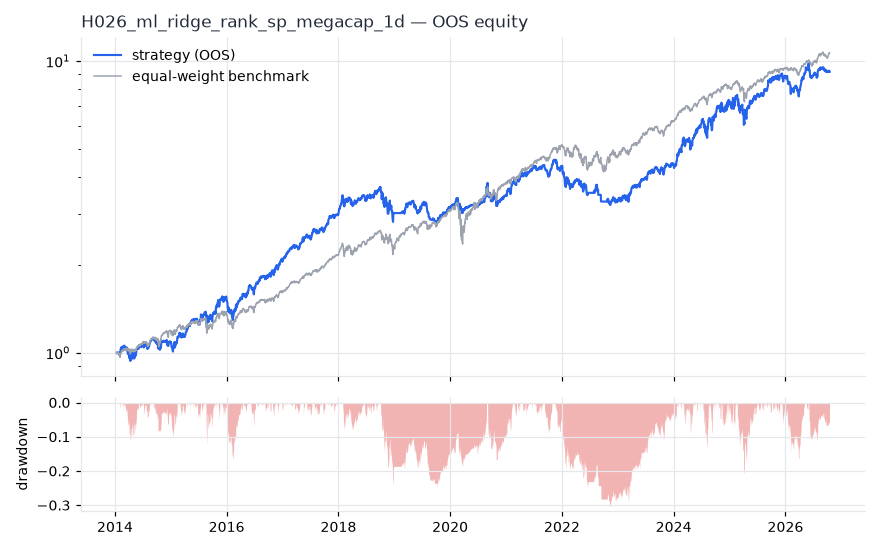
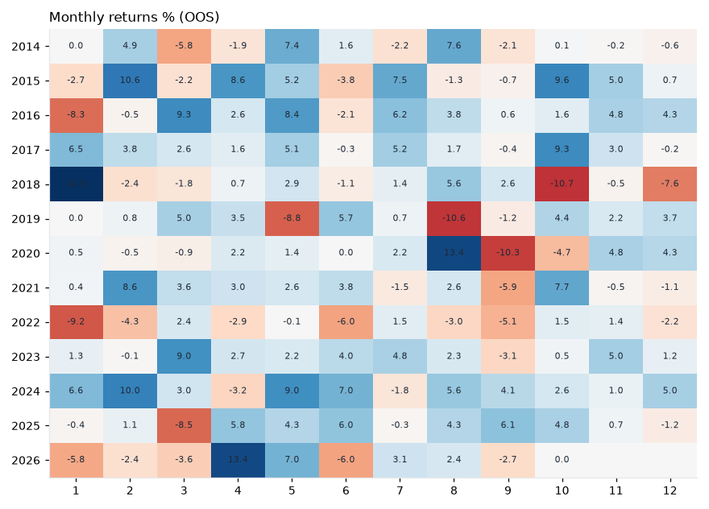

# H026 — ml_ridge_rank on sp_megacap [1d]  🟡 WATCH

- Kind: strategy · Source: Gu, Kelly & Xiu (2020) Empirical Asset Pricing via Machine Learning (linear baseline)
- For system: `global_momentum_quant`
- Data: 2010-01-04 00:00:00 → 2026-10-16 00:00:00 · 30 assets · 251.7 bars/year · survivorship mask: True
- Costs: {'commission': 0.0002, 'slippage': 0.0003, 'funding_annual': 0.0, 'borrow_annual': 0.0}
- Variants tried (DSR trials): 22 (failed: 0)
- Final variant: `ml_ridge_rank|train_months=36,alpha=1.0,top_n=10|overlay=eqma_s`

## Verdict reasons
- with 2x costs it does not beat the equal-weight benchmark
- PBO 0.878 > 0.5 (variant selection is overfit)
- Reality Check p 0.676 > 0.1 (best variant may be data-mined)

## Walk-forward out-of-sample


| Metric | Strategy | Equal-weight benchmark |
|---|---|---|
| years | 12.76 | 12.76 |
| cagr | 0.1898 | 0.2038 |
| vol | 0.1849 | 0.1622 |
| sharpe | 1.033 | 1.225 |
| sharpe_excess_rf | 0.931 | None |
| sortino | 1.33 | 1.765 |
| max_dd | -0.301 | -0.279 |
| max_dd_bars | 547 | 314 |
| calmar | 0.631 | 0.731 |
| ulcer | 0.1071 | 0.0443 |
| var95 | -0.0189 | -0.0146 |
| cvar95 | -0.0283 | -0.0242 |
| omega | 1.21 | 1.265 |
| tail_ratio | 0.948 | 0.979 |
| skew | -0.088 | -0.297 |
| kurtosis | 6.61 | 15.548 |
| hit_rate | 0.531 | 0.565 |
| turnover_ann | 12.48 | None |

- **Gate Sharpe (excess of T-bill): 0.931**
- Deflated Sharpe: **0.999** · PBO: **0.878** · Reality Check p: **0.676**
- PSR 1.0 · Info ratio -0.061 · Beta 0.842 · Up/Down capture 1.025/1.043
- Sharpe with 2× costs: 0.999 · Walk-forward efficiency: 0.699
- Bootstrap: {'p_sharpe_pos': 1.0, 'cagr_p05': 0.1003, 'maxdd_p05': -0.4227}
- Yearly OOS Sharpe: {'2014': 0.6, '2015': 1.87, '2016': 1.77, '2017': 3.16, '2018': 0.19, '2019': 0.39, '2020': 0.65, '2021': 1.65, '2022': -1.37, '2023': 2.11, '2024': 1.98, '2025': 0.96, '2026': 0.38}



## Regimes (where does it work?)
`{"bull": {"sharpe": 1.7, "ann_ret": 0.2916, "bars": 2702}, "bear": {"sharpe": -1.42, "ann_ret": -0.3446, "bars": 508}, "calm": {"sharpe": 1.82, "ann_ret": 0.2642, "bars": 1677}, "stressed": {"sharpe": 0.5, "ann_ret": 0.1107, "bars": 1533}, "vix_lt_20": {"sharpe": 2.76, "ann_ret": 0.4302, "bars": 2335}, "vix_20_30": {"sharpe": -1.56, "ann_ret": -0.3457, "bars": 717}, "vix_ge_30": {"sharpe": -2.9, "ann_ret": -0.91, "bars": 158}, "curve_inverted": {"sharpe": 1.17, "ann_ret": 0.2339, "bars": 614}, "curve_normal": {"sharpe": 1.0, "ann_ret": 0.1808, "bars": 2596}}`

## Calendar profile (weekday / month / hour)
`{"weekday": {"0": 0.00066, "1": 0.00065, "2": 0.00148, "3": 0.0006, "4": 0.00038}, "month": {"1": 0.00014, "2": 0.0012, "3": 0.00045, "4": 0.00137, "5": 0.00167, "6": 0.00032, "7": 0.00099, "8": 0.00119, "9": -0.00066, "10": 0.00097, "11": 0.00114, "12": 0.00029}}`

## Robustness
- **delay**: `{"sharpe": 1.265, "sharpe_delayed_1bar": 1.285, "retained": 1.016}`
- **neighbourhood**: `{"neighbours": 1, "best_sharpe": 1.1, "neighbour_median": 1.117, "share_positive": 1.0, "stability": 1.016}`
- **noise**: `{"noise_bp": 0.002, "sharpe_min": 1.194, "sharpe_median": 1.251}`

## Timing, take-profit, stop-loss and profit studies (in-sample diagnostics)
- Portfolio overlays (vol target, drawdown brake, equity-curve filter): `{"none": {"sharpe": 1.033, "cagr": 0.1898, "max_dd": -0.301}, "vol_target_0.1": {"sharpe": 1.053, "cagr": 0.1139, "max_dd": -0.2103}, "vol_target_0.15": {"sharpe": 1.052, "cagr": 0.1694, "max_dd": -0.3015}, "vol_target_0.2": {"sharpe": 1.055, "cagr": 0.2244, "max_dd": -0.384}, "dd_brake_0.1": {"sharpe": 1.0, "cagr": 0.1561, "max_dd": -0.2208}, "dd_brake_0.2": {"sharpe": 1.011, "cagr": 0.1784, "max_dd": -0.2852}, "equity_ma_41": {"sharpe": 0.921, "cagr": 0.1216, "max_dd": -0.2327}, "equity_ma_125": {"sharpe": 1.002, "cagr": 0.1485, "max_dd": -0.1813}, "best_by_calmar": "equity_ma_125"}`
> Studies are in-sample diagnostics. To use a better exit, register it (exits: [...]) and let the gate judge it.

## Walk-forward windows
- 2020-12-23 00:00:00 → 2021-06-23 00:00:00: IS 1.106 / OOS 2.886 — `ml_ridge_rank|train_months=36,alpha=10.0,top_n=10|overlay=eqma_s`
- 2021-06-24 00:00:00 → 2021-12-20 00:00:00: IS 1.374 / OOS -0.211 — `ml_ridge_rank|train_months=36,alpha=10.0,top_n=10|overlay=eqma_s`
- 2021-12-21 00:00:00 → 2022-06-21 00:00:00: IS 1.551 / OOS -1.494 — `ml_ridge_rank|train_months=36,alpha=10.0,top_n=10|overlay=vt20`
- 2022-06-22 00:00:00 → 2022-12-16 00:00:00: IS 1.157 / OOS -0.972 — `ml_ridge_rank|train_months=36,alpha=10.0,top_n=10|overlay=eqma_l`
- 2022-12-19 00:00:00 → 2023-06-20 00:00:00: IS 1.022 / OOS 2.424 — `ml_ridge_rank|train_months=36,alpha=10.0,top_n=10|overlay=eqma_l`
- 2023-06-21 00:00:00 → 2023-12-15 00:00:00: IS 1.294 / OOS 1.824 — `ml_ridge_rank|train_months=36,alpha=10.0,top_n=10|overlay=eqma_l`
- 2023-12-18 00:00:00 → 2024-06-17 00:00:00: IS 1.496 / OOS 2.915 — `ml_ridge_rank|train_months=60,alpha=1.0,top_n=5`
- 2024-06-18 00:00:00 → 2024-12-13 00:00:00: IS 1.494 / OOS 1.422 — `ml_ridge_rank|train_months=60,alpha=1.0,top_n=5`
- 2024-12-16 00:00:00 → 2025-06-17 00:00:00: IS 1.544 / OOS 0.389 — `ml_ridge_rank|train_months=60,alpha=1.0,top_n=5`
- 2025-06-18 00:00:00 → 2025-12-15 00:00:00: IS 1.919 / OOS 2.225 — `ml_ridge_rank|train_months=60,alpha=1.0,top_n=10`
- 2025-12-16 00:00:00 → 2026-06-16 00:00:00: IS 2.083 / OOS 0.288 — `ml_ridge_rank|train_months=60,alpha=1.0,top_n=10`
- 2026-06-17 00:00:00 → 2026-10-16 00:00:00: IS 1.725 / OOS 1.167 — `ml_ridge_rank|train_months=36,alpha=1.0,top_n=10|overlay=eqma_s`

## Best variants (full sample, reference only)
- ml_ridge_rank|train_months=36,alpha=10.0,top_n=10|overlay=vt10: Sharpe 1.149
- ml_ridge_rank|train_months=36,alpha=1.0,top_n=10|overlay=vt10: Sharpe 1.148
- ml_ridge_rank|train_months=36,alpha=10.0,top_n=10|overlay=vt15: Sharpe 1.143
- ml_ridge_rank|train_months=36,alpha=10.0,top_n=10: Sharpe 1.139
- ml_ridge_rank|train_months=36,alpha=1.0,top_n=10|overlay=vt15: Sharpe 1.139
- ml_ridge_rank|train_months=36,alpha=1.0,top_n=10|overlay=dd10: Sharpe 1.137
- ml_ridge_rank|train_months=36,alpha=10.0,top_n=10|overlay=dd10: Sharpe 1.133
- ml_ridge_rank|train_months=36,alpha=10.0,top_n=10|overlay=vt20: Sharpe 1.13
- ml_ridge_rank|train_months=36,alpha=1.0,top_n=10|overlay=vt20: Sharpe 1.125
- ml_ridge_rank|train_months=36,alpha=1.0,top_n=10: Sharpe 1.122

## Current targets / signals
```json
{
 "NVDA": 0.1,
 "AMZN": 0.1,
 "GOOGL": 0.1,
 "UNH": 0.1,
 "JNJ": 0.1,
 "AVGO": 0.1,
 "MRK": 0.1,
 "ORCL": 0.1,
 "CSCO": 0.1,
 "META": 0.1
}
```

> Survivorship bias: unless a membership mask is used, universes are today's members (upper-bound results).