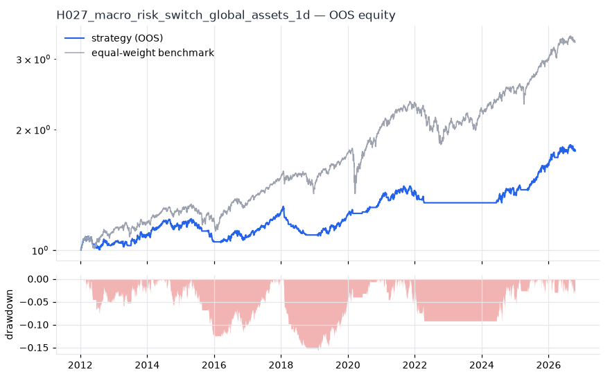
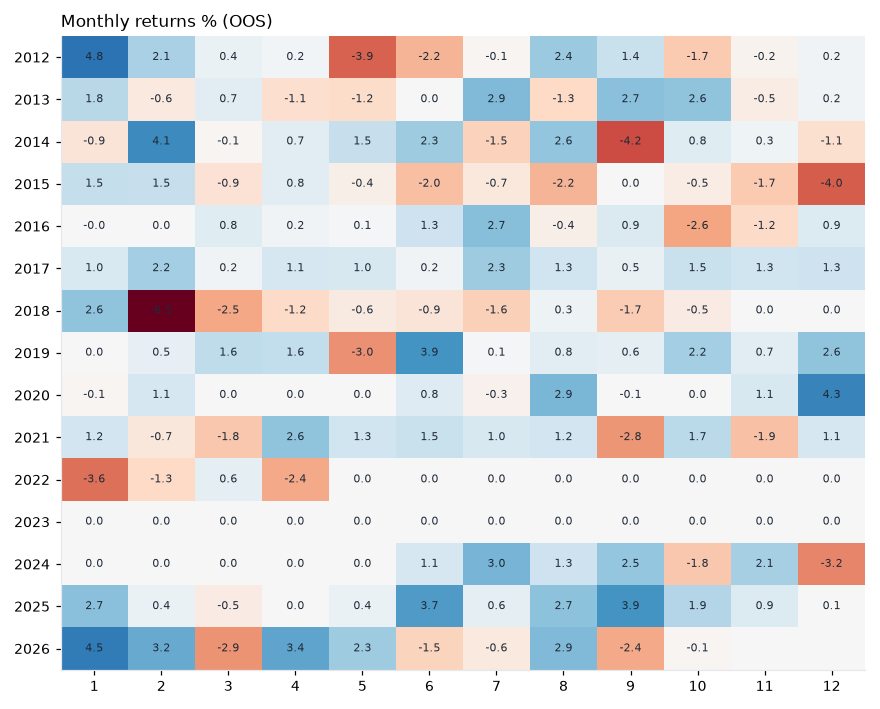

# H027 — macro_risk_switch on global_assets [1d]  🟡 WATCH

- Kind: strategy · Source: Risk-on / risk-off timing with VIX, yield curve and trend
- For system: `macro-model`
- Data: 2008-01-02 00:00:00 → 2026-10-16 00:00:00 · 10 assets · 251.7 bars/year · survivorship mask: False
- Costs: {'commission': 0.0002, 'slippage': 0.0003, 'funding_annual': 0.0, 'borrow_annual': 0.0}
- Variants tried (DSR trials): 26 (failed: 0)
- Final variant: `macro_risk_switch|vix_max=30,use_curve=False,trend_n=100`

## Verdict reasons
- DSR 0.86 < 0.9 (luck not excluded after 26 trials)
- OOS Sharpe (excess of T-bill) 0.366 < 0.5
- with 2x costs it does not beat the equal-weight benchmark
- PBO 0.541 > 0.5 (variant selection is overfit)
- Reality Check p 0.998 > 0.1 (best variant may be data-mined)

## Walk-forward out-of-sample


| Metric | Strategy | Equal-weight benchmark |
|---|---|---|
| years | 14.76 | 14.76 |
| cagr | 0.0394 | 0.0844 |
| vol | 0.0669 | 0.111 |
| sharpe | 0.611 | 0.785 |
| sharpe_excess_rf | 0.366 | None |
| sortino | 0.511 | 1.1 |
| max_dd | -0.1559 | -0.2308 |
| max_dd_bars | 865 | 630 |
| calmar | 0.253 | 0.365 |
| ulcer | 0.0696 | 0.0554 |
| var95 | -0.007 | -0.0103 |
| cvar95 | -0.0106 | -0.0162 |
| omega | 1.133 | 1.154 |
| tail_ratio | 1.05 | 1.018 |
| skew | -0.429 | -0.635 |
| kurtosis | 4.22 | 12.368 |
| hit_rate | 0.37 | 0.549 |
| turnover_ann | 8.81 | None |

- **Gate Sharpe (excess of T-bill): 0.366**
- Deflated Sharpe: **0.86** · PBO: **0.541** · Reality Check p: **0.998**
- PSR 0.99 · Info ratio -0.523 · Beta 0.364 · Up/Down capture 0.53/0.539
- Sharpe with 2× costs: 0.546 · Walk-forward efficiency: 0.764
- Bootstrap: {'p_sharpe_pos': 0.994, 'cagr_p05': 0.0113, 'maxdd_p05': -0.2335}
- Yearly OOS Sharpe: {'2012': 0.46, '2013': 0.85, '2014': 0.66, '2015': -1.14, '2016': 0.44, '2017': 2.77, '2018': -2.39, '2019': 1.79, '2020': 1.96, '2021': 0.55, '2022': -1.38, '2023': 0.0, '2024': 0.71, '2025': 2.35, '2026': 1.1}



## Regimes (where does it work?)
`{"bull": {"sharpe": 0.77, "ann_ret": 0.0549, "bars": 3204}, "bear": {"sharpe": -2.58, "ann_ret": -0.0471, "bars": 511}, "calm": {"sharpe": 0.62, "ann_ret": 0.04, "bars": 2043}, "stressed": {"sharpe": 0.61, "ann_ret": 0.042, "bars": 1672}, "vix_lt_20": {"sharpe": 1.64, "ann_ret": 0.1093, "bars": 2796}, "vix_20_30": {"sharpe": -2.56, "ann_ret": -0.1781, "bars": 761}, "vix_ge_30": {"sharpe": -2.79, "ann_ret": -0.1148, "bars": 158}, "curve_inverted": {"sharpe": 0.89, "ann_ret": 0.0462, "bars": 614}, "curve_normal": {"sharpe": 0.57, "ann_ret": 0.0398, "bars": 3101}}`

## Calendar profile (weekday / month / hour)
`{"weekday": {"0": 8e-05, "1": 0.0002, "2": 0.00013, "3": 0.00016, "4": 0.00024}, "month": {"1": 0.00052, "2": 0.00021, "3": -0.00013, "4": 0.00019, "5": -7e-05, "6": 0.00026, "7": 0.00025, "8": 0.00044, "9": 4e-05, "10": 0.00011, "11": 3e-05, "12": 9e-05}}`

## Robustness
- **delay**: `{"sharpe": 0.598, "sharpe_delayed_1bar": 0.638, "retained": 1.068}`
- **neighbourhood**: `{"neighbours": 4, "best_sharpe": 0.594, "neighbour_median": 0.515, "share_positive": 1.0, "stability": 0.867}`
- **noise**: `{"noise_bp": 0.002, "sharpe_min": 0.589, "sharpe_median": 0.6}`

## Timing, take-profit, stop-loss and profit studies (in-sample diagnostics)
- Portfolio overlays (vol target, drawdown brake, equity-curve filter): `{"none": {"sharpe": 0.611, "cagr": 0.0394, "max_dd": -0.1559}, "vol_target_0.1": {"sharpe": 0.638, "cagr": 0.0576, "max_dd": -0.2399}, "vol_target_0.15": {"sharpe": 0.573, "cagr": 0.065, "max_dd": -0.2845}, "vol_target_0.2": {"sharpe": 0.575, "cagr": 0.0697, "max_dd": -0.2894}, "dd_brake_0.1": {"sharpe": 0.589, "cagr": 0.0364, "max_dd": -0.1311}, "dd_brake_0.2": {"sharpe": 0.611, "cagr": 0.0394, "max_dd": -0.1559}, "equity_ma_41": {"sharpe": 0.389, "cagr": 0.0195, "max_dd": -0.1022}, "equity_ma_125": {"sharpe": 0.576, "cagr": 0.0318, "max_dd": -0.1177}, "best_by_calmar": "dd_brake_0.1"}`
> Studies are in-sample diagnostics. To use a better exit, register it (exits: [...]) and let the gate judge it.

## Walk-forward windows
- 2020-12-16 00:00:00 → 2021-06-16 00:00:00: IS 0.88 / OOS 1.187 — `macro_risk_switch|vix_max=30,use_curve=True,trend_n=200|overlay=eqma_s`
- 2021-06-17 00:00:00 → 2021-12-13 00:00:00: IS 1.328 / OOS -0.184 — `macro_risk_switch|vix_max=30,use_curve=True,trend_n=100`
- 2021-12-14 00:00:00 → 2022-06-13 00:00:00: IS 1.463 / OOS -1.316 — `macro_risk_switch|vix_max=30,use_curve=True,trend_n=200`
- 2022-06-14 00:00:00 → 2022-12-09 00:00:00: IS 1.347 / OOS 0.0 — `macro_risk_switch|vix_max=30,use_curve=True,trend_n=200|overlay=eqma_l`
- 2022-12-12 00:00:00 → 2023-06-12 00:00:00: IS 1.226 / OOS 0.0 — `macro_risk_switch|vix_max=30,use_curve=True,trend_n=200|overlay=eqma_l`
- 2023-06-13 00:00:00 → 2023-12-08 00:00:00: IS 1.014 / OOS 0.0 — `macro_risk_switch|vix_max=30,use_curve=True,trend_n=200|overlay=eqma_l`
- 2023-12-11 00:00:00 → 2024-06-10 00:00:00: IS 0.523 / OOS 0.0 — `macro_risk_switch|vix_max=30,use_curve=True,trend_n=200|overlay=eqma_l`
- 2024-06-11 00:00:00 → 2024-12-06 00:00:00: IS 0.155 / OOS 1.845 — `macro_risk_switch|vix_max=30,use_curve=False,trend_n=200`
- 2024-12-09 00:00:00 → 2025-06-10 00:00:00: IS 0.483 / OOS 0.491 — `macro_risk_switch|vix_max=30,use_curve=False,trend_n=100`
- 2025-06-11 00:00:00 → 2025-12-08 00:00:00: IS 0.738 / OOS 2.816 — `macro_risk_switch|vix_max=30,use_curve=False,trend_n=100`
- 2025-12-09 00:00:00 → 2026-06-09 00:00:00: IS 1.315 / OOS 1.789 — `macro_risk_switch|vix_max=30,use_curve=False,trend_n=100`
- 2026-06-10 00:00:00 → 2026-10-16 00:00:00: IS 1.554 / OOS 0.13 — `macro_risk_switch|vix_max=30,use_curve=False,trend_n=100`

## Best variants (full sample, reference only)
- macro_risk_switch|vix_max=30,use_curve=False,trend_n=200: Sharpe 0.666
- macro_risk_switch|vix_max=30,use_curve=False,trend_n=200|overlay=dd20: Sharpe 0.666
- macro_risk_switch|vix_max=30,use_curve=False,trend_n=200|overlay=vt20: Sharpe 0.666
- macro_risk_switch|vix_max=30,use_curve=False,trend_n=200|overlay=vt15: Sharpe 0.664
- macro_risk_switch|vix_max=30,use_curve=False,trend_n=200|overlay=dd10: Sharpe 0.626
- macro_risk_switch|vix_max=30,use_curve=False,trend_n=200|overlay=vt10: Sharpe 0.616
- macro_risk_switch|vix_max=30,use_curve=True,trend_n=200|overlay=vt20: Sharpe 0.607
- macro_risk_switch|vix_max=30,use_curve=True,trend_n=200|overlay=dd20: Sharpe 0.607
- macro_risk_switch|vix_max=30,use_curve=True,trend_n=200: Sharpe 0.607
- macro_risk_switch|vix_max=30,use_curve=True,trend_n=200|overlay=vt15: Sharpe 0.604

## Current targets / signals
```json
{
 "SPY": 0.1,
 "QQQ": 0.1,
 "IWM": 0.1,
 "EFA": 0.1,
 "EEM": 0.1,
 "TLT": 0.1,
 "IEF": 0.1,
 "GLD": 0.1,
 "DBC": 0.1,
 "VNQ": 0.1
}
```

> Survivorship bias: unless a membership mask is used, universes are today's members (upper-bound results).