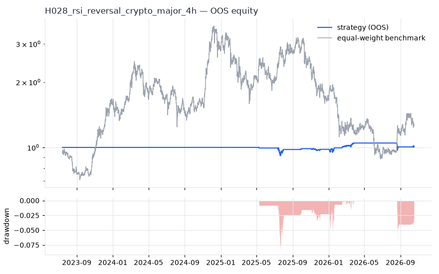
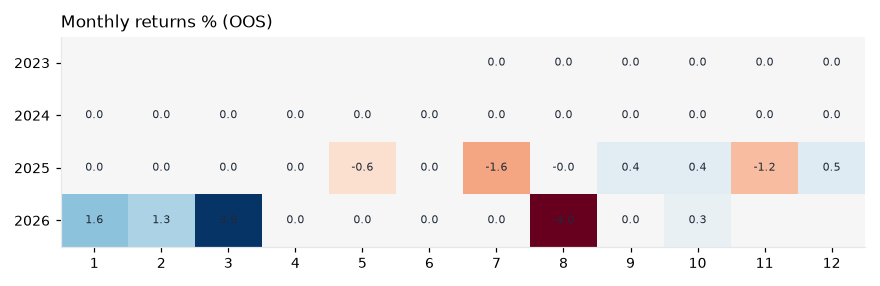
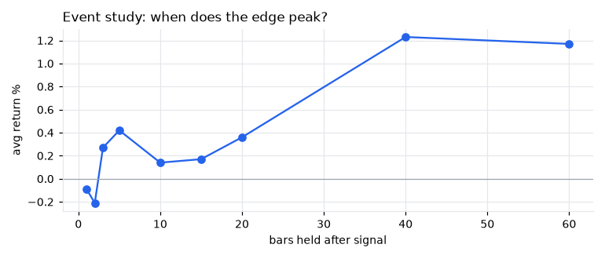
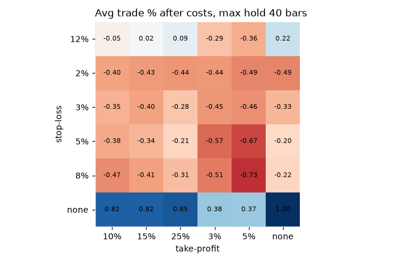

# H028 — rsi_reversal on crypto_major [4h]  ❌ REJECT

- Kind: rule · Source: Wilder (1978) RSI; Connors (2009)
- For system: `karma_perp_bot`
- Data: 2021-01-01 00:00:00 → 2026-10-17 04:00:00 · 10 assets · 2191.7 bars/year · survivorship mask: False
- Costs: {'commission': 0.0006, 'slippage': 0.0005, 'funding_annual': 0.08, 'borrow_annual': 0.0}
- Variants tried (DSR trials): 393 (failed: 0)
- Final variant: `rsi_reversal|n=7,lo=20,exit=60|f=htf_week_sma10|x=signal_only`

## Verdict reasons
- DSR 0.0 < 0.9 (luck not excluded after 393 trials)
- OOS Sharpe (excess of T-bill) -0.759 < 0.5
- bootstrap P(SR>0) 0.558 < 0.85
- only 50% of OOS years positive
- with 2x costs it does not beat the equal-weight benchmark
- Reality Check p 0.828 > 0.1 (best variant may be data-mined)
- random entries match it (p=0.44): the edge is in the exits, not the signal
- parameter spike: only 0% of neighbouring settings are profitable

## Walk-forward out-of-sample


| Metric | Strategy | Equal-weight benchmark |
|---|---|---|
| years | 3.26 | 3.26 |
| cagr | 0.0027 | 0.075 |
| vol | 0.0516 | 0.6401 |
| sharpe | 0.079 | 0.435 |
| sharpe_excess_rf | -0.759 | None |
| sortino | -1.03 | 0.598 |
| max_dd | -0.0866 | -0.756 |
| max_dd_bars | 3780 | 4064 |
| calmar | 0.032 | 0.099 |
| ulcer | 0.0142 | 0.4136 |
| var95 | -0.0001 | -0.0213 |
| cvar95 | -0.0021 | -0.0335 |
| omega | 1.017 | 1.028 |
| tail_ratio | 1.723 | 0.967 |
| skew | -2.125 | -0.549 |
| kurtosis | 107.093 | 9.504 |
| hit_rate | 0.053 | 0.514 |
| turnover_ann | 1.41 | None |

- **Gate Sharpe (excess of T-bill): -0.759**
- Deflated Sharpe: **0.0** · PBO: **0.303** · Reality Check p: **0.828**
- PSR 0.556 · Info ratio -0.422 · Beta -0.011 · Up/Down capture -0.014/-0.015
- Sharpe with 2× costs: 0.048 · Walk-forward efficiency: 0.053
- Bootstrap: {'p_sharpe_pos': 0.558, 'cagr_p05': -0.0381, 'maxdd_p05': -0.1749}
- Yearly OOS Sharpe: {'2023': 1.12, '2024': 0.0, '2025': -0.33, '2026': 0.5}



## Regimes (where does it work?)
`{"bull": {"sharpe": -0.28, "ann_ret": -0.0128, "bars": 5348}, "bear": {"sharpe": 0.82, "ann_ret": 0.0541, "bars": 1796}, "calm": {"sharpe": -0.31, "ann_ret": -0.0218, "bars": 3234}, "stressed": {"sharpe": 1.01, "ann_ret": 0.0255, "bars": 3910}, "vix_lt_20": {"sharpe": -0.1, "ann_ret": -0.0054, "bars": 5938}, "vix_20_30": {"sharpe": 1.5, "ann_ret": 0.0567, "bars": 1080}, "vix_ge_30": {"sharpe": 0.0, "ann_ret": 0.0, "bars": 126}}`

## Calendar profile (weekday / month / hour)
`{"weekday": {"0": -0.0, "1": -4e-05, "2": 7e-05, "3": 2e-05, "4": -4e-05, "5": -1e-05, "6": 1e-05}, "month": {"1": 3e-05, "2": 3e-05, "3": 7e-05, "4": 0.0, "5": -1e-05, "6": 0.0, "7": -2e-05, "8": -5e-05, "9": 1e-05, "10": 1e-05, "11": -2e-05, "12": 1e-05}, "hour": {"0": -3e-05, "4": 1e-05, "8": 3e-05, "12": 2e-05, "16": 3e-05, "20": -5e-05}}`

## Trades (OOS)
`{"n_trades": 616, "trades_per_year": 189.0, "win_rate": 0.661, "avg_trade": 0.0031, "median_trade": 0.0171, "avg_win": 0.0342, "avg_loss": -0.0575, "profit_factor": 1.159, "payoff": 0.595, "expectancy_r": null, "sqn": null, "kelly_fraction": 0.091, "max_consec_losses": 10, "avg_bars": 18.2, "avg_bars_win": 10.9, "avg_bars_loss": 32.4, "avg_mfe": 0.0336, "avg_mae": -0.0657, "edge_ratio": 0.512, "exit_reasons": {"signal": 616}, "long_short": {"-1": {"count": 354, "mean": 0.0031}, "1": {"count": 262, "mean": 0.0031}}}`

## Robustness
- **delay**: `{"sharpe": -0.585, "sharpe_delayed_1bar": -0.477, "retained": null}`
- **neighbourhood**: `{"neighbours": 13, "best_sharpe": -0.585, "neighbour_median": -0.695, "share_positive": 0.0, "stability": null}`
- **noise**: `{"noise_bp": 0.002, "sharpe_min": -0.731, "sharpe_median": -0.583}`
- **random_entry**: `{"actual_ret_per_exposure_ann": -0.8494, "random_median_ann": -1.0394, "random_p95_ann": -0.1846, "trades_actual": 1050, "p_value": 0.44}`
- **mc_trade_shuffle**: `{"maxdd_median": -0.638, "maxdd_p95": -0.6862, "final_p05": -0.5967, "final_median": -0.5967}`

## Timing, take-profit, stop-loss and profit studies (in-sample diagnostics)
- Event study (forward return by bars held): `{"1": {"n": 681, "mean": -0.0009, "hit": 0.51, "t": -1.08, "per_bar": -0.00088}, "2": {"n": 681, "mean": -0.0021, "hit": 0.515, "t": -1.56, "per_bar": -0.00107}, "3": {"n": 681, "mean": 0.0027, "hit": 0.549, "t": 1.7, "per_bar": 0.00088}, "5": {"n": 681, "mean": 0.0042, "hit": 0.567, "t": 2.07, "per_bar": 0.00083}, "10": {"n": 681, "mean": 0.0014, "hit": 0.515, "t": 0.57, "per_bar": 0.00014}, "15": {"n": 677, "mean": 0.0017, "hit": 0.504, "t": 0.61, "per_bar": 0.00012}, "20": {"n": 677, "mean": 0.0036, "hit": 0.523, "t": 1.03, "per_bar": 0.00018}, "40": {"n": 676, "mean": 0.0123, "hit": 0.493, "t": 2.74, "per_bar": 0.00031}, "60": {"n": 663, "mean": 0.0117, "hit": 0.474, "t": 1.98, "per_bar": 0.00019}, "best_holding_bars": 40}`

- Event study short: `{"1": {"n": 983, "mean": -0.0016, "hit": 0.49, "t": -2.21, "per_bar": -0.00163}, "2": {"n": 983, "mean": -0.0032, "hit": 0.493, "t": -3.12, "per_bar": -0.00158}, "3": {"n": 983, "mean": -0.0031, "hit": 0.507, "t": -2.61, "per_bar": -0.00104}, "5": {"n": 983, "mean": -0.0023, "hit": 0.518, "t": -1.42, "per_bar": -0.00046}, "10": {"n": 983, "mean": -0.0077, "hit": 0.493, "t": -3.21, "per_bar": -0.00077}, "15": {"n": 983, "mean": -0.0104, "hit": 0.528, "t": -3.18, "per_bar": -0.0007}, "20": {"n": 983, "mean": -0.014, "hit": 0.509, "t": -3.67, "per_bar": -0.0007}, "40": {"n": 983, "mean": -0.0241, "hit": 0.516, "t": -4.04, "per_bar": -0.0006}, "60": {"n": 983, "mean": -0.0306, "hit": 0.523, "t": -4.48, "per_bar": -0.00051}, "best_holding_bars": 5}`
- Best stop / target / max-hold combinations: `[{"stop": NaN, "target": 0.1, "max_hold": 40, "n": 681, "mean": 0.0082, "hit": 0.5316, "per_bar": 0.0003, "t": 2.523}, {"stop": NaN, "target": NaN, "max_hold": 40, "n": 681, "mean": 0.01, "hit": 0.4743, "per_bar": 0.0003, "t": 2.2459}, {"stop": NaN, "target": 0.15, "max_hold": 40, "n": 681, "mean": 0.0082, "hit": 0.4949, "per_bar": 0.0002, "t": 2.2362}, {"stop": NaN, "target": 0.25, "max_hold": 40, "n": 681, "mean": 0.0085, "hit": 0.4743, "per_bar": 0.0002, "t": 2.0529}, {"stop": NaN, "target": 0.03, "max_hold": 40, "n": 681, "mean": 0.0038, "hit": 0.7577, "per_bar": 0.0002, "t": 1.9417}]`

- Portfolio overlays (vol target, drawdown brake, equity-curve filter): `{"none": {"sharpe": 0.079, "cagr": 0.0027, "max_dd": -0.0866}, "vol_target_0.1": {"sharpe": -0.505, "cagr": -0.0415, "max_dd": -0.1754}, "vol_target_0.15": {"sharpe": -0.168, "cagr": -0.0202, "max_dd": -0.1665}, "vol_target_0.2": {"sharpe": 0.044, "cagr": -0.0007, "max_dd": -0.1669}, "dd_brake_0.1": {"sharpe": 0.079, "cagr": 0.0027, "max_dd": -0.0866}, "dd_brake_0.2": {"sharpe": 0.079, "cagr": 0.0027, "max_dd": -0.0866}, "equity_ma_365": {"sharpe": 0.249, "cagr": 0.0053, "max_dd": -0.0388}, "equity_ma_1095": {"sharpe": 0.141, "cagr": 0.0028, "max_dd": -0.0462}, "best_by_calmar": "equity_ma_365"}`
> Studies are in-sample diagnostics. To use a better exit, register it (exits: [...]) and let the gate judge it.

## Walk-forward windows
- 2024-01-13 00:00:00 → 2024-04-13 00:00:00: IS 1.37 / OOS 0.0 — `rsi_reversal|n=28,lo=10,exit=70|f=none|x=signal_only`
- 2024-04-13 04:00:00 → 2024-07-13 04:00:00: IS 1.37 / OOS 0.0 — `rsi_reversal|n=28,lo=10,exit=70|f=none|x=signal_only`
- 2024-07-13 08:00:00 → 2024-10-12 08:00:00: IS 1.37 / OOS 0.0 — `rsi_reversal|n=28,lo=10,exit=70|f=none|x=signal_only`
- 2024-10-12 12:00:00 → 2025-01-11 12:00:00: IS 1.37 / OOS 0.0 — `rsi_reversal|n=28,lo=10,exit=70|f=none|x=signal_only`
- 2025-01-11 16:00:00 → 2025-04-12 16:00:00: IS 1.37 / OOS 0.0 — `rsi_reversal|n=28,lo=10,exit=70|f=none|x=signal_only`
- 2025-04-12 20:00:00 → 2025-07-12 20:00:00: IS 2.007 / OOS -1.709 — `rsi_reversal|n=14,lo=10,exit=50|f=htf_week_sma10|x=stop_atr=2.0,tp_r=2.0,use_signal_exit=False`
- 2025-07-13 00:00:00 → 2025-10-12 00:00:00: IS 2.094 / OOS -0.205 — `rsi_reversal|n=28,lo=25,exit=60|f=htf_week_sma10|x=signal_only`
- 2025-10-12 04:00:00 → 2026-01-11 04:00:00: IS 1.627 / OOS -0.394 — `rsi_reversal|n=28,lo=30,exit=60|f=htf_week_sma10|x=signal_only`
- 2026-01-11 08:00:00 → 2026-04-12 08:00:00: IS 1.659 / OOS 2.983 — `rsi_reversal|n=28,lo=30,exit=60|f=htf_week_sma10|x=signal_only`
- 2026-04-12 12:00:00 → 2026-07-12 12:00:00: IS 1.525 / OOS 0.0 — `rsi_reversal|n=9,lo=10,exit=50|f=htf_week_sma10|x=signal_only`
- 2026-07-12 16:00:00 → 2026-10-11 16:00:00: IS 1.523 / OOS -1.761 — `rsi_reversal|n=9,lo=10,exit=50|f=htf_week_sma10|x=signal_only`
- 2026-10-11 20:00:00 → 2026-10-17 04:00:00: IS 1.067 / OOS 0.299 — `rsi_reversal|n=7,lo=20,exit=60|f=htf_week_sma10|x=signal_only`

## Best variants (full sample, reference only)
- rsi_reversal|n=28,lo=10,exit=60|f=htf_week_sma10|x=stop_atr=2.0,tp_r=1.5|overlay=dd10: Sharpe 0.73
- rsi_reversal|n=28,lo=10,exit=60|f=htf_week_sma10|x=stop_atr=2.0,tp_r=1.5|overlay=dd20: Sharpe 0.73
- rsi_reversal|n=28,lo=10,exit=60|f=htf_week_sma10|x=stop_atr=2.0,tp_r=1.5|overlay=vt20: Sharpe 0.73
- rsi_reversal|n=28,lo=10,exit=60|f=htf_week_sma10|x=stop_atr=2.0,tp_r=1.5: Sharpe 0.73
- rsi_reversal|n=28,lo=10,exit=60|f=htf_week_sma10|x=stop_atr=2.0,tp_r=1.5|overlay=vt10: Sharpe 0.73
- rsi_reversal|n=28,lo=10,exit=60|f=htf_week_sma10|x=stop_atr=2.0,tp_r=1.5|overlay=vt15: Sharpe 0.73
- rsi_reversal|n=14,lo=10,exit=50|f=htf_week_sma10|x=stop_atr=2.0,tp_r=2.0,max_hold=20|overlay=vt15: Sharpe 0.681
- rsi_reversal|n=14,lo=10,exit=50|f=htf_week_sma10|x=stop_atr=2.0,tp_r=2.0,max_hold=20: Sharpe 0.681
- rsi_reversal|n=14,lo=10,exit=50|f=htf_week_sma10|x=stop_atr=2.0,tp_r=2.0,max_hold=20|overlay=vt20: Sharpe 0.681
- rsi_reversal|n=14,lo=10,exit=50|f=htf_week_sma10|x=stop_atr=2.0,tp_r=2.0,max_hold=20|overlay=dd10: Sharpe 0.681

## Current targets / signals
```json
{
 "positions": {
  "BNB/USDT": 0.1,
  "XRP/USDT": 0.1,
  "DOGE/USDT": 0.1,
  "LINK/USDT": 0.1
 },
 "entry_long_next_open": [],
 "exit_long_next_open": [],
 "entry_short_next_open": []
}
```

> Survivorship bias: unless a membership mask is used, universes are today's members (upper-bound results).