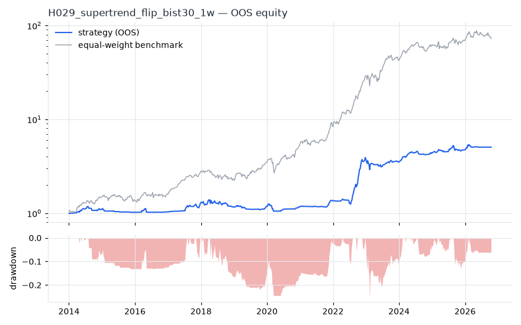
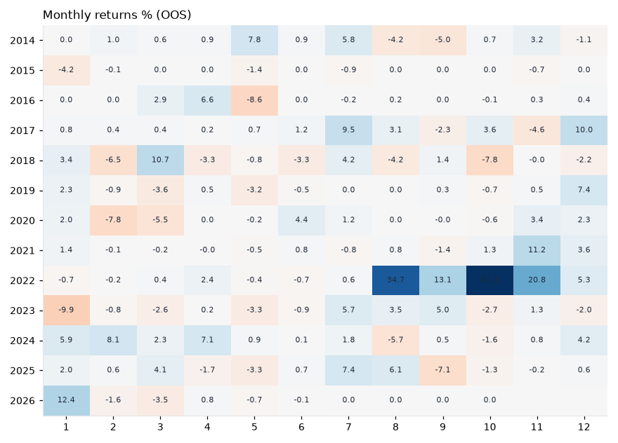
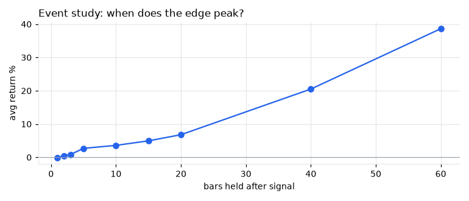
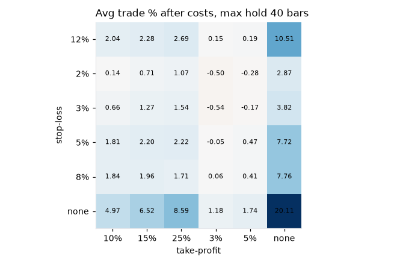

# H029 — supertrend_flip on bist30 [1w]  ❌ REJECT

- Kind: rule · Source: Supertrend (ATR bands)
- For system: `bist_orderflow_quant`
- Data: 2010-01-01 00:00:00 → 2026-10-16 00:00:00 · 29 assets · 52.2 bars/year · survivorship mask: False
- Costs: {'commission': 0.001, 'slippage': 0.001, 'funding_annual': 0.0, 'borrow_annual': 0.0}
- Variants tried (DSR trials): 163 (failed: 0)
- Final variant: `supertrend_flip|cfg=(10, 2.0)|f=usdtry_calm|x=signal_only`

## Verdict reasons
- DSR 0.777 < 0.9 (luck not excluded after 163 trials)
- OOS Sharpe (USD, excess of US T-bill) -0.439 < 0.5
- OOS MaxDD -0.8729 worse than -0.45 (local or USD)
- with 2x costs it does not beat the equal-weight benchmark
- Reality Check p 1.0 > 0.1 (best variant may be data-mined)
- random entries match it (p=1.0): the edge is in the exits, not the signal

## Walk-forward out-of-sample


| Metric | Strategy | Equal-weight benchmark |
|---|---|---|
| years | 12.79 | 12.79 |
| cagr | 0.1352 | 0.3979 |
| vol | 0.1606 | 0.2658 |
| sharpe | 0.869 | 1.397 |
| sharpe_excess_rf | 0.753 | None |
| sortino | 1.288 | 2.254 |
| max_dd | -0.258 | -0.3033 |
| max_dd_bars | 209 | 74 |
| calmar | 0.524 | 1.312 |
| ulcer | 0.1169 | 0.0788 |
| var95 | -0.0253 | -0.0514 |
| cvar95 | -0.0476 | -0.0756 |
| omega | 1.599 | 1.677 |
| tail_ratio | 1.308 | 1.221 |
| skew | 1.231 | -0.076 |
| kurtosis | 11.081 | 2.73 |
| hit_rate | 0.445 | 0.599 |
| turnover_ann | 5.04 | None |

- **Gate Sharpe (USD, excess of US T-bill): -0.439**
- Deflated Sharpe: **0.777** · PBO: **0.208** · Reality Check p: **1.0**
- PSR 0.999 · Info ratio -1.079 · Beta 0.356 · Up/Down capture 0.357/0.344
- Sharpe with 2× costs: 0.806 · Walk-forward efficiency: 0.506
- Bootstrap: {'p_sharpe_pos': 0.997, 'cagr_p05': 0.0373, 'maxdd_p05': -0.4177}
- Yearly OOS Sharpe: {'2014': 1.0, '2015': -1.52, '2016': 0.14, '2017': 1.8, '2018': -0.4, '2019': 0.26, '2020': -0.08, '2021': 2.09, '2022': 3.29, '2023': -0.18, '2024': 2.36, '2025': 0.56, '2026': 0.78}
- In USD: CAGR -0.1111 · Sharpe -0.362 · excess-rf Sharpe -0.439 · MaxDD -0.8729



## Regimes (where does it work?)
`{"bull": {"sharpe": 1.34, "ann_ret": 0.2359, "bars": 492}, "bear": {"sharpe": -1.37, "ann_ret": -0.1295, "bars": 176}, "calm": {"sharpe": 1.95, "ann_ret": 0.2175, "bars": 355}, "stressed": {"sharpe": 0.25, "ann_ret": 0.0513, "bars": 313}, "vix_lt_20": {"sharpe": 0.83, "ann_ret": 0.1019, "bars": 484}, "vix_20_30": {"sharpe": 0.98, "ann_ret": 0.2201, "bars": 154}, "curve_inverted": {"sharpe": 0.46, "ann_ret": 0.0923, "bars": 125}, "curve_normal": {"sharpe": 1.0, "ann_ret": 0.1505, "bars": 543}}`

## Calendar profile (weekday / month / hour)
`{"weekday": {"4": 0.00267}, "month": {"1": 0.00258, "2": -0.0012, "3": 0.00104, "4": 0.00257, "5": -0.00221, "6": 0.00048, "7": 0.00593, "8": 0.00537, "9": 0.00081, "10": 0.00485, "11": 0.00684, "12": 0.00537}}`

## Trades (OOS)
`{"n_trades": 115, "trades_per_year": 9.0, "win_rate": 0.417, "avg_trade": 0.1001, "median_trade": -0.0201, "avg_win": 0.3801, "avg_loss": -0.1004, "profit_factor": 2.712, "payoff": 3.785, "expectancy_r": null, "sqn": null, "kelly_fraction": 0.263, "max_consec_losses": 9, "avg_bars": 18.2, "avg_bars_win": 29.6, "avg_bars_loss": 10.0, "avg_mfe": 0.3349, "avg_mae": -0.1102, "edge_ratio": 3.039, "exit_reasons": {"signal": 115}, "long_short": {"1": {"count": 115, "mean": 0.1001}}}`

## Robustness
- **delay**: `{"sharpe": 0.486, "sharpe_delayed_1bar": 0.581, "retained": 1.196}`
- **neighbourhood**: `{"neighbours": 3, "best_sharpe": 0.478, "neighbour_median": 0.517, "share_positive": 1.0, "stability": 1.081}`
- **noise**: `{"noise_bp": 0.002, "sharpe_min": 0.43, "sharpe_median": 0.473}`
- **random_entry**: `{"actual_ret_per_exposure_ann": 0.1721, "random_median_ann": 0.2899, "random_p95_ann": 0.3423, "trades_actual": 178, "p_value": 1.0}`
- **mc_trade_shuffle**: `{"maxdd_median": -0.0425, "maxdd_p95": -0.069, "final_p05": 0.7587, "final_median": 0.7587}`

## Timing, take-profit, stop-loss and profit studies (in-sample diagnostics)
- Event study (forward return by bars held): `{"1": {"n": 208, "mean": -0.0006, "hit": 0.534, "t": -0.17, "per_bar": -0.00057}, "2": {"n": 208, "mean": 0.0051, "hit": 0.519, "t": 1.33, "per_bar": 0.00253}, "3": {"n": 208, "mean": 0.0084, "hit": 0.505, "t": 1.43, "per_bar": 0.0028}, "5": {"n": 208, "mean": 0.027, "hit": 0.567, "t": 3.54, "per_bar": 0.0054}, "10": {"n": 208, "mean": 0.0359, "hit": 0.591, "t": 3.13, "per_bar": 0.00359}, "15": {"n": 208, "mean": 0.0495, "hit": 0.5, "t": 3.28, "per_bar": 0.0033}, "20": {"n": 208, "mean": 0.068, "hit": 0.548, "t": 3.74, "per_bar": 0.0034}, "40": {"n": 208, "mean": 0.2051, "hit": 0.644, "t": 6.95, "per_bar": 0.00513}, "60": {"n": 208, "mean": 0.3864, "hit": 0.683, "t": 6.58, "per_bar": 0.00644}, "best_holding_bars": 40}`

- Best stop / target / max-hold combinations: `[{"stop": NaN, "target": NaN, "max_hold": 40, "n": 208, "mean": 0.2011, "hit": 0.6346, "per_bar": 0.005, "t": 6.8301}, {"stop": NaN, "target": 0.1, "max_hold": 40, "n": 208, "mean": 0.0497, "hit": 0.8365, "per_bar": 0.0033, "t": 6.3783}, {"stop": NaN, "target": 0.25, "max_hold": 40, "n": 208, "mean": 0.0859, "hit": 0.6587, "per_bar": 0.0029, "t": 6.368}, {"stop": NaN, "target": 0.15, "max_hold": 40, "n": 208, "mean": 0.0652, "hit": 0.7548, "per_bar": 0.0031, "t": 6.351}, {"stop": 0.12, "target": NaN, "max_hold": 40, "n": 208, "mean": 0.1051, "hit": 0.3942, "per_bar": 0.0044, "t": 3.9375}]`

- Portfolio overlays (vol target, drawdown brake, equity-curve filter): `{"none": {"sharpe": 0.869, "cagr": 0.1352, "max_dd": -0.258}, "vol_target_0.1": {"sharpe": 1.058, "cagr": 0.1248, "max_dd": -0.1747}, "vol_target_0.15": {"sharpe": 0.979, "cagr": 0.1548, "max_dd": -0.2456}, "vol_target_0.2": {"sharpe": 0.917, "cagr": 0.1713, "max_dd": -0.2997}, "dd_brake_0.1": {"sharpe": 0.832, "cagr": 0.1155, "max_dd": -0.2232}, "dd_brake_0.2": {"sharpe": 0.851, "cagr": 0.1283, "max_dd": -0.258}, "equity_ma_8": {"sharpe": 1.021, "cagr": 0.1346, "max_dd": -0.2047}, "equity_ma_26": {"sharpe": 0.761, "cagr": 0.1055, "max_dd": -0.2617}, "best_by_calmar": "vol_target_0.1"}`
> Studies are in-sample diagnostics. To use a better exit, register it (exits: [...]) and let the gate judge it.

## Walk-forward windows
- 2020-12-25 00:00:00 → 2021-06-18 00:00:00: IS 1.446 / OOS 0.531 — `supertrend_flip|cfg=(7, 2.0)|f=none|x=max_hold=5,use_signal_exit=False`
- 2021-06-25 00:00:00 → 2021-12-17 00:00:00: IS 1.476 / OOS 3.152 — `supertrend_flip|cfg=(7, 2.0)|f=none|x=max_hold=5,use_signal_exit=False`
- 2021-12-24 00:00:00 → 2022-06-17 00:00:00: IS 2.155 / OOS 0.272 — `supertrend_flip|cfg=(7, 2.0)|f=none|x=max_hold=5,use_signal_exit=False`
- 2022-06-24 00:00:00 → 2022-12-16 00:00:00: IS 2.097 / OOS 5.076 — `supertrend_flip|cfg=(10, 3.0)|f=none|x=stop_pct=0.05|size=atr_risk0.02`
- 2022-12-23 00:00:00 → 2023-06-16 00:00:00: IS 2.821 / OOS -0.716 — `supertrend_flip|cfg=(10, 3.0)|f=none|x=stop_pct=0.05|size=atr_risk0.02`
- 2023-06-23 00:00:00 → 2023-12-15 00:00:00: IS 2.57 / OOS 3.027 — `supertrend_flip|cfg=(10, 3.0)|f=none|x=stop_pct=0.03|size=atr_risk0.01|overlay=vt10`
- 2023-12-22 00:00:00 → 2024-06-14 00:00:00: IS 2.808 / OOS 3.76 — `supertrend_flip|cfg=(10, 3.0)|f=none|x=stop_pct=0.03|size=atr_risk0.01|overlay=vt10`
- 2024-06-21 00:00:00 → 2024-12-13 00:00:00: IS 3.048 / OOS 0.127 — `supertrend_flip|cfg=(10, 3.0)|f=none|x=stop_pct=0.03|size=atr_risk0.01|overlay=vt10`
- 2024-12-20 00:00:00 → 2025-06-13 00:00:00: IS 2.53 / OOS 0.654 — `supertrend_flip|cfg=(10, 3.0)|f=none|x=stop_pct=0.03|size=atr_risk0.005|overlay=vt20`
- 2025-06-20 00:00:00 → 2025-12-12 00:00:00: IS 2.249 / OOS 0.562 — `supertrend_flip|cfg=(10, 3.0)|f=none|x=stop_pct=0.03|size=atr_risk0.005|overlay=vt20`
- 2025-12-19 00:00:00 → 2026-06-12 00:00:00: IS 1.469 / OOS 1.006 — `supertrend_flip|cfg=(10, 3.0)|f=none|x=stop_pct=0.03|size=atr_risk0.005|overlay=vt10`
- 2026-06-19 00:00:00 → 2026-10-16 00:00:00: IS 1.932 / OOS 0.0 — `supertrend_flip|cfg=(10, 2.0)|f=usdtry_calm|x=signal_only`

## Best variants (full sample, reference only)
- supertrend_flip|cfg=(10, 3.0)|f=none|x=stop_pct=0.03|size=atr_risk0.005|overlay=dd10: Sharpe 1.243
- supertrend_flip|cfg=(10, 3.0)|f=none|x=stop_pct=0.03|size=atr_risk0.01|overlay=eqma_s: Sharpe 1.242
- supertrend_flip|cfg=(10, 3.0)|f=none|x=stop_pct=0.03|size=atr_risk0.005|overlay=vt20: Sharpe 1.23
- supertrend_flip|cfg=(10, 3.0)|f=none|x=stop_pct=0.03|size=atr_risk0.005|overlay=eqma_s: Sharpe 1.223
- supertrend_flip|cfg=(10, 3.0)|f=none|x=stop_pct=0.03|size=atr_risk0.005|overlay=vt10: Sharpe 1.223
- supertrend_flip|cfg=(10, 3.0)|f=none|x=stop_pct=0.03|size=atr_risk0.005: Sharpe 1.216
- supertrend_flip|cfg=(10, 3.0)|f=none|x=stop_pct=0.03|size=atr_risk0.005|overlay=vt15: Sharpe 1.207
- supertrend_flip|cfg=(10, 3.0)|f=none|x=stop_pct=0.03|size=atr_risk0.01: Sharpe 1.191
- supertrend_flip|cfg=(10, 3.0)|f=none|x=stop_pct=0.03|size=atr_risk0.02: Sharpe 1.191
- supertrend_flip|cfg=(10, 3.0)|f=none|x=stop_pct=0.03|size=atr_risk0.005|overlay=dd20: Sharpe 1.19

## Current targets / signals
```json
{
 "positions": {},
 "entry_long_next_open": [],
 "exit_long_next_open": [
  "OYAKC.IS"
 ],
 "entry_short_next_open": []
}
```

> Survivorship bias: unless a membership mask is used, universes are today's members (upper-bound results).