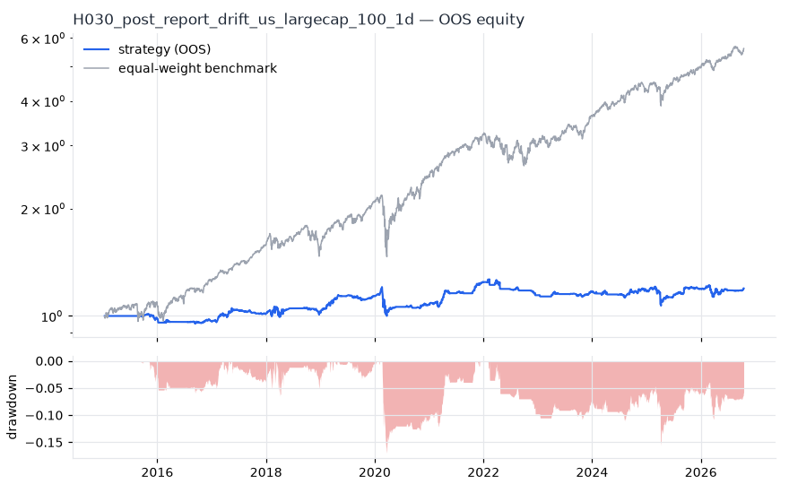
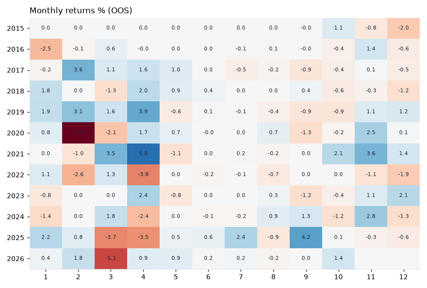

# H030 — post_report_drift on us_largecap_100 [1d]  ❌ REJECT

- Kind: strategy · Source: Ball & Brown (1968); Bernard & Thomas (1989) post-earnings-announcement drift (proxy)
- For system: `us_f1_bot`
- Data: 2011-01-03 00:00:00 → 2026-10-16 00:00:00 · 99 assets · 251.6 bars/year · survivorship mask: True
- Costs: {'commission': 0.0002, 'slippage': 0.0004, 'funding_annual': 0.0, 'borrow_annual': 0.0}
- Variants tried (DSR trials): 20 (failed: 0)
- Final variant: `post_report_drift|hold=63,min_react=0.0`

## Verdict reasons
- DSR 0.408 < 0.9 (luck not excluded after 20 trials)
- OOS Sharpe (excess of T-bill) -0.044 < 0.5
- bootstrap P(SR>0) 0.832 < 0.85
- with 2x costs it does not beat the equal-weight benchmark
- Reality Check p 1.0 > 0.1 (best variant may be data-mined)

## Walk-forward out-of-sample


| Metric | Strategy | Equal-weight benchmark |
|---|---|---|
| years | 11.76 | 11.76 |
| cagr | 0.0152 | 0.1579 |
| vol | 0.0685 | 0.1635 |
| sharpe | 0.255 | 0.979 |
| sharpe_excess_rf | -0.044 | None |
| sortino | -0.06 | 1.394 |
| max_dd | -0.1699 | -0.327 |
| max_dd_bars | 1175 | 360 |
| calmar | 0.09 | 0.483 |
| ulcer | 0.0655 | 0.049 |
| var95 | -0.0055 | -0.0147 |
| cvar95 | -0.0111 | -0.0244 |
| omega | 1.068 | 1.212 |
| tail_ratio | 1.04 | 0.958 |
| skew | -0.74 | -0.364 |
| kurtosis | 21.06 | 18.427 |
| hit_rate | 0.373 | 0.553 |
| turnover_ann | 5.67 | None |

- **Gate Sharpe (excess of T-bill): -0.044**
- Deflated Sharpe: **0.408** · PBO: **0.344** · Reality Check p: **1.0**
- PSR 0.808 · Info ratio -1.069 · Beta 0.255 · Up/Down capture 0.243/0.271
- Sharpe with 2× costs: 0.205 · Walk-forward efficiency: 0.349
- Bootstrap: {'p_sharpe_pos': 0.832, 'cagr_p05': -0.0188, 'maxdd_p05': -0.3307}
- Yearly OOS Sharpe: {'2015': -0.71, '2016': -0.44, '2017': 0.91, '2018': 0.24, '2019': 1.8, '2020': -0.4, '2021': 2.45, '2022': -1.32, '2023': 0.85, '2024': 0.04, '2025': 0.2, '2026': 0.09}



## Regimes (where does it work?)
`{"bull": {"sharpe": 0.87, "ann_ret": 0.0537, "bars": 2455}, "bear": {"sharpe": -1.68, "ann_ret": -0.1592, "bars": 503}, "calm": {"sharpe": 1.17, "ann_ret": 0.0541, "bars": 1554}, "stressed": {"sharpe": -0.27, "ann_ret": -0.0231, "bars": 1404}, "vix_lt_20": {"sharpe": 1.87, "ann_ret": 0.0959, "bars": 2095}, "vix_20_30": {"sharpe": -1.92, "ann_ret": -0.1493, "bars": 705}, "vix_ge_30": {"sharpe": -1.76, "ann_ret": -0.279, "bars": 158}, "curve_inverted": {"sharpe": -1.07, "ann_ret": -0.0758, "bars": 614}, "curve_normal": {"sharpe": 0.62, "ann_ret": 0.0419, "bars": 2344}}`

## Calendar profile (weekday / month / hour)
`{"weekday": {"0": 0.00022, "1": 7e-05, "2": 0.0002, "3": -0.00018, "4": 4e-05}, "month": {"1": 0.00013, "2": -9e-05, "3": -6e-05, "4": 0.00036, "5": 6e-05, "6": 4e-05, "7": 8e-05, "8": -2e-05, "9": 6e-05, "10": 2e-05, "11": 0.00045, "12": -0.00015}}`

## Robustness
- **delay**: `{"sharpe": 0.429, "sharpe_delayed_1bar": 0.399, "retained": 0.929}`
- **neighbourhood**: `{"neighbours": 3, "best_sharpe": 0.428, "neighbour_median": 0.078, "share_positive": 1.0, "stability": 0.182}`
- **noise**: `{"noise_bp": 0.002, "sharpe_min": 0.394, "sharpe_median": 0.422}`

## Timing, take-profit, stop-loss and profit studies (in-sample diagnostics)
- Portfolio overlays (vol target, drawdown brake, equity-curve filter): `{"none": {"sharpe": 0.255, "cagr": 0.0152, "max_dd": -0.1699}, "vol_target_0.1": {"sharpe": 0.318, "cagr": 0.0256, "max_dd": -0.1841}, "vol_target_0.15": {"sharpe": 0.294, "cagr": 0.0271, "max_dd": -0.2461}, "vol_target_0.2": {"sharpe": 0.245, "cagr": 0.0228, "max_dd": -0.2892}, "dd_brake_0.1": {"sharpe": 0.174, "cagr": 0.0089, "max_dd": -0.1703}, "dd_brake_0.2": {"sharpe": 0.255, "cagr": 0.0152, "max_dd": -0.1699}, "equity_ma_41": {"sharpe": 0.424, "cagr": 0.0178, "max_dd": -0.0794}, "equity_ma_125": {"sharpe": 0.271, "cagr": 0.0116, "max_dd": -0.0953}, "best_by_calmar": "equity_ma_41"}`
> Studies are in-sample diagnostics. To use a better exit, register it (exits: [...]) and let the gate judge it.

## Walk-forward windows
- 2020-12-28 00:00:00 → 2021-06-25 00:00:00: IS 0.691 / OOS 2.244 — `post_report_drift|hold=42,min_react=0.0|overlay=eqma_s`
- 2021-06-28 00:00:00 → 2021-12-22 00:00:00: IS 1.247 / OOS 3.039 — `post_report_drift|hold=42,min_react=0.0|overlay=eqma_s`
- 2021-12-23 00:00:00 → 2022-06-23 00:00:00: IS 1.581 / OOS -0.984 — `post_report_drift|hold=42,min_react=0.0|overlay=eqma_s`
- 2022-06-24 00:00:00 → 2022-12-20 00:00:00: IS 0.915 / OOS -2.558 — `post_report_drift|hold=42,min_react=0.0|overlay=eqma_s`
- 2022-12-21 00:00:00 → 2023-06-22 00:00:00: IS 0.684 / OOS 0.469 — `post_report_drift|hold=42,min_react=0.0|overlay=eqma_s`
- 2023-06-23 00:00:00 → 2023-12-19 00:00:00: IS 0.6 / OOS 1.028 — `post_report_drift|hold=42,min_react=0.0|overlay=vt10`
- 2023-12-20 00:00:00 → 2024-06-20 00:00:00: IS 0.587 / OOS -0.633 — `post_report_drift|hold=42,min_react=0.0|overlay=eqma_s`
- 2024-06-21 00:00:00 → 2024-12-17 00:00:00: IS 0.108 / OOS 1.223 — `post_report_drift|hold=63,min_react=0.0|overlay=vt10`
- 2024-12-18 00:00:00 → 2025-06-20 00:00:00: IS -0.081 / OOS -0.822 — `post_report_drift|hold=63,min_react=0.0|overlay=vt10`
- 2025-06-23 00:00:00 → 2025-12-17 00:00:00: IS 0.122 / OOS 1.89 — `post_report_drift|hold=63,min_react=0.0|overlay=vt20`
- 2025-12-18 00:00:00 → 2026-06-18 00:00:00: IS 0.422 / OOS -0.024 — `post_report_drift|hold=63,min_react=0.0|overlay=dd10`
- 2026-06-22 00:00:00 → 2026-10-16 00:00:00: IS 0.522 / OOS 0.993 — `post_report_drift|hold=63,min_react=0.0`

## Best variants (full sample, reference only)
- post_report_drift|hold=63,min_react=0.0|overlay=vt10: Sharpe 0.446
- post_report_drift|hold=63,min_react=0.0: Sharpe 0.428
- post_report_drift|hold=63,min_react=0.0|overlay=vt15: Sharpe 0.428
- post_report_drift|hold=63,min_react=0.0|overlay=dd10: Sharpe 0.421
- post_report_drift|hold=63,min_react=0.0|overlay=vt20: Sharpe 0.41
- post_report_drift|hold=63,min_react=0.0|overlay=dd20: Sharpe 0.367
- post_report_drift|hold=42,min_react=0.0|overlay=dd10: Sharpe 0.359
- post_report_drift|hold=42,min_react=0.0|overlay=vt10: Sharpe 0.314
- post_report_drift|hold=42,min_react=0.0: Sharpe 0.313
- post_report_drift|hold=42,min_react=0.0|overlay=vt15: Sharpe 0.31

## Current targets / signals
```json
{
 "PG": 0.1,
 "COST": 0.1,
 "ACN": 0.1
}
```

> Survivorship bias: unless a membership mask is used, universes are today's members (upper-bound results).