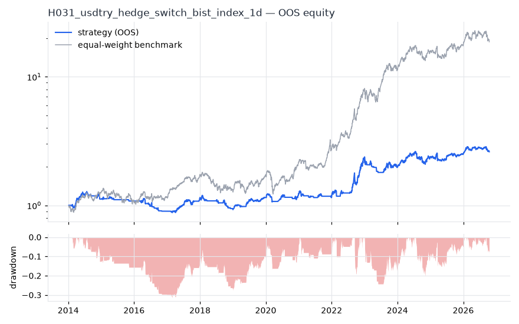
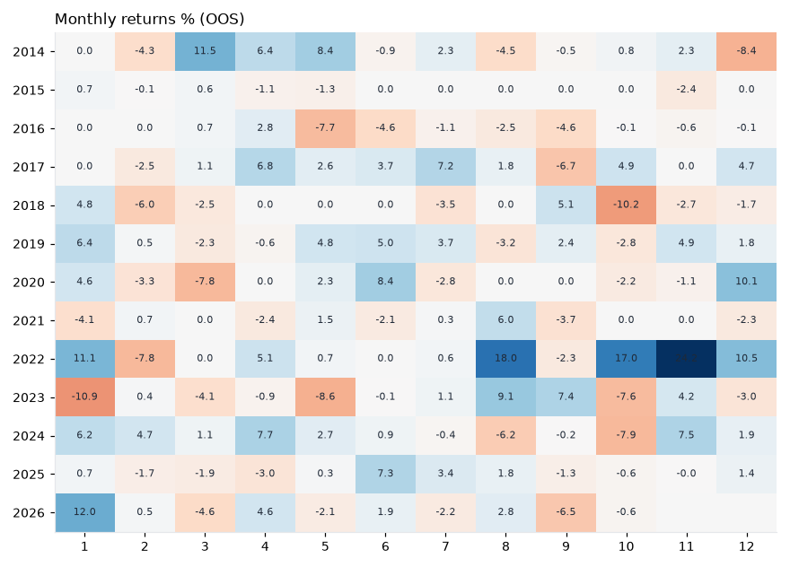

# H031 — usdtry_hedge_switch on bist_index [1d]  ❌ REJECT

- Kind: strategy · Source: BIST: step aside when the lira is in acute depreciation
- For system: `macro-model`
- Data: 2010-01-04 00:00:00 → 2026-10-16 00:00:00 · 4 assets · 250.9 bars/year · survivorship mask: False
- Costs: {'commission': 0.0005, 'slippage': 0.0005, 'funding_annual': 0.0, 'borrow_annual': 0.0}
- Variants tried (DSR trials): 18 (failed: 0)
- Final variant: `usdtry_hedge_switch|n=20,thr=0.03|overlay=vt10`

## Verdict reasons
- DSR 0.884 < 0.9 (luck not excluded after 18 trials)
- OOS Sharpe (USD, excess of US T-bill) -0.696 < 0.5
- OOS MaxDD -0.9139 worse than -0.45 (local or USD)
- with 2x costs it does not beat the equal-weight benchmark
- Reality Check p 0.998 > 0.1 (best variant may be data-mined)

## Walk-forward out-of-sample


| Metric | Strategy | Equal-weight benchmark |
|---|---|---|
| years | 12.75 | 12.75 |
| cagr | 0.0782 | 0.2582 |
| vol | 0.1522 | 0.2576 |
| sharpe | 0.571 | 1.021 |
| sharpe_excess_rf | 0.447 | None |
| sortino | 0.625 | 1.476 |
| max_dd | -0.3145 | -0.3445 |
| max_dd_bars | 1619 | 532 |
| calmar | 0.248 | 0.749 |
| ulcer | 0.1441 | 0.1238 |
| var95 | -0.0135 | -0.0233 |
| cvar95 | -0.0243 | -0.0373 |
| omega | 1.144 | 1.196 |
| tail_ratio | 1.186 | 1.141 |
| skew | -0.706 | -0.328 |
| kurtosis | 10.841 | 3.731 |
| hit_rate | 0.316 | 0.537 |
| turnover_ann | 13.69 | None |

- **Gate Sharpe (USD, excess of US T-bill): -0.696**
- Deflated Sharpe: **0.884** · PBO: **0.495** · Reality Check p: **0.998**
- PSR 0.978 · Info ratio -0.955 · Beta 0.418 · Up/Down capture 0.426/0.445
- Sharpe with 2× costs: 0.481 · Walk-forward efficiency: 0.559
- Bootstrap: {'p_sharpe_pos': 0.974, 'cagr_p05': 0.0018, 'maxdd_p05': -0.5242}
- Yearly OOS Sharpe: {'2014': 0.79, '2015': -0.55, '2016': -1.33, '2017': 1.87, '2018': -1.39, '2019': 2.05, '2020': 0.59, '2021': -0.58, '2022': 2.77, '2023': -0.61, '2024': 1.03, '2025': 0.49, '2026': 0.54}
- In USD: CAGR -0.1564 · Sharpe -0.615 · excess-rf Sharpe -0.696 · MaxDD -0.9139



## Regimes (where does it work?)
`{"bull": {"sharpe": 1.07, "ann_ret": 0.1707, "bars": 2338}, "bear": {"sharpe": -1.11, "ann_ret": -0.1404, "bars": 862}, "calm": {"sharpe": 1.21, "ann_ret": 0.1523, "bars": 1675}, "stressed": {"sharpe": 0.09, "ann_ret": 0.0151, "bars": 1525}, "vix_lt_20": {"sharpe": 0.97, "ann_ret": 0.1311, "bars": 2329}, "vix_20_30": {"sharpe": 0.06, "ann_ret": 0.0115, "bars": 714}, "vix_ge_30": {"sharpe": -1.14, "ann_ret": -0.2263, "bars": 157}}`

## Calendar profile (weekday / month / hour)
`{"weekday": {"0": 0.00094, "1": -0.0001, "2": -0.00054, "3": 0.00094, "4": 0.00049}, "month": {"1": 0.00111, "2": -0.00072, "3": -0.00028, "4": 0.00096, "5": 0.00013, "6": 0.00073, "7": 0.00034, "8": 0.00081, "9": -0.00037, "10": -0.0004, "11": 0.00134, "12": 0.00055}}`

## Robustness
- **delay**: `{"sharpe": 0.727, "sharpe_delayed_1bar": 0.364, "retained": 0.5}`
- **neighbourhood**: `{"neighbours": 1, "best_sharpe": 0.725, "neighbour_median": 0.611, "share_positive": 1.0, "stability": 0.843}`
- **noise**: `{"noise_bp": 0.002, "sharpe_min": 0.71, "sharpe_median": 0.726}`

## Timing, take-profit, stop-loss and profit studies (in-sample diagnostics)
- Portfolio overlays (vol target, drawdown brake, equity-curve filter): `{"none": {"sharpe": 0.571, "cagr": 0.0782, "max_dd": -0.3145}, "vol_target_0.1": {"sharpe": 0.635, "cagr": 0.0697, "max_dd": -0.2902}, "vol_target_0.15": {"sharpe": 0.65, "cagr": 0.0989, "max_dd": -0.3617}, "vol_target_0.2": {"sharpe": 0.642, "cagr": 0.117, "max_dd": -0.4225}, "dd_brake_0.1": {"sharpe": 0.468, "cagr": 0.0512, "max_dd": -0.2415}, "dd_brake_0.2": {"sharpe": 0.508, "cagr": 0.0661, "max_dd": -0.2904}, "equity_ma_41": {"sharpe": 0.569, "cagr": 0.0663, "max_dd": -0.283}, "equity_ma_125": {"sharpe": 0.383, "cagr": 0.0424, "max_dd": -0.2431}, "best_by_calmar": "vol_target_0.2"}`
> Studies are in-sample diagnostics. To use a better exit, register it (exits: [...]) and let the gate judge it.

## Walk-forward windows
- 2020-12-24 00:00:00 → 2021-06-25 00:00:00: IS 1.237 / OOS -0.352 — `usdtry_hedge_switch|n=20,thr=0.03|overlay=eqma_s`
- 2021-06-28 00:00:00 → 2021-12-28 00:00:00: IS 1.15 / OOS 0.051 — `usdtry_hedge_switch|n=20,thr=0.03|overlay=eqma_s`
- 2021-12-29 00:00:00 → 2022-06-27 00:00:00: IS 1.12 / OOS 0.896 — `usdtry_hedge_switch|n=20,thr=0.03|overlay=eqma_s`
- 2022-06-28 00:00:00 → 2022-12-23 00:00:00: IS 0.895 / OOS 4.174 — `usdtry_hedge_switch|n=20,thr=0.05|overlay=eqma_s`
- 2022-12-26 00:00:00 → 2023-06-27 00:00:00: IS 1.679 / OOS -2.212 — `usdtry_hedge_switch|n=20,thr=0.05|overlay=eqma_s`
- 2023-07-03 00:00:00 → 2023-12-26 00:00:00: IS 1.221 / OOS 0.965 — `usdtry_hedge_switch|n=20,thr=0.05|overlay=vt20`
- 2023-12-27 00:00:00 → 2024-07-01 00:00:00: IS 1.427 / OOS 3.113 — `usdtry_hedge_switch|n=20,thr=0.05|overlay=vt15`
- 2024-07-02 00:00:00 → 2024-12-27 00:00:00: IS 1.708 / OOS -0.216 — `usdtry_hedge_switch|n=20,thr=0.05|overlay=vt20`
- 2024-12-30 00:00:00 → 2025-07-02 00:00:00: IS 1.561 / OOS 0.293 — `usdtry_hedge_switch|n=20,thr=0.05|overlay=vt15`
- 2025-07-03 00:00:00 → 2025-12-29 00:00:00: IS 1.378 / OOS 0.618 — `usdtry_hedge_switch|n=20,thr=0.03|overlay=vt10`
- 2025-12-30 00:00:00 → 2026-07-02 00:00:00: IS 0.801 / OOS 2.163 — `usdtry_hedge_switch|n=20,thr=0.03|overlay=vt10`
- 2026-07-03 00:00:00 → 2026-10-16 00:00:00: IS 1.238 / OOS -2.286 — `usdtry_hedge_switch|n=20,thr=0.03|overlay=vt10`

## Best variants (full sample, reference only)
- usdtry_hedge_switch|n=20,thr=0.03|overlay=vt10: Sharpe 0.725
- usdtry_hedge_switch|n=20,thr=0.03|overlay=vt15: Sharpe 0.693
- usdtry_hedge_switch|n=20,thr=0.03|overlay=vt20: Sharpe 0.66
- usdtry_hedge_switch|n=20,thr=0.03: Sharpe 0.655
- usdtry_hedge_switch|n=20,thr=0.05: Sharpe 0.62
- usdtry_hedge_switch|n=20,thr=0.03|overlay=eqma_s: Sharpe 0.615
- usdtry_hedge_switch|n=20,thr=0.05|overlay=vt15: Sharpe 0.612
- usdtry_hedge_switch|n=20,thr=0.05|overlay=vt10: Sharpe 0.611
- usdtry_hedge_switch|n=20,thr=0.05|overlay=eqma_s: Sharpe 0.604
- usdtry_hedge_switch|n=20,thr=0.03|overlay=dd10: Sharpe 0.603

## Current targets / signals
```json
{
 "XU100.IS": 0.0989,
 "XU030.IS": 0.0989,
 "XBANK.IS": 0.0989,
 "XUSIN.IS": 0.0989
}
```

> Survivorship bias: unless a membership mask is used, universes are today's members (upper-bound results).