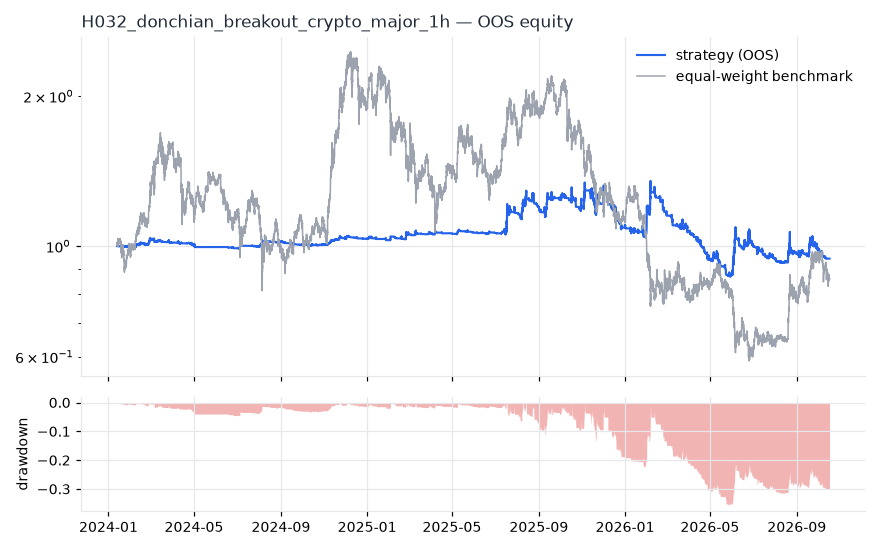
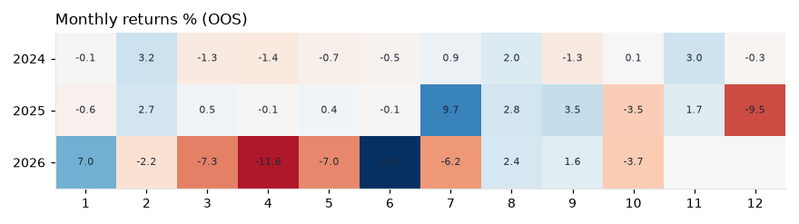
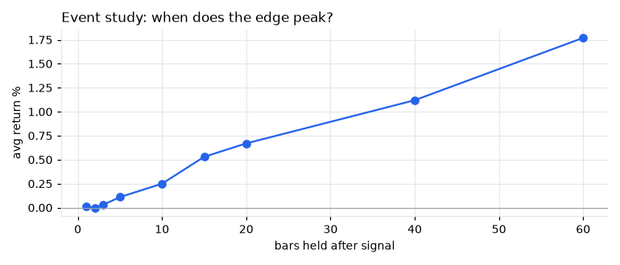
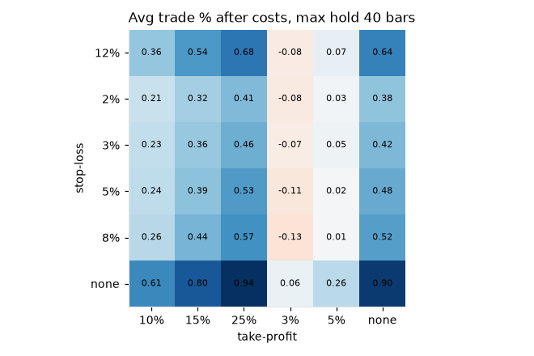

# H032 — donchian_breakout on crypto_major [1h]  ❌ REJECT

- Kind: rule · Source: Turtle / Donchian
- For system: `karma_perp_bot`
- Data: 2022-01-01 00:00:00 → 2026-10-17 07:00:00 · 10 assets · 8766.2 bars/year · survivorship mask: False
- Costs: {'commission': 0.0006, 'slippage': 0.0005, 'funding_annual': 0.08, 'borrow_annual': 0.0}
- Variants tried (DSR trials): 169 (failed: 0)
- Final variant: `donchian_breakout|entry=100,exit=20|f=htf_week_sma10|x=stop_pct=0.05,tp_pct=0.1|size=atr_risk0.01`

## Verdict reasons
- OOS too short (2.76y < 3.0y)
- DSR 0.034 < 0.9 (luck not excluded after 169 trials)
- OOS Sharpe (excess of T-bill) -0.197 < 0.5
- bootstrap P(SR>0) 0.531 < 0.85
- with 2x costs it does not beat the equal-weight benchmark
- Reality Check p 0.89 > 0.1 (best variant may be data-mined)
- 1-bar delay keeps only -183% of Sharpe (latency-fragile)

## Walk-forward out-of-sample


| Metric | Strategy | Equal-weight benchmark |
|---|---|---|
| years | 2.76 | 2.76 |
| cagr | -0.0207 | -0.0536 |
| vol | 0.2083 | 0.6767 |
| sharpe | 0.003 | 0.258 |
| sharpe_excess_rf | -0.197 | None |
| sortino | -0.285 | 0.353 |
| max_dd | -0.3574 | -0.7601 |
| max_dd_bars | 6411 | 16256 |
| calmar | -0.058 | -0.07 |
| ulcer | 0.1404 | 0.4445 |
| var95 | -0.0018 | -0.0106 |
| cvar95 | -0.0051 | -0.0178 |
| omega | 1.0 | 1.008 |
| tail_ratio | 0.979 | 0.974 |
| skew | 0.74 | -0.594 |
| kurtosis | 110.102 | 15.324 |
| hit_rate | 0.265 | 0.512 |
| turnover_ann | 86.5 | None |

- **Gate Sharpe (excess of T-bill): -0.197**
- Deflated Sharpe: **0.034** · PBO: **0.165** · Reality Check p: **0.89**
- PSR 0.502 · Info ratio -0.237 · Beta -0.039 · Up/Down capture -0.024/-0.024
- Sharpe with 2× costs: -0.453 · Walk-forward efficiency: 0.003
- Bootstrap: {'p_sharpe_pos': 0.531, 'cagr_p05': -0.183, 'maxdd_p05': -0.5442}
- Yearly OOS Sharpe: {'2024': 0.79, '2025': 0.38, '2026': -0.53}



## Regimes (where does it work?)
`{"bull": {"sharpe": 0.59, "ann_ret": 0.091, "bars": 17038}, "bear": {"sharpe": -0.71, "ann_ret": -0.2141, "bars": 7160}, "calm": {"sharpe": 1.05, "ann_ret": 0.2258, "bars": 11214}, "stressed": {"sharpe": -0.96, "ann_ret": -0.1937, "bars": 12984}, "vix_lt_20": {"sharpe": 0.33, "ann_ret": 0.0683, "bars": 19614}, "vix_20_30": {"sharpe": -1.21, "ann_ret": -0.2645, "bars": 4080}, "vix_ge_30": {"sharpe": -4.46, "ann_ret": -0.4821, "bars": 504}}`

## Calendar profile (weekday / month / hour)
`{"weekday": {"0": -5e-05, "1": -3e-05, "2": -0.0, "3": 5e-05, "4": 6e-05, "5": -0.0, "6": -3e-05}, "month": {"1": 3e-05, "2": 2e-05, "3": -4e-05, "4": -6e-05, "5": -3e-05, "6": 6e-05, "7": 2e-05, "8": 3e-05, "9": 2e-05, "10": -4e-05, "11": 4e-05, "12": -7e-05}, "hour": {"0": 8e-05, "1": -0.00012, "2": 3e-05, "3": -0.00011, "4": 0.00013, "5": -0.00011, "6": -0.0, "7": -6e-05, "8": 0.00016, "9": 6e-05, "10": -2e-05, "11": -0.00014, "12": 3e-05, "13": 2e-05, "14": -0.00013, "15": 4e-05, "16": 1e-05, "17": 0.00012, "18": 9e-05, "19": 4e-05, "20": -8e-05, "21": -0.00011, "22": 8e-05, "23": -1e-05}}`

## Trades (OOS)
`{"n_trades": 1381, "trades_per_year": 500.3, "win_rate": 0.376, "avg_trade": 0.0051, "median_trade": -0.0146, "avg_win": 0.0662, "avg_loss": -0.0317, "profit_factor": 1.256, "payoff": 2.086, "expectancy_r": 0.101, "sqn": 0.92, "kelly_fraction": 0.077, "max_consec_losses": 22, "avg_bars": 32.5, "avg_bars_win": 43.2, "avg_bars_loss": 26.1, "avg_mfe": 0.0422, "avg_mae": -0.0242, "edge_ratio": 1.74, "exit_reasons": {"signal": 784, "target": 300, "stop": 297}, "long_short": {"-1": {"count": 733, "mean": 0.004}, "1": {"count": 648, "mean": 0.0062}}}`

## Robustness
- **delay**: `{"sharpe": 0.076, "sharpe_delayed_1bar": -0.138, "retained": -1.829}`
- **neighbourhood**: `{"neighbours": 1, "best_sharpe": 0.075, "neighbour_median": 0.126, "share_positive": 1.0, "stability": 1.673}`
- **noise**: `{"noise_bp": 0.002, "sharpe_min": -0.093, "sharpe_median": 0.04}`
- **random_entry**: `{"actual_ret_per_exposure_ann": 0.0856, "random_median_ann": -0.615, "random_p95_ann": -0.1721, "trades_actual": 2331, "p_value": 0.0}`
- **mc_trade_shuffle**: `{"maxdd_median": -0.2441, "maxdd_p95": -0.358, "final_p05": 1.7586, "final_median": 1.7586}`

## Timing, take-profit, stop-loss and profit studies (in-sample diagnostics)
- Event study (forward return by bars held): `{"1": {"n": 3393, "mean": 0.0001, "hit": 0.464, "t": 0.44, "per_bar": 0.00011}, "2": {"n": 3393, "mean": 0.0, "hit": 0.459, "t": 0.05, "per_bar": 1e-05}, "3": {"n": 3393, "mean": 0.0003, "hit": 0.454, "t": 0.79, "per_bar": 0.0001}, "5": {"n": 3393, "mean": 0.0011, "hit": 0.476, "t": 2.37, "per_bar": 0.00022}, "10": {"n": 3393, "mean": 0.0025, "hit": 0.482, "t": 3.93, "per_bar": 0.00025}, "15": {"n": 3393, "mean": 0.0053, "hit": 0.506, "t": 6.76, "per_bar": 0.00035}, "20": {"n": 3393, "mean": 0.0067, "hit": 0.506, "t": 7.39, "per_bar": 0.00033}, "40": {"n": 3393, "mean": 0.0112, "hit": 0.498, "t": 8.94, "per_bar": 0.00028}, "60": {"n": 3393, "mean": 0.0177, "hit": 0.527, "t": 11.37, "per_bar": 0.00029}, "best_holding_bars": 60}`

- Event study short: `{"1": {"n": 3630, "mean": -0.0007, "hit": 0.415, "t": -2.53, "per_bar": -0.00069}, "2": {"n": 3630, "mean": -0.0004, "hit": 0.444, "t": -1.27, "per_bar": -0.00022}, "3": {"n": 3630, "mean": -0.0006, "hit": 0.437, "t": -1.63, "per_bar": -0.00021}, "5": {"n": 3630, "mean": -0.0005, "hit": 0.445, "t": -1.16, "per_bar": -0.0001}, "10": {"n": 3630, "mean": 0.0015, "hit": 0.465, "t": 2.36, "per_bar": 0.00015}, "15": {"n": 3630, "mean": -0.0009, "hit": 0.439, "t": -1.19, "per_bar": -6e-05}, "20": {"n": 3630, "mean": -0.0015, "hit": 0.441, "t": -1.88, "per_bar": -8e-05}, "40": {"n": 3630, "mean": -0.001, "hit": 0.462, "t": -0.95, "per_bar": -3e-05}, "60": {"n": 3630, "mean": -0.0022, "hit": 0.46, "t": -1.58, "per_bar": -4e-05}, "best_holding_bars": 10}`
- Best stop / target / max-hold combinations: `[{"stop": NaN, "target": 0.25, "max_hold": 40, "n": 3393, "mean": 0.0094, "hit": 0.4825, "per_bar": 0.0002, "t": 7.6892}, {"stop": NaN, "target": 0.15, "max_hold": 40, "n": 3393, "mean": 0.008, "hit": 0.4845, "per_bar": 0.0002, "t": 7.2437}, {"stop": NaN, "target": NaN, "max_hold": 40, "n": 3393, "mean": 0.009, "hit": 0.4819, "per_bar": 0.0002, "t": 7.1877}, {"stop": NaN, "target": 0.1, "max_hold": 40, "n": 3393, "mean": 0.0061, "hit": 0.4916, "per_bar": 0.0002, "t": 6.1229}, {"stop": 0.12, "target": 0.25, "max_hold": 40, "n": 3393, "mean": 0.0068, "hit": 0.4766, "per_bar": 0.0002, "t": 5.3798}]`

- Portfolio overlays (vol target, drawdown brake, equity-curve filter): `{"none": {"sharpe": 0.003, "cagr": -0.0207, "max_dd": -0.3574}, "vol_target_0.1": {"sharpe": 0.722, "cagr": 0.0751, "max_dd": -0.1404}, "vol_target_0.15": {"sharpe": 0.6, "cagr": 0.0799, "max_dd": -0.2036}, "vol_target_0.2": {"sharpe": 0.513, "cagr": 0.0787, "max_dd": -0.2626}, "dd_brake_0.1": {"sharpe": 0.172, "cagr": 0.0148, "max_dd": -0.2538}, "dd_brake_0.2": {"sharpe": -0.018, "cagr": -0.0184, "max_dd": -0.3151}, "equity_ma_1461": {"sharpe": -0.028, "cagr": -0.0188, "max_dd": -0.2444}, "equity_ma_4383": {"sharpe": -0.147, "cagr": -0.0349, "max_dd": -0.3046}, "best_by_calmar": "vol_target_0.1"}`
> Studies are in-sample diagnostics. To use a better exit, register it (exits: [...]) and let the gate judge it.

## Walk-forward windows
- 2024-11-12 11:00:00 → 2025-01-12 07:00:00: IS 1.28 / OOS 1.287 — `donchian_breakout|entry=100,exit=20|f=htf_week_sma10|x=stop_pct=0.05,tp_pct=0.1|size=vol0.2|overlay=eqma_s`
- 2025-01-12 08:00:00 → 2025-03-14 04:00:00: IS 1.374 / OOS 1.628 — `donchian_breakout|entry=100,exit=20|f=htf_week_sma10|x=stop_pct=0.05,tp_pct=0.1|size=vol0.2|overlay=eqma_s`
- 2025-03-14 05:00:00 → 2025-05-14 01:00:00: IS 1.379 / OOS 1.817 — `donchian_breakout|entry=100,exit=10|f=htf_week_sma10|x=stop_pct=0.05,tp_pct=0.1|size=vol0.1`
- 2025-05-14 02:00:00 → 2025-07-13 22:00:00: IS 2.183 / OOS -0.752 — `donchian_breakout|entry=100,exit=10|f=htf_week_sma10|x=stop_pct=0.05,tp_pct=0.1|size=vol0.1`
- 2025-07-13 23:00:00 → 2025-09-12 19:00:00: IS 1.737 / OOS 3.12 — `donchian_breakout|entry=100,exit=10|f=htf_week_sma10|x=stop_pct=0.05,tp_pct=0.1|size=atr_risk0.01`
- 2025-09-12 20:00:00 → 2025-11-12 16:00:00: IS 2.037 / OOS 0.885 — `donchian_breakout|entry=100,exit=10|f=htf_week_sma10|x=stop_pct=0.05,tp_pct=0.1|size=atr_risk0.01`
- 2025-11-12 17:00:00 → 2026-01-12 13:00:00: IS 1.686 / OOS -2.921 — `donchian_breakout|entry=100,exit=10|f=htf_week_sma10|x=stop_pct=0.05,tp_pct=0.1|size=atr_risk0.01`
- 2026-01-12 14:00:00 → 2026-03-14 10:00:00: IS 0.77 / OOS 0.744 — `donchian_breakout|entry=100,exit=10|f=htf_week_sma10|x=stop_pct=0.05,tp_pct=0.1|size=atr_risk0.01`
- 2026-03-14 11:00:00 → 2026-05-14 07:00:00: IS 0.366 / OOS -4.512 — `donchian_breakout|entry=100,exit=20|f=htf_week_sma10|x=stop_pct=0.05,tp_pct=0.1|size=atr_risk0.01`
- 2026-05-14 08:00:00 → 2026-07-14 04:00:00: IS 0.058 / OOS 1.083 — `donchian_breakout|entry=55,exit=20|f=htf_week_sma10|x=stop_pct=0.05,tp_pct=0.1`
- 2026-07-14 05:00:00 → 2026-09-13 01:00:00: IS 0.352 / OOS -0.233 — `donchian_breakout|entry=55,exit=20|f=htf_week_sma10|x=stop_pct=0.08,tp_pct=0.2`
- 2026-09-13 02:00:00 → 2026-10-17 07:00:00: IS 0.177 / OOS -0.838 — `donchian_breakout|entry=100,exit=20|f=htf_week_sma10|x=stop_pct=0.05,tp_pct=0.1|size=atr_risk0.01`

## Best variants (full sample, reference only)
- donchian_breakout|entry=100,exit=20|f=htf_week_sma10|x=stop_pct=0.05,tp_pct=0.1|size=vol0.2|overlay=eqma_l: Sharpe 0.402
- donchian_breakout|entry=100,exit=20|f=htf_week_sma10|x=stop_pct=0.05,tp_pct=0.1|size=vol0.1|overlay=eqma_l: Sharpe 0.387
- donchian_breakout|entry=100,exit=20|f=htf_week_sma10|x=stop_pct=0.05,tp_pct=0.1|size=vol0.1|overlay=eqma_s: Sharpe 0.302
- donchian_breakout|entry=100,exit=20|f=htf_week_sma10|x=stop_pct=0.05,tp_pct=0.1|size=vol0.2|overlay=eqma_s: Sharpe 0.264
- donchian_breakout|entry=100,exit=20|f=htf_week_sma10|x=stop_pct=0.05,tp_pct=0.1|size=vol0.1|overlay=dd10: Sharpe 0.251
- donchian_breakout|entry=100,exit=20|f=htf_week_sma10|x=stop_pct=0.05,tp_pct=0.1|size=vol0.1|overlay=vt10: Sharpe 0.251
- donchian_breakout|entry=100,exit=20|f=htf_week_sma10|x=stop_pct=0.05,tp_pct=0.1|size=vol0.1: Sharpe 0.251
- donchian_breakout|entry=100,exit=20|f=htf_week_sma10|x=stop_pct=0.05,tp_pct=0.1|size=vol0.2|overlay=vt10: Sharpe 0.251
- donchian_breakout|entry=100,exit=20|f=htf_week_sma10|x=stop_pct=0.05,tp_pct=0.1|size=vol0.2: Sharpe 0.251
- donchian_breakout|entry=100,exit=20|f=htf_week_sma10|x=stop_pct=0.05,tp_pct=0.1|size=vol0.2|overlay=vt20: Sharpe 0.251

## Current targets / signals
```json
{
 "positions": {},
 "entry_long_next_open": [],
 "exit_long_next_open": [],
 "entry_short_next_open": []
}
```

> Survivorship bias: unless a membership mask is used, universes are today's members (upper-bound results).