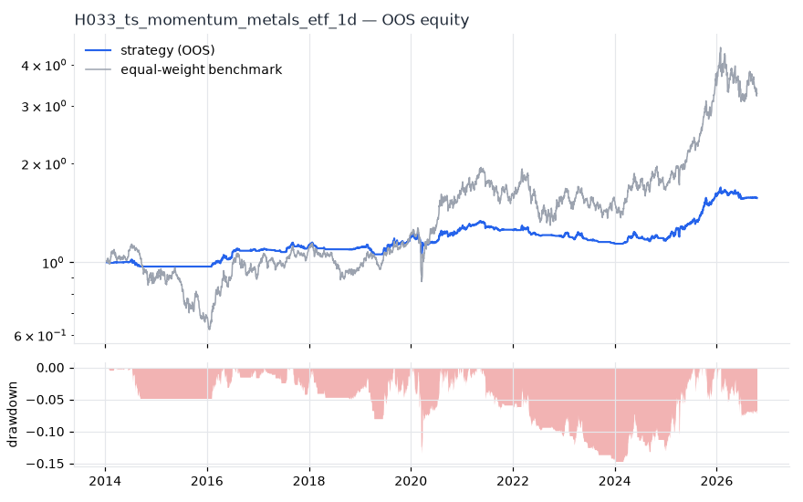
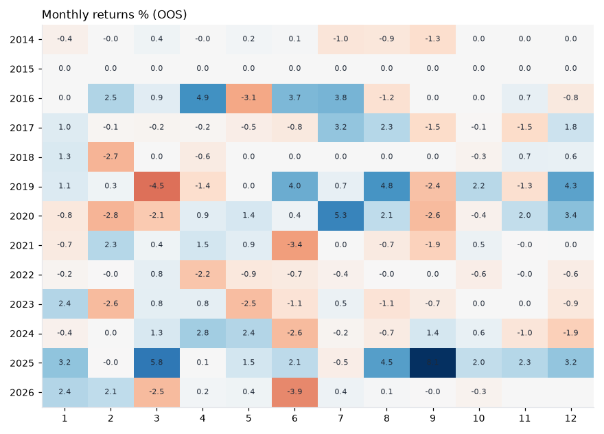

# H033 — ts_momentum on metals_etf [1d]  🟡 WATCH

- Kind: strategy · Source: Moskowitz, Ooi & Pedersen (2012) Time Series Momentum
- For system: `metals`
- Data: 2010-01-04 00:00:00 → 2026-10-16 00:00:00 · 8 assets · 251.7 bars/year · survivorship mask: False
- Costs: {'commission': 0.0002, 'slippage': 0.0003, 'funding_annual': 0.0, 'borrow_annual': 0.0}
- Variants tried (DSR trials): 20 (failed: 0)
- Final variant: `ts_momentum|lookback=126,vol_target=0.15|overlay=vt10`

## Verdict reasons
- OOS Sharpe (excess of T-bill) 0.28 < 0.5
- only 46% of OOS years positive
- PBO 0.929 > 0.5 (variant selection is overfit)
- Reality Check p 0.934 > 0.1 (best variant may be data-mined)

## Walk-forward out-of-sample


| Metric | Strategy | Equal-weight benchmark |
|---|---|---|
| years | 12.76 | 12.76 |
| cagr | 0.036 | 0.0974 |
| vol | 0.0666 | 0.2457 |
| sharpe | 0.564 | 0.502 |
| sharpe_excess_rf | 0.28 | None |
| sortino | 0.385 | 0.702 |
| max_dd | -0.1468 | -0.4505 |
| max_dd_bars | 1045 | 890 |
| calmar | 0.245 | 0.216 |
| ulcer | 0.064 | 0.1685 |
| var95 | -0.006 | -0.0236 |
| cvar95 | -0.0108 | -0.0363 |
| omega | 1.142 | 1.091 |
| tail_ratio | 1.115 | 1.022 |
| skew | -0.836 | -0.479 |
| kurtosis | 13.275 | 5.437 |
| hit_rate | 0.337 | 0.523 |
| turnover_ann | 4.23 | None |

- **Gate Sharpe (excess of T-bill): 0.28**
- Deflated Sharpe: **0.935** · PBO: **0.929** · Reality Check p: **0.934**
- PSR 0.976 · Info ratio -0.423 · Beta 0.197 · Up/Down capture 0.198/0.189
- Sharpe with 2× costs: 0.532 · Walk-forward efficiency: 1.117
- Bootstrap: {'p_sharpe_pos': 0.976, 'cagr_p05': 0.0044, 'maxdd_p05': -0.2434}
- Yearly OOS Sharpe: {'2014': -0.81, '2015': 0.0, '2016': 1.9, '2017': 0.77, '2018': -0.39, '2019': 1.03, '2020': 0.6, '2021': -0.21, '2022': -1.12, '2023': -0.92, '2024': 0.3, '2025': 2.84, '2026': -0.18}



## Regimes (where does it work?)
`{"bull": {"sharpe": 0.95, "ann_ret": 0.0756, "bars": 2038}, "bear": {"sharpe": -0.86, "ann_ret": -0.0287, "bars": 1172}, "calm": {"sharpe": 1.28, "ann_ret": 0.0649, "bars": 1701}, "stressed": {"sharpe": 0.08, "ann_ret": 0.0067, "bars": 1509}, "vix_lt_20": {"sharpe": 0.82, "ann_ret": 0.048, "bars": 2335}, "vix_20_30": {"sharpe": 0.55, "ann_ret": 0.0369, "bars": 717}, "vix_ge_30": {"sharpe": -0.85, "ann_ret": -0.1144, "bars": 158}, "curve_inverted": {"sharpe": -0.32, "ann_ret": -0.0221, "bars": 614}, "curve_normal": {"sharpe": 0.79, "ann_ret": 0.0517, "bars": 2596}}`

## Calendar profile (weekday / month / hour)
`{"weekday": {"0": 0.00028, "1": 0.00024, "2": 0.00034, "3": 5e-05, "4": -0.00015}, "month": {"1": 0.00035, "2": -4e-05, "3": 4e-05, "4": 0.00025, "5": -1e-05, "6": -9e-05, "7": 0.00043, "8": 0.00031, "9": -4e-05, "10": 0.00014, "11": 8e-05, "12": 0.00036}}`

## Robustness
- **delay**: `{"sharpe": 0.474, "sharpe_delayed_1bar": 0.422, "retained": 0.89}`
- **neighbourhood**: `{"neighbours": 1, "best_sharpe": 0.465, "neighbour_median": 0.482, "share_positive": 1.0, "stability": 1.035}`
- **noise**: `{"noise_bp": 0.002, "sharpe_min": 0.452, "sharpe_median": 0.466}`

## Timing, take-profit, stop-loss and profit studies (in-sample diagnostics)
- Portfolio overlays (vol target, drawdown brake, equity-curve filter): `{"none": {"sharpe": 0.564, "cagr": 0.036, "max_dd": -0.1468}, "vol_target_0.1": {"sharpe": 0.532, "cagr": 0.0444, "max_dd": -0.2473}, "vol_target_0.15": {"sharpe": 0.508, "cagr": 0.0522, "max_dd": -0.2762}, "vol_target_0.2": {"sharpe": 0.539, "cagr": 0.0615, "max_dd": -0.2761}, "dd_brake_0.1": {"sharpe": 0.499, "cagr": 0.03, "max_dd": -0.1421}, "dd_brake_0.2": {"sharpe": 0.564, "cagr": 0.036, "max_dd": -0.1468}, "equity_ma_41": {"sharpe": 0.672, "cagr": 0.0357, "max_dd": -0.0626}, "equity_ma_125": {"sharpe": 0.628, "cagr": 0.0355, "max_dd": -0.0843}, "best_by_calmar": "equity_ma_41"}`
> Studies are in-sample diagnostics. To use a better exit, register it (exits: [...]) and let the gate judge it.

## Walk-forward windows
- 2020-12-23 00:00:00 → 2021-06-23 00:00:00: IS 0.612 / OOS 0.629 — `ts_momentum|lookback=126,vol_target=0.1`
- 2021-06-24 00:00:00 → 2021-12-20 00:00:00: IS 0.812 / OOS -1.283 — `ts_momentum|lookback=126,vol_target=0.1`
- 2021-12-21 00:00:00 → 2022-06-21 00:00:00: IS 0.653 / OOS -1.13 — `ts_momentum|lookback=126,vol_target=0.1`
- 2022-06-22 00:00:00 → 2022-12-16 00:00:00: IS 0.506 / OOS -1.939 — `ts_momentum|lookback=252,vol_target=0.15`
- 2022-12-19 00:00:00 → 2023-06-20 00:00:00: IS 0.292 / OOS -0.689 — `ts_momentum|lookback=126,vol_target=0.15|overlay=eqma_l`
- 2023-06-21 00:00:00 → 2023-12-15 00:00:00: IS 0.412 / OOS -1.979 — `ts_momentum|lookback=126,vol_target=0.1|overlay=eqma_s`
- 2023-12-18 00:00:00 → 2024-06-17 00:00:00: IS -0.107 / OOS 1.248 — `ts_momentum|lookback=126,vol_target=0.1|overlay=eqma_s`
- 2024-06-18 00:00:00 → 2024-12-13 00:00:00: IS 0.096 / OOS -0.139 — `ts_momentum|lookback=126,vol_target=0.1|overlay=eqma_s`
- 2024-12-16 00:00:00 → 2025-06-17 00:00:00: IS 0.159 / OOS 1.876 — `ts_momentum|lookback=252,vol_target=0.15`
- 2025-06-18 00:00:00 → 2025-12-15 00:00:00: IS 0.682 / OOS 3.219 — `ts_momentum|lookback=126,vol_target=0.15|overlay=vt10`
- 2025-12-16 00:00:00 → 2026-06-16 00:00:00: IS 1.292 / OOS 0.669 — `ts_momentum|lookback=126,vol_target=0.15|overlay=vt10`
- 2026-06-17 00:00:00 → 2026-10-16 00:00:00: IS 1.304 / OOS -2.203 — `ts_momentum|lookback=126,vol_target=0.15|overlay=vt10`

## Best variants (full sample, reference only)
- ts_momentum|lookback=126,vol_target=0.15: Sharpe 0.486
- ts_momentum|lookback=126,vol_target=0.15|overlay=vt20: Sharpe 0.486
- ts_momentum|lookback=126,vol_target=0.1|overlay=vt15: Sharpe 0.486
- ts_momentum|lookback=126,vol_target=0.1: Sharpe 0.486
- ts_momentum|lookback=126,vol_target=0.1|overlay=dd20: Sharpe 0.486
- ts_momentum|lookback=126,vol_target=0.1|overlay=vt20: Sharpe 0.486
- ts_momentum|lookback=126,vol_target=0.15|overlay=vt15: Sharpe 0.482
- ts_momentum|lookback=126,vol_target=0.1|overlay=vt10: Sharpe 0.482
- ts_momentum|lookback=126,vol_target=0.15|overlay=dd20: Sharpe 0.479
- ts_momentum|lookback=126,vol_target=0.15|overlay=vt10: Sharpe 0.465

## Current targets / signals
```json
{
 "CPER": 0.0817
}
```

> Survivorship bias: unless a membership mask is used, universes are today's members (upper-bound results).