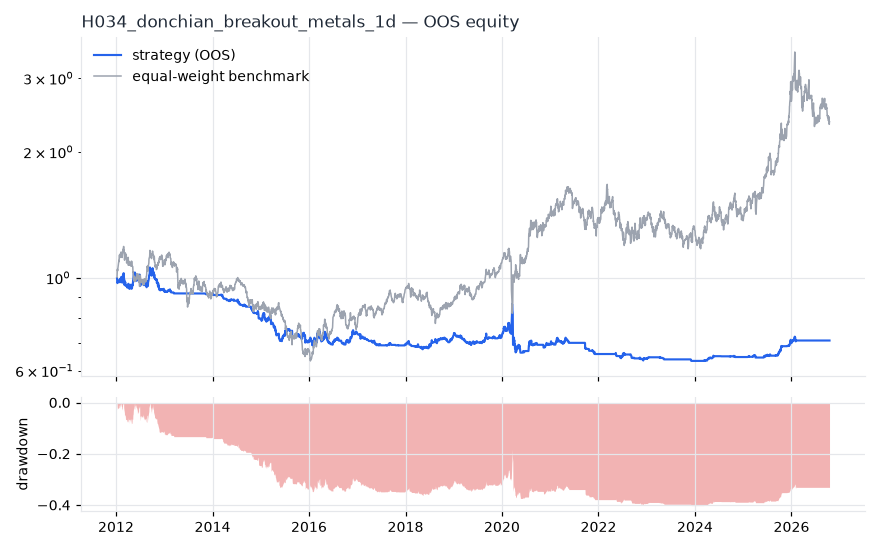
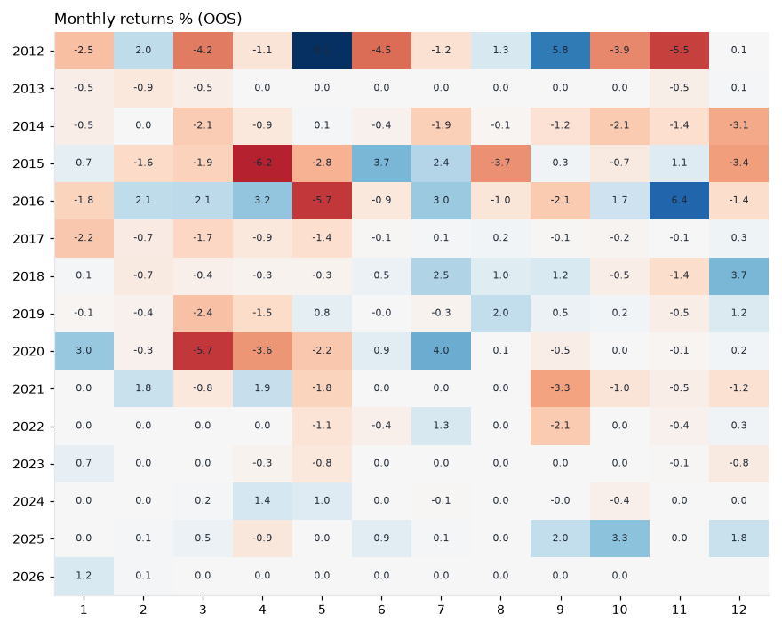
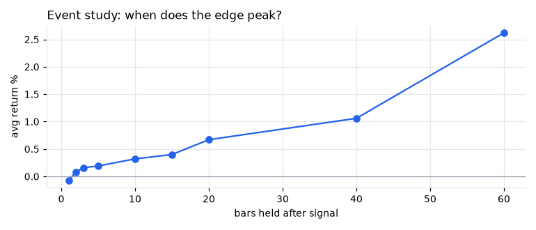
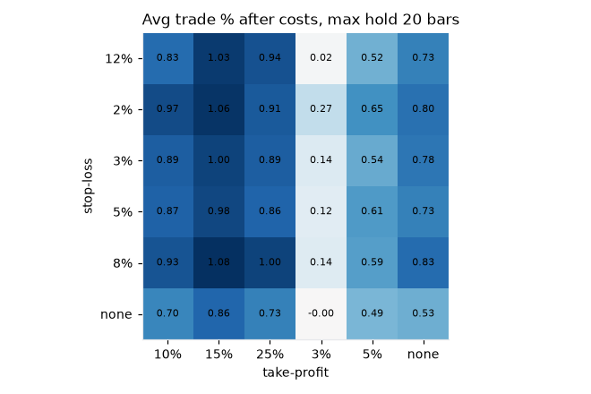

# H034 — donchian_breakout on metals [1d]  ❌ REJECT

- Kind: rule · Source: Turtle / Donchian
- For system: `metals`
- Data: 2008-01-02 00:00:00 → 2026-10-16 00:00:00 · 5 assets · 251.7 bars/year · survivorship mask: False
- Costs: {'commission': 0.0002, 'slippage': 0.0005, 'funding_annual': 0.0, 'borrow_annual': 0.0}
- Variants tried (DSR trials): 177 (failed: 0)
- Final variant: `donchian_breakout|entry=100,exit=10|f=vix_below_25|x=max_hold=5,use_signal_exit=False|size=vol0.1|overlay=eqma_s`

## Verdict reasons
- DSR 0.008 < 0.9 (luck not excluded after 177 trials)
- OOS Sharpe (excess of T-bill) -0.466 < 0.5
- bootstrap P(SR>0) 0.147 < 0.85
- only 33% of OOS years positive
- with 2x costs it does not beat the equal-weight benchmark
- Reality Check p 0.996 > 0.1 (best variant may be data-mined)
- 1-bar delay keeps only -41% of Sharpe (latency-fragile)

## Walk-forward out-of-sample


| Metric | Strategy | Equal-weight benchmark |
|---|---|---|
| years | 14.76 | 14.76 |
| cagr | -0.0231 | 0.0598 |
| vol | 0.0788 | 0.2196 |
| sharpe | -0.257 | 0.375 |
| sharpe_excess_rf | -0.466 | None |
| sortino | -0.618 | 0.518 |
| max_dd | -0.402 | -0.4673 |
| max_dd_bars | 3541 | 2108 |
| calmar | -0.057 | 0.128 |
| ulcer | 0.3196 | 0.2199 |
| var95 | -0.0063 | -0.0209 |
| cvar95 | -0.0128 | -0.0323 |
| omega | 0.927 | 1.069 |
| tail_ratio | 0.913 | 1.035 |
| skew | -1.563 | -0.712 |
| kurtosis | 58.303 | 8.895 |
| hit_rate | 0.274 | 0.529 |
| turnover_ann | 10.41 | None |

- **Gate Sharpe (excess of T-bill): -0.466**
- Deflated Sharpe: **0.008** · PBO: **0.333** · Reality Check p: **0.996**
- PSR 0.159 · Info ratio -0.439 · Beta -0.003 · Up/Down capture 0.005/0.022
- Sharpe with 2× costs: -0.35 · Walk-forward efficiency: -0.507
- Bootstrap: {'p_sharpe_pos': 0.147, 'cagr_p05': -0.0521, 'maxdd_p05': -0.5871}
- Yearly OOS Sharpe: {'2012': -0.39, '2013': -1.09, '2014': -3.02, '2015': -1.29, '2016': 0.52, '2017': -1.8, '2018': 0.99, '2019': -0.05, '2020': -0.16, '2021': -0.93, '2022': -0.76, '2023': -1.17, '2024': 1.45, '2025': 1.79, '2026': 0.55}



## Regimes (where does it work?)
`{"bull": {"sharpe": -0.14, "ann_ret": -0.0107, "bars": 2225}, "bear": {"sharpe": -0.43, "ann_ret": -0.0346, "bars": 1490}, "calm": {"sharpe": 0.37, "ann_ret": 0.0234, "bars": 1959}, "stressed": {"sharpe": -0.74, "ann_ret": -0.069, "bars": 1756}, "vix_lt_20": {"sharpe": -0.16, "ann_ret": -0.0104, "bars": 2796}, "vix_20_30": {"sharpe": -0.28, "ann_ret": -0.0202, "bars": 761}, "vix_ge_30": {"sharpe": -0.91, "ann_ret": -0.1957, "bars": 158}, "curve_inverted": {"sharpe": -0.22, "ann_ret": -0.008, "bars": 615}, "curve_normal": {"sharpe": -0.27, "ann_ret": -0.0227, "bars": 3100}}`

## Calendar profile (weekday / month / hour)
`{"weekday": {"0": -0.00013, "1": -0.00015, "2": 0.00016, "3": -5e-05, "4": -0.00024}, "month": {"1": -5e-05, "2": 7e-05, "3": -0.00048, "4": -0.00029, "5": -0.0002, "6": -1e-05, "7": 0.00031, "8": -0.0, "9": 1e-05, "10": -0.00012, "11": -0.00011, "12": -7e-05}}`

## Trades (OOS)
`{"n_trades": 326, "trades_per_year": 22.1, "win_rate": 0.509, "avg_trade": 0.0041, "median_trade": 0.0004, "avg_win": 0.0371, "avg_loss": -0.0302, "profit_factor": 1.275, "payoff": 1.229, "expectancy_r": null, "sqn": null, "kelly_fraction": 0.11, "max_consec_losses": 12, "avg_bars": 5.0, "avg_bars_win": 5.0, "avg_bars_loss": 5.0, "avg_mfe": 0.0281, "avg_mae": -0.0245, "edge_ratio": 1.144, "exit_reasons": {"time": 326}, "long_short": {"-1": {"count": 41, "mean": -0.0126}, "1": {"count": 285, "mean": 0.0065}}}`

## Robustness
- **delay**: `{"sharpe": 0.292, "sharpe_delayed_1bar": -0.121, "retained": -0.413}`
- **neighbourhood**: `{"neighbours": 1, "best_sharpe": 0.287, "neighbour_median": 0.287, "share_positive": 1.0, "stability": 1.0}`
- **noise**: `{"noise_bp": 0.002, "sharpe_min": 0.02, "sharpe_median": 0.256}`
- **random_entry**: `{"actual_ret_per_exposure_ann": 0.2255, "random_median_ann": 0.043, "random_p95_ann": 0.0947, "trades_actual": 430, "p_value": 0.0}`
- **mc_trade_shuffle**: `{"maxdd_median": -0.0455, "maxdd_p95": -0.0723, "final_p05": 0.1529, "final_median": 0.1529}`

## Timing, take-profit, stop-loss and profit studies (in-sample diagnostics)
- Event study (forward return by bars held): `{"1": {"n": 813, "mean": -0.0007, "hit": 0.325, "t": -1.48, "per_bar": -0.00071}, "2": {"n": 813, "mean": 0.0008, "hit": 0.515, "t": 0.86, "per_bar": 0.00038}, "3": {"n": 813, "mean": 0.0016, "hit": 0.515, "t": 1.5, "per_bar": 0.00053}, "5": {"n": 813, "mean": 0.0019, "hit": 0.552, "t": 1.27, "per_bar": 0.00039}, "10": {"n": 813, "mean": 0.0032, "hit": 0.504, "t": 1.45, "per_bar": 0.00032}, "15": {"n": 813, "mean": 0.004, "hit": 0.531, "t": 1.4, "per_bar": 0.00027}, "20": {"n": 813, "mean": 0.0067, "hit": 0.541, "t": 2.01, "per_bar": 0.00034}, "40": {"n": 812, "mean": 0.0106, "hit": 0.507, "t": 2.46, "per_bar": 0.00027}, "60": {"n": 811, "mean": 0.0262, "hit": 0.528, "t": 5.05, "per_bar": 0.00044}, "best_holding_bars": 60}`

- Event study short: `{"1": {"n": 122, "mean": 0.0021, "hit": 0.336, "t": 0.93, "per_bar": 0.00209}, "2": {"n": 122, "mean": 0.0024, "hit": 0.426, "t": 0.58, "per_bar": 0.0012}, "3": {"n": 122, "mean": -0.0015, "hit": 0.459, "t": -0.28, "per_bar": -0.00048}, "5": {"n": 122, "mean": -0.0109, "hit": 0.426, "t": -1.41, "per_bar": -0.00218}, "10": {"n": 122, "mean": -0.0095, "hit": 0.41, "t": -0.98, "per_bar": -0.00095}, "15": {"n": 122, "mean": -0.0114, "hit": 0.443, "t": -1.0, "per_bar": -0.00076}, "20": {"n": 122, "mean": -0.0298, "hit": 0.303, "t": -2.45, "per_bar": -0.00149}, "40": {"n": 122, "mean": -0.0238, "hit": 0.41, "t": -1.59, "per_bar": -0.0006}, "60": {"n": 122, "mean": -0.0433, "hit": 0.459, "t": -2.33, "per_bar": -0.00072}, "best_holding_bars": 1}`
- Best stop / target / max-hold combinations: `[{"stop": 0.02, "target": 0.1, "max_hold": 20, "n": 813, "mean": 0.0097, "hit": 0.3395, "per_bar": 0.001, "t": 5.8332}, {"stop": 0.02, "target": 0.15, "max_hold": 40, "n": 813, "mean": 0.0126, "hit": 0.2657, "per_bar": 0.0009, "t": 5.7859}, {"stop": 0.02, "target": 0.1, "max_hold": 40, "n": 813, "mean": 0.0103, "hit": 0.2952, "per_bar": 0.0009, "t": 5.7817}, {"stop": 0.02, "target": 0.05, "max_hold": 40, "n": 813, "mean": 0.0069, "hit": 0.4047, "per_bar": 0.0009, "t": 5.7193}, {"stop": 0.02, "target": 0.15, "max_hold": 20, "n": 813, "mean": 0.0106, "hit": 0.321, "per_bar": 0.0011, "t": 5.5724}]`

- Portfolio overlays (vol target, drawdown brake, equity-curve filter): `{"none": {"sharpe": -0.257, "cagr": -0.0231, "max_dd": -0.402}, "vol_target_0.1": {"sharpe": -0.135, "cagr": -0.015, "max_dd": -0.4497}, "vol_target_0.15": {"sharpe": -0.179, "cagr": -0.0245, "max_dd": -0.521}, "vol_target_0.2": {"sharpe": -0.192, "cagr": -0.0302, "max_dd": -0.5557}, "dd_brake_0.1": {"sharpe": -0.23, "cagr": -0.0129, "max_dd": -0.2633}, "dd_brake_0.2": {"sharpe": -0.311, "cagr": -0.0174, "max_dd": -0.3111}, "equity_ma_41": {"sharpe": 0.019, "cagr": -0.0007, "max_dd": -0.2102}, "equity_ma_125": {"sharpe": -0.109, "cagr": -0.0083, "max_dd": -0.264}, "best_by_calmar": "equity_ma_41"}`
> Studies are in-sample diagnostics. To use a better exit, register it (exits: [...]) and let the gate judge it.

## Walk-forward windows
- 2020-12-21 00:00:00 → 2021-06-21 00:00:00: IS 1.135 / OOS 0.176 — `donchian_breakout|entry=100,exit=20|f=vix_below_25|x=trail_pct=0.05`
- 2021-06-22 00:00:00 → 2021-12-16 00:00:00: IS 1.215 / OOS -2.591 — `donchian_breakout|entry=100,exit=20|f=vix_below_25|x=trail_pct=0.05`
- 2021-12-17 00:00:00 → 2022-06-16 00:00:00: IS 0.848 / OOS -2.078 — `donchian_breakout|entry=100,exit=20|f=vix_below_25|x=trail_pct=0.05`
- 2022-06-17 00:00:00 → 2022-12-14 00:00:00: IS 0.727 / OOS -0.096 — `donchian_breakout|entry=100,exit=10|f=vix_below_25|x=max_hold=5,use_signal_exit=False|size=atr_risk0.005`
- 2022-12-15 00:00:00 → 2023-06-15 00:00:00: IS 0.525 / OOS -0.949 — `donchian_breakout|entry=100,exit=10|f=vix_below_25|x=max_hold=5,use_signal_exit=False|size=vol0.1`
- 2023-06-16 00:00:00 → 2023-12-12 00:00:00: IS 0.415 / OOS -1.628 — `donchian_breakout|entry=100,exit=10|f=vix_below_25|x=max_hold=5,use_signal_exit=False|size=vol0.1|overlay=eqma_s`
- 2023-12-13 00:00:00 → 2024-06-12 00:00:00: IS 0.009 / OOS 2.912 — `donchian_breakout|entry=100,exit=10|f=vix_below_25|x=max_hold=5,use_signal_exit=False|size=vol0.1|overlay=eqma_s`
- 2024-06-13 00:00:00 → 2024-12-10 00:00:00: IS 0.342 / OOS -0.895 — `donchian_breakout|entry=100,exit=10|f=vix_below_25|x=max_hold=5,use_signal_exit=False|size=vol0.1|overlay=eqma_s`
- 2024-12-11 00:00:00 → 2025-06-11 00:00:00: IS 0.241 / OOS 0.66 — `donchian_breakout|entry=100,exit=10|f=vix_below_25|x=max_hold=5,use_signal_exit=False|size=vol0.1|overlay=eqma_s`
- 2025-06-12 00:00:00 → 2025-12-08 00:00:00: IS 0.4 / OOS 2.666 — `donchian_breakout|entry=100,exit=10|f=vix_below_25|x=max_hold=5,use_signal_exit=False|size=vol0.1|overlay=eqma_s`
- 2025-12-09 00:00:00 → 2026-06-09 00:00:00: IS 1.089 / OOS 1.057 — `donchian_breakout|entry=100,exit=10|f=vix_below_25|x=max_hold=5,use_signal_exit=False|size=vol0.1|overlay=eqma_s`
- 2026-06-10 00:00:00 → 2026-10-16 00:00:00: IS 1.109 / OOS 0.0 — `donchian_breakout|entry=100,exit=10|f=vix_below_25|x=max_hold=5,use_signal_exit=False|size=vol0.1|overlay=eqma_s`

## Best variants (full sample, reference only)
- donchian_breakout|entry=100,exit=20|f=vix_below_25|x=max_hold=5,use_signal_exit=False|size=vol0.1|overlay=eqma_s: Sharpe 0.287
- donchian_breakout|entry=100,exit=10|f=vix_below_25|x=max_hold=5,use_signal_exit=False|size=vol0.1|overlay=eqma_s: Sharpe 0.287
- donchian_breakout|entry=100,exit=20|f=vix_below_25|x=max_hold=5,use_signal_exit=False|size=vol0.1|overlay=vt15: Sharpe 0.213
- donchian_breakout|entry=100,exit=20|f=vix_below_25|x=max_hold=5,use_signal_exit=False|size=vol0.1|overlay=dd20: Sharpe 0.213
- donchian_breakout|entry=100,exit=10|f=vix_below_25|x=max_hold=5,use_signal_exit=False|size=vol0.1|overlay=vt10: Sharpe 0.213
- donchian_breakout|entry=100,exit=20|f=vix_below_25|x=max_hold=5,use_signal_exit=False|size=vol0.1|overlay=vt10: Sharpe 0.213
- donchian_breakout|entry=100,exit=10|f=vix_below_25|x=max_hold=5,use_signal_exit=False|size=vol0.1: Sharpe 0.213
- donchian_breakout|entry=100,exit=10|f=vix_below_25|x=max_hold=5,use_signal_exit=False|size=vol0.1|overlay=vt15: Sharpe 0.213
- donchian_breakout|entry=100,exit=10|f=vix_below_25|x=max_hold=5,use_signal_exit=False|size=vol0.1|overlay=vt20: Sharpe 0.213
- donchian_breakout|entry=100,exit=20|f=vix_below_25|x=max_hold=5,use_signal_exit=False|size=vol0.1|overlay=vt20: Sharpe 0.213

## Current targets / signals
```json
{
 "positions": {},
 "entry_long_next_open": [],
 "exit_long_next_open": [],
 "entry_short_next_open": []
}
```

> Survivorship bias: unless a membership mask is used, universes are today's members (upper-bound results).