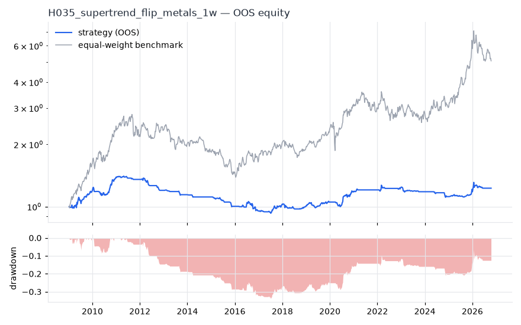
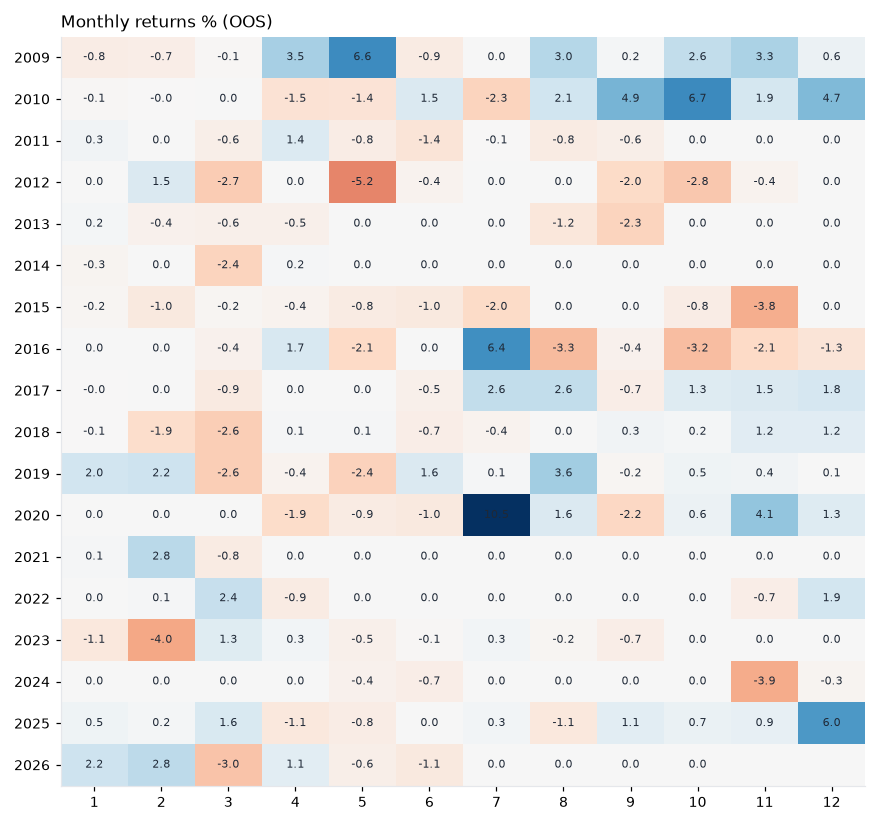
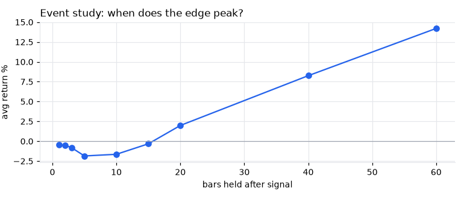
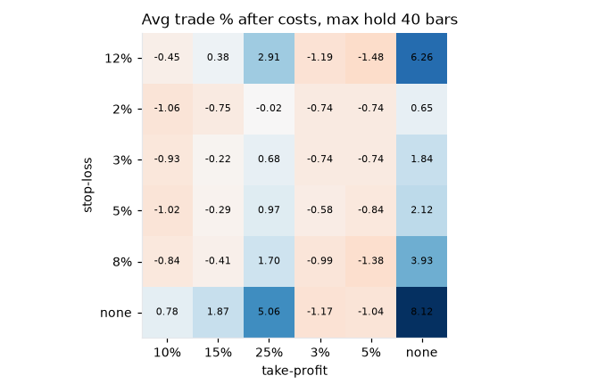

# H035 — supertrend_flip on metals [1w]  ❌ REJECT

- Kind: rule · Source: Supertrend (ATR bands)
- For system: `metals`
- Data: 2005-01-07 00:00:00 → 2026-10-16 00:00:00 · 5 assets · 52.2 bars/year · survivorship mask: False
- Costs: {'commission': 0.0002, 'slippage': 0.0005, 'funding_annual': 0.0, 'borrow_annual': 0.0}
- Variants tried (DSR trials): 163 (failed: 0)
- Final variant: `supertrend_flip|cfg=(14, 3.0)|f=none|x=stop_pct=0.03`

## Verdict reasons
- DSR 0.018 < 0.9 (luck not excluded after 163 trials)
- OOS Sharpe (excess of T-bill) -0.003 < 0.5
- bootstrap P(SR>0) 0.791 < 0.85
- only 50% of OOS years positive
- with 2x costs it does not beat the equal-weight benchmark
- Reality Check p 0.966 > 0.1 (best variant may be data-mined)
- random entries match it (p=0.48): the edge is in the exits, not the signal

## Walk-forward out-of-sample


| Metric | Strategy | Equal-weight benchmark |
|---|---|---|
| years | 17.77 | 17.77 |
| cagr | 0.0116 | 0.0956 |
| vol | 0.0646 | 0.2187 |
| sharpe | 0.211 | 0.528 |
| sharpe_excess_rf | -0.003 | None |
| sortino | -0.004 | 0.778 |
| max_dd | -0.3389 | -0.5034 |
| max_dd_bars | 807 | 465 |
| calmar | 0.034 | 0.19 |
| ulcer | 0.1945 | 0.2301 |
| var95 | -0.012 | -0.0428 |
| cvar95 | -0.0212 | -0.0666 |
| omega | 1.119 | 1.22 |
| tail_ratio | 1.165 | 1.073 |
| skew | 0.68 | -0.133 |
| kurtosis | 9.96 | 3.768 |
| hit_rate | 0.314 | 0.55 |
| turnover_ann | 1.43 | None |

- **Gate Sharpe (excess of T-bill): -0.003**
- Deflated Sharpe: **0.018** · PBO: **0.343** · Reality Check p: **0.966**
- PSR 0.815 · Info ratio -0.538 · Beta 0.169 · Up/Down capture 0.176/0.189
- Sharpe with 2× costs: 0.195 · Walk-forward efficiency: 0.261
- Bootstrap: {'p_sharpe_pos': 0.791, 'cagr_p05': -0.0132, 'maxdd_p05': -0.3635}
- Yearly OOS Sharpe: {'2009': 1.5, '2010': 1.65, '2011': -0.9, '2012': -2.14, '2013': -1.72, '2014': -1.58, '2015': -2.64, '2016': -0.54, '2017': 1.35, '2018': -0.45, '2019': 0.93, '2020': 1.32, '2021': 0.91, '2022': 0.48, '2023': -1.34, '2024': -1.41, '2025': 1.7, '2026': 0.2}



## Regimes (where does it work?)
`{"bull": {"sharpe": 0.67, "ann_ret": 0.0495, "bars": 612}, "bear": {"sharpe": -1.38, "ann_ret": -0.0559, "bars": 316}, "calm": {"sharpe": 0.43, "ann_ret": 0.0261, "bars": 485}, "stressed": {"sharpe": -0.0, "ann_ret": -0.0001, "bars": 443}, "vix_lt_20": {"sharpe": -0.02, "ann_ret": -0.0008, "bars": 624}, "vix_20_30": {"sharpe": 0.94, "ann_ret": 0.0665, "bars": 232}, "vix_ge_30": {"sharpe": -0.3, "ann_ret": -0.0315, "bars": 72}, "curve_inverted": {"sharpe": -0.51, "ann_ret": -0.0202, "bars": 125}, "curve_normal": {"sharpe": 0.28, "ann_ret": 0.0189, "bars": 803}}`

## Calendar profile (weekday / month / hour)
`{"weekday": {"4": 0.00026}, "month": {"1": 0.00041, "2": 0.00023, "3": -0.00146, "4": 0.00021, "5": -0.00112, "6": -0.0006, "7": 0.00187, "8": 0.00077, "9": -0.00032, "10": 0.00074, "11": 0.00033, "12": 0.00212}}`

## Trades (OOS)
`{"n_trades": 85, "trades_per_year": 4.8, "win_rate": 0.141, "avg_trade": 0.0287, "median_trade": -0.03, "avg_win": 0.3872, "avg_loss": -0.0302, "profit_factor": 2.105, "payoff": 12.806, "expectancy_r": 0.956, "sqn": 1.26, "kelly_fraction": 0.074, "max_consec_losses": 24, "avg_bars": 8.0, "avg_bars_win": 45.2, "avg_bars_loss": 1.9, "avg_mfe": 0.1202, "avg_mae": -0.0114, "edge_ratio": 10.513, "exit_reasons": {"stop": 73, "signal": 12}, "long_short": {"1": {"count": 85, "mean": 0.0287}}}`

## Robustness
- **delay**: `{"sharpe": 0.378, "sharpe_delayed_1bar": 0.485, "retained": 1.284}`
- **neighbourhood**: `{"neighbours": 1, "best_sharpe": 0.376, "neighbour_median": 0.18, "share_positive": 1.0, "stability": 0.478}`
- **noise**: `{"noise_bp": 0.002, "sharpe_min": 0.303, "sharpe_median": 0.441}`
- **random_entry**: `{"actual_ret_per_exposure_ann": 0.1474, "random_median_ann": 0.1465, "random_p95_ann": 0.2272, "trades_actual": 100, "p_value": 0.48}`
- **mc_trade_shuffle**: `{"maxdd_median": -0.1236, "maxdd_p95": -0.1846, "final_p05": 0.7633, "final_median": 0.7633}`

## Timing, take-profit, stop-loss and profit studies (in-sample diagnostics)
- Event study (forward return by bars held): `{"1": {"n": 100, "mean": -0.0046, "hit": 0.47, "t": -1.34, "per_bar": -0.00459}, "2": {"n": 100, "mean": -0.0051, "hit": 0.41, "t": -1.36, "per_bar": -0.00253}, "3": {"n": 100, "mean": -0.0081, "hit": 0.42, "t": -1.46, "per_bar": -0.00271}, "5": {"n": 100, "mean": -0.0185, "hit": 0.37, "t": -2.5, "per_bar": -0.00369}, "10": {"n": 98, "mean": -0.0164, "hit": 0.378, "t": -1.38, "per_bar": -0.00164}, "15": {"n": 99, "mean": -0.0032, "hit": 0.414, "t": -0.21, "per_bar": -0.00021}, "20": {"n": 98, "mean": 0.0199, "hit": 0.51, "t": 1.17, "per_bar": 0.001}, "40": {"n": 100, "mean": 0.0826, "hit": 0.52, "t": 2.97, "per_bar": 0.00206}, "60": {"n": 98, "mean": 0.1421, "hit": 0.612, "t": 4.08, "per_bar": 0.00237}, "best_holding_bars": 60}`

- Best stop / target / max-hold combinations: `[{"stop": NaN, "target": NaN, "max_hold": 40, "n": 100, "mean": 0.0812, "hit": 0.52, "per_bar": 0.002, "t": 2.939}, {"stop": NaN, "target": 0.25, "max_hold": 40, "n": 100, "mean": 0.0506, "hit": 0.57, "per_bar": 0.0015, "t": 2.6113}, {"stop": 0.12, "target": NaN, "max_hold": 40, "n": 100, "mean": 0.0626, "hit": 0.4, "per_bar": 0.0023, "t": 2.4498}, {"stop": 0.12, "target": 0.25, "max_hold": 40, "n": 100, "mean": 0.0291, "hit": 0.45, "per_bar": 0.0014, "t": 1.7532}, {"stop": 0.08, "target": NaN, "max_hold": 40, "n": 100, "mean": 0.0393, "hit": 0.28, "per_bar": 0.002, "t": 1.7417}]`

- Portfolio overlays (vol target, drawdown brake, equity-curve filter): `{"none": {"sharpe": 0.211, "cagr": 0.0116, "max_dd": -0.3389}, "vol_target_0.1": {"sharpe": 0.072, "cagr": 0.0024, "max_dd": -0.4992}, "vol_target_0.15": {"sharpe": 0.172, "cagr": 0.013, "max_dd": -0.5374}, "vol_target_0.2": {"sharpe": 0.192, "cagr": 0.016, "max_dd": -0.5651}, "dd_brake_0.1": {"sharpe": 0.245, "cagr": 0.0108, "max_dd": -0.2276}, "dd_brake_0.2": {"sharpe": 0.206, "cagr": 0.01, "max_dd": -0.2718}, "equity_ma_8": {"sharpe": 0.52, "cagr": 0.0252, "max_dd": -0.1127}, "equity_ma_26": {"sharpe": 0.469, "cagr": 0.0228, "max_dd": -0.1367}, "best_by_calmar": "equity_ma_8"}`
> Studies are in-sample diagnostics. To use a better exit, register it (exits: [...]) and let the gate judge it.

## Walk-forward windows
- 2020-12-25 00:00:00 → 2021-06-18 00:00:00: IS 1.72 / OOS 1.037 — `supertrend_flip|cfg=(20, 4.0)|f=none|x=trail_pct=0.1`
- 2021-06-25 00:00:00 → 2021-12-17 00:00:00: IS 1.953 / OOS 0.0 — `supertrend_flip|cfg=(20, 4.0)|f=none|x=trail_pct=0.1`
- 2021-12-24 00:00:00 → 2022-06-17 00:00:00: IS 1.849 / OOS 0.427 — `supertrend_flip|cfg=(20, 4.0)|f=none|x=trail_pct=0.1`
- 2022-06-24 00:00:00 → 2022-12-16 00:00:00: IS 1.676 / OOS -0.535 — `supertrend_flip|cfg=(20, 4.0)|f=none|x=trail_pct=0.1`
- 2022-12-23 00:00:00 → 2023-06-16 00:00:00: IS 1.388 / OOS -0.776 — `supertrend_flip|cfg=(20, 4.0)|f=none|x=trail_pct=0.1`
- 2023-06-23 00:00:00 → 2023-12-15 00:00:00: IS 0.994 / OOS -1.23 — `supertrend_flip|cfg=(20, 4.0)|f=none|x=trail_pct=0.1`
- 2023-12-22 00:00:00 → 2024-06-14 00:00:00: IS 0.6 / OOS -2.019 — `supertrend_flip|cfg=(20, 4.0)|f=none|x=max_hold=5`
- 2024-06-21 00:00:00 → 2024-12-13 00:00:00: IS 0.409 / OOS -1.324 — `supertrend_flip|cfg=(20, 4.0)|f=none|x=max_hold=5`
- 2024-12-20 00:00:00 → 2025-06-13 00:00:00: IS 0.262 / OOS 0.754 — `supertrend_flip|cfg=(20, 4.0)|f=none|x=trail_pct=0.15|size=vol0.1|overlay=eqma_s`
- 2025-06-20 00:00:00 → 2025-12-12 00:00:00: IS 0.488 / OOS 1.199 — `supertrend_flip|cfg=(20, 4.0)|f=none|x=trail_pct=0.15|size=vol0.1|overlay=eqma_s`
- 2025-12-19 00:00:00 → 2026-06-12 00:00:00: IS 1.302 / OOS 1.027 — `supertrend_flip|cfg=(14, 3.0)|f=none|x=stop_pct=0.03`
- 2026-06-19 00:00:00 → 2026-10-16 00:00:00: IS 1.18 / OOS 0.0 — `supertrend_flip|cfg=(14, 3.0)|f=none|x=stop_pct=0.03`

## Best variants (full sample, reference only)
- supertrend_flip|cfg=(20, 4.0)|f=none|x=trail_pct=0.15|size=vol0.1|overlay=eqma_l: Sharpe 0.704
- supertrend_flip|cfg=(20, 4.0)|f=none|x=trail_pct=0.15|size=vol0.2|overlay=eqma_l: Sharpe 0.678
- supertrend_flip|cfg=(20, 4.0)|f=none|x=trail_pct=0.15|size=vol0.1|overlay=vt10: Sharpe 0.678
- supertrend_flip|cfg=(20, 4.0)|f=none|x=trail_pct=0.15|size=vol0.1: Sharpe 0.66
- supertrend_flip|cfg=(20, 4.0)|f=none|x=trail_pct=0.15|size=vol0.1|overlay=vt15: Sharpe 0.66
- supertrend_flip|cfg=(20, 4.0)|f=none|x=trail_pct=0.15|size=vol0.1|overlay=vt20: Sharpe 0.66
- supertrend_flip|cfg=(20, 4.0)|f=none|x=trail_pct=0.15|size=vol0.1|overlay=dd20: Sharpe 0.66
- supertrend_flip|cfg=(20, 4.0)|f=none|x=trail_pct=0.15|size=vol0.2|overlay=dd10: Sharpe 0.648
- supertrend_flip|cfg=(20, 4.0)|f=none|x=trail_pct=0.15|size=vol0.2|overlay=vt15: Sharpe 0.648
- supertrend_flip|cfg=(20, 4.0)|f=none|x=trail_pct=0.15|size=vol0.1|overlay=dd10: Sharpe 0.644

## Current targets / signals
```json
{
 "positions": {},
 "entry_long_next_open": [],
 "exit_long_next_open": [],
 "entry_short_next_open": []
}
```

> Survivorship bias: unless a membership mask is used, universes are today's members (upper-bound results).