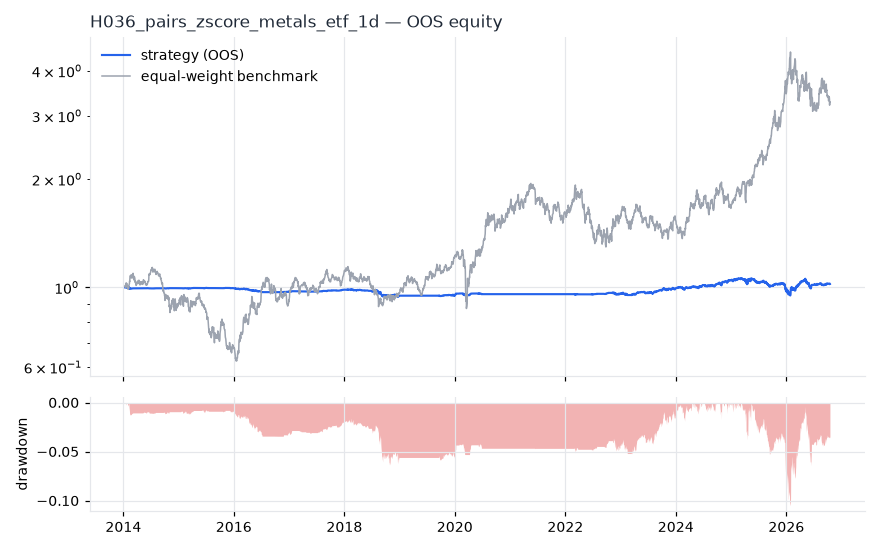
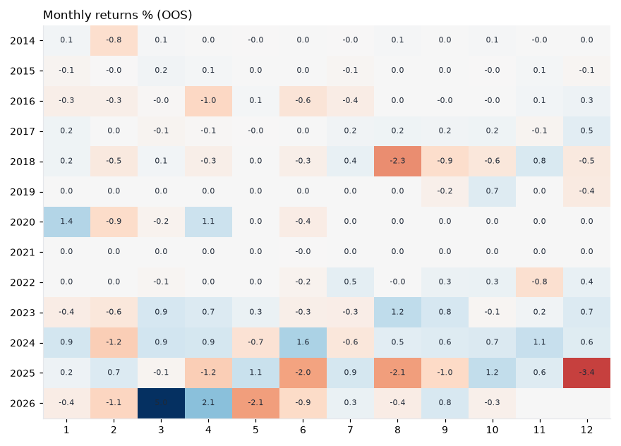

# H036 — pairs_zscore on metals_etf [1d]  ❌ REJECT

- Kind: strategy · Source: Gatev, Goetzmann & Rouwenhorst (2006) Pairs Trading; Vidyamurthy (2004)
- For system: `metals`
- Data: 2010-01-04 00:00:00 → 2026-10-16 00:00:00 · 8 assets · 251.7 bars/year · survivorship mask: False
- Costs: {'commission': 0.0002, 'slippage': 0.0003, 'funding_annual': 0.0, 'borrow_annual': 0.0}
- Variants tried (DSR trials): 38 (failed: 0)
- Final variant: `pairs_zscore|form=252,entry_z=2.0,min_corr=0.8,hedge=ratio`

## Verdict reasons
- DSR 0.1 < 0.9 (luck not excluded after 38 trials)
- OOS Sharpe (excess of T-bill) -0.511 < 0.5
- bootstrap P(SR>0) 0.625 < 0.85
- only 54% of OOS years positive
- with 2x costs it does not beat the equal-weight benchmark
- PBO 0.753 > 0.5 (variant selection is overfit)
- Reality Check p 0.88 > 0.1 (best variant may be data-mined)

## Walk-forward out-of-sample


| Metric | Strategy | Equal-weight benchmark |
|---|---|---|
| years | 12.76 | 12.76 |
| cagr | 0.0018 | 0.0974 |
| vol | 0.0325 | 0.2457 |
| sharpe | 0.07 | 0.502 |
| sharpe_excess_rf | -0.511 | None |
| sortino | -0.734 | 0.702 |
| max_dd | -0.105 | -0.4505 |
| max_dd_bars | 2575 | 890 |
| calmar | 0.017 | 0.216 |
| ulcer | 0.0361 | 0.1685 |
| var95 | -0.0027 | -0.0236 |
| cvar95 | -0.005 | -0.0363 |
| omega | 1.02 | 1.091 |
| tail_ratio | 0.952 | 1.022 |
| skew | 1.376 | -0.479 |
| kurtosis | 34.541 | 5.437 |
| hit_rate | 0.287 | 0.523 |
| turnover_ann | 6.56 | None |

- **Gate Sharpe (excess of T-bill): -0.511**
- Deflated Sharpe: **0.1** · PBO: **0.753** · Reality Check p: **0.88**
- PSR 0.6 · Info ratio -0.479 · Beta -0.019 · Up/Down capture -0.012/-0.015
- Sharpe with 2× costs: -0.031 · Walk-forward efficiency: 0.077
- Bootstrap: {'p_sharpe_pos': 0.625, 'cagr_p05': -0.0116, 'maxdd_p05': -0.1975}
- Yearly OOS Sharpe: {'2014': -0.53, '2015': 0.06, '2016': -1.66, '2017': 1.69, '2018': -1.1, '2019': -0.01, '2020': 0.66, '2021': -0.2, '2022': 0.25, '2023': 1.05, '2024': 1.45, '2025': -0.78, '2026': 0.5}



## Regimes (where does it work?)
`{"bull": {"sharpe": 0.04, "ann_ret": 0.0014, "bars": 2038}, "bear": {"sharpe": 0.19, "ann_ret": 0.0039, "bars": 1172}, "calm": {"sharpe": -0.27, "ann_ret": -0.0065, "bars": 1701}, "stressed": {"sharpe": 0.31, "ann_ret": 0.0122, "bars": 1509}, "vix_lt_20": {"sharpe": -0.1, "ann_ret": -0.0031, "bars": 2335}, "vix_20_30": {"sharpe": 0.77, "ann_ret": 0.0249, "bars": 717}, "vix_ge_30": {"sharpe": -0.49, "ann_ret": -0.0203, "bars": 158}, "curve_inverted": {"sharpe": 0.6, "ann_ret": 0.0206, "bars": 614}, "curve_normal": {"sharpe": -0.06, "ann_ret": -0.002, "bars": 2596}}`

## Calendar profile (weekday / month / hour)
`{"weekday": {"0": 6e-05, "1": -0.00012, "2": 4e-05, "3": -4e-05, "4": 0.00011}, "month": {"1": 8e-05, "2": -0.00019, "3": 0.00023, "4": 8e-05, "5": -5e-05, "6": -0.00011, "7": 3e-05, "8": -9e-05, "9": 3e-05, "10": 8e-05, "11": 9e-05, "12": -8e-05}}`

## Robustness
- **delay**: `{"sharpe": 0.349, "sharpe_delayed_1bar": 0.342, "retained": 0.982}`
- **neighbourhood**: `{"neighbours": 4, "best_sharpe": 0.332, "neighbour_median": 0.29, "share_positive": 1.0, "stability": 0.874}`
- **noise**: `{"noise_bp": 0.002, "sharpe_min": 0.226, "sharpe_median": 0.396}`

## Timing, take-profit, stop-loss and profit studies (in-sample diagnostics)
- Portfolio overlays (vol target, drawdown brake, equity-curve filter): `{"none": {"sharpe": 0.07, "cagr": 0.0018, "max_dd": -0.105}, "vol_target_0.1": {"sharpe": 0.01, "cagr": -0.0009, "max_dd": -0.1744}, "vol_target_0.15": {"sharpe": 0.024, "cagr": -0.0004, "max_dd": -0.1924}, "vol_target_0.2": {"sharpe": 0.058, "cagr": 0.0017, "max_dd": -0.2027}, "dd_brake_0.1": {"sharpe": 0.064, "cagr": 0.0015, "max_dd": -0.1032}, "dd_brake_0.2": {"sharpe": 0.07, "cagr": 0.0018, "max_dd": -0.105}, "equity_ma_41": {"sharpe": -0.269, "cagr": -0.0054, "max_dd": -0.1151}, "equity_ma_125": {"sharpe": -0.153, "cagr": -0.0034, "max_dd": -0.098}, "best_by_calmar": "none"}`
> Studies are in-sample diagnostics. To use a better exit, register it (exits: [...]) and let the gate judge it.

## Walk-forward windows
- 2020-12-23 00:00:00 → 2021-06-23 00:00:00: IS 0.704 / OOS -0.281 — `pairs_zscore|form=126,entry_z=2.0,min_corr=0.6,hedge=ols`
- 2021-06-24 00:00:00 → 2021-12-20 00:00:00: IS 0.696 / OOS 0.0 — `pairs_zscore|form=126,entry_z=2.0,min_corr=0.6,hedge=ols`
- 2021-12-21 00:00:00 → 2022-06-21 00:00:00: IS 0.696 / OOS -0.256 — `pairs_zscore|form=126,entry_z=2.0,min_corr=0.6,hedge=ols`
- 2022-06-22 00:00:00 → 2022-12-16 00:00:00: IS 0.598 / OOS 0.315 — `pairs_zscore|form=126,entry_z=2.0,min_corr=0.8,hedge=ratio`
- 2022-12-19 00:00:00 → 2023-06-20 00:00:00: IS 0.795 / OOS 0.308 — `pairs_zscore|form=252,entry_z=2.0,min_corr=0.6,hedge=ratio|overlay=eqma_l`
- 2023-06-21 00:00:00 → 2023-12-15 00:00:00: IS 1.082 / OOS 1.98 — `pairs_zscore|form=252,entry_z=1.5,min_corr=0.6,hedge=ratio`
- 2023-12-18 00:00:00 → 2024-06-17 00:00:00: IS 1.642 / OOS 0.645 — `pairs_zscore|form=252,entry_z=1.5,min_corr=0.6,hedge=ratio`
- 2024-06-18 00:00:00 → 2024-12-13 00:00:00: IS 1.411 / OOS 2.015 — `pairs_zscore|form=252,entry_z=1.5,min_corr=0.6,hedge=ratio`
- 2024-12-16 00:00:00 → 2025-06-17 00:00:00: IS 1.669 / OOS -0.201 — `pairs_zscore|form=252,entry_z=1.5,min_corr=0.6,hedge=ratio`
- 2025-06-18 00:00:00 → 2025-12-15 00:00:00: IS 1.152 / OOS -0.803 — `pairs_zscore|form=252,entry_z=1.5,min_corr=0.6,hedge=ratio`
- 2025-12-16 00:00:00 → 2026-06-16 00:00:00: IS 0.818 / OOS -0.035 — `pairs_zscore|form=126,entry_z=1.5,min_corr=0.6,hedge=ratio`
- 2026-06-17 00:00:00 → 2026-10-16 00:00:00: IS 0.964 / OOS 0.733 — `pairs_zscore|form=252,entry_z=2.0,min_corr=0.8,hedge=ratio`

## Best variants (full sample, reference only)
- pairs_zscore|form=126,entry_z=2.0,min_corr=0.6,hedge=ratio|overlay=dd20: Sharpe 0.415
- pairs_zscore|form=126,entry_z=2.0,min_corr=0.6,hedge=ratio|overlay=dd10: Sharpe 0.415
- pairs_zscore|form=126,entry_z=2.0,min_corr=0.6,hedge=ratio: Sharpe 0.415
- pairs_zscore|form=126,entry_z=2.0,min_corr=0.6,hedge=ratio|overlay=vt20: Sharpe 0.415
- pairs_zscore|form=126,entry_z=2.0,min_corr=0.6,hedge=ratio|overlay=vt15: Sharpe 0.415
- pairs_zscore|form=126,entry_z=2.0,min_corr=0.6,hedge=ratio|overlay=vt10: Sharpe 0.406
- pairs_zscore|form=252,entry_z=2.0,min_corr=0.6,hedge=ratio|overlay=dd20: Sharpe 0.381
- pairs_zscore|form=252,entry_z=2.0,min_corr=0.6,hedge=ratio|overlay=vt20: Sharpe 0.381
- pairs_zscore|form=252,entry_z=2.0,min_corr=0.6,hedge=ratio|overlay=vt15: Sharpe 0.381
- pairs_zscore|form=252,entry_z=2.0,min_corr=0.6,hedge=ratio: Sharpe 0.381

## Current targets / signals
```json
{
 "SLV": 0.05,
 "PALL": 0.05,
 "SIL": 0.05,
 "GDX": -0.05,
 "PPLT": -0.1
}
```

> Survivorship bias: unless a membership mask is used, universes are today's members (upper-bound results).