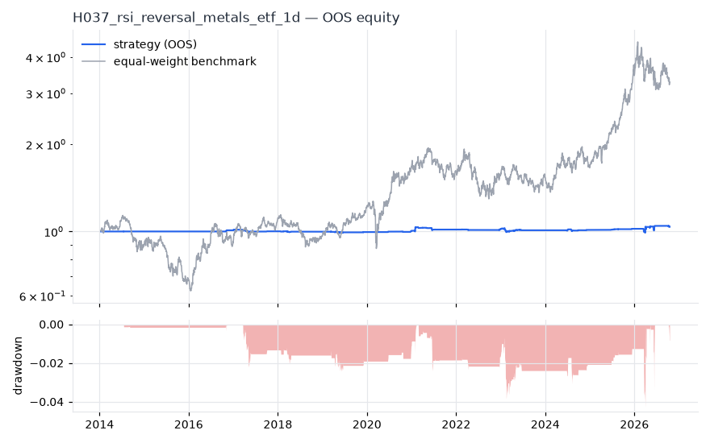
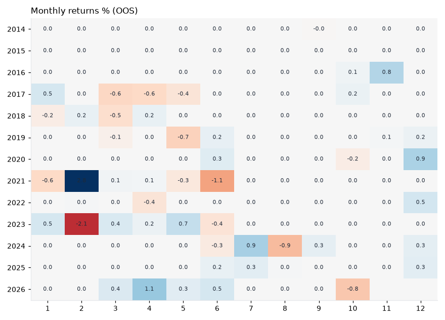
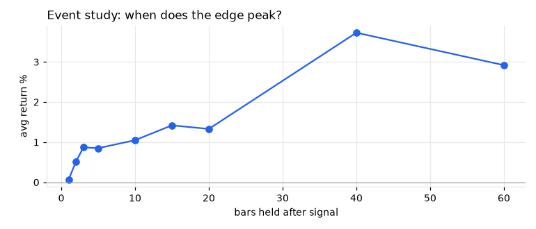
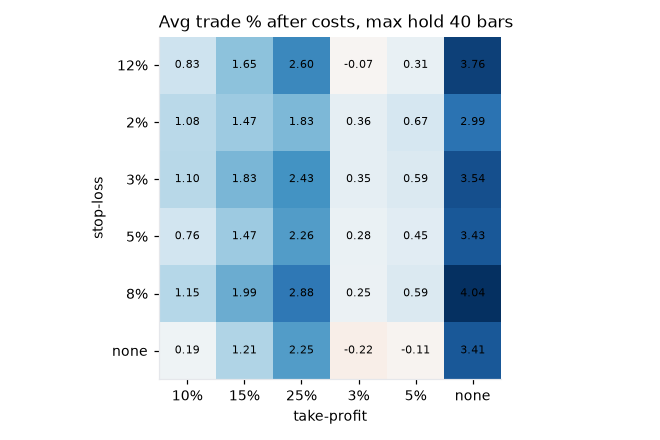

# H037 — rsi_reversal on metals_etf [1d]  ❌ REJECT

- Kind: rule · Source: Wilder (1978) RSI; Connors (2009)
- For system: `metals`
- Data: 2010-01-04 00:00:00 → 2026-10-16 00:00:00 · 8 assets · 251.7 bars/year · survivorship mask: False
- Costs: {'commission': 0.0002, 'slippage': 0.0003, 'funding_annual': 0.0, 'borrow_annual': 0.0}
- Variants tried (DSR trials): 1653 (failed: 0)
- Final variant: `rsi_reversal+macd_cross|n=3,lo=30,exit=70|f=htf_week_sma30|x=signal_only|confirm=cfg=(6, 13, 4),zero_filter=False,within=0`

## Verdict reasons
- DSR 0.002 < 0.9 (luck not excluded after 1653 trials)
- OOS Sharpe (excess of T-bill) -0.717 < 0.5
- bootstrap P(SR>0) 0.778 < 0.85
- only 54% of OOS years positive
- with 2x costs it does not beat the equal-weight benchmark
- Reality Check p 0.952 > 0.1 (best variant may be data-mined)
- 1-bar delay keeps only 4% of Sharpe (latency-fragile)
- random entries match it (p=0.28): the edge is in the exits, not the signal

## Walk-forward out-of-sample


| Metric | Strategy | Equal-weight benchmark |
|---|---|---|
| years | 12.76 | 12.76 |
| cagr | 0.0029 | 0.0974 |
| vol | 0.022 | 0.2457 |
| sharpe | 0.142 | 0.502 |
| sharpe_excess_rf | -0.717 | None |
| sortino | -1.229 | 0.702 |
| max_dd | -0.0428 | -0.4505 |
| max_dd_bars | 1280 | 890 |
| calmar | 0.067 | 0.216 |
| ulcer | 0.0161 | 0.1685 |
| var95 | -0.0002 | -0.0236 |
| cvar95 | -0.0023 | -0.0363 |
| omega | 1.107 | 1.091 |
| tail_ratio | 1.698 | 1.022 |
| skew | 10.128 | -0.479 |
| kurtosis | 291.71 | 5.437 |
| hit_rate | 0.059 | 0.523 |
| turnover_ann | 2.09 | None |

- **Gate Sharpe (excess of T-bill): -0.717**
- Deflated Sharpe: **0.002** · PBO: **0.452** · Reality Check p: **0.952**
- PSR 0.702 · Info ratio -0.497 · Beta 0.02 · Up/Down capture 0.017/0.016
- Sharpe with 2× costs: 0.094 · Walk-forward efficiency: 0.098
- Bootstrap: {'p_sharpe_pos': 0.778, 'cagr_p05': -0.0038, 'maxdd_p05': -0.0927}
- Yearly OOS Sharpe: {'2014': -0.04, '2015': 0.0, '2016': 1.29, '2017': -0.58, '2018': -0.41, '2019': -0.25, '2020': 1.51, '2021': 0.28, '2022': 0.25, '2023': -0.31, '2024': 0.29, '2025': 1.75, '2026': 0.32}



## Regimes (where does it work?)
`{"bull": {"sharpe": 0.32, "ann_ret": 0.0079, "bars": 2038}, "bear": {"sharpe": -0.32, "ann_ret": -0.0052, "bars": 1172}, "calm": {"sharpe": -0.34, "ann_ret": -0.0039, "bars": 1701}, "stressed": {"sharpe": 0.37, "ann_ret": 0.011, "bars": 1509}, "vix_lt_20": {"sharpe": 0.09, "ann_ret": 0.0012, "bars": 2335}, "vix_20_30": {"sharpe": 0.06, "ann_ret": 0.0019, "bars": 717}, "vix_ge_30": {"sharpe": 0.79, "ann_ret": 0.0364, "bars": 158}, "curve_inverted": {"sharpe": 0.0, "ann_ret": 0.0, "bars": 614}, "curve_normal": {"sharpe": 0.17, "ann_ret": 0.0038, "bars": 2596}}`

## Calendar profile (weekday / month / hour)
`{"weekday": {"0": 0.00013, "1": 6e-05, "2": -1e-05, "3": -9e-05, "4": -2e-05}, "month": {"1": 1e-05, "2": 4e-05, "3": -1e-05, "4": 2e-05, "5": -1e-05, "6": -2e-05, "7": 5e-05, "8": -3e-05, "9": 1e-05, "10": -2e-05, "11": 4e-05, "12": 9e-05}}`

## Trades (OOS)
`{"n_trades": 112, "trades_per_year": 8.8, "win_rate": 0.688, "avg_trade": 0.0054, "median_trade": 0.0087, "avg_win": 0.0234, "avg_loss": -0.0343, "profit_factor": 1.504, "payoff": 0.684, "expectancy_r": null, "sqn": null, "kelly_fraction": 0.23, "max_consec_losses": 5, "avg_bars": 4.8, "avg_bars_win": 2.8, "avg_bars_loss": 9.2, "avg_mfe": 0.0188, "avg_mae": -0.0255, "edge_ratio": 0.737, "exit_reasons": {"signal": 112}, "long_short": {"1": {"count": 112, "mean": 0.0054}}}`

## Robustness
- **delay**: `{"sharpe": 0.229, "sharpe_delayed_1bar": 0.008, "retained": 0.037}`
- **neighbourhood**: `{"neighbours": 2, "best_sharpe": 0.223, "neighbour_median": 0.183, "share_positive": 0.5, "stability": 0.82}`
- **noise**: `{"noise_bp": 0.002, "sharpe_min": 0.086, "sharpe_median": 0.234}`
- **random_entry**: `{"actual_ret_per_exposure_ann": 0.197, "random_median_ann": 0.1018, "random_p95_ann": 0.2835, "trades_actual": 126, "p_value": 0.28}`
- **mc_trade_shuffle**: `{"maxdd_median": -0.0412, "maxdd_p95": -0.063, "final_p05": 0.087, "final_median": 0.087}`

## Timing, take-profit, stop-loss and profit studies (in-sample diagnostics)
- Event study (forward return by bars held): `{"1": {"n": 135, "mean": 0.0007, "hit": 0.526, "t": 0.76, "per_bar": 0.00073}, "2": {"n": 134, "mean": 0.0052, "hit": 0.567, "t": 2.79, "per_bar": 0.00259}, "3": {"n": 134, "mean": 0.0087, "hit": 0.642, "t": 3.18, "per_bar": 0.00289}, "5": {"n": 134, "mean": 0.0085, "hit": 0.59, "t": 2.19, "per_bar": 0.0017}, "10": {"n": 132, "mean": 0.0105, "hit": 0.568, "t": 2.26, "per_bar": 0.00105}, "15": {"n": 131, "mean": 0.0142, "hit": 0.565, "t": 2.44, "per_bar": 0.00095}, "20": {"n": 131, "mean": 0.0133, "hit": 0.511, "t": 1.72, "per_bar": 0.00067}, "40": {"n": 131, "mean": 0.0373, "hit": 0.534, "t": 2.5, "per_bar": 0.00093}, "60": {"n": 131, "mean": 0.0292, "hit": 0.55, "t": 1.86, "per_bar": 0.00049}, "best_holding_bars": 3}`

- Best stop / target / max-hold combinations: `[{"stop": 0.08, "target": NaN, "max_hold": 40, "n": 135, "mean": 0.0404, "hit": 0.4741, "per_bar": 0.0013, "t": 3.0759}, {"stop": 0.03, "target": 0.25, "max_hold": 40, "n": 135, "mean": 0.0243, "hit": 0.3185, "per_bar": 0.0012, "t": 3.0565}, {"stop": 0.03, "target": NaN, "max_hold": 40, "n": 135, "mean": 0.0354, "hit": 0.3185, "per_bar": 0.0017, "t": 3.0189}, {"stop": 0.02, "target": 0.05, "max_hold": 3, "n": 135, "mean": 0.006, "hit": 0.563, "per_bar": 0.0023, "t": 2.9469}, {"stop": 0.02, "target": 0.1, "max_hold": 3, "n": 135, "mean": 0.0066, "hit": 0.563, "per_bar": 0.0025, "t": 2.9436}]`

- Portfolio overlays (vol target, drawdown brake, equity-curve filter): `{"none": {"sharpe": 0.142, "cagr": 0.0029, "max_dd": -0.0428}, "vol_target_0.1": {"sharpe": 0.122, "cagr": 0.004, "max_dd": -0.0826}, "vol_target_0.15": {"sharpe": 0.127, "cagr": 0.0044, "max_dd": -0.085}, "vol_target_0.2": {"sharpe": 0.133, "cagr": 0.0048, "max_dd": -0.085}, "dd_brake_0.1": {"sharpe": 0.142, "cagr": 0.0029, "max_dd": -0.0428}, "dd_brake_0.2": {"sharpe": 0.142, "cagr": 0.0029, "max_dd": -0.0428}, "equity_ma_41": {"sharpe": -0.04, "cagr": -0.0005, "max_dd": -0.031}, "equity_ma_125": {"sharpe": 0.08, "cagr": 0.0011, "max_dd": -0.0243}, "best_by_calmar": "none"}`
> Studies are in-sample diagnostics. To use a better exit, register it (exits: [...]) and let the gate judge it.

## Walk-forward windows
- 2020-12-23 00:00:00 → 2021-06-23 00:00:00: IS 1.623 / OOS 0.711 — `rsi_reversal+macd_cross|n=2,lo=35,exit=50|f=trend_sma200|x=signal_only|confirm=cfg=(6, 13, 4),zero_filter=False,within=0`
- 2021-06-24 00:00:00 → 2021-12-20 00:00:00: IS 1.591 / OOS 0.234 — `rsi_reversal+macd_cross|n=2,lo=35,exit=60|f=htf_week_sma30|x=signal_only|confirm=cfg=(5, 35, 5),zero_filter=False,within=0`
- 2021-12-21 00:00:00 → 2022-06-21 00:00:00: IS 1.608 / OOS -1.146 — `rsi_reversal+macd_cross|n=2,lo=35,exit=60|f=htf_week_sma30|x=signal_only|confirm=cfg=(5, 35, 5),zero_filter=False,within=0`
- 2022-06-22 00:00:00 → 2022-12-16 00:00:00: IS 1.532 / OOS 0.0 — `rsi_reversal+macd_cross|n=7,lo=25,exit=60|f=trend_sma200|x=stop_atr=2.0,partial_r=1.0,partial_frac=0.5,partial_to_be=True,trail_atr=3.0|confirm=cfg=(5, 35, 5),zero_filter=True,within=5`
- 2022-12-19 00:00:00 → 2023-06-20 00:00:00: IS 1.642 / OOS -0.118 — `rsi_reversal+macd_cross|n=2,lo=30,exit=60|f=htf_week_sma30|x=signal_only|confirm=cfg=(6, 13, 4),zero_filter=False,within=5`
- 2023-06-21 00:00:00 → 2023-12-15 00:00:00: IS 1.532 / OOS 0.0 — `rsi_reversal+macd_cross|n=7,lo=25,exit=60|f=trend_sma200|x=stop_atr=2.0,partial_r=1.0,partial_frac=0.5,partial_to_be=True,trail_atr=3.0|confirm=cfg=(5, 35, 5),zero_filter=True,within=5`
- 2023-12-18 00:00:00 → 2024-06-17 00:00:00: IS 1.276 / OOS 0.0 — `rsi_reversal+macd_cross|n=5,lo=25,exit=70|f=trend_sma200|x=signal_only|confirm=cfg=(8, 21, 5),zero_filter=True,within=3`
- 2024-06-18 00:00:00 → 2024-12-13 00:00:00: IS 1.278 / OOS 0.409 — `rsi_reversal+macd_cross|n=2,lo=30,exit=70|f=htf_week_sma30|x=signal_only|confirm=cfg=(8, 21, 5),zero_filter=False,within=3`
- 2024-12-16 00:00:00 → 2025-06-17 00:00:00: IS 1.332 / OOS 0.0 — `rsi_reversal+macd_cross|n=14,lo=30,exit=70|f=trend_sma200|x=signal_only|confirm=cfg=(8, 21, 5),zero_filter=True,within=3`
- 2025-06-18 00:00:00 → 2025-12-15 00:00:00: IS 1.277 / OOS 2.492 — `rsi_reversal+macd_cross|n=2,lo=20,exit=50|f=htf_week_sma30|x=signal_only|confirm=cfg=(8, 21, 5),zero_filter=False,within=3`
- 2025-12-16 00:00:00 → 2026-06-16 00:00:00: IS 1.443 / OOS 0.599 — `rsi_reversal+macd_cross|n=5,lo=35,exit=70|f=trend_sma200|x=signal_only|confirm=cfg=(8, 21, 5),zero_filter=False,within=5`
- 2026-06-17 00:00:00 → 2026-10-16 00:00:00: IS 1.43 / OOS -1.473 — `rsi_reversal+macd_cross|n=3,lo=30,exit=70|f=htf_week_sma30|x=signal_only|confirm=cfg=(6, 13, 4),zero_filter=False,within=0`

## Best variants (full sample, reference only)
- rsi_reversal+macd_cross|n=7,lo=25,exit=60|f=trend_sma200|x=stop_atr=2.0,tp_r=2.0,use_signal_exit=False|confirm=cfg=(5, 35, 5),zero_filter=False,within=3|size=vol0.2|overlay=dd20: Sharpe 0.791
- rsi_reversal+macd_cross|n=7,lo=25,exit=60|f=trend_sma200|x=stop_atr=2.0,tp_r=2.0,use_signal_exit=False|confirm=cfg=(5, 35, 5),zero_filter=False,within=3|size=vol0.2|overlay=dd10: Sharpe 0.791
- rsi_reversal+macd_cross|n=7,lo=25,exit=60|f=trend_sma200|x=stop_atr=2.0,tp_r=2.0,use_signal_exit=False|confirm=cfg=(5, 35, 5),zero_filter=False,within=3|size=vol0.1|overlay=vt20: Sharpe 0.791
- rsi_reversal+macd_cross|n=7,lo=25,exit=60|f=trend_sma200|x=stop_atr=2.0,tp_r=2.0,use_signal_exit=False|confirm=cfg=(5, 35, 5),zero_filter=False,within=3|size=vol0.2|overlay=vt20: Sharpe 0.791
- rsi_reversal+macd_cross|n=7,lo=25,exit=60|f=trend_sma200|x=stop_atr=2.0,tp_r=2.0,use_signal_exit=False|confirm=cfg=(5, 35, 5),zero_filter=False,within=3|size=vol0.2: Sharpe 0.791
- rsi_reversal+macd_cross|n=7,lo=25,exit=60|f=trend_sma200|x=stop_atr=2.0,tp_r=2.0,use_signal_exit=False|confirm=cfg=(5, 35, 5),zero_filter=False,within=3|size=vol0.1|overlay=vt15: Sharpe 0.791
- rsi_reversal+macd_cross|n=7,lo=25,exit=60|f=trend_sma200|x=stop_atr=2.0,tp_r=2.0,use_signal_exit=False|confirm=cfg=(5, 35, 5),zero_filter=False,within=3|size=vol0.1|overlay=vt10: Sharpe 0.791
- rsi_reversal+macd_cross|n=7,lo=25,exit=60|f=trend_sma200|x=stop_atr=2.0,tp_r=2.0,use_signal_exit=False|confirm=cfg=(5, 35, 5),zero_filter=False,within=3|size=vol0.1|overlay=dd20: Sharpe 0.791
- rsi_reversal+macd_cross|n=7,lo=25,exit=60|f=trend_sma200|x=stop_atr=2.0,tp_r=2.0,use_signal_exit=False|confirm=cfg=(5, 35, 5),zero_filter=False,within=3|size=vol0.1|overlay=dd10: Sharpe 0.791
- rsi_reversal+macd_cross|n=7,lo=25,exit=60|f=trend_sma200|x=stop_atr=2.0,tp_r=2.0,use_signal_exit=False|confirm=cfg=(5, 35, 5),zero_filter=False,within=3|size=vol0.2|overlay=vt10: Sharpe 0.791

## Current targets / signals
```json
{
 "positions": {
  "GDX": 0.125,
  "COPX": 0.125
 },
 "entry_long_next_open": [],
 "exit_long_next_open": [],
 "entry_short_next_open": []
}
```

> Survivorship bias: unless a membership mask is used, universes are today's members (upper-bound results).