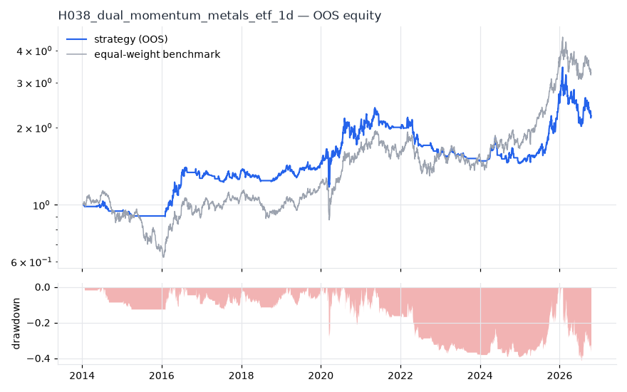
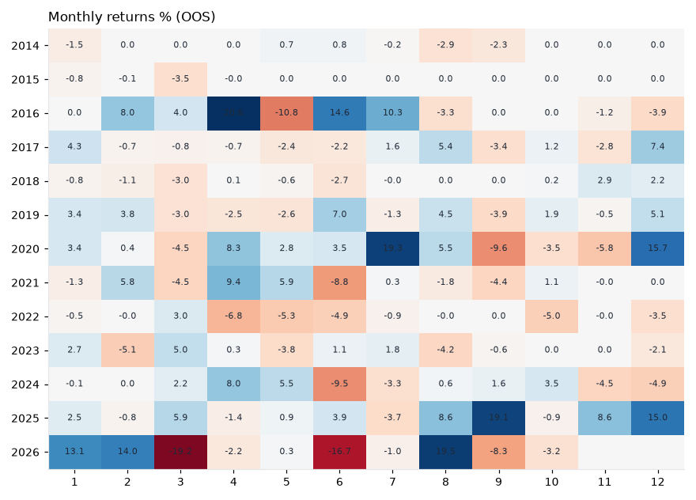

# H038 — dual_momentum on metals_etf [1d]  🟡 WATCH

- Kind: strategy · Source: Antonacci (2014) Dual Momentum Investing
- For system: `metals`
- Data: 2010-01-04 00:00:00 → 2026-10-16 00:00:00 · 8 assets · 251.7 bars/year · survivorship mask: False
- Costs: {'commission': 0.0002, 'slippage': 0.0003, 'funding_annual': 0.0, 'borrow_annual': 0.0}
- Variants tried (DSR trials): 20 (failed: 0)
- Final variant: `dual_momentum|lookback=252,top_n=5`

## Verdict reasons
- DSR 0.847 < 0.9 (luck not excluded after 20 trials)
- OOS Sharpe (excess of T-bill) 0.311 < 0.5
- only 46% of OOS years positive
- with 2x costs it does not beat the equal-weight benchmark
- PBO 0.773 > 0.5 (variant selection is overfit)
- Reality Check p 0.648 > 0.1 (best variant may be data-mined)

## Walk-forward out-of-sample


| Metric | Strategy | Equal-weight benchmark |
|---|---|---|
| years | 12.76 | 12.76 |
| cagr | 0.0648 | 0.0974 |
| vol | 0.2196 | 0.2457 |
| sharpe | 0.397 | 0.502 |
| sharpe_excess_rf | 0.311 | None |
| sortino | 0.423 | 0.702 |
| max_dd | -0.4117 | -0.4505 |
| max_dd_bars | 1158 | 890 |
| calmar | 0.157 | 0.216 |
| ulcer | 0.2021 | 0.1685 |
| var95 | -0.019 | -0.0236 |
| cvar95 | -0.0361 | -0.0363 |
| omega | 1.098 | 1.091 |
| tail_ratio | 1.132 | 1.022 |
| skew | -1.128 | -0.479 |
| kurtosis | 16.985 | 5.437 |
| hit_rate | 0.364 | 0.523 |
| turnover_ann | 7.85 | None |

- **Gate Sharpe (excess of T-bill): 0.311**
- Deflated Sharpe: **0.847** · PBO: **0.773** · Reality Check p: **0.648**
- PSR 0.919 · Info ratio -0.231 · Beta 0.696 · Up/Down capture 0.625/0.617
- Sharpe with 2× costs: 0.379 · Walk-forward efficiency: 0.708
- Bootstrap: {'p_sharpe_pos': 0.942, 'cagr_p05': -0.026, 'maxdd_p05': -0.6588}
- Yearly OOS Sharpe: {'2014': -0.64, '2015': -1.04, '2016': 1.62, '2017': 0.65, '2018': -0.33, '2019': 1.0, '2020': 0.96, '2021': 0.13, '2022': -1.3, '2023': -0.57, '2024': -0.03, '2025': 2.3, '2026': -0.09}



## Regimes (where does it work?)
`{"bull": {"sharpe": 0.89, "ann_ret": 0.2199, "bars": 2038}, "bear": {"sharpe": -0.9, "ann_ret": -0.1436, "bars": 1172}, "calm": {"sharpe": 1.03, "ann_ret": 0.1532, "bars": 1701}, "stressed": {"sharpe": 0.05, "ann_ret": 0.0128, "bars": 1509}, "vix_lt_20": {"sharpe": 0.87, "ann_ret": 0.1593, "bars": 2335}, "vix_20_30": {"sharpe": -0.33, "ann_ret": -0.0843, "bars": 717}, "vix_ge_30": {"sharpe": -0.46, "ann_ret": -0.2004, "bars": 158}, "curve_inverted": {"sharpe": -0.23, "ann_ret": -0.0341, "bars": 614}, "curve_normal": {"sharpe": 0.5, "ann_ret": 0.1159, "bars": 2596}}`

## Calendar profile (weekday / month / hour)
`{"weekday": {"0": 0.00122, "1": 0.00033, "2": 0.00041, "3": -0.00026, "4": 9e-05}, "month": {"1": 0.00105, "2": 0.00104, "3": -0.00056, "4": 0.00119, "5": -0.00031, "6": -0.00056, "7": 0.00082, "8": 0.00111, "9": -0.00048, "10": -0.00011, "11": -0.0001, "12": 0.00118}}`

## Robustness
- **delay**: `{"sharpe": 0.359, "sharpe_delayed_1bar": 0.341, "retained": 0.949}`
- **neighbourhood**: `{"neighbours": 3, "best_sharpe": 0.348, "neighbour_median": 0.395, "share_positive": 1.0, "stability": 1.137}`
- **noise**: `{"noise_bp": 0.002, "sharpe_min": 0.345, "sharpe_median": 0.359}`

## Timing, take-profit, stop-loss and profit studies (in-sample diagnostics)
- Portfolio overlays (vol target, drawdown brake, equity-curve filter): `{"none": {"sharpe": 0.397, "cagr": 0.0648, "max_dd": -0.4117}, "vol_target_0.1": {"sharpe": 0.47, "cagr": 0.0476, "max_dd": -0.2695}, "vol_target_0.15": {"sharpe": 0.441, "cagr": 0.0589, "max_dd": -0.3504}, "vol_target_0.2": {"sharpe": 0.421, "cagr": 0.0658, "max_dd": -0.413}, "dd_brake_0.1": {"sharpe": 0.363, "cagr": 0.048, "max_dd": -0.3272}, "dd_brake_0.2": {"sharpe": 0.39, "cagr": 0.0579, "max_dd": -0.3825}, "equity_ma_41": {"sharpe": 0.381, "cagr": 0.0521, "max_dd": -0.3321}, "equity_ma_125": {"sharpe": 0.302, "cagr": 0.0397, "max_dd": -0.3605}, "best_by_calmar": "vol_target_0.1"}`
> Studies are in-sample diagnostics. To use a better exit, register it (exits: [...]) and let the gate judge it.

## Walk-forward windows
- 2020-12-23 00:00:00 → 2021-06-23 00:00:00: IS 0.743 / OOS 0.807 — `dual_momentum|lookback=252,top_n=3`
- 2021-06-24 00:00:00 → 2021-12-20 00:00:00: IS 1.007 / OOS -1.333 — `dual_momentum|lookback=126,top_n=3|overlay=vt10`
- 2021-12-21 00:00:00 → 2022-06-21 00:00:00: IS 0.778 / OOS -1.232 — `dual_momentum|lookback=126,top_n=5`
- 2022-06-22 00:00:00 → 2022-12-16 00:00:00: IS 0.63 / OOS -1.913 — `dual_momentum|lookback=252,top_n=3`
- 2022-12-19 00:00:00 → 2023-06-20 00:00:00: IS 0.481 / OOS 0.26 — `dual_momentum|lookback=126,top_n=5|overlay=dd20`
- 2023-06-21 00:00:00 → 2023-12-15 00:00:00: IS 0.601 / OOS -1.523 — `dual_momentum|lookback=126,top_n=5|overlay=eqma_s`
- 2023-12-18 00:00:00 → 2024-06-17 00:00:00: IS 0.023 / OOS 0.605 — `dual_momentum|lookback=126,top_n=5|overlay=eqma_s`
- 2024-06-18 00:00:00 → 2024-12-13 00:00:00: IS -0.16 / OOS -0.497 — `dual_momentum|lookback=126,top_n=5|overlay=eqma_s`
- 2024-12-16 00:00:00 → 2025-06-17 00:00:00: IS -0.027 / OOS 1.426 — `dual_momentum|lookback=126,top_n=5|overlay=vt10`
- 2025-06-18 00:00:00 → 2025-12-15 00:00:00: IS 0.435 / OOS 2.651 — `dual_momentum|lookback=126,top_n=5|overlay=dd20`
- 2025-12-16 00:00:00 → 2026-06-16 00:00:00: IS 1.148 / OOS 0.507 — `dual_momentum|lookback=126,top_n=5|overlay=dd20`
- 2026-06-17 00:00:00 → 2026-10-16 00:00:00: IS 1.094 / OOS -0.628 — `dual_momentum|lookback=252,top_n=5`

## Best variants (full sample, reference only)
- dual_momentum|lookback=126,top_n=3|overlay=dd10: Sharpe 0.459
- dual_momentum|lookback=126,top_n=5: Sharpe 0.447
- dual_momentum|lookback=126,top_n=5|overlay=vt10: Sharpe 0.444
- dual_momentum|lookback=126,top_n=5|overlay=vt20: Sharpe 0.435
- dual_momentum|lookback=126,top_n=5|overlay=dd20: Sharpe 0.43
- dual_momentum|lookback=126,top_n=5|overlay=dd10: Sharpe 0.422
- dual_momentum|lookback=126,top_n=5|overlay=vt15: Sharpe 0.42
- dual_momentum|lookback=126,top_n=3|overlay=vt10: Sharpe 0.41
- dual_momentum|lookback=126,top_n=3: Sharpe 0.41
- dual_momentum|lookback=126,top_n=1: Sharpe 0.4

## Current targets / signals
```json
{
 "SLV": 0.2,
 "GDX": 0.2,
 "CPER": 0.2,
 "SIL": 0.2,
 "COPX": 0.2
}
```

> Survivorship bias: unless a membership mask is used, universes are today's members (upper-bound results).