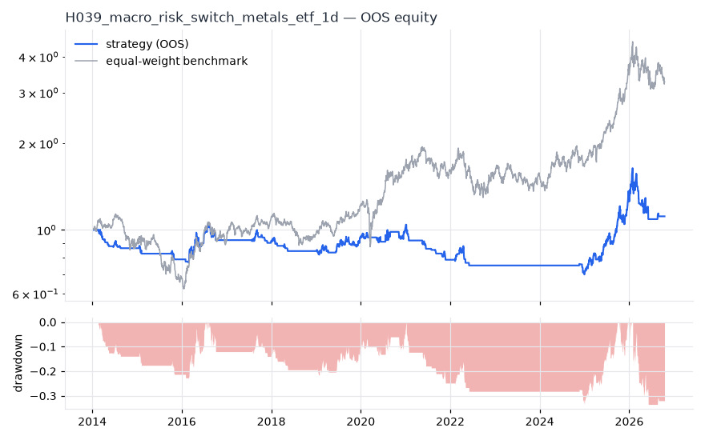
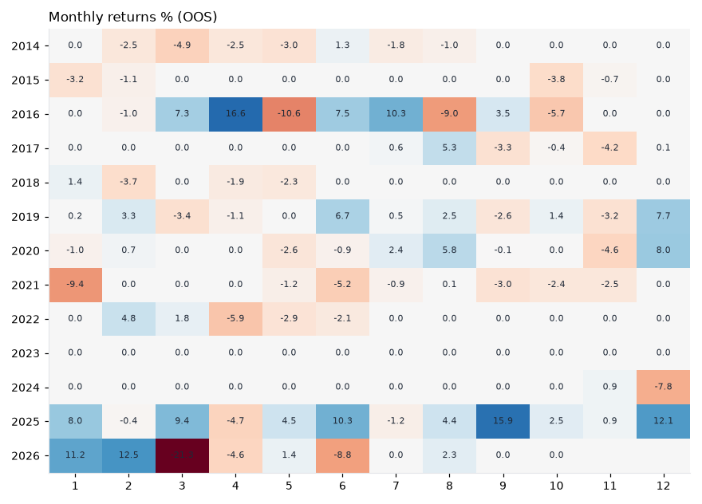

# H039 — macro_risk_switch on metals_etf [1d]  ❌ REJECT

- Kind: strategy · Source: Risk-on / risk-off timing with VIX, yield curve and trend
- For system: `metals`
- Data: 2010-01-04 00:00:00 → 2026-10-16 00:00:00 · 8 assets · 251.7 bars/year · survivorship mask: False
- Costs: {'commission': 0.0002, 'slippage': 0.0003, 'funding_annual': 0.0, 'borrow_annual': 0.0}
- Variants tried (DSR trials): 26 (failed: 0)
- Final variant: `macro_risk_switch|vix_max=30,use_curve=True,trend_n=200|overlay=vt20`

## Verdict reasons
- DSR 0.432 < 0.9 (luck not excluded after 26 trials)
- OOS Sharpe (excess of T-bill) 0.002 < 0.5
- bootstrap P(SR>0) 0.674 < 0.85
- only 31% of OOS years positive
- with 2x costs it does not beat the equal-weight benchmark
- PBO 0.879 > 0.5 (variant selection is overfit)
- Reality Check p 0.942 > 0.1 (best variant may be data-mined)

## Walk-forward out-of-sample


| Metric | Strategy | Equal-weight benchmark |
|---|---|---|
| years | 12.76 | 12.76 |
| cagr | 0.0086 | 0.0974 |
| vol | 0.1451 | 0.2457 |
| sharpe | 0.132 | 0.502 |
| sharpe_excess_rf | 0.002 | None |
| sortino | 0.003 | 0.702 |
| max_dd | -0.335 | -0.4505 |
| max_dd_bars | 2299 | 890 |
| calmar | 0.026 | 0.216 |
| ulcer | 0.1966 | 0.1685 |
| var95 | -0.0127 | -0.0236 |
| cvar95 | -0.0244 | -0.0363 |
| omega | 1.042 | 1.091 |
| tail_ratio | 1.082 | 1.022 |
| skew | -2.012 | -0.479 |
| kurtosis | 32.358 | 5.437 |
| hit_rate | 0.172 | 0.523 |
| turnover_ann | 13.87 | None |

- **Gate Sharpe (excess of T-bill): 0.002**
- Deflated Sharpe: **0.432** · PBO: **0.879** · Reality Check p: **0.942**
- PSR 0.68 · Info ratio -0.526 · Beta 0.35 · Up/Down capture 0.322/0.337
- Sharpe with 2× costs: 0.084 · Walk-forward efficiency: 0.272
- Bootstrap: {'p_sharpe_pos': 0.674, 'cagr_p05': -0.0545, 'maxdd_p05': -0.6496}
- Yearly OOS Sharpe: {'2014': -2.08, '2015': -1.18, '2016': 0.9, '2017': -0.32, '2018': -1.05, '2019': 0.99, '2020': 0.53, '2021': -2.49, '2022': -0.43, '2023': 0.0, '2024': -1.55, '2025': 2.5, '2026': -0.26}



## Regimes (where does it work?)
`{"bull": {"sharpe": 0.45, "ann_ret": 0.0801, "bars": 2038}, "bear": {"sharpe": -1.68, "ann_ret": -0.0867, "bars": 1172}, "calm": {"sharpe": 0.67, "ann_ret": 0.0724, "bars": 1701}, "stressed": {"sharpe": -0.23, "ann_ret": -0.0408, "bars": 1509}, "vix_lt_20": {"sharpe": 0.59, "ann_ret": 0.0839, "bars": 2335}, "vix_20_30": {"sharpe": -0.9, "ann_ret": -0.1484, "bars": 717}, "vix_ge_30": {"sharpe": -2.02, "ann_ret": -0.1771, "bars": 158}, "curve_inverted": {"sharpe": -0.23, "ann_ret": -0.0141, "bars": 614}, "curve_normal": {"sharpe": 0.17, "ann_ret": 0.0271, "bars": 2596}}`

## Calendar profile (weekday / month / hour)
`{"weekday": {"0": 0.00035, "1": -1e-05, "2": 0.00063, "3": -4e-05, "4": -0.00054}, "month": {"1": 0.00032, "2": 0.00053, "3": -0.00047, "4": -0.00018, "5": -0.00059, "6": 0.00031, "7": 0.00037, "8": 0.00037, "9": 0.00037, "10": -0.00028, "11": -0.00054, "12": 0.00077}}`

## Robustness
- **delay**: `{"sharpe": 0.444, "sharpe_delayed_1bar": 0.391, "retained": 0.879}`
- **neighbourhood**: `{"neighbours": 1, "best_sharpe": 0.439, "neighbour_median": 0.426, "share_positive": 1.0, "stability": 0.971}`
- **noise**: `{"noise_bp": 0.002, "sharpe_min": 0.434, "sharpe_median": 0.447}`

## Timing, take-profit, stop-loss and profit studies (in-sample diagnostics)
- Portfolio overlays (vol target, drawdown brake, equity-curve filter): `{"none": {"sharpe": 0.132, "cagr": 0.0086, "max_dd": -0.335}, "vol_target_0.1": {"sharpe": 0.041, "cagr": -0.001, "max_dd": -0.326}, "vol_target_0.15": {"sharpe": 0.07, "cagr": 0.0, "max_dd": -0.3923}, "vol_target_0.2": {"sharpe": 0.06, "cagr": -0.004, "max_dd": -0.4991}, "dd_brake_0.1": {"sharpe": 0.003, "cagr": -0.006, "max_dd": -0.3431}, "dd_brake_0.2": {"sharpe": 0.127, "cagr": 0.008, "max_dd": -0.3139}, "equity_ma_41": {"sharpe": 0.247, "cagr": 0.0228, "max_dd": -0.2617}, "equity_ma_125": {"sharpe": 0.235, "cagr": 0.0218, "max_dd": -0.2976}, "best_by_calmar": "equity_ma_41"}`
> Studies are in-sample diagnostics. To use a better exit, register it (exits: [...]) and let the gate judge it.

## Walk-forward windows
- 2020-12-23 00:00:00 → 2021-06-23 00:00:00: IS 0.908 / OOS -1.941 — `macro_risk_switch|vix_max=25,use_curve=False,trend_n=200`
- 2021-06-24 00:00:00 → 2021-12-20 00:00:00: IS 0.652 / OOS -2.397 — `macro_risk_switch|vix_max=20,use_curve=False,trend_n=200`
- 2021-12-21 00:00:00 → 2022-06-21 00:00:00: IS 0.426 / OOS -0.611 — `macro_risk_switch|vix_max=30,use_curve=False,trend_n=200|overlay=eqma_l`
- 2022-06-22 00:00:00 → 2022-12-16 00:00:00: IS 0.288 / OOS 0.0 — `macro_risk_switch|vix_max=30,use_curve=False,trend_n=200|overlay=eqma_l`
- 2022-12-19 00:00:00 → 2023-06-20 00:00:00: IS 0.207 / OOS 0.0 — `macro_risk_switch|vix_max=30,use_curve=True,trend_n=200|overlay=eqma_s`
- 2023-06-21 00:00:00 → 2023-12-15 00:00:00: IS 0.283 / OOS 0.0 — `macro_risk_switch|vix_max=30,use_curve=True,trend_n=200|overlay=eqma_s`
- 2023-12-18 00:00:00 → 2024-06-17 00:00:00: IS 0.049 / OOS 0.0 — `macro_risk_switch|vix_max=30,use_curve=True,trend_n=200|overlay=eqma_s`
- 2024-06-18 00:00:00 → 2024-12-13 00:00:00: IS 0.274 / OOS -0.768 — `macro_risk_switch|vix_max=30,use_curve=True,trend_n=200|overlay=eqma_s`
- 2024-12-16 00:00:00 → 2025-06-17 00:00:00: IS 0.386 / OOS 2.038 — `macro_risk_switch|vix_max=30,use_curve=False,trend_n=100`
- 2025-06-18 00:00:00 → 2025-12-15 00:00:00: IS 1.019 / OOS 2.361 — `macro_risk_switch|vix_max=30,use_curve=True,trend_n=200|overlay=eqma_s`
- 2025-12-16 00:00:00 → 2026-06-16 00:00:00: IS 1.702 / OOS -0.147 — `macro_risk_switch|vix_max=25,use_curve=True,trend_n=200`
- 2026-06-17 00:00:00 → 2026-10-16 00:00:00: IS 1.356 / OOS 1.02 — `macro_risk_switch|vix_max=30,use_curve=True,trend_n=200|overlay=vt20`

## Best variants (full sample, reference only)
- macro_risk_switch|vix_max=30,use_curve=True,trend_n=200|overlay=eqma_s: Sharpe 0.489
- macro_risk_switch|vix_max=30,use_curve=False,trend_n=200|overlay=dd10: Sharpe 0.457
- macro_risk_switch|vix_max=30,use_curve=True,trend_n=200|overlay=dd10: Sharpe 0.456
- macro_risk_switch|vix_max=30,use_curve=True,trend_n=200|overlay=vt20: Sharpe 0.439
- macro_risk_switch|vix_max=30,use_curve=False,trend_n=200|overlay=vt20: Sharpe 0.426
- macro_risk_switch|vix_max=30,use_curve=True,trend_n=200: Sharpe 0.415
- macro_risk_switch|vix_max=30,use_curve=False,trend_n=200: Sharpe 0.412
- macro_risk_switch|vix_max=25,use_curve=True,trend_n=200: Sharpe 0.405
- macro_risk_switch|vix_max=25,use_curve=False,trend_n=200: Sharpe 0.404
- macro_risk_switch|vix_max=30,use_curve=True,trend_n=200|overlay=vt15: Sharpe 0.394

## Current targets / signals
```json
{}
```

> Survivorship bias: unless a membership mask is used, universes are today's members (upper-bound results).