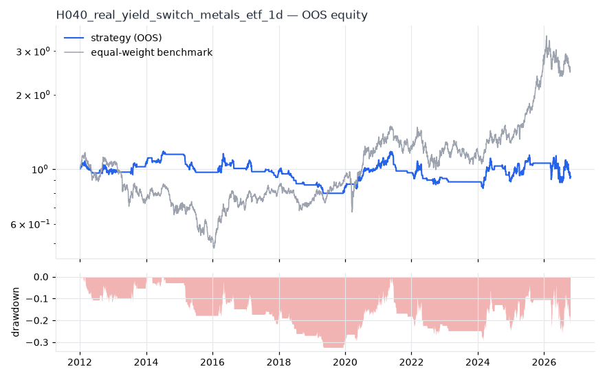
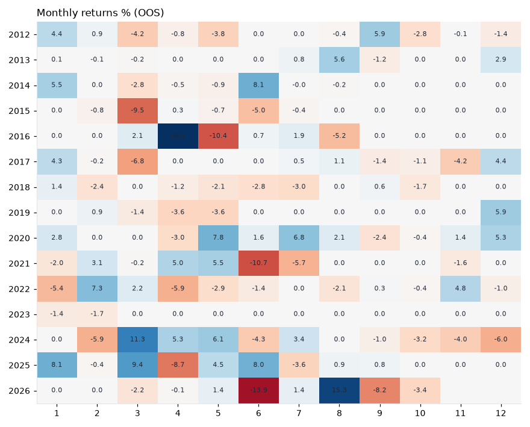

# H040 — real_yield_switch on metals_etf [1d]  ❌ REJECT

- Kind: strategy · Source: Gold vs real interest rates (Erb & Harvey 2013, The Golden Dilemma)
- For system: `metals`
- Data: 2008-01-02 00:00:00 → 2026-10-16 00:00:00 · 8 assets · 251.7 bars/year · survivorship mask: False
- Costs: {'commission': 0.0002, 'slippage': 0.0003, 'funding_annual': 0.0, 'borrow_annual': 0.0}
- Variants tried (DSR trials): 17 (failed: 0)
- Final variant: `real_yield_switch|n=200`

## Verdict reasons
- DSR 0.331 < 0.9 (luck not excluded after 17 trials)
- OOS Sharpe (excess of T-bill) -0.088 < 0.5
- bootstrap P(SR>0) 0.556 < 0.85
- only 40% of OOS years positive
- with 2x costs it does not beat the equal-weight benchmark
- PBO 0.674 > 0.5 (variant selection is overfit)
- Reality Check p 0.994 > 0.1 (best variant may be data-mined)

## Walk-forward out-of-sample


| Metric | Strategy | Equal-weight benchmark |
|---|---|---|
| years | 14.76 | 14.76 |
| cagr | -0.0047 | 0.0643 |
| vol | 0.1354 | 0.2426 |
| sharpe | 0.033 | 0.379 |
| sharpe_excess_rf | -0.088 | None |
| sortino | -0.12 | 0.528 |
| max_dd | -0.3241 | -0.5898 |
| max_dd_bars | 3085 | 2115 |
| calmar | -0.014 | 0.109 |
| ulcer | 0.1791 | 0.2747 |
| var95 | -0.0123 | -0.0236 |
| cvar95 | -0.0233 | -0.0358 |
| omega | 1.009 | 1.068 |
| tail_ratio | 1.083 | 1.016 |
| skew | -0.518 | -0.47 |
| kurtosis | 10.696 | 5.298 |
| hit_rate | 0.206 | 0.515 |
| turnover_ann | 13.63 | None |

- **Gate Sharpe (excess of T-bill): -0.088**
- Deflated Sharpe: **0.331** · PBO: **0.674** · Reality Check p: **0.994**
- PSR 0.551 · Info ratio -0.455 · Beta 0.342 · Up/Down capture 0.345/0.365
- Sharpe with 2× costs: -0.017 · Walk-forward efficiency: 0.069
- Bootstrap: {'p_sharpe_pos': 0.556, 'cagr_p05': -0.0567, 'maxdd_p05': -0.669}
- Yearly OOS Sharpe: {'2012': -0.17, '2013': 0.84, '2014': 1.11, '2015': -2.26, '2016': 0.32, '2017': -0.45, '2018': -1.49, '2019': -0.27, '2020': 1.68, '2021': -0.46, '2022': -0.28, '2023': -1.68, '2024': 0.09, '2025': 1.14, '2026': -0.32}



## Regimes (where does it work?)
`{"bull": {"sharpe": 0.46, "ann_ret": 0.0656, "bars": 2182}, "bear": {"sharpe": -0.67, "ann_ret": -0.0824, "bars": 1533}, "calm": {"sharpe": 0.14, "ann_ret": 0.0157, "bars": 1993}, "stressed": {"sharpe": -0.05, "ann_ret": -0.0084, "bars": 1722}, "vix_lt_20": {"sharpe": 0.13, "ann_ret": 0.017, "bars": 2796}, "vix_20_30": {"sharpe": -0.17, "ann_ret": -0.0246, "bars": 761}, "vix_ge_30": {"sharpe": -0.39, "ann_ret": -0.0757, "bars": 158}, "curve_inverted": {"sharpe": -0.17, "ann_ret": -0.0191, "bars": 614}, "curve_normal": {"sharpe": 0.07, "ann_ret": 0.0092, "bars": 3101}}`

## Calendar profile (weekday / month / hour)
`{"weekday": {"0": 0.00021, "1": 6e-05, "2": -0.00012, "3": 0.00013, "4": -0.00018}, "month": {"1": 0.00059, "2": 4e-05, "3": -7e-05, "4": 0.0001, "5": 4e-05, "6": -0.00066, "7": 8e-05, "8": 0.0005, "9": -0.0002, "10": -0.00039, "11": -0.00013, "12": 0.00034}}`

## Robustness
- **delay**: `{"sharpe": -0.005, "sharpe_delayed_1bar": 0.034, "retained": null}`
- **neighbourhood**: `{"neighbours": 2, "best_sharpe": -0.005, "neighbour_median": 0.153, "share_positive": 1.0, "stability": null}`
- **noise**: `{"noise_bp": 0.002, "sharpe_min": -0.005, "sharpe_median": -0.002}`

## Timing, take-profit, stop-loss and profit studies (in-sample diagnostics)
- Portfolio overlays (vol target, drawdown brake, equity-curve filter): `{"none": {"sharpe": 0.033, "cagr": -0.0047, "max_dd": -0.3241}, "vol_target_0.1": {"sharpe": -0.041, "cagr": -0.0108, "max_dd": -0.3995}, "vol_target_0.15": {"sharpe": -0.018, "cagr": -0.0137, "max_dd": -0.4557}, "vol_target_0.2": {"sharpe": -0.018, "cagr": -0.0189, "max_dd": -0.529}, "dd_brake_0.1": {"sharpe": -0.182, "cagr": -0.0202, "max_dd": -0.3204}, "dd_brake_0.2": {"sharpe": -0.02, "cagr": -0.0102, "max_dd": -0.2792}, "equity_ma_41": {"sharpe": 0.2, "cagr": 0.0149, "max_dd": -0.1714}, "equity_ma_125": {"sharpe": 0.007, "cagr": -0.0046, "max_dd": -0.3503}, "best_by_calmar": "equity_ma_41"}`
> Studies are in-sample diagnostics. To use a better exit, register it (exits: [...]) and let the gate judge it.

## Walk-forward windows
- 2020-12-16 00:00:00 → 2021-06-16 00:00:00: IS 0.834 / OOS 0.986 — `real_yield_switch|n=50|overlay=vt20`
- 2021-06-17 00:00:00 → 2021-12-13 00:00:00: IS 1.111 / OOS -2.887 — `real_yield_switch|n=100|overlay=eqma_l`
- 2021-12-14 00:00:00 → 2022-06-13 00:00:00: IS 0.81 / OOS -0.51 — `real_yield_switch|n=100|overlay=eqma_l`
- 2022-06-14 00:00:00 → 2022-12-09 00:00:00: IS 0.923 / OOS 0.064 — `real_yield_switch|n=100|overlay=vt10`
- 2022-12-12 00:00:00 → 2023-06-12 00:00:00: IS 0.814 / OOS -2.392 — `real_yield_switch|n=50|overlay=eqma_l`
- 2023-06-13 00:00:00 → 2023-12-08 00:00:00: IS 0.682 / OOS 0.0 — `real_yield_switch|n=50|overlay=eqma_l`
- 2023-12-11 00:00:00 → 2024-06-10 00:00:00: IS 0.218 / OOS 1.447 — `real_yield_switch|n=50|overlay=eqma_l`
- 2024-06-11 00:00:00 → 2024-12-06 00:00:00: IS 0.089 / OOS -1.22 — `real_yield_switch|n=50|overlay=eqma_l`
- 2024-12-09 00:00:00 → 2025-06-10 00:00:00: IS 0.186 / OOS 1.267 — `real_yield_switch|n=200`
- 2025-06-11 00:00:00 → 2025-12-08 00:00:00: IS 0.326 / OOS -0.214 — `real_yield_switch|n=200`
- 2025-12-09 00:00:00 → 2026-06-09 00:00:00: IS 0.574 / OOS -0.678 — `real_yield_switch|n=200`
- 2026-06-10 00:00:00 → 2026-10-16 00:00:00: IS 0.386 / OOS 0.115 — `real_yield_switch|n=200`

## Best variants (full sample, reference only)
- real_yield_switch|n=50|overlay=vt10: Sharpe 0.249
- real_yield_switch|n=50|overlay=vt15: Sharpe 0.195
- real_yield_switch|n=100|overlay=vt10: Sharpe 0.193
- real_yield_switch|n=50|overlay=vt20: Sharpe 0.19
- real_yield_switch|n=50: Sharpe 0.184
- real_yield_switch|n=50|overlay=dd20: Sharpe 0.16
- real_yield_switch|n=100|overlay=vt15: Sharpe 0.128
- real_yield_switch|n=100: Sharpe 0.123
- real_yield_switch|n=100|overlay=vt20: Sharpe 0.118
- real_yield_switch|n=100|overlay=eqma_l: Sharpe 0.101

## Current targets / signals
```json
{
 "GLD": 0.125,
 "SLV": 0.125,
 "GDX": 0.125,
 "CPER": 0.125,
 "PPLT": 0.125,
 "PALL": 0.125,
 "SIL": 0.125,
 "COPX": 0.125
}
```

> Survivorship bias: unless a membership mask is used, universes are today's members (upper-bound results).