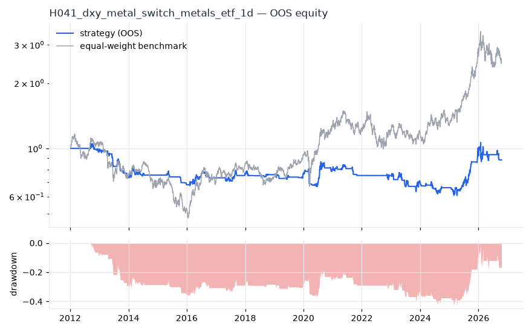
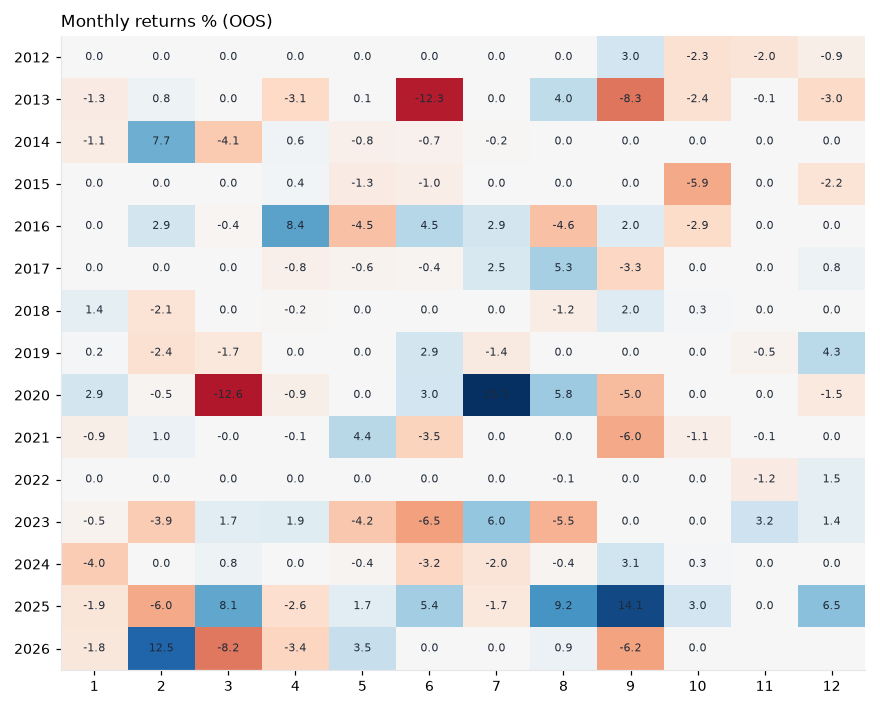

# H041 — dxy_metal_switch on metals_etf [1d]  ❌ REJECT

- Kind: strategy · Source: Dollar-metals inverse relationship (Capie, Mills & Wood 2005)
- For system: `metals`
- Data: 2008-01-02 00:00:00 → 2026-10-16 00:00:00 · 8 assets · 251.7 bars/year · survivorship mask: False
- Costs: {'commission': 0.0002, 'slippage': 0.0003, 'funding_annual': 0.0, 'borrow_annual': 0.0}
- Variants tried (DSR trials): 17 (failed: 0)
- Final variant: `dxy_metal_switch|n=200|overlay=dd20`

## Verdict reasons
- DSR 0.334 < 0.9 (luck not excluded after 17 trials)
- OOS Sharpe (excess of T-bill) -0.135 < 0.5
- bootstrap P(SR>0) 0.526 < 0.85
- only 53% of OOS years positive
- with 2x costs it does not beat the equal-weight benchmark
- PBO 0.636 > 0.5 (variant selection is overfit)
- Reality Check p 0.964 > 0.1 (best variant may be data-mined)

## Walk-forward out-of-sample


| Metric | Strategy | Equal-weight benchmark |
|---|---|---|
| years | 14.76 | 14.76 |
| cagr | -0.0082 | 0.0643 |
| vol | 0.1244 | 0.2426 |
| sharpe | -0.003 | 0.379 |
| sharpe_excess_rf | -0.135 | None |
| sortino | -0.177 | 0.528 |
| max_dd | -0.4251 | -0.5898 |
| max_dd_bars | 3359 | 2115 |
| calmar | -0.019 | 0.109 |
| ulcer | 0.2806 | 0.2747 |
| var95 | -0.0104 | -0.0236 |
| cvar95 | -0.0206 | -0.0358 |
| omega | 0.999 | 1.068 |
| tail_ratio | 1.066 | 1.016 |
| skew | -2.584 | -0.47 |
| kurtosis | 46.909 | 5.298 |
| hit_rate | 0.176 | 0.515 |
| turnover_ann | 13.28 | None |

- **Gate Sharpe (excess of T-bill): -0.135**
- Deflated Sharpe: **0.334** · PBO: **0.636** · Reality Check p: **0.964**
- PSR 0.495 · Info ratio -0.466 · Beta 0.298 · Up/Down capture 0.273/0.292
- Sharpe with 2× costs: -0.057 · Walk-forward efficiency: -0.008
- Bootstrap: {'p_sharpe_pos': 0.526, 'cagr_p05': -0.0518, 'maxdd_p05': -0.6439}
- Yearly OOS Sharpe: {'2012': -0.29, '2013': -2.16, '2014': 0.15, '2015': -1.68, '2016': 0.73, '2017': 0.44, '2018': 0.05, '2019': 0.21, '2020': 0.34, '2021': -0.73, '2022': 0.06, '2023': -0.46, '2024': -0.56, '2025': 1.93, '2026': -0.03}



## Regimes (where does it work?)
`{"bull": {"sharpe": 0.44, "ann_ret": 0.0658, "bars": 2182}, "bear": {"sharpe": -1.24, "ann_ret": -0.0946, "bars": 1533}, "calm": {"sharpe": 0.78, "ann_ret": 0.0772, "bars": 1993}, "stressed": {"sharpe": -0.61, "ann_ret": -0.0902, "bars": 1722}, "vix_lt_20": {"sharpe": 0.13, "ann_ret": 0.0157, "bars": 2796}, "vix_20_30": {"sharpe": -0.06, "ann_ret": -0.0085, "bars": 761}, "vix_ge_30": {"sharpe": -1.61, "ann_ret": -0.2459, "bars": 158}, "curve_inverted": {"sharpe": -0.59, "ann_ret": -0.0707, "bars": 614}, "curve_normal": {"sharpe": 0.11, "ann_ret": 0.0135, "bars": 3101}}`

## Calendar profile (weekday / month / hour)
`{"weekday": {"0": 0.0001, "1": -0.0, "2": 0.00011, "3": -0.00034, "4": 0.00013}, "month": {"1": -0.00018, "2": 0.00035, "3": -0.00052, "4": 1e-05, "5": -5e-05, "6": -0.0004, "7": 0.00067, "8": 0.00041, "9": -0.00018, "10": -0.00035, "11": -2e-05, "12": 0.00026}}`

## Robustness
- **delay**: `{"sharpe": 0.315, "sharpe_delayed_1bar": 0.279, "retained": 0.885}`
- **neighbourhood**: `{"neighbours": 1, "best_sharpe": 0.311, "neighbour_median": 0.21, "share_positive": 1.0, "stability": 0.675}`
- **noise**: `{"noise_bp": 0.002, "sharpe_min": 0.305, "sharpe_median": 0.314}`

## Timing, take-profit, stop-loss and profit studies (in-sample diagnostics)
- Portfolio overlays (vol target, drawdown brake, equity-curve filter): `{"none": {"sharpe": -0.003, "cagr": -0.0082, "max_dd": -0.4251}, "vol_target_0.1": {"sharpe": -0.064, "cagr": -0.0134, "max_dd": -0.4469}, "vol_target_0.15": {"sharpe": -0.057, "cagr": -0.0196, "max_dd": -0.5524}, "vol_target_0.2": {"sharpe": -0.035, "cagr": -0.0221, "max_dd": -0.6084}, "dd_brake_0.1": {"sharpe": -0.101, "cagr": -0.0112, "max_dd": -0.2725}, "dd_brake_0.2": {"sharpe": -0.106, "cagr": -0.0146, "max_dd": -0.3844}, "equity_ma_41": {"sharpe": -0.043, "cagr": -0.009, "max_dd": -0.3198}, "equity_ma_125": {"sharpe": -0.083, "cagr": -0.0135, "max_dd": -0.3928}, "best_by_calmar": "none"}`
> Studies are in-sample diagnostics. To use a better exit, register it (exits: [...]) and let the gate judge it.

## Walk-forward windows
- 2020-12-16 00:00:00 → 2021-06-16 00:00:00: IS 0.562 / OOS 0.627 — `dxy_metal_switch|n=50|overlay=vt10`
- 2021-06-17 00:00:00 → 2021-12-13 00:00:00: IS 0.613 / OOS -2.273 — `dxy_metal_switch|n=50|overlay=vt10`
- 2021-12-14 00:00:00 → 2022-06-13 00:00:00: IS 0.404 / OOS 0.0 — `dxy_metal_switch|n=200|overlay=eqma_l`
- 2022-06-14 00:00:00 → 2022-12-09 00:00:00: IS 0.484 / OOS 0.089 — `dxy_metal_switch|n=50|overlay=eqma_s`
- 2022-12-12 00:00:00 → 2023-06-12 00:00:00: IS 0.438 / OOS -0.797 — `dxy_metal_switch|n=200|overlay=eqma_l`
- 2023-06-13 00:00:00 → 2023-12-08 00:00:00: IS 0.656 / OOS -0.886 — `dxy_metal_switch|n=50|overlay=vt15`
- 2023-12-11 00:00:00 → 2024-06-10 00:00:00: IS 0.157 / OOS -0.144 — `dxy_metal_switch|n=50|overlay=vt10`
- 2024-06-11 00:00:00 → 2024-12-06 00:00:00: IS -0.1 / OOS 0.032 — `dxy_metal_switch|n=50|overlay=vt10`
- 2024-12-09 00:00:00 → 2025-06-10 00:00:00: IS 0.218 / OOS 0.268 — `dxy_metal_switch|n=50|overlay=vt10`
- 2025-06-11 00:00:00 → 2025-12-08 00:00:00: IS 0.277 / OOS 3.281 — `dxy_metal_switch|n=100`
- 2025-12-09 00:00:00 → 2026-06-09 00:00:00: IS 0.749 / OOS 0.605 — `dxy_metal_switch|n=100`
- 2026-06-10 00:00:00 → 2026-10-16 00:00:00: IS 0.814 / OOS -1.295 — `dxy_metal_switch|n=200|overlay=dd20`

## Best variants (full sample, reference only)
- dxy_metal_switch|n=200: Sharpe 0.357
- dxy_metal_switch|n=50|overlay=eqma_s: Sharpe 0.345
- dxy_metal_switch|n=200|overlay=dd20: Sharpe 0.311
- dxy_metal_switch|n=50|overlay=vt20: Sharpe 0.308
- dxy_metal_switch|n=50: Sharpe 0.3
- dxy_metal_switch|n=50|overlay=vt10: Sharpe 0.298
- dxy_metal_switch|n=200|overlay=vt20: Sharpe 0.293
- dxy_metal_switch|n=50|overlay=vt15: Sharpe 0.285
- dxy_metal_switch|n=50|overlay=dd10: Sharpe 0.27
- dxy_metal_switch|n=200|overlay=dd10: Sharpe 0.244

## Current targets / signals
```json
{}
```

> Survivorship bias: unless a membership mask is used, universes are today's members (upper-bound results).