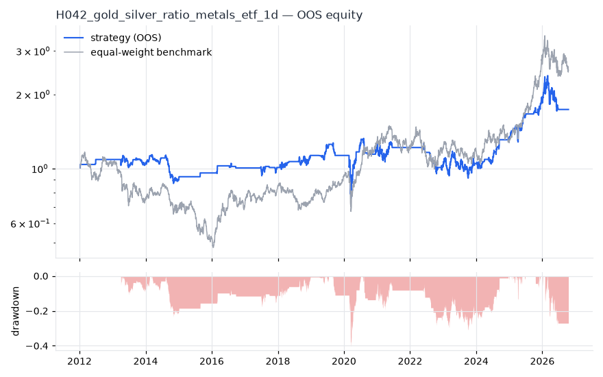
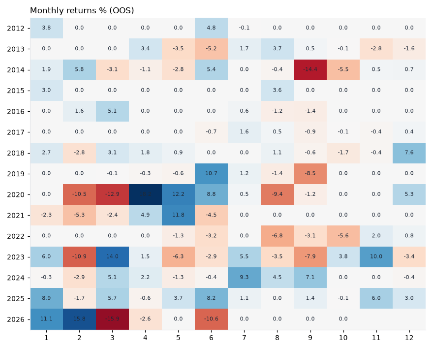

# H042 — gold_silver_ratio on metals_etf [1d]  🟡 WATCH

- Kind: strategy · Source: Gold/silver ratio mean reversion (relative value)
- For system: `metals`
- Data: 2008-01-02 00:00:00 → 2026-10-16 00:00:00 · 8 assets · 251.7 bars/year · survivorship mask: False
- Costs: {'commission': 0.0002, 'slippage': 0.0003, 'funding_annual': 0.0, 'borrow_annual': 0.0}
- Variants tried (DSR trials): 32 (failed: 0)
- Final variant: `gold_silver_ratio|z_n=504,entry=1.0,neutral=flat|overlay=vt20`

## Verdict reasons
- DSR 0.599 < 0.9 (luck not excluded after 32 trials)
- OOS Sharpe (excess of T-bill) 0.208 < 0.5
- with 2x costs it does not beat the equal-weight benchmark
- PBO 0.796 > 0.5 (variant selection is overfit)
- Reality Check p 0.904 > 0.1 (best variant may be data-mined)

## Walk-forward out-of-sample


| Metric | Strategy | Equal-weight benchmark |
|---|---|---|
| years | 14.76 | 14.76 |
| cagr | 0.0381 | 0.0643 |
| vol | 0.1729 | 0.2426 |
| sharpe | 0.303 | 0.379 |
| sharpe_excess_rf | 0.208 | None |
| sortino | 0.293 | 0.528 |
| max_dd | -0.4044 | -0.5898 |
| max_dd_bars | 1312 | 2115 |
| calmar | 0.094 | 0.109 |
| ulcer | 0.1289 | 0.2747 |
| var95 | -0.015 | -0.0236 |
| cvar95 | -0.0279 | -0.0358 |
| omega | 1.092 | 1.068 |
| tail_ratio | 1.122 | 1.016 |
| skew | -0.561 | -0.47 |
| kurtosis | 20.91 | 5.298 |
| hit_rate | 0.199 | 0.515 |
| turnover_ann | 11.54 | None |

- **Gate Sharpe (excess of T-bill): 0.208**
- Deflated Sharpe: **0.599** · PBO: **0.796** · Reality Check p: **0.904**
- PSR 0.876 · Info ratio -0.208 · Beta 0.448 · Up/Down capture 0.399/0.387
- Sharpe with 2× costs: 0.27 · Walk-forward efficiency: 0.317
- Bootstrap: {'p_sharpe_pos': 0.9, 'cagr_p05': -0.0303, 'maxdd_p05': -0.6394}
- Yearly OOS Sharpe: {'2012': 1.63, '2013': -0.29, '2014': -1.19, '2015': 1.51, '2016': 0.76, '2017': 0.09, '2018': 0.84, '2019': 0.05, '2020': 0.36, '2021': 0.15, '2022': -1.14, '2023': 0.24, '2024': 1.6, '2025': 1.67, '2026': -0.07}



## Regimes (where does it work?)
`{"bull": {"sharpe": 0.7, "ann_ret": 0.1379, "bars": 2182}, "bear": {"sharpe": -0.52, "ann_ret": -0.0693, "bars": 1533}, "calm": {"sharpe": 0.15, "ann_ret": 0.0195, "bars": 1993}, "stressed": {"sharpe": 0.42, "ann_ret": 0.0905, "bars": 1722}, "vix_lt_20": {"sharpe": 0.57, "ann_ret": 0.0758, "bars": 2796}, "vix_20_30": {"sharpe": -0.38, "ann_ret": -0.0772, "bars": 761}, "vix_ge_30": {"sharpe": 0.61, "ann_ret": 0.2623, "bars": 158}, "curve_inverted": {"sharpe": 0.23, "ann_ret": 0.0468, "bars": 614}, "curve_normal": {"sharpe": 0.32, "ann_ret": 0.0535, "bars": 3101}}`

## Calendar profile (weekday / month / hour)
`{"weekday": {"0": 0.00069, "1": 0.00041, "2": 0.00029, "3": -7e-05, "4": -0.00025}, "month": {"1": 0.00119, "2": -0.00039, "3": 0.0, "4": 0.0009, "5": 0.00041, "6": 0.00032, "7": 0.00068, "8": -0.00028, "9": -0.00099, "10": -0.00027, "11": 0.00053, "12": 0.00044}}`

## Robustness
- **delay**: `{"sharpe": 0.339, "sharpe_delayed_1bar": 0.255, "retained": 0.752}`
- **neighbourhood**: `{"neighbours": 0}`
- **noise**: `{"noise_bp": 0.002, "sharpe_min": 0.329, "sharpe_median": 0.338}`

## Timing, take-profit, stop-loss and profit studies (in-sample diagnostics)
- Portfolio overlays (vol target, drawdown brake, equity-curve filter): `{"none": {"sharpe": 0.303, "cagr": 0.0381, "max_dd": -0.4044}, "vol_target_0.1": {"sharpe": 0.226, "cagr": 0.02, "max_dd": -0.2999}, "vol_target_0.15": {"sharpe": 0.197, "cagr": 0.0188, "max_dd": -0.4305}, "vol_target_0.2": {"sharpe": 0.213, "cagr": 0.0226, "max_dd": -0.5227}, "dd_brake_0.1": {"sharpe": 0.26, "cagr": 0.0254, "max_dd": -0.3001}, "dd_brake_0.2": {"sharpe": 0.206, "cagr": 0.0199, "max_dd": -0.325}, "equity_ma_41": {"sharpe": 0.216, "cagr": 0.0187, "max_dd": -0.3048}, "equity_ma_125": {"sharpe": -0.079, "cagr": -0.0174, "max_dd": -0.5025}, "best_by_calmar": "none"}`
> Studies are in-sample diagnostics. To use a better exit, register it (exits: [...]) and let the gate judge it.

## Walk-forward windows
- 2020-12-16 00:00:00 → 2021-06-16 00:00:00: IS 0.629 / OOS 0.574 — `gold_silver_ratio|z_n=252,entry=2.0,neutral=both`
- 2021-06-17 00:00:00 → 2021-12-13 00:00:00: IS 0.857 / OOS -1.419 — `gold_silver_ratio|z_n=504,entry=1.0,neutral=flat|overlay=eqma_s`
- 2021-12-14 00:00:00 → 2022-06-13 00:00:00: IS 1.063 / OOS -0.668 — `gold_silver_ratio|z_n=504,entry=1.0,neutral=flat|overlay=eqma_s`
- 2022-06-14 00:00:00 → 2022-12-09 00:00:00: IS 0.885 / OOS -1.988 — `gold_silver_ratio|z_n=504,entry=1.0,neutral=flat|overlay=eqma_s`
- 2022-12-12 00:00:00 → 2023-06-12 00:00:00: IS 0.38 / OOS 0.456 — `gold_silver_ratio|z_n=504,entry=2.0,neutral=both`
- 2023-06-13 00:00:00 → 2023-12-08 00:00:00: IS 0.348 / OOS -0.076 — `gold_silver_ratio|z_n=504,entry=2.0,neutral=both`
- 2023-12-11 00:00:00 → 2024-06-10 00:00:00: IS 0.315 / OOS 0.463 — `gold_silver_ratio|z_n=504,entry=1.0,neutral=flat|overlay=vt10`
- 2024-06-11 00:00:00 → 2024-12-06 00:00:00: IS 0.347 / OOS 3.018 — `gold_silver_ratio|z_n=126,entry=1.0,neutral=flat`
- 2024-12-09 00:00:00 → 2025-06-10 00:00:00: IS 0.867 / OOS 1.689 — `gold_silver_ratio|z_n=126,entry=1.0,neutral=flat`
- 2025-06-11 00:00:00 → 2025-12-08 00:00:00: IS 1.215 / OOS 1.193 — `gold_silver_ratio|z_n=504,entry=1.0,neutral=flat|overlay=dd20`
- 2025-12-09 00:00:00 → 2026-06-09 00:00:00: IS 1.628 / OOS 0.244 — `gold_silver_ratio|z_n=504,entry=1.0,neutral=flat`
- 2026-06-10 00:00:00 → 2026-10-16 00:00:00: IS 1.344 / OOS -0.277 — `gold_silver_ratio|z_n=504,entry=1.0,neutral=flat|overlay=vt20`

## Best variants (full sample, reference only)
- gold_silver_ratio|z_n=504,entry=1.0,neutral=flat|overlay=dd10: Sharpe 0.441
- gold_silver_ratio|z_n=504,entry=2.0,neutral=both|overlay=dd10: Sharpe 0.424
- gold_silver_ratio|z_n=504,entry=1.0,neutral=flat|overlay=eqma_s: Sharpe 0.412
- gold_silver_ratio|z_n=504,entry=1.0,neutral=flat|overlay=vt10: Sharpe 0.401
- gold_silver_ratio|z_n=504,entry=1.0,neutral=flat|overlay=dd20: Sharpe 0.397
- gold_silver_ratio|z_n=504,entry=2.0,neutral=both: Sharpe 0.386
- gold_silver_ratio|z_n=504,entry=1.0,neutral=flat: Sharpe 0.386
- gold_silver_ratio|z_n=504,entry=1.5,neutral=both: Sharpe 0.372
- gold_silver_ratio|z_n=504,entry=1.0,neutral=both: Sharpe 0.367
- gold_silver_ratio|z_n=504,entry=1.0,neutral=flat|overlay=vt15: Sharpe 0.355

## Current targets / signals
```json
{}
```

> Survivorship bias: unless a membership mask is used, universes are today's members (upper-bound results).