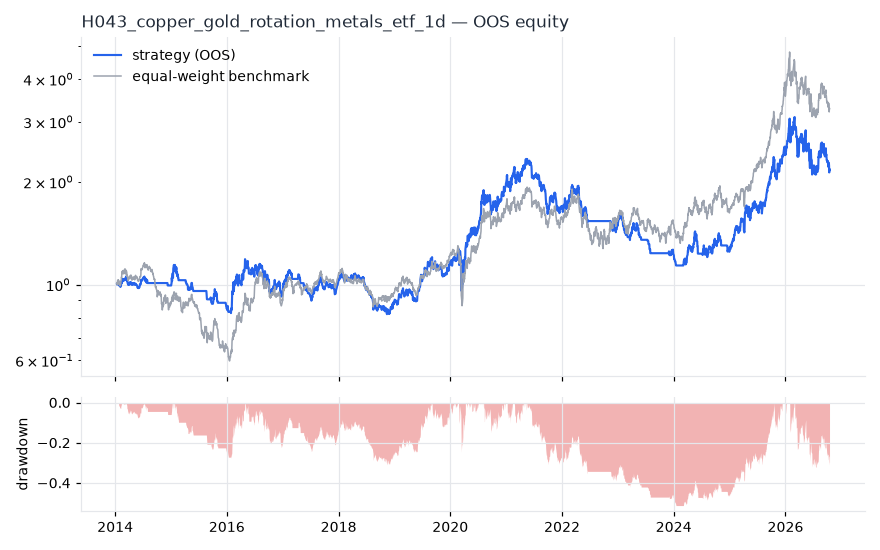
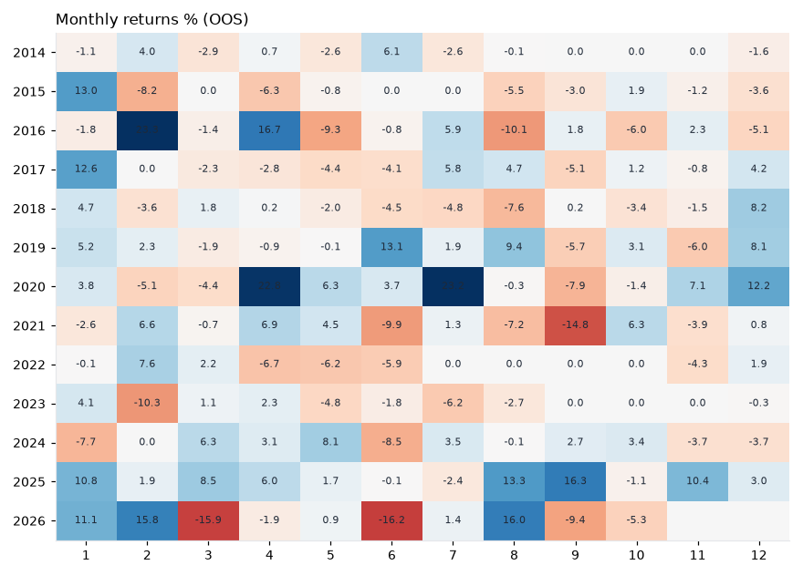

# H043 — copper_gold_rotation on metals_etf [1d]  🟡 WATCH

- Kind: strategy · Source: Copper/gold ratio as growth signal (risk-on industrial vs safe-haven gold)
- For system: `metals`
- Data: 2010-01-04 00:00:00 → 2026-10-16 00:00:00 · 7 assets · 251.7 bars/year · survivorship mask: False
- Costs: {'commission': 0.0002, 'slippage': 0.0003, 'funding_annual': 0.0, 'borrow_annual': 0.0}
- Variants tried (DSR trials): 17 (failed: 0)
- Final variant: `copper_gold_rotation|n=200`

## Verdict reasons
- DSR 0.799 < 0.9 (luck not excluded after 17 trials)
- OOS Sharpe (excess of T-bill) 0.295 < 0.5
- OOS MaxDD -0.5126 worse than -0.45 (local or USD)
- only 46% of OOS years positive
- with 2x costs it does not beat the equal-weight benchmark
- PBO 0.518 > 0.5 (variant selection is overfit)
- Reality Check p 0.906 > 0.1 (best variant may be data-mined)

## Walk-forward out-of-sample


| Metric | Strategy | Equal-weight benchmark |
|---|---|---|
| years | 12.76 | 12.76 |
| cagr | 0.0626 | 0.0975 |
| vol | 0.2383 | 0.26 |
| sharpe | 0.374 | 0.489 |
| sharpe_excess_rf | 0.295 | None |
| sortino | 0.414 | 0.684 |
| max_dd | -0.5126 | -0.4841 |
| max_dd_bars | 1113 | 1295 |
| calmar | 0.122 | 0.201 |
| ulcer | 0.2453 | 0.1856 |
| var95 | -0.0234 | -0.025 |
| cvar95 | -0.0367 | -0.038 |
| omega | 1.077 | 1.088 |
| tail_ratio | 1.052 | 1.027 |
| skew | -0.388 | -0.501 |
| kurtosis | 6.255 | 5.762 |
| hit_rate | 0.403 | 0.52 |
| turnover_ann | 29.05 | None |

- **Gate Sharpe (excess of T-bill): 0.295**
- Deflated Sharpe: **0.799** · PBO: **0.518** · Reality Check p: **0.906**
- PSR 0.908 · Info ratio -0.252 · Beta 0.754 · Up/Down capture 0.739/0.742
- Sharpe with 2× costs: 0.313 · Walk-forward efficiency: 0.843
- Bootstrap: {'p_sharpe_pos': 0.915, 'cagr_p05': -0.045, 'maxdd_p05': -0.7347}
- Yearly OOS Sharpe: {'2014': -0.03, '2015': -0.85, '2016': 0.5, '2017': 0.59, '2018': -0.71, '2019': 1.54, '2020': 1.59, '2021': -0.51, '2022': -0.53, '2023': -1.36, '2024': 0.19, '2025': 2.47, '2026': -0.08}



## Regimes (where does it work?)
`{"bull": {"sharpe": 1.19, "ann_ret": 0.3046, "bars": 2038}, "bear": {"sharpe": -1.43, "ann_ret": -0.2853, "bars": 1172}, "calm": {"sharpe": 0.52, "ann_ret": 0.0926, "bars": 1701}, "stressed": {"sharpe": 0.29, "ann_ret": 0.0855, "bars": 1509}, "vix_lt_20": {"sharpe": 0.38, "ann_ret": 0.0789, "bars": 2335}, "vix_20_30": {"sharpe": 0.38, "ann_ret": 0.1001, "bars": 717}, "vix_ge_30": {"sharpe": 0.43, "ann_ret": 0.1928, "bars": 158}, "curve_inverted": {"sharpe": -0.02, "ann_ret": -0.0043, "bars": 614}, "curve_normal": {"sharpe": 0.45, "ann_ret": 0.1114, "bars": 2596}}`

## Calendar profile (weekday / month / hour)
`{"weekday": {"0": 0.00081, "1": 0.00053, "2": 0.00024, "3": 0.00023, "4": -1e-05}, "month": {"1": 0.00203, "2": 0.0013, "3": -0.0002, "4": 0.00145, "5": -0.00025, "6": -0.00108, "7": 0.00096, "8": 0.0003, "9": -0.00098, "10": 2e-05, "11": -5e-05, "12": 0.00096}}`

## Robustness
- **delay**: `{"sharpe": 0.35, "sharpe_delayed_1bar": 0.304, "retained": 0.866}`
- **neighbourhood**: `{"neighbours": 2, "best_sharpe": 0.35, "neighbour_median": 0.385, "share_positive": 1.0, "stability": 1.099}`
- **noise**: `{"noise_bp": 0.002, "sharpe_min": 0.346, "sharpe_median": 0.353}`

## Timing, take-profit, stop-loss and profit studies (in-sample diagnostics)
- Portfolio overlays (vol target, drawdown brake, equity-curve filter): `{"none": {"sharpe": 0.374, "cagr": 0.0626, "max_dd": -0.5126}, "vol_target_0.1": {"sharpe": 0.214, "cagr": 0.018, "max_dd": -0.3678}, "vol_target_0.15": {"sharpe": 0.251, "cagr": 0.028, "max_dd": -0.4748}, "vol_target_0.2": {"sharpe": 0.261, "cagr": 0.0333, "max_dd": -0.5718}, "dd_brake_0.1": {"sharpe": 0.299, "cagr": 0.037, "max_dd": -0.3388}, "dd_brake_0.2": {"sharpe": 0.259, "cagr": 0.0324, "max_dd": -0.4119}, "equity_ma_41": {"sharpe": 0.436, "cagr": 0.0639, "max_dd": -0.2754}, "equity_ma_125": {"sharpe": 0.46, "cagr": 0.0714, "max_dd": -0.3369}, "best_by_calmar": "equity_ma_41"}`
> Studies are in-sample diagnostics. To use a better exit, register it (exits: [...]) and let the gate judge it.

## Walk-forward windows
- 2020-12-23 00:00:00 → 2021-06-23 00:00:00: IS 0.996 / OOS 0.844 — `copper_gold_rotation|n=50`
- 2021-06-24 00:00:00 → 2021-12-20 00:00:00: IS 1.154 / OOS -2.031 — `copper_gold_rotation|n=50`
- 2021-12-21 00:00:00 → 2022-06-21 00:00:00: IS 1.004 / OOS -0.523 — `copper_gold_rotation|n=50`
- 2022-06-22 00:00:00 → 2022-12-16 00:00:00: IS 0.695 / OOS -0.971 — `copper_gold_rotation|n=50|overlay=eqma_l`
- 2022-12-19 00:00:00 → 2023-06-20 00:00:00: IS 0.57 / OOS -0.649 — `copper_gold_rotation|n=100|overlay=eqma_l`
- 2023-06-21 00:00:00 → 2023-12-15 00:00:00: IS 0.557 / OOS -2.633 — `copper_gold_rotation|n=50|overlay=eqma_l`
- 2023-12-18 00:00:00 → 2024-06-17 00:00:00: IS -0.038 / OOS 0.138 — `copper_gold_rotation|n=50|overlay=eqma_s`
- 2024-06-18 00:00:00 → 2024-12-13 00:00:00: IS -0.008 / OOS 0.704 — `copper_gold_rotation|n=50|overlay=eqma_s`
- 2024-12-16 00:00:00 → 2025-06-17 00:00:00: IS 0.338 / OOS 2.219 — `copper_gold_rotation|n=200`
- 2025-06-18 00:00:00 → 2025-12-15 00:00:00: IS 0.752 / OOS 2.438 — `copper_gold_rotation|n=200`
- 2025-12-16 00:00:00 → 2026-06-16 00:00:00: IS 1.209 / OOS 0.428 — `copper_gold_rotation|n=200`
- 2026-06-17 00:00:00 → 2026-10-16 00:00:00: IS 1.118 / OOS -0.88 — `copper_gold_rotation|n=200`

## Best variants (full sample, reference only)
- copper_gold_rotation|n=50|overlay=eqma_s: Sharpe 0.449
- copper_gold_rotation|n=100|overlay=dd10: Sharpe 0.427
- copper_gold_rotation|n=50|overlay=dd10: Sharpe 0.412
- copper_gold_rotation|n=100: Sharpe 0.39
- copper_gold_rotation|n=50: Sharpe 0.38
- copper_gold_rotation|n=100|overlay=dd20: Sharpe 0.375
- copper_gold_rotation|n=50|overlay=dd20: Sharpe 0.375
- copper_gold_rotation|n=200: Sharpe 0.35
- copper_gold_rotation|n=100|overlay=eqma_s: Sharpe 0.316
- copper_gold_rotation|n=100|overlay=vt20: Sharpe 0.297

## Current targets / signals
```json
{
 "SLV": 0.2,
 "PPLT": 0.2,
 "PALL": 0.2,
 "SIL": 0.2,
 "COPX": 0.2
}
```

> Survivorship bias: unless a membership mask is used, universes are today's members (upper-bound results).