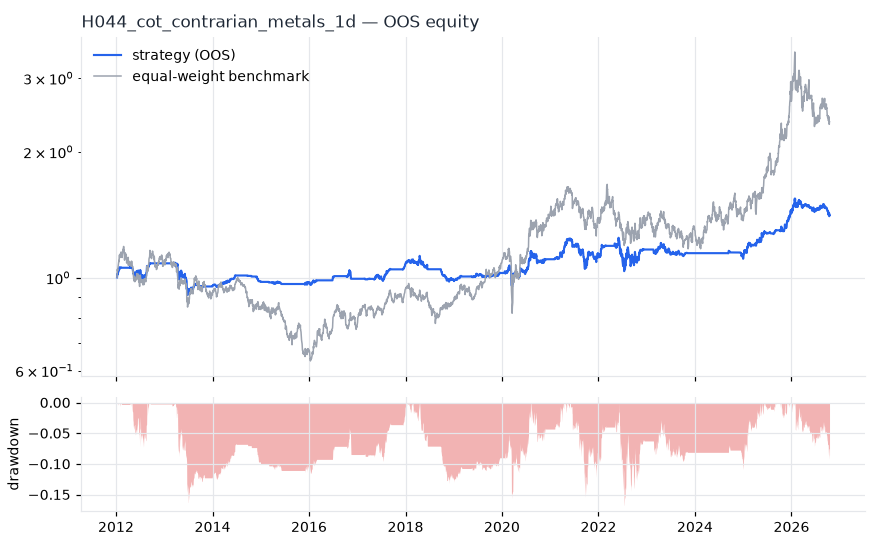
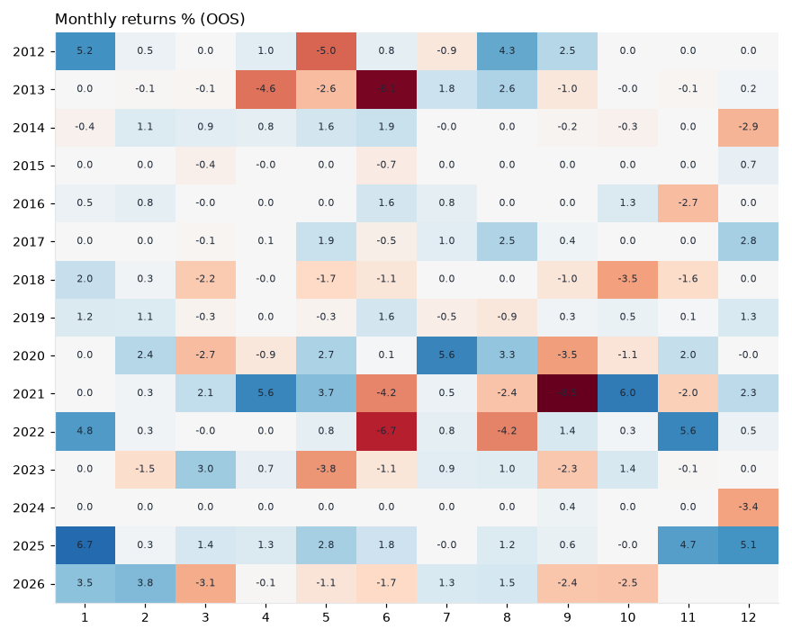

# H044 — cot_contrarian on metals [1d]  🟡 WATCH

- Kind: strategy · Source: Speculator positioning extremes are contrarian (Wang 2003; Sanders, Boris & Manfredo 2004)
- For system: `metals`
- Data: 2008-01-02 00:00:00 → 2026-10-16 00:00:00 · 5 assets · 251.7 bars/year · survivorship mask: False
- Costs: {'commission': 0.0002, 'slippage': 0.0005, 'funding_annual': 0.0, 'borrow_annual': 0.0}
- Variants tried (DSR trials): 23 (failed: 0)
- Final variant: `cot_contrarian|look=156,thr=1.0|overlay=vt10`

## Verdict reasons
- DSR 0.739 < 0.9 (luck not excluded after 23 trials)
- OOS Sharpe (excess of T-bill) 0.125 < 0.5
- with 2x costs it does not beat the equal-weight benchmark
- PBO 0.561 > 0.5 (variant selection is overfit)
- Reality Check p 0.958 > 0.1 (best variant may be data-mined)

## Walk-forward out-of-sample


| Metric | Strategy | Equal-weight benchmark |
|---|---|---|
| years | 14.76 | 14.76 |
| cagr | 0.0237 | 0.0598 |
| vol | 0.0854 | 0.2196 |
| sharpe | 0.317 | 0.375 |
| sharpe_excess_rf | 0.125 | None |
| sortino | 0.174 | 0.518 |
| max_dd | -0.1679 | -0.4673 |
| max_dd_bars | 1221 | 2108 |
| calmar | 0.141 | 0.128 |
| ulcer | 0.0774 | 0.2199 |
| var95 | -0.0077 | -0.0209 |
| cvar95 | -0.0138 | -0.0323 |
| omega | 1.081 | 1.069 |
| tail_ratio | 1.105 | 1.035 |
| skew | -0.526 | -0.712 |
| kurtosis | 12.425 | 8.895 |
| hit_rate | 0.326 | 0.529 |
| turnover_ann | 3.78 | None |

- **Gate Sharpe (excess of T-bill): 0.125**
- Deflated Sharpe: **0.739** · PBO: **0.561** · Reality Check p: **0.958**
- PSR 0.887 · Info ratio -0.321 · Beta 0.268 · Up/Down capture 0.259/0.254
- Sharpe with 2× costs: 0.286 · Walk-forward efficiency: 0.406
- Bootstrap: {'p_sharpe_pos': 0.909, 'cagr_p05': -0.0101, 'maxdd_p05': -0.3791}
- Yearly OOS Sharpe: {'2012': 0.94, '2013': -1.07, '2014': 0.75, '2015': -0.15, '2016': 0.49, '2017': 1.99, '2018': -1.25, '2019': 1.3, '2020': 0.67, '2021': 0.25, '2022': 0.27, '2023': -0.27, '2024': -1.3, '2025': 2.8, '2026': -0.07}



## Regimes (where does it work?)
`{"bull": {"sharpe": 1.31, "ann_ret": 0.0958, "bars": 2225}, "bear": {"sharpe": -0.75, "ann_ret": -0.0755, "bars": 1490}, "calm": {"sharpe": 0.37, "ann_ret": 0.0272, "bars": 1959}, "stressed": {"sharpe": 0.28, "ann_ret": 0.027, "bars": 1756}, "vix_lt_20": {"sharpe": 0.53, "ann_ret": 0.0371, "bars": 2796}, "vix_20_30": {"sharpe": 0.11, "ann_ret": 0.0124, "bars": 761}, "vix_ge_30": {"sharpe": -0.54, "ann_ret": -0.0783, "bars": 158}, "curve_inverted": {"sharpe": -0.12, "ann_ret": -0.0056, "bars": 615}, "curve_normal": {"sharpe": 0.37, "ann_ret": 0.0336, "bars": 3100}}`

## Calendar profile (weekday / month / hour)
`{"weekday": {"0": -0.0, "1": 5e-05, "2": 0.00031, "3": -3e-05, "4": 0.0002}, "month": {"1": 0.00078, "2": 0.00033, "3": -4e-05, "4": 0.00012, "5": -3e-05, "6": -0.00051, "7": 0.00036, "8": 0.00028, "9": -0.00044, "10": 7e-05, "11": 0.00021, "12": 0.00022}}`

## Robustness
- **delay**: `{"sharpe": 0.419, "sharpe_delayed_1bar": 0.453, "retained": 1.083}`
- **neighbourhood**: `{"neighbours": 1, "best_sharpe": 0.415, "neighbour_median": 0.334, "share_positive": 1.0, "stability": 0.805}`
- **noise**: `{"noise_bp": 0.002, "sharpe_min": 0.418, "sharpe_median": 0.422}`

## Timing, take-profit, stop-loss and profit studies (in-sample diagnostics)
- Portfolio overlays (vol target, drawdown brake, equity-curve filter): `{"none": {"sharpe": 0.317, "cagr": 0.0237, "max_dd": -0.1679}, "vol_target_0.1": {"sharpe": 0.331, "cagr": 0.0277, "max_dd": -0.2138}, "vol_target_0.15": {"sharpe": 0.331, "cagr": 0.0337, "max_dd": -0.2569}, "vol_target_0.2": {"sharpe": 0.307, "cagr": 0.0341, "max_dd": -0.2922}, "dd_brake_0.1": {"sharpe": 0.212, "cagr": 0.0134, "max_dd": -0.1662}, "dd_brake_0.2": {"sharpe": 0.317, "cagr": 0.0237, "max_dd": -0.1679}, "equity_ma_41": {"sharpe": 0.377, "cagr": 0.0201, "max_dd": -0.1113}, "equity_ma_125": {"sharpe": 0.457, "cagr": 0.0245, "max_dd": -0.1169}, "best_by_calmar": "equity_ma_125"}`
> Studies are in-sample diagnostics. To use a better exit, register it (exits: [...]) and let the gate judge it.

## Walk-forward windows
- 2020-12-21 00:00:00 → 2021-06-21 00:00:00: IS 0.577 / OOS 1.698 — `cot_contrarian|look=156,thr=1.0`
- 2021-06-22 00:00:00 → 2021-12-16 00:00:00: IS 0.874 / OOS -0.893 — `cot_contrarian|look=156,thr=1.5|overlay=vt15`
- 2021-12-17 00:00:00 → 2022-06-16 00:00:00: IS 0.581 / OOS 1.005 — `cot_contrarian|look=156,thr=1.5|overlay=vt20`
- 2022-06-17 00:00:00 → 2022-12-14 00:00:00: IS 0.634 / OOS 0.042 — `cot_contrarian|look=156,thr=1.0`
- 2022-12-15 00:00:00 → 2023-06-15 00:00:00: IS 0.531 / OOS 0.127 — `cot_contrarian|look=156,thr=1.0`
- 2023-06-16 00:00:00 → 2023-12-12 00:00:00: IS 0.513 / OOS -0.952 — `cot_contrarian|look=156,thr=2.0`
- 2023-12-13 00:00:00 → 2024-06-12 00:00:00: IS 0.278 / OOS 0.0 — `cot_contrarian|look=156,thr=2.0`
- 2024-06-13 00:00:00 → 2024-12-10 00:00:00: IS 0.189 / OOS 0.505 — `cot_contrarian|look=260,thr=1.0`
- 2024-12-11 00:00:00 → 2025-06-11 00:00:00: IS 0.449 / OOS 2.368 — `cot_contrarian|look=156,thr=1.0`
- 2025-06-12 00:00:00 → 2025-12-08 00:00:00: IS 0.648 / OOS 1.756 — `cot_contrarian|look=156,thr=1.0|overlay=vt10`
- 2025-12-09 00:00:00 → 2026-06-09 00:00:00: IS 1.042 / OOS 0.976 — `cot_contrarian|look=156,thr=1.0|overlay=vt10`
- 2026-06-10 00:00:00 → 2026-10-16 00:00:00: IS 1.218 / OOS -0.706 — `cot_contrarian|look=156,thr=1.0|overlay=vt10`

## Best variants (full sample, reference only)
- cot_contrarian|look=156,thr=1.0|overlay=vt20: Sharpe 0.435
- cot_contrarian|look=156,thr=1.0|overlay=vt15: Sharpe 0.435
- cot_contrarian|look=156,thr=1.0|overlay=vt10: Sharpe 0.415
- cot_contrarian|look=156,thr=1.0|overlay=dd20: Sharpe 0.41
- cot_contrarian|look=156,thr=1.0: Sharpe 0.408
- cot_contrarian|look=156,thr=1.5|overlay=eqma_l: Sharpe 0.38
- cot_contrarian|look=156,thr=1.5|overlay=vt20: Sharpe 0.38
- cot_contrarian|look=156,thr=1.5|overlay=vt15: Sharpe 0.38
- cot_contrarian|look=156,thr=1.5|overlay=dd20: Sharpe 0.358
- cot_contrarian|look=156,thr=1.5: Sharpe 0.357

## Current targets / signals
```json
{
 "PL=F": 0.2,
 "PA=F": 0.2
}
```

> Survivorship bias: unless a membership mask is used, universes are today's members (upper-bound results).