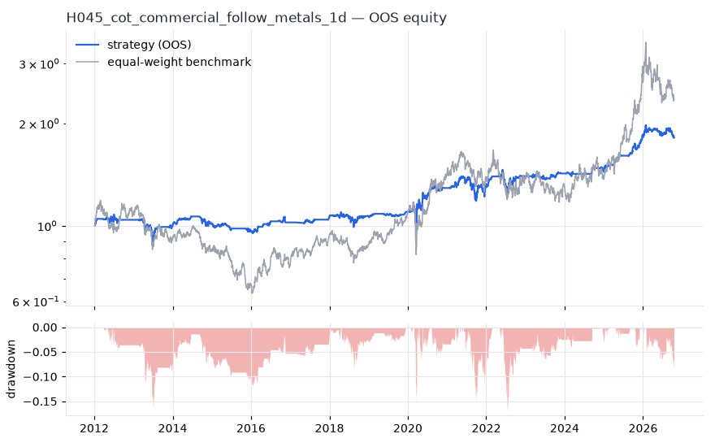
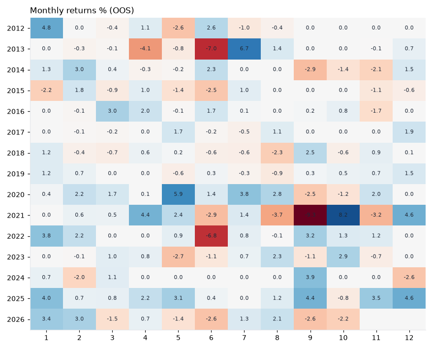

# H045 — cot_commercial_follow on metals [1d]  🟡 WATCH

- Kind: strategy · Source: Commercial hedgers' positioning leads prices (Bessembinder & Chan 1992)
- For system: `metals`
- Data: 2008-01-02 00:00:00 → 2026-10-16 00:00:00 · 5 assets · 251.7 bars/year · survivorship mask: False
- Costs: {'commission': 0.0002, 'slippage': 0.0005, 'funding_annual': 0.0, 'borrow_annual': 0.0}
- Variants tried (DSR trials): 18 (failed: 0)
- Final variant: `cot_commercial_follow|look=156,thr=0.5|overlay=vt10`

## Verdict reasons
- DSR 0.873 < 0.9 (luck not excluded after 18 trials)
- OOS Sharpe (excess of T-bill) 0.299 < 0.5
- Reality Check p 0.956 > 0.1 (best variant may be data-mined)

## Walk-forward out-of-sample


| Metric | Strategy | Equal-weight benchmark |
|---|---|---|
| years | 14.76 | 14.76 |
| cagr | 0.0413 | 0.0598 |
| vol | 0.0959 | 0.2196 |
| sharpe | 0.47 | 0.375 |
| sharpe_excess_rf | 0.299 | None |
| sortino | 0.435 | 0.518 |
| max_dd | -0.1693 | -0.4673 |
| max_dd_bars | 1450 | 2108 |
| calmar | 0.244 | 0.128 |
| ulcer | 0.0494 | 0.2199 |
| var95 | -0.0078 | -0.0209 |
| cvar95 | -0.015 | -0.0323 |
| omega | 1.126 | 1.069 |
| tail_ratio | 1.116 | 1.035 |
| skew | 0.518 | -0.712 |
| kurtosis | 22.198 | 8.895 |
| hit_rate | 0.329 | 0.529 |
| turnover_ann | 5.4 | None |

- **Gate Sharpe (excess of T-bill): 0.299**
- Deflated Sharpe: **0.873** · PBO: **0.392** · Reality Check p: **0.956**
- PSR 0.965 · Info ratio -0.22 · Beta 0.297 · Up/Down capture 0.29/0.272
- Sharpe with 2× costs: 0.431 · Walk-forward efficiency: 0.677
- Bootstrap: {'p_sharpe_pos': 0.991, 'cagr_p05': 0.0098, 'maxdd_p05': -0.3309}
- Yearly OOS Sharpe: {'2012': 0.52, '2013': -0.29, '2014': 0.25, '2015': -0.91, '2016': 0.98, '2017': 1.29, '2018': 0.06, '2019': 1.22, '2020': 0.94, '2021': 0.2, '2022': 0.53, '2023': 0.37, '2024': 0.25, '2025': 2.76, '2026': 0.03}



## Regimes (where does it work?)
`{"bull": {"sharpe": 1.34, "ann_ret": 0.1138, "bars": 2225}, "bear": {"sharpe": -0.52, "ann_ret": -0.0575, "bars": 1490}, "calm": {"sharpe": 0.38, "ann_ret": 0.0299, "bars": 1959}, "stressed": {"sharpe": 0.55, "ann_ret": 0.062, "bars": 1756}, "vix_lt_20": {"sharpe": 0.58, "ann_ret": 0.0447, "bars": 2796}, "vix_20_30": {"sharpe": 0.3, "ann_ret": 0.0345, "bars": 761}, "vix_ge_30": {"sharpe": 0.47, "ann_ret": 0.1024, "bars": 158}, "curve_inverted": {"sharpe": 0.29, "ann_ret": 0.0134, "bars": 615}, "curve_normal": {"sharpe": 0.5, "ann_ret": 0.0514, "bars": 3100}}`

## Calendar profile (weekday / month / hour)
`{"weekday": {"0": 0.00015, "1": 0.00013, "2": 0.00024, "3": 5e-05, "4": 0.00032}, "month": {"1": 0.00062, "2": 0.00038, "3": 0.00017, "4": 0.00028, "5": 0.00015, "6": -0.00047, "7": 0.00043, "8": 0.00012, "9": -0.00014, "10": 0.00023, "11": -2e-05, "12": 0.00041}}`

## Robustness
- **delay**: `{"sharpe": 0.339, "sharpe_delayed_1bar": 0.336, "retained": 0.992}`
- **neighbourhood**: `{"neighbours": 1, "best_sharpe": 0.336, "neighbour_median": 0.292, "share_positive": 1.0, "stability": 0.869}`
- **noise**: `{"noise_bp": 0.002, "sharpe_min": 0.337, "sharpe_median": 0.342}`

## Timing, take-profit, stop-loss and profit studies (in-sample diagnostics)
- Portfolio overlays (vol target, drawdown brake, equity-curve filter): `{"none": {"sharpe": 0.47, "cagr": 0.0413, "max_dd": -0.1693}, "vol_target_0.1": {"sharpe": 0.456, "cagr": 0.0429, "max_dd": -0.1871}, "vol_target_0.15": {"sharpe": 0.402, "cagr": 0.0447, "max_dd": -0.2464}, "vol_target_0.2": {"sharpe": 0.39, "cagr": 0.0483, "max_dd": -0.279}, "dd_brake_0.1": {"sharpe": 0.409, "cagr": 0.0325, "max_dd": -0.1555}, "dd_brake_0.2": {"sharpe": 0.47, "cagr": 0.0413, "max_dd": -0.1693}, "equity_ma_41": {"sharpe": 0.238, "cagr": 0.0133, "max_dd": -0.2004}, "equity_ma_125": {"sharpe": 0.291, "cagr": 0.0168, "max_dd": -0.1474}, "best_by_calmar": "none"}`
> Studies are in-sample diagnostics. To use a better exit, register it (exits: [...]) and let the gate judge it.

## Walk-forward windows
- 2020-12-21 00:00:00 → 2021-06-21 00:00:00: IS 0.662 / OOS 0.907 — `cot_commercial_follow|look=156,thr=0.5`
- 2021-06-22 00:00:00 → 2021-12-16 00:00:00: IS 0.714 / OOS -0.606 — `cot_commercial_follow|look=156,thr=0.5`
- 2021-12-17 00:00:00 → 2022-06-16 00:00:00: IS 0.604 / OOS 1.503 — `cot_commercial_follow|look=156,thr=1.0`
- 2022-06-17 00:00:00 → 2022-12-14 00:00:00: IS 0.78 / OOS 0.34 — `cot_commercial_follow|look=156,thr=1.0`
- 2022-12-15 00:00:00 → 2023-06-15 00:00:00: IS 0.716 / OOS 0.095 — `cot_commercial_follow|look=156,thr=1.0`
- 2023-06-16 00:00:00 → 2023-12-12 00:00:00: IS 0.587 / OOS 0.73 — `cot_commercial_follow|look=156,thr=1.0`
- 2023-12-13 00:00:00 → 2024-06-12 00:00:00: IS 0.552 / OOS -0.106 — `cot_commercial_follow|look=156,thr=1.0`
- 2024-06-13 00:00:00 → 2024-12-10 00:00:00: IS 0.342 / OOS 2.853 — `cot_commercial_follow|look=156,thr=1.0`
- 2024-12-11 00:00:00 → 2025-06-11 00:00:00: IS 0.66 / OOS 1.848 — `cot_commercial_follow|look=156,thr=1.0|overlay=dd10`
- 2025-06-12 00:00:00 → 2025-12-08 00:00:00: IS 0.741 / OOS 2.292 — `cot_commercial_follow|look=156,thr=0.5|overlay=vt10`
- 2025-12-09 00:00:00 → 2026-06-09 00:00:00: IS 1.253 / OOS 0.996 — `cot_commercial_follow|look=156,thr=0.5|overlay=vt10`
- 2026-06-10 00:00:00 → 2026-10-16 00:00:00: IS 1.365 / OOS -0.374 — `cot_commercial_follow|look=156,thr=0.5|overlay=vt10`

## Best variants (full sample, reference only)
- cot_commercial_follow|look=156,thr=0.5|overlay=vt20: Sharpe 0.383
- cot_commercial_follow|look=156,thr=0.5: Sharpe 0.372
- cot_commercial_follow|look=156,thr=0.5|overlay=vt15: Sharpe 0.37
- cot_commercial_follow|look=156,thr=0.5|overlay=dd20: Sharpe 0.363
- cot_commercial_follow|look=156,thr=1.0|overlay=vt20: Sharpe 0.342
- cot_commercial_follow|look=156,thr=0.5|overlay=vt10: Sharpe 0.336
- cot_commercial_follow|look=156,thr=1.0|overlay=vt15: Sharpe 0.335
- cot_commercial_follow|look=156,thr=1.0: Sharpe 0.319
- cot_commercial_follow|look=260,thr=0.5: Sharpe 0.313
- cot_commercial_follow|look=156,thr=1.0|overlay=dd20: Sharpe 0.311

## Current targets / signals
```json
{
 "HG=F": 0.1504,
 "PL=F": 0.1504,
 "PA=F": 0.1504
}
```

> Survivorship bias: unless a membership mask is used, universes are today's members (upper-bound results).