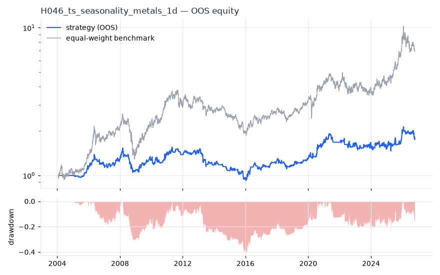
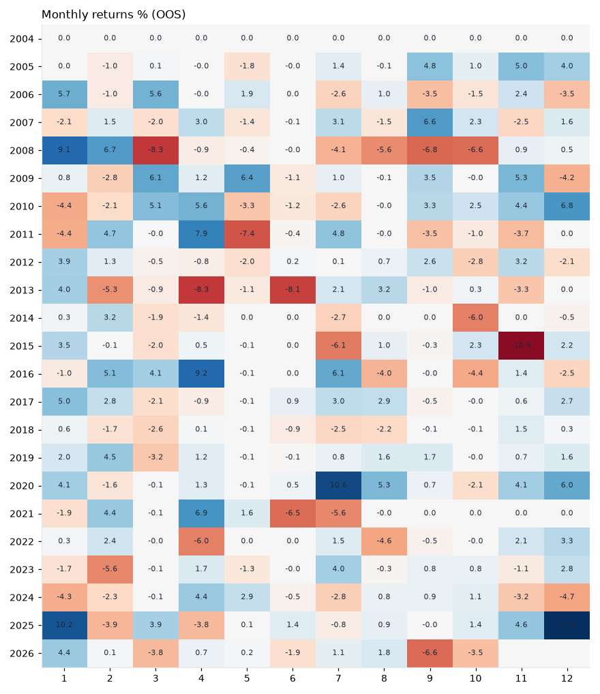

# H046 — ts_seasonality on metals [1d]  🟡 WATCH

- Kind: strategy · Source: Calendar seasonality of commodities (Sorensen 2002; Heston & Sadka 2008)
- For system: `metals`
- Data: 2000-01-04 00:00:00 → 2026-10-16 00:00:00 · 5 assets · 251.4 bars/year · survivorship mask: False
- Costs: {'commission': 0.0002, 'slippage': 0.0005, 'funding_annual': 0.0, 'borrow_annual': 0.0}
- Variants tried (DSR trials): 20 (failed: 0)
- Final variant: `ts_seasonality|years=5,thr=0.005|overlay=vt20`

## Verdict reasons
- DSR 0.742 < 0.9 (luck not excluded after 20 trials)
- OOS Sharpe (excess of T-bill) 0.127 < 0.5
- only 52% of OOS years positive
- with 2x costs it does not beat the equal-weight benchmark
- PBO 0.798 > 0.5 (variant selection is overfit)
- Reality Check p 0.996 > 0.1 (best variant may be data-mined)

## Walk-forward out-of-sample


| Metric | Strategy | Equal-weight benchmark |
|---|---|---|
| years | 22.75 | 22.75 |
| cagr | 0.0255 | 0.0893 |
| vol | 0.1243 | 0.2253 |
| sharpe | 0.265 | 0.493 |
| sharpe_excess_rf | 0.127 | None |
| sortino | 0.173 | 0.679 |
| max_dd | -0.4057 | -0.5054 |
| max_dd_bars | 2328 | 2233 |
| calmar | 0.063 | 0.177 |
| ulcer | 0.1798 | 0.2266 |
| var95 | -0.0125 | -0.0218 |
| cvar95 | -0.0202 | -0.034 |
| omega | 1.059 | 1.091 |
| tail_ratio | 0.993 | 0.991 |
| skew | -0.53 | -0.625 |
| kurtosis | 9.03 | 6.555 |
| hit_rate | 0.388 | 0.537 |
| turnover_ann | 7.85 | None |

- **Gate Sharpe (excess of T-bill): 0.127**
- Deflated Sharpe: **0.742** · PBO: **0.798** · Reality Check p: **0.996**
- PSR 0.896 · Info ratio -0.499 · Beta 0.411 · Up/Down capture 0.427/0.439
- Sharpe with 2× costs: 0.221 · Walk-forward efficiency: 0.409
- Bootstrap: {'p_sharpe_pos': 0.925, 'cagr_p05': -0.0136, 'maxdd_p05': -0.5846}
- Yearly OOS Sharpe: {'2004': 0.0, '2005': 1.93, '2006': 0.36, '2007': 0.78, '2008': -1.07, '2009': 1.25, '2010': 0.94, '2011': -0.32, '2012': 0.42, '2013': -1.39, '2014': -1.34, '2015': -0.87, '2016': 1.16, '2017': 2.15, '2018': -0.72, '2019': 1.39, '2020': 1.68, '2021': -0.11, '2022': -0.05, '2023': 0.05, '2024': -0.55, '2025': 1.35, '2026': -0.55}



## Regimes (where does it work?)
`{"bull": {"sharpe": 0.95, "ann_ret": 0.1207, "bars": 3972}, "bear": {"sharpe": -1.43, "ann_ret": -0.1666, "bars": 1747}, "calm": {"sharpe": 0.63, "ann_ret": 0.0669, "bars": 2895}, "stressed": {"sharpe": -0.01, "ann_ret": -0.0019, "bars": 2824}, "vix_lt_20": {"sharpe": 0.52, "ann_ret": 0.0604, "bars": 3942}, "vix_20_30": {"sharpe": 0.07, "ann_ret": 0.0093, "bars": 1328}, "vix_ge_30": {"sharpe": -0.88, "ann_ret": -0.1375, "bars": 449}, "curve_inverted": {"sharpe": -0.45, "ann_ret": -0.0604, "bars": 813}, "curve_normal": {"sharpe": 0.4, "ann_ret": 0.0484, "bars": 4906}}`

## Calendar profile (weekday / month / hour)
`{"weekday": {"0": 0.00016, "1": 0.00024, "2": 0.00016, "3": 0.00013, "4": -3e-05}, "month": {"1": 0.00076, "2": 0.00022, "3": -5e-05, "4": 0.00047, "5": -0.00012, "6": -0.00036, "7": 0.0002, "8": 2e-05, "9": 4e-05, "10": -0.00033, "11": 0.00026, "12": 0.00057}}`

## Robustness
- **delay**: `{"sharpe": 0.394, "sharpe_delayed_1bar": 0.329, "retained": 0.835}`
- **neighbourhood**: `{"neighbours": 1, "best_sharpe": 0.355, "neighbour_median": 0.353, "share_positive": 1.0, "stability": 0.995}`
- **noise**: `{"noise_bp": 0.002, "sharpe_min": 0.342, "sharpe_median": 0.378}`

## Timing, take-profit, stop-loss and profit studies (in-sample diagnostics)
- Portfolio overlays (vol target, drawdown brake, equity-curve filter): `{"none": {"sharpe": 0.265, "cagr": 0.0255, "max_dd": -0.4057}, "vol_target_0.1": {"sharpe": 0.354, "cagr": 0.0334, "max_dd": -0.4126}, "vol_target_0.15": {"sharpe": 0.309, "cagr": 0.0367, "max_dd": -0.5232}, "vol_target_0.2": {"sharpe": 0.292, "cagr": 0.0384, "max_dd": -0.6017}, "dd_brake_0.1": {"sharpe": 0.223, "cagr": 0.016, "max_dd": -0.3306}, "dd_brake_0.2": {"sharpe": 0.201, "cagr": 0.0164, "max_dd": -0.3397}, "equity_ma_41": {"sharpe": 0.212, "cagr": 0.0161, "max_dd": -0.2932}, "equity_ma_125": {"sharpe": 0.15, "cagr": 0.01, "max_dd": -0.4288}, "best_by_calmar": "vol_target_0.1"}`
> Studies are in-sample diagnostics. To use a better exit, register it (exits: [...]) and let the gate judge it.

## Walk-forward windows
- 2020-12-15 00:00:00 → 2021-06-15 00:00:00: IS 1.325 / OOS 1.833 — `ts_seasonality|years=5,thr=0.005|overlay=eqma_l`
- 2021-06-16 00:00:00 → 2021-12-10 00:00:00: IS 1.576 / OOS -1.938 — `ts_seasonality|years=5,thr=0.005|overlay=eqma_l`
- 2021-12-13 00:00:00 → 2022-06-10 00:00:00: IS 1.218 / OOS -0.532 — `ts_seasonality|years=5,thr=0.0|overlay=eqma_l`
- 2022-06-13 00:00:00 → 2022-12-08 00:00:00: IS 1.177 / OOS 0.256 — `ts_seasonality|years=10,thr=0.005`
- 2022-12-09 00:00:00 → 2023-06-09 00:00:00: IS 0.808 / OOS -0.811 — `ts_seasonality|years=10,thr=0.005`
- 2023-06-12 00:00:00 → 2023-12-06 00:00:00: IS 0.571 / OOS 0.074 — `ts_seasonality|years=10,thr=0.005`
- 2023-12-07 00:00:00 → 2024-06-06 00:00:00: IS 0.143 / OOS 1.086 — `ts_seasonality|years=10,thr=0.005`
- 2024-06-07 00:00:00 → 2024-12-04 00:00:00: IS 0.156 / OOS -0.605 — `ts_seasonality|years=10,thr=0.005`
- 2024-12-05 00:00:00 → 2025-06-05 00:00:00: IS 0.181 / OOS 0.258 — `ts_seasonality|years=10,thr=0.0`
- 2025-06-06 00:00:00 → 2025-12-02 00:00:00: IS 0.157 / OOS 0.779 — `ts_seasonality|years=5,thr=0.005|overlay=vt15`
- 2025-12-03 00:00:00 → 2026-06-03 00:00:00: IS 0.414 / OOS 1.395 — `ts_seasonality|years=5,thr=0.005|overlay=vt15`
- 2026-06-04 00:00:00 → 2026-10-16 00:00:00: IS 0.751 / OOS -1.252 — `ts_seasonality|years=5,thr=0.005|overlay=vt20`

## Best variants (full sample, reference only)
- ts_seasonality|years=5,thr=0.005|overlay=vt10: Sharpe 0.363
- ts_seasonality|years=5,thr=0.005|overlay=vt15: Sharpe 0.358
- ts_seasonality|years=5,thr=0.0|overlay=vt15: Sharpe 0.356
- ts_seasonality|years=5,thr=0.005|overlay=vt20: Sharpe 0.355
- ts_seasonality|years=5,thr=0.0|overlay=vt20: Sharpe 0.353
- ts_seasonality|years=5,thr=0.0|overlay=vt10: Sharpe 0.346
- ts_seasonality|years=5,thr=0.0: Sharpe 0.31
- ts_seasonality|years=5,thr=0.005: Sharpe 0.309
- ts_seasonality|years=5,thr=0.0|overlay=dd10: Sharpe 0.296
- ts_seasonality|years=5,thr=0.005|overlay=dd20: Sharpe 0.295

## Current targets / signals
```json
{}
```

> Survivorship bias: unless a membership mask is used, universes are today's members (upper-bound results).