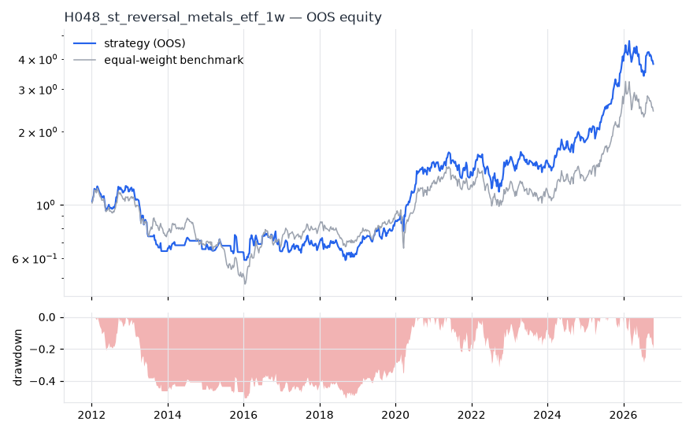
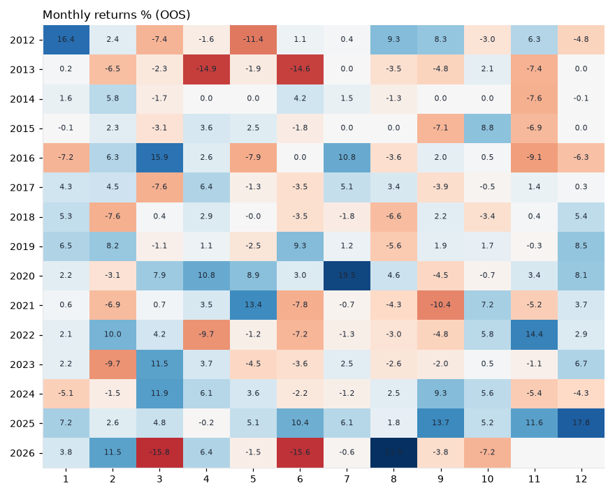

# H048 — st_reversal on metals_etf [1w]  🟡 WATCH

- Kind: strategy · Source: Lehmann (1990) Fads, Martingales and Market Efficiency; Jegadeesh (1990)
- For system: `metals`
- Data: 2008-01-04 00:00:00 → 2026-10-16 00:00:00 · 8 assets · 52.2 bars/year · survivorship mask: False
- Costs: {'commission': 0.0002, 'slippage': 0.0003, 'funding_annual': 0.0, 'borrow_annual': 0.0}
- Variants tried (DSR trials): 20 (failed: 0)
- Final variant: `st_reversal|lookback=5,top_n=3`

## Verdict reasons
- DSR 0.891 < 0.9 (luck not excluded after 20 trials)
- OOS Sharpe (excess of T-bill) 0.428 < 0.5
- OOS MaxDD -0.5064 worse than -0.45 (local or USD)
- PBO 0.536 > 0.5 (variant selection is overfit)
- Reality Check p 0.598 > 0.1 (best variant may be data-mined)

## Walk-forward out-of-sample


| Metric | Strategy | Equal-weight benchmark |
|---|---|---|
| years | 14.78 | 14.78 |
| cagr | 0.0948 | 0.0622 |
| vol | 0.2402 | 0.2372 |
| sharpe | 0.496 | 0.373 |
| sharpe_excess_rf | 0.428 | None |
| sortino | 0.653 | 0.549 |
| max_dd | -0.5064 | -0.5979 |
| max_dd_bars | 397 | 440 |
| calmar | 0.187 | 0.104 |
| ulcer | 0.2972 | 0.2771 |
| var95 | -0.048 | -0.0469 |
| cvar95 | -0.0726 | -0.0697 |
| omega | 1.22 | 1.149 |
| tail_ratio | 1.146 | 1.155 |
| skew | 0.39 | -0.103 |
| kurtosis | 3.207 | 3.158 |
| hit_rate | 0.465 | 0.516 |
| turnover_ann | 19.33 | None |

- **Gate Sharpe (excess of T-bill): 0.428**
- Deflated Sharpe: **0.891** · PBO: **0.536** · Reality Check p: **0.598**
- PSR 0.973 · Info ratio 0.24 · Beta 0.868 · Up/Down capture 0.892/0.824
- Sharpe with 2× costs: 0.456 · Walk-forward efficiency: 0.761
- Bootstrap: {'p_sharpe_pos': 0.982, 'cagr_p05': -0.005, 'maxdd_p05': -0.6929}
- Yearly OOS Sharpe: {'2012': 0.75, '2013': -2.48, '2014': 0.22, '2015': -0.02, '2016': 0.16, '2017': 0.52, '2018': -0.31, '2019': 1.73, '2020': 1.98, '2021': -0.23, '2022': 0.46, '2023': 0.19, '2024': 0.86, '2025': 3.38, '2026': -0.07}



## Regimes (where does it work?)
`{"bull": {"sharpe": 1.71, "ann_ret": 0.3979, "bars": 446}, "bear": {"sharpe": -1.09, "ann_ret": -0.2621, "bars": 326}, "calm": {"sharpe": 0.33, "ann_ret": 0.069, "bars": 399}, "stressed": {"sharpe": 0.64, "ann_ret": 0.1729, "bars": 373}, "vix_lt_20": {"sharpe": 0.64, "ann_ret": 0.1408, "bars": 579}, "vix_20_30": {"sharpe": 0.23, "ann_ret": 0.0619, "bars": 163}, "curve_inverted": {"sharpe": 0.41, "ann_ret": 0.099, "bars": 125}, "curve_normal": {"sharpe": 0.51, "ann_ret": 0.1231, "bars": 647}}`

## Calendar profile (weekday / month / hour)
`{"weekday": {"4": 0.00228}, "month": {"1": 0.00596, "2": 0.00305, "3": 0.00277, "4": 0.00341, "5": 0.00029, "6": -0.00521, "7": 0.0064, "8": 0.00188, "9": -0.00044, "10": 0.00381, "11": -0.00068, "12": 0.00606}}`

## Robustness
- **delay**: `{"sharpe": 0.429, "sharpe_delayed_1bar": 0.361, "retained": 0.843}`
- **neighbourhood**: `{"neighbours": 3, "best_sharpe": 0.427, "neighbour_median": 0.396, "share_positive": 1.0, "stability": 0.928}`
- **noise**: `{"noise_bp": 0.002, "sharpe_min": 0.395, "sharpe_median": 0.437}`

## Timing, take-profit, stop-loss and profit studies (in-sample diagnostics)
- Portfolio overlays (vol target, drawdown brake, equity-curve filter): `{"none": {"sharpe": 0.496, "cagr": 0.0948, "max_dd": -0.5064}, "vol_target_0.1": {"sharpe": 0.423, "cagr": 0.0473, "max_dd": -0.3551}, "vol_target_0.15": {"sharpe": 0.445, "cagr": 0.0671, "max_dd": -0.445}, "vol_target_0.2": {"sharpe": 0.452, "cagr": 0.083, "max_dd": -0.5257}, "dd_brake_0.1": {"sharpe": 0.52, "cagr": 0.0765, "max_dd": -0.3585}, "dd_brake_0.2": {"sharpe": 0.527, "cagr": 0.0861, "max_dd": -0.3687}, "equity_ma_8": {"sharpe": 0.126, "cagr": 0.0068, "max_dd": -0.4962}, "equity_ma_26": {"sharpe": 0.364, "cagr": 0.0499, "max_dd": -0.3941}, "best_by_calmar": "dd_brake_0.2"}`
> Studies are in-sample diagnostics. To use a better exit, register it (exits: [...]) and let the gate judge it.

## Walk-forward windows
- 2020-12-25 00:00:00 → 2021-06-18 00:00:00: IS 1.257 / OOS 0.046 — `st_reversal|lookback=21,top_n=3`
- 2021-06-25 00:00:00 → 2021-12-17 00:00:00: IS 1.199 / OOS -0.879 — `st_reversal|lookback=21,top_n=3`
- 2021-12-24 00:00:00 → 2022-06-17 00:00:00: IS 1.107 / OOS 0.362 — `st_reversal|lookback=21,top_n=3`
- 2022-06-24 00:00:00 → 2022-12-16 00:00:00: IS 0.812 / OOS 0.641 — `st_reversal|lookback=21,top_n=3`
- 2022-12-23 00:00:00 → 2023-06-16 00:00:00: IS 0.803 / OOS 0.631 — `st_reversal|lookback=21,top_n=3`
- 2023-06-23 00:00:00 → 2023-12-15 00:00:00: IS 0.542 / OOS -0.213 — `st_reversal|lookback=21,top_n=3|overlay=vt15`
- 2023-12-22 00:00:00 → 2024-06-14 00:00:00: IS 0.258 / OOS 1.272 — `st_reversal|lookback=5,top_n=5`
- 2024-06-21 00:00:00 → 2024-12-13 00:00:00: IS 0.361 / OOS 0.946 — `st_reversal|lookback=5,top_n=5`
- 2024-12-20 00:00:00 → 2025-06-13 00:00:00: IS 0.652 / OOS 1.938 — `st_reversal|lookback=5,top_n=3|overlay=dd10`
- 2025-06-20 00:00:00 → 2025-12-12 00:00:00: IS 1.086 / OOS 3.631 — `st_reversal|lookback=5,top_n=3|overlay=dd10`
- 2025-12-19 00:00:00 → 2026-06-12 00:00:00: IS 1.759 / OOS 0.401 — `st_reversal|lookback=5,top_n=3|overlay=dd10`
- 2026-06-19 00:00:00 → 2026-10-16 00:00:00: IS 1.536 / OOS 0.178 — `st_reversal|lookback=5,top_n=3`

## Best variants (full sample, reference only)
- st_reversal|lookback=21,top_n=3: Sharpe 0.461
- st_reversal|lookback=5,top_n=3: Sharpe 0.427
- st_reversal|lookback=21,top_n=5: Sharpe 0.407
- st_reversal|lookback=21,top_n=3|overlay=eqma_l: Sharpe 0.407
- st_reversal|lookback=21,top_n=3|overlay=vt20: Sharpe 0.401
- st_reversal|lookback=21,top_n=3|overlay=dd20: Sharpe 0.399
- st_reversal|lookback=5,top_n=5: Sharpe 0.396
- st_reversal|lookback=21,top_n=3|overlay=dd10: Sharpe 0.384
- st_reversal|lookback=5,top_n=3|overlay=dd20: Sharpe 0.384
- st_reversal|lookback=21,top_n=3|overlay=vt15: Sharpe 0.357

## Current targets / signals
```json
{
 "SLV": 0.3333,
 "PALL": 0.3333,
 "SIL": 0.3333
}
```

> Survivorship bias: unless a membership mask is used, universes are today's members (upper-bound results).