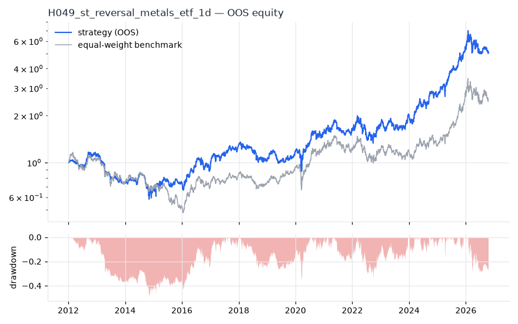
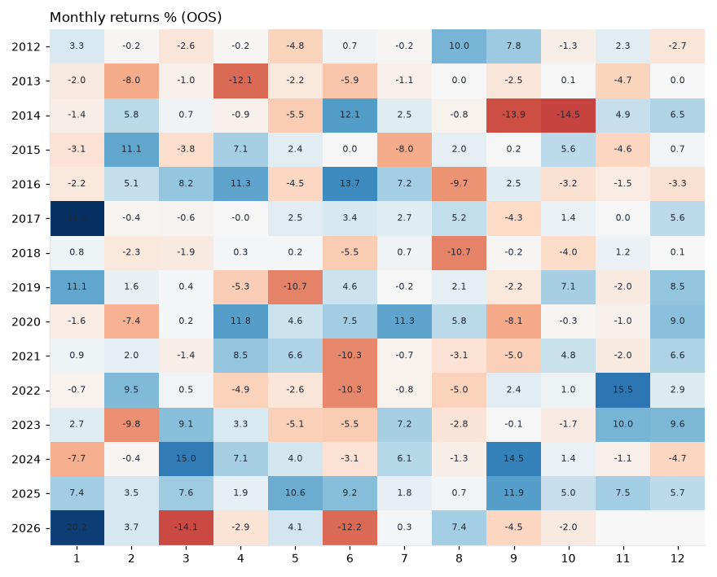

# H049 — st_reversal on metals_etf [1d]  🟡 WATCH

- Kind: strategy · Source: Lehmann (1990) Fads, Martingales and Market Efficiency; Jegadeesh (1990)
- For system: `metals`
- Data: 2008-01-02 00:00:00 → 2026-10-16 00:00:00 · 8 assets · 251.7 bars/year · survivorship mask: False
- Costs: {'commission': 0.0002, 'slippage': 0.0003, 'funding_annual': 0.0, 'borrow_annual': 0.0}
- Variants tried (DSR trials): 20 (failed: 0)
- Final variant: `st_reversal|lookback=21,top_n=5|overlay=vt20`

## Verdict reasons
- OOS Sharpe (excess of T-bill) 0.497 < 0.5
- OOS MaxDD -0.4997 worse than -0.45 (local or USD)
- Reality Check p 0.148 > 0.1 (best variant may be data-mined)

## Walk-forward out-of-sample


| Metric | Strategy | Equal-weight benchmark |
|---|---|---|
| years | 14.76 | 14.76 |
| cagr | 0.1165 | 0.0643 |
| vol | 0.2536 | 0.2426 |
| sharpe | 0.561 | 0.379 |
| sharpe_excess_rf | 0.497 | None |
| sortino | 0.727 | 0.528 |
| max_dd | -0.4997 | -0.5898 |
| max_dd_bars | 1202 | 2115 |
| calmar | 0.233 | 0.109 |
| ulcer | 0.1995 | 0.2747 |
| var95 | -0.0227 | -0.0236 |
| cvar95 | -0.036 | -0.0358 |
| omega | 1.109 | 1.068 |
| tail_ratio | 1.063 | 1.016 |
| skew | 0.378 | -0.47 |
| kurtosis | 11.708 | 5.298 |
| hit_rate | 0.508 | 0.515 |
| turnover_ann | 32.88 | None |

- **Gate Sharpe (excess of T-bill): 0.497**
- Deflated Sharpe: **0.901** · PBO: **0.31** · Reality Check p: **0.148**
- PSR 0.985 · Info ratio 0.407 · Beta 0.916 · Up/Down capture 0.923/0.88
- Sharpe with 2× costs: 0.496 · Walk-forward efficiency: 0.864
- Bootstrap: {'p_sharpe_pos': 0.995, 'cagr_p05': 0.0188, 'maxdd_p05': -0.6558}
- Yearly OOS Sharpe: {'2012': 0.89, '2013': -1.94, '2014': -0.1, '2015': 0.42, '2016': 0.95, '2017': 1.89, '2018': -1.02, '2019': 0.92, '2020': 1.01, '2021': 0.36, '2022': 0.32, '2023': 0.79, '2024': 1.2, '2025': 2.69, '2026': 0.05}



## Regimes (where does it work?)
`{"bull": {"sharpe": 1.43, "ann_ret": 0.3681, "bars": 2182}, "bear": {"sharpe": -0.73, "ann_ret": -0.1791, "bars": 1533}, "calm": {"sharpe": 0.39, "ann_ret": 0.0781, "bars": 1993}, "stressed": {"sharpe": 0.71, "ann_ret": 0.2166, "bars": 1722}, "vix_lt_20": {"sharpe": 0.85, "ann_ret": 0.1936, "bars": 2796}, "vix_20_30": {"sharpe": 0.07, "ann_ret": 0.0191, "bars": 761}, "vix_ge_30": {"sharpe": -0.38, "ann_ret": -0.1715, "bars": 158}, "curve_inverted": {"sharpe": 0.74, "ann_ret": 0.1729, "bars": 614}, "curve_normal": {"sharpe": 0.53, "ann_ret": 0.1363, "bars": 3101}}`

## Calendar profile (weekday / month / hour)
`{"weekday": {"0": 0.00043, "1": 0.00085, "2": 0.00095, "3": -0.00011, "4": 0.00069}, "month": {"1": 0.00158, "2": 0.00059, "3": 0.00062, "4": 0.00085, "5": 1e-05, "6": -0.0001, "7": 0.00093, "8": 0.0, "9": -6e-05, "10": 3e-05, "11": 0.00092, "12": 0.00159}}`

## Robustness
- **delay**: `{"sharpe": 0.465, "sharpe_delayed_1bar": 0.435, "retained": 0.935}`
- **neighbourhood**: `{"neighbours": 1, "best_sharpe": 0.464, "neighbour_median": 0.445, "share_positive": 1.0, "stability": 0.96}`
- **noise**: `{"noise_bp": 0.002, "sharpe_min": 0.441, "sharpe_median": 0.474}`

## Timing, take-profit, stop-loss and profit studies (in-sample diagnostics)
- Portfolio overlays (vol target, drawdown brake, equity-curve filter): `{"none": {"sharpe": 0.561, "cagr": 0.1165, "max_dd": -0.4997}, "vol_target_0.1": {"sharpe": 0.358, "cagr": 0.0335, "max_dd": -0.3281}, "vol_target_0.15": {"sharpe": 0.355, "cagr": 0.0455, "max_dd": -0.4579}, "vol_target_0.2": {"sharpe": 0.357, "cagr": 0.0552, "max_dd": -0.5749}, "dd_brake_0.1": {"sharpe": 0.572, "cagr": 0.0912, "max_dd": -0.3232}, "dd_brake_0.2": {"sharpe": 0.527, "cagr": 0.0924, "max_dd": -0.364}, "equity_ma_41": {"sharpe": 0.315, "cagr": 0.0398, "max_dd": -0.4563}, "equity_ma_125": {"sharpe": 0.575, "cagr": 0.0928, "max_dd": -0.3259}, "best_by_calmar": "equity_ma_125"}`
> Studies are in-sample diagnostics. To use a better exit, register it (exits: [...]) and let the gate judge it.

## Walk-forward windows
- 2020-12-16 00:00:00 → 2021-06-16 00:00:00: IS 0.747 / OOS 1.409 — `st_reversal|lookback=21,top_n=5`
- 2021-06-17 00:00:00 → 2021-12-13 00:00:00: IS 0.87 / OOS -1.626 — `st_reversal|lookback=21,top_n=5|overlay=dd10`
- 2021-12-14 00:00:00 → 2022-06-13 00:00:00: IS 0.87 / OOS 0.557 — `st_reversal|lookback=10,top_n=3`
- 2022-06-14 00:00:00 → 2022-12-09 00:00:00: IS 0.949 / OOS 0.492 — `st_reversal|lookback=10,top_n=3`
- 2022-12-12 00:00:00 → 2023-06-12 00:00:00: IS 0.913 / OOS 0.163 — `st_reversal|lookback=10,top_n=3`
- 2023-06-13 00:00:00 → 2023-12-08 00:00:00: IS 0.728 / OOS 0.495 — `st_reversal|lookback=10,top_n=3`
- 2023-12-11 00:00:00 → 2024-06-10 00:00:00: IS 0.547 / OOS 2.121 — `st_reversal|lookback=10,top_n=3`
- 2024-06-11 00:00:00 → 2024-12-06 00:00:00: IS 0.542 / OOS 1.568 — `st_reversal|lookback=10,top_n=3`
- 2024-12-09 00:00:00 → 2025-06-10 00:00:00: IS 0.849 / OOS 2.442 — `st_reversal|lookback=10,top_n=3`
- 2025-06-11 00:00:00 → 2025-12-08 00:00:00: IS 1.151 / OOS 2.294 — `st_reversal|lookback=10,top_n=3`
- 2025-12-09 00:00:00 → 2026-06-09 00:00:00: IS 1.617 / OOS 0.27 — `st_reversal|lookback=10,top_n=3`
- 2026-06-10 00:00:00 → 2026-10-16 00:00:00: IS 1.595 / OOS -0.017 — `st_reversal|lookback=21,top_n=5|overlay=vt20`

## Best variants (full sample, reference only)
- st_reversal|lookback=21,top_n=3: Sharpe 0.544
- st_reversal|lookback=21,top_n=5: Sharpe 0.515
- st_reversal|lookback=21,top_n=3|overlay=dd20: Sharpe 0.487
- st_reversal|lookback=21,top_n=5|overlay=dd20: Sharpe 0.481
- st_reversal|lookback=21,top_n=5|overlay=vt20: Sharpe 0.464
- st_reversal|lookback=10,top_n=3: Sharpe 0.459
- st_reversal|lookback=21,top_n=3|overlay=vt20: Sharpe 0.445
- st_reversal|lookback=21,top_n=5|overlay=vt15: Sharpe 0.432
- st_reversal|lookback=5,top_n=5: Sharpe 0.424
- st_reversal|lookback=21,top_n=3|overlay=vt15: Sharpe 0.42

## Current targets / signals
```json
{
 "SLV": 0.1165,
 "GDX": 0.1165,
 "PPLT": 0.1165,
 "PALL": 0.1165,
 "SIL": 0.1165
}
```

> Survivorship bias: unless a membership mask is used, universes are today's members (upper-bound results).