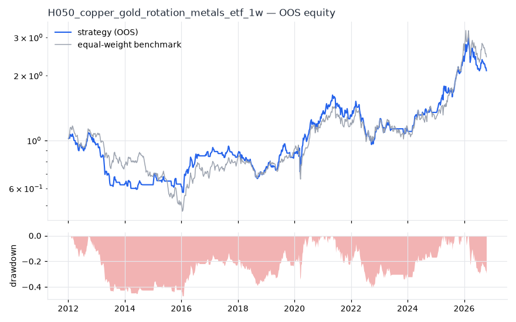
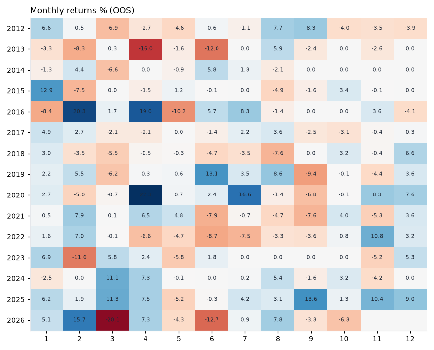

# H050 — copper_gold_rotation on metals_etf [1w]  🟡 WATCH

- Kind: strategy · Source: Copper/gold ratio as growth signal (risk-on industrial vs safe-haven gold)
- For system: `metals`
- Data: 2008-01-04 00:00:00 → 2026-10-16 00:00:00 · 8 assets · 52.2 bars/year · survivorship mask: False
- Costs: {'commission': 0.0002, 'slippage': 0.0003, 'funding_annual': 0.0, 'borrow_annual': 0.0}
- Variants tried (DSR trials): 17 (failed: 0)
- Final variant: `copper_gold_rotation|n=100|overlay=vt20`

## Verdict reasons
- DSR 0.816 < 0.9 (luck not excluded after 17 trials)
- OOS Sharpe (excess of T-bill) 0.266 < 0.5
- OOS MaxDD -0.4708 worse than -0.45 (local or USD)
- with 2x costs it does not beat the equal-weight benchmark
- PBO 0.657 > 0.5 (variant selection is overfit)
- Reality Check p 0.904 > 0.1 (best variant may be data-mined)

## Walk-forward out-of-sample


| Metric | Strategy | Equal-weight benchmark |
|---|---|---|
| years | 14.78 | 14.78 |
| cagr | 0.0516 | 0.0622 |
| vol | 0.219 | 0.2372 |
| sharpe | 0.34 | 0.373 |
| sharpe_excess_rf | 0.266 | None |
| sortino | 0.385 | 0.549 |
| max_dd | -0.4708 | -0.5979 |
| max_dd_bars | 406 | 440 |
| calmar | 0.11 | 0.104 |
| ulcer | 0.2644 | 0.2771 |
| var95 | -0.0472 | -0.0469 |
| cvar95 | -0.0667 | -0.0697 |
| omega | 1.154 | 1.149 |
| tail_ratio | 1.067 | 1.155 |
| skew | -0.238 | -0.103 |
| kurtosis | 5.501 | 3.158 |
| hit_rate | 0.409 | 0.516 |
| turnover_ann | 10.69 | None |

- **Gate Sharpe (excess of T-bill): 0.266**
- Deflated Sharpe: **0.816** · PBO: **0.657** · Reality Check p: **0.904**
- PSR 0.903 · Info ratio -0.102 · Beta 0.756 · Up/Down capture 0.756/0.744
- Sharpe with 2× costs: 0.316 · Walk-forward efficiency: 0.516
- Bootstrap: {'p_sharpe_pos': 0.92, 'cagr_p05': -0.0369, 'maxdd_p05': -0.7363}
- Yearly OOS Sharpe: {'2012': -0.17, '2013': -2.21, '2014': 0.06, '2015': 0.12, '2016': 1.34, '2017': 0.2, '2018': -0.81, '2019': 0.98, '2020': 1.31, '2021': 0.1, '2022': -0.43, '2023': -0.02, '2024': 1.19, '2025': 2.45, '2026': -0.4}



## Regimes (where does it work?)
`{"bull": {"sharpe": 1.15, "ann_ret": 0.2755, "bars": 446}, "bear": {"sharpe": -1.12, "ann_ret": -0.2005, "bars": 326}, "calm": {"sharpe": -0.13, "ann_ret": -0.0213, "bars": 399}, "stressed": {"sharpe": 0.68, "ann_ret": 0.177, "bars": 373}, "vix_lt_20": {"sharpe": 0.42, "ann_ret": 0.0756, "bars": 579}, "vix_20_30": {"sharpe": 0.06, "ann_ret": 0.0144, "bars": 163}, "curve_inverted": {"sharpe": 0.73, "ann_ret": 0.1441, "bars": 125}, "curve_normal": {"sharpe": 0.27, "ann_ret": 0.0611, "bars": 647}}`

## Calendar profile (weekday / month / hour)
`{"weekday": {"4": 0.00143}, "month": {"1": 0.00561, "2": 0.00475, "3": -0.00222, "4": 0.00647, "5": -0.00424, "6": -0.00299, "7": 0.00362, "8": 0.00262, "9": -0.00277, "10": 0.00057, "11": 0.00121, "12": 0.00513}}`

## Robustness
- **delay**: `{"sharpe": 0.322, "sharpe_delayed_1bar": 0.323, "retained": 1.002}`
- **neighbourhood**: `{"neighbours": 1, "best_sharpe": 0.322, "neighbour_median": 0.3, "share_positive": 1.0, "stability": 0.933}`
- **noise**: `{"noise_bp": 0.002, "sharpe_min": 0.312, "sharpe_median": 0.32}`

## Timing, take-profit, stop-loss and profit studies (in-sample diagnostics)
- Portfolio overlays (vol target, drawdown brake, equity-curve filter): `{"none": {"sharpe": 0.34, "cagr": 0.0516, "max_dd": -0.4708}, "vol_target_0.1": {"sharpe": 0.314, "cagr": 0.0326, "max_dd": -0.2733}, "vol_target_0.15": {"sharpe": 0.319, "cagr": 0.0421, "max_dd": -0.3832}, "vol_target_0.2": {"sharpe": 0.32, "cagr": 0.0485, "max_dd": -0.4853}, "dd_brake_0.1": {"sharpe": 0.385, "cagr": 0.0471, "max_dd": -0.3422}, "dd_brake_0.2": {"sharpe": 0.235, "cagr": 0.0261, "max_dd": -0.4176}, "equity_ma_8": {"sharpe": 0.24, "cagr": 0.0261, "max_dd": -0.2999}, "equity_ma_26": {"sharpe": 0.295, "cagr": 0.0361, "max_dd": -0.3667}, "best_by_calmar": "dd_brake_0.1"}`
> Studies are in-sample diagnostics. To use a better exit, register it (exits: [...]) and let the gate judge it.

## Walk-forward windows
- 2020-12-25 00:00:00 → 2021-06-18 00:00:00: IS 0.913 / OOS 0.647 — `copper_gold_rotation|n=50|overlay=dd20`
- 2021-06-25 00:00:00 → 2021-12-17 00:00:00: IS 1.001 / OOS -0.793 — `copper_gold_rotation|n=50|overlay=dd20`
- 2021-12-24 00:00:00 → 2022-06-17 00:00:00: IS 0.905 / OOS -0.462 — `copper_gold_rotation|n=50`
- 2022-06-24 00:00:00 → 2022-12-16 00:00:00: IS 0.639 / OOS -0.196 — `copper_gold_rotation|n=50`
- 2022-12-23 00:00:00 → 2023-06-16 00:00:00: IS 0.508 / OOS 0.11 — `copper_gold_rotation|n=50`
- 2023-06-23 00:00:00 → 2023-12-15 00:00:00: IS 0.476 / OOS -0.252 — `copper_gold_rotation|n=50|overlay=eqma_l`
- 2023-12-22 00:00:00 → 2024-06-14 00:00:00: IS 0.18 / OOS 1.968 — `copper_gold_rotation|n=100|overlay=eqma_s`
- 2024-06-21 00:00:00 → 2024-12-13 00:00:00: IS 0.252 / OOS 0.461 — `copper_gold_rotation|n=100|overlay=eqma_s`
- 2024-12-20 00:00:00 → 2025-06-13 00:00:00: IS 0.564 / OOS 2.126 — `copper_gold_rotation|n=100|overlay=eqma_s`
- 2025-06-20 00:00:00 → 2025-12-12 00:00:00: IS 1.024 / OOS 2.27 — `copper_gold_rotation|n=100|overlay=dd20`
- 2025-12-19 00:00:00 → 2026-06-12 00:00:00: IS 1.419 / OOS 0.036 — `copper_gold_rotation|n=200`
- 2026-06-19 00:00:00 → 2026-10-16 00:00:00: IS 1.257 / OOS -0.845 — `copper_gold_rotation|n=100|overlay=vt20`

## Best variants (full sample, reference only)
- copper_gold_rotation|n=100|overlay=dd10: Sharpe 0.444
- copper_gold_rotation|n=50|overlay=dd10: Sharpe 0.419
- copper_gold_rotation|n=100: Sharpe 0.407
- copper_gold_rotation|n=50: Sharpe 0.406
- copper_gold_rotation|n=50|overlay=dd20: Sharpe 0.406
- copper_gold_rotation|n=100|overlay=dd20: Sharpe 0.362
- copper_gold_rotation|n=50|overlay=eqma_s: Sharpe 0.335
- copper_gold_rotation|n=100|overlay=eqma_s: Sharpe 0.328
- copper_gold_rotation|n=100|overlay=vt20: Sharpe 0.322
- copper_gold_rotation|n=50|overlay=eqma_l: Sharpe 0.302

## Current targets / signals
```json
{
 "SLV": 0.1149,
 "CPER": 0.1149,
 "PPLT": 0.1149,
 "PALL": 0.1149,
 "SIL": 0.1149,
 "COPX": 0.1149
}
```

> Survivorship bias: unless a membership mask is used, universes are today's members (upper-bound results).