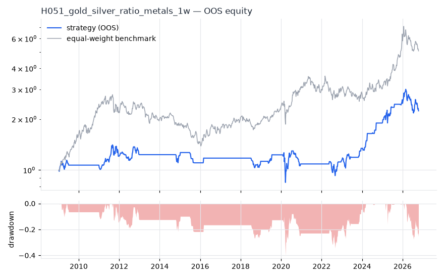
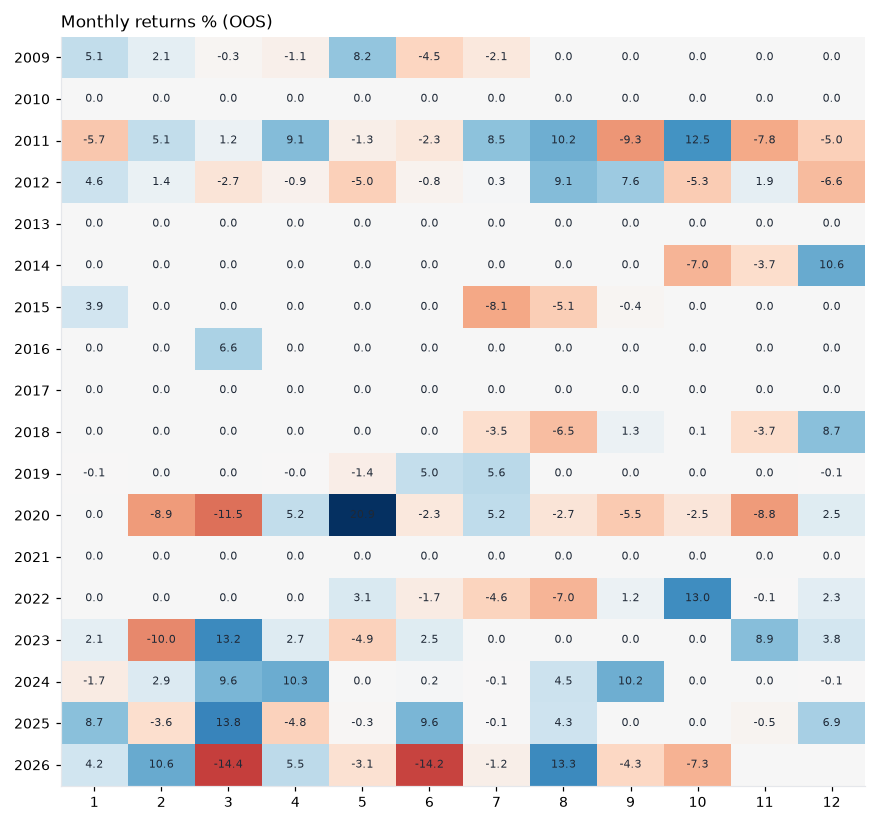

# H051 — gold_silver_ratio on metals [1w]  🟡 WATCH

- Kind: strategy · Source: Gold/silver ratio mean reversion (relative value)
- For system: `metals`
- Data: 2005-01-07 00:00:00 → 2026-10-16 00:00:00 · 5 assets · 52.2 bars/year · survivorship mask: False
- Costs: {'commission': 0.0002, 'slippage': 0.0005, 'funding_annual': 0.0, 'borrow_annual': 0.0}
- Variants tried (DSR trials): 32 (failed: 0)
- Final variant: `gold_silver_ratio|z_n=504,entry=2.0,neutral=both`

## Verdict reasons
- DSR 0.631 < 0.9 (luck not excluded after 32 trials)
- OOS Sharpe (excess of T-bill) 0.273 < 0.5
- only 50% of OOS years positive
- with 2x costs it does not beat the equal-weight benchmark
- PBO 0.63 > 0.5 (variant selection is overfit)
- Reality Check p 0.498 > 0.1 (best variant may be data-mined)

## Walk-forward out-of-sample


| Metric | Strategy | Equal-weight benchmark |
|---|---|---|
| years | 17.77 | 17.77 |
| cagr | 0.0464 | 0.0956 |
| vol | 0.1674 | 0.2187 |
| sharpe | 0.355 | 0.528 |
| sharpe_excess_rf | 0.273 | None |
| sortino | 0.405 | 0.778 |
| max_dd | -0.4009 | -0.5034 |
| max_dd_bars | 652 | 465 |
| calmar | 0.116 | 0.19 |
| ulcer | 0.1514 | 0.2301 |
| var95 | -0.0295 | -0.0428 |
| cvar95 | -0.0565 | -0.0666 |
| omega | 1.255 | 1.22 |
| tail_ratio | 1.379 | 1.073 |
| skew | -0.037 | -0.133 |
| kurtosis | 14.047 | 3.768 |
| hit_rate | 0.205 | 0.55 |
| turnover_ann | 4.27 | None |

- **Gate Sharpe (excess of T-bill): 0.273**
- Deflated Sharpe: **0.631** · PBO: **0.63** · Reality Check p: **0.498**
- PSR 0.932 · Info ratio -0.316 · Beta 0.465 · Up/Down capture 0.408/0.384
- Sharpe with 2× costs: 0.337 · Walk-forward efficiency: 0.393
- Bootstrap: {'p_sharpe_pos': 0.96, 'cagr_p05': -0.0095, 'maxdd_p05': -0.6002}
- Yearly OOS Sharpe: {'2009': 0.58, '2010': 0.0, '2011': 0.63, '2012': 0.22, '2013': 0.0, '2014': -0.03, '2015': -1.2, '2016': 0.98, '2017': 0.0, '2018': -0.36, '2019': 1.03, '2020': -0.14, '2021': 0.0, '2022': 0.35, '2023': 1.06, '2024': 2.13, '2025': 1.41, '2026': -0.53}



## Regimes (where does it work?)
`{"bull": {"sharpe": 0.88, "ann_ret": 0.1552, "bars": 612}, "bear": {"sharpe": -0.87, "ann_ret": -0.126, "bars": 316}, "calm": {"sharpe": -0.06, "ann_ret": -0.0065, "bars": 485}, "stressed": {"sharpe": 0.62, "ann_ret": 0.1316, "bars": 443}, "vix_lt_20": {"sharpe": 0.59, "ann_ret": 0.0726, "bars": 624}, "vix_20_30": {"sharpe": 0.35, "ann_ret": 0.0585, "bars": 232}, "vix_ge_30": {"sharpe": -0.14, "ann_ret": -0.0513, "bars": 72}, "curve_inverted": {"sharpe": 0.66, "ann_ret": 0.1356, "bars": 125}, "curve_normal": {"sharpe": 0.3, "ann_ret": 0.0476, "bars": 803}}`

## Calendar profile (weekday / month / hour)
`{"weekday": {"4": 0.00114}, "month": {"1": 0.00268, "2": -6e-05, "3": 0.00219, "4": 0.00367, "5": 0.00188, "6": -0.00117, "7": 3e-05, "8": 0.00251, "9": 0.00016, "10": 0.00034, "11": -0.00189, "12": 0.00301}}`

## Robustness
- **delay**: `{"sharpe": 0.601, "sharpe_delayed_1bar": 0.639, "retained": 1.063}`
- **neighbourhood**: `{"neighbours": 5, "best_sharpe": 0.601, "neighbour_median": 0.587, "share_positive": 1.0, "stability": 0.976}`
- **noise**: `{"noise_bp": 0.002, "sharpe_min": 0.598, "sharpe_median": 0.6}`

## Timing, take-profit, stop-loss and profit studies (in-sample diagnostics)
- Portfolio overlays (vol target, drawdown brake, equity-curve filter): `{"none": {"sharpe": 0.355, "cagr": 0.0464, "max_dd": -0.4009}, "vol_target_0.1": {"sharpe": 0.222, "cagr": 0.0202, "max_dd": -0.5083}, "vol_target_0.15": {"sharpe": 0.218, "cagr": 0.0224, "max_dd": -0.6103}, "vol_target_0.2": {"sharpe": 0.243, "cagr": 0.0287, "max_dd": -0.6572}, "dd_brake_0.1": {"sharpe": 0.358, "cagr": 0.0368, "max_dd": -0.3524}, "dd_brake_0.2": {"sharpe": 0.301, "cagr": 0.0336, "max_dd": -0.4139}, "equity_ma_8": {"sharpe": 0.321, "cagr": 0.0308, "max_dd": -0.244}, "equity_ma_26": {"sharpe": 0.303, "cagr": 0.0293, "max_dd": -0.3076}, "best_by_calmar": "equity_ma_8"}`
> Studies are in-sample diagnostics. To use a better exit, register it (exits: [...]) and let the gate judge it.

## Walk-forward windows
- 2020-12-25 00:00:00 → 2021-06-18 00:00:00: IS 0.742 / OOS 0.0 — `gold_silver_ratio|z_n=504,entry=1.5,neutral=flat`
- 2021-06-25 00:00:00 → 2021-12-17 00:00:00: IS 0.742 / OOS 0.0 — `gold_silver_ratio|z_n=504,entry=1.5,neutral=flat`
- 2021-12-24 00:00:00 → 2022-06-17 00:00:00: IS 0.726 / OOS 0.585 — `gold_silver_ratio|z_n=504,entry=1.0,neutral=flat`
- 2022-06-24 00:00:00 → 2022-12-16 00:00:00: IS 0.694 / OOS 0.225 — `gold_silver_ratio|z_n=504,entry=1.0,neutral=flat`
- 2022-12-23 00:00:00 → 2023-06-16 00:00:00: IS 0.583 / OOS 0.706 — `gold_silver_ratio|z_n=126,entry=1.0,neutral=both`
- 2023-06-23 00:00:00 → 2023-12-15 00:00:00: IS 0.868 / OOS 2.221 — `gold_silver_ratio|z_n=504,entry=1.0,neutral=flat`
- 2023-12-22 00:00:00 → 2024-06-14 00:00:00: IS 0.697 / OOS 2.335 — `gold_silver_ratio|z_n=504,entry=1.0,neutral=flat`
- 2024-06-21 00:00:00 → 2024-12-13 00:00:00: IS 1.204 / OOS 1.88 — `gold_silver_ratio|z_n=126,entry=1.0,neutral=flat`
- 2024-12-20 00:00:00 → 2025-06-13 00:00:00: IS 1.443 / OOS 1.466 — `gold_silver_ratio|z_n=126,entry=1.0,neutral=flat`
- 2025-06-20 00:00:00 → 2025-12-12 00:00:00: IS 1.472 / OOS 1.358 — `gold_silver_ratio|z_n=126,entry=1.0,neutral=flat`
- 2025-12-19 00:00:00 → 2026-06-12 00:00:00: IS 1.69 / OOS -0.011 — `gold_silver_ratio|z_n=126,entry=1.5,neutral=both`
- 2026-06-19 00:00:00 → 2026-10-16 00:00:00: IS 1.541 / OOS -0.684 — `gold_silver_ratio|z_n=504,entry=2.0,neutral=both`

## Best variants (full sample, reference only)
- gold_silver_ratio|z_n=504,entry=1.5,neutral=both|overlay=dd10: Sharpe 0.666
- gold_silver_ratio|z_n=504,entry=1.0,neutral=both|overlay=dd10: Sharpe 0.642
- gold_silver_ratio|z_n=504,entry=1.0,neutral=both|overlay=dd20: Sharpe 0.627
- gold_silver_ratio|z_n=504,entry=1.5,neutral=both|overlay=dd20: Sharpe 0.621
- gold_silver_ratio|z_n=504,entry=1.5,neutral=both: Sharpe 0.617
- gold_silver_ratio|z_n=504,entry=1.0,neutral=both: Sharpe 0.614
- gold_silver_ratio|z_n=252,entry=1.0,neutral=both: Sharpe 0.611
- gold_silver_ratio|z_n=504,entry=1.5,neutral=both|overlay=vt20: Sharpe 0.607
- gold_silver_ratio|z_n=126,entry=1.0,neutral=both: Sharpe 0.604
- gold_silver_ratio|z_n=504,entry=2.0,neutral=both: Sharpe 0.601

## Current targets / signals
```json
{
 "GC=F": 0.5,
 "SI=F": 0.5
}
```

> Survivorship bias: unless a membership mask is used, universes are today's members (upper-bound results).